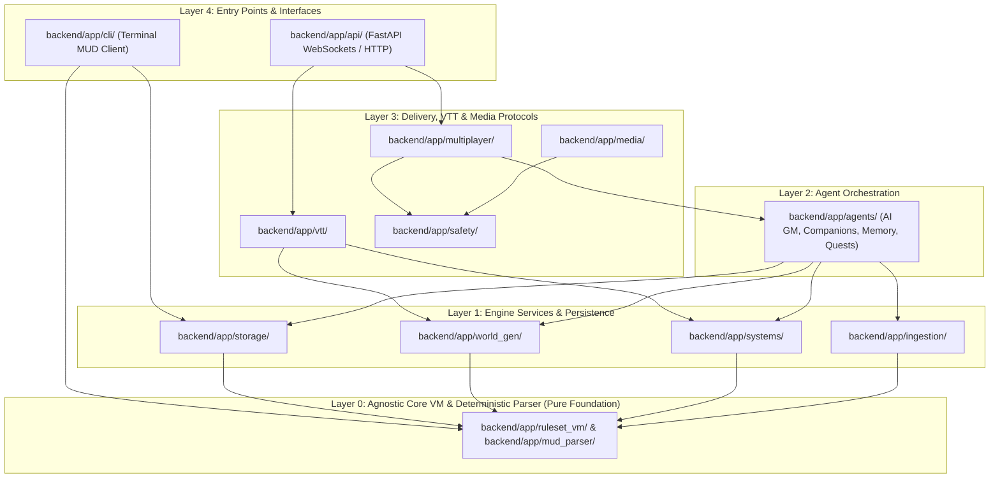
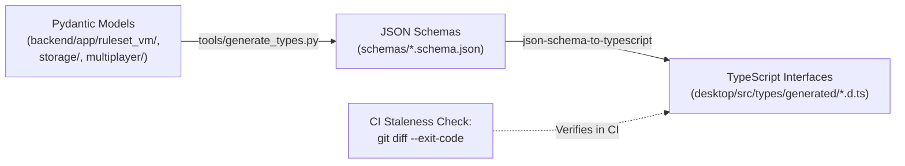
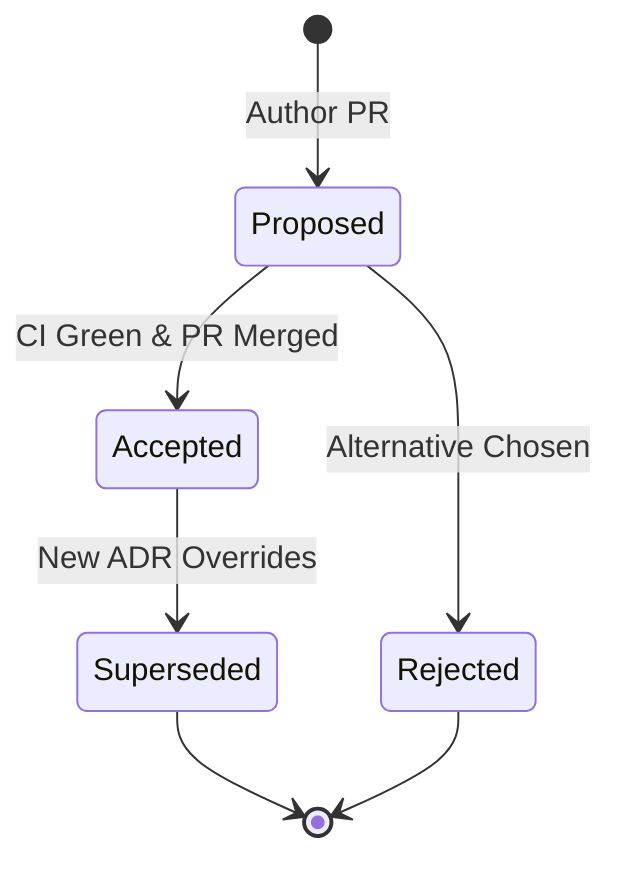

# Meddah: The Universal Story Engine — Development Workflow, Repository Standards & Engineering Conventions

> [!IMPORTANT]
> **Authoritative Engineering Standards Document**
> This specification defines the repository architecture, module boundaries, automated CI gates, toolchains, type generation pipeline, release lifecycle, and Architecture Decision Record (ADR) governance for **Meddah: The Universal Story Engine** (CLI binary: `meddah`). All phases (from Phase 1 through Phase 14, with contiguous MVP Phases 1–6 + Phase 2.5 Slice and Post-MVP Modular Expansion Phases 7–14) must strictly adhere to these standards.

---

## 1. Repository Layout & Module Architecture

The project is structured as a single monorepo containing the Python authoritative backend, the Electron/React/PixiJS desktop client, shared schema definitions, sample rulesets, documentation, and developer toolchains.

```
Agentic-RPG/
├── .github/                      # CI workflows, PR templates, issue templates
│   └── workflows/
│       ├── ci.yml                # Fast pull-request validation (lint, typecheck, test, agnosticism)
│       └── release.yml           # Tagged release packaging (Linux AppImage/deb, sidecar freezing)
├── backend/                      # Python authoritative engine sidecar & server (CLI binary: meddah)
│   ├── pyproject.toml            # Poetry / uv workspace manifest & dependency pins
│   ├── uv.lock                   # Deterministic Python lockfile
│   ├── .importlinter             # Unidirectional module boundary enforcement rules
│   ├── app/                      # Application source code
│   │   ├── ruleset_vm/           # Layer 0: Core VM, module_registry.py, inventory_graph.py, AST evaluator, advancement
│   │   ├── mud_parser/           # Layer 0: <5ms deterministic MUD lexer, social_dsl.py, emotes, custom_commands.py, diegetic_comms.py
│   │   ├── storage/              # Layer 1: SQLite event store, checkpoints, package exporter/importer
│   │   ├── world_gen/            # Layer 1: Cosmology, multi-floor dungeons, megacities, chronology
│   │   ├── systems/              # Layer 1: Holdings, vehicles, downtime, crafting, loot, piety, contraptions, retinue, chase, competition, hit_location_engine
│   │   ├── ingestion/            # Layer 1: Document parser, 14-domain probes, balance simulator
│   │   ├── agents/               # Layer 2: LLM router, AI GM, AI Companions, memory, quest engine
│   │   ├── vtt/                  # Layer 3: Tactical grid, LoS raycaster, tileset engine, mass warfare
│   │   ├── multiplayer/          # Layer 3: WebSocket JSON-RPC gateway, RBAC, split-party router, guild_server/ (West Marches & InstanceSupervisor)
│   │   ├── media/                # Layer 3: Progressive TTS/image/audio services, content-addressed cache
│   │   ├── safety/               # Layer 3: Content rating, lines/veils, live X-card handler
│   │   ├── cli/                  # Layer 4: Interactive terminal MUD client (Phase 2.5 slice)
│   │   └── api/                  # Layer 4: FastAPI server entry point & WebSocket endpoints
│   └── tests/                    # Automated test suites
│       ├── unit/                 # Fast unit tests per module
│       ├── property/             # Hypothesis property-based tests (AST, dice, randomizers)
│       ├── conformance/          # 7 Conformance Ruleset golden-file scenario test suites
│       ├── vtt/                  # Spatial & tactical curveball stress suite (test_tactical_curveballs.py)
│       ├── perf/                 # Response time (<5ms) & event replay speed benchmarks
│       └── fixtures/             # Reusable mock events, rulebook PDFs, sample payloads
├── desktop/                      # Electron + React + TypeScript + PixiJS desktop client
│   ├── package.json              # Node dependencies, scripts, electron-builder targets
│   ├── pnpm-lock.yaml            # Deterministic Node lockfile
│   ├── vite.config.ts            # Vite bundler configuration
│   ├── tsconfig.json             # TypeScript compiler options (strict: true)
│   ├── electron/                 # Electron main & preload scripts (contextIsolation, CSP)
│   ├── src/                      # Frontend React/PixiJS source
│   │   ├── types/
│   │   │   └── generated/        # Auto-generated TypeScript types (from Pydantic schemas)
│   │   ├── components/           # UI components (Hypertext MUD, VTT, Capabilities Deck, etc.)
│   │   ├── features/             # Feature views (Ruleset Studio, Map Transposer, World Studio)
│   │   ├── themes/               # Theme tokens, font configurations, WCAG contrast presets
│   │   └── accessibility/        # ARIA live-regions, screen-reader narrator, focus rings
│   └── tests/                    # Frontend tests
│       ├── unit/                 # Vitest component tests
│       ├── a11y/                 # axe-core accessibility automated contrast/landmark audits
│       └── e2e/                  # Playwright Electron integration tests
├── schemas/                      # Authoritative JSON Schemas generated from backend Pydantic models
│   ├── manifest.schema.json      # Package manifest schema (.rpgrules, .rpgworld, .rpgcampaign, .rpgcharacter)
│   ├── ruleset.schema.json       # Universal building-block ruleset schema
│   ├── event.schema.json         # Event-sourced event wire schemas
│   └── wire_protocol.schema.json # WebSocket JSON-RPC protocol schema
├── sample_rulesets/              # 3 Full Showcase Rulesets + 4 Minimal Conformance Fixtures
│   ├── showcase/                 # Full playable packages (archetypes, companions, compendiums & starter modules)
│   │   ├── classic_d20_fantasy/  # SRD 5.1 (CC-BY 4.0) d20 tactical + "The Sunken Crypt of Ashfall" module
│   │   ├── grimdark_d100_investigative/ # Original d100 roll-under + Sanity/Ticks + "The Lighthouse at Devil's Reef"
│   │   └── narrative_2d6_clocks/ # Open PbtA/FitD 2d6 tiers/clocks/spotlight + "The Clockwork Train Heist"
│   └── conformance/              # Minimal Phase 1 agnosticism fixtures (1 char + 1 encounter + 2 golden scenarios)
│       ├── dice_pool_successes/  # Nd6 pool counting hits >= 5, threshold & glitch comparison
│       ├── step_symbol_dice/     # Polyhedral step-dice (d4->d12 + Wild d6) & narrative symbol mapping
│       ├── resource_wager_card_draw/ # 52-card + Joker draw without replacement & Momentum burn wagering
│       └── rules_light_narrative/# Zero-stat, tag-only narrative fixture (flushes numeric engine assumptions)
├── docs/                         # Project documentation
│   ├── adr/                      # Architecture Decision Records (0001-*.md, 0002-*.md, ...)
│   ├── ruleset-authoring.md      # Ruleset authoring guide & building-block reference
│   ├── quickstart.md             # Developer & player setup guide
│   ├── architecture.md           # System architecture overview & module contracts
│   ├── errors.md                 # Error code catalog (RPG-E####) and recovery guide
│   ├── CONTRIBUTING.md           # Contribution guidelines & coding conventions
│   └── THIRD_PARTY_NOTICES.md    # Generated third-party license notices
├── tools/                        # Developer & CI automation scripts
│   ├── generate_types.py         # Pydantic -> JSON Schemas & TypeScript generator
│   ├── lint_agnosticism.py       # Scans engine core & modules for forbidden game-specific terms (Golden Rule #1)
│   ├── lint_modularity.py        # Verifies MeddahModule manifests, dormancy tests & RAW defaults (Golden Rule #4)
│   ├── roadmap.py                # Validates ROADMAP.md front-matter, statuses, DoD & links
│   ├── eval_ingestion.py         # Phase 2 Ingestion Accuracy Evaluation Harness
│   ├── eval_aigm.py              # Phase 4 AI GM Acceptance Evaluation Suite
│   ├── validate_package.py       # CLI tool to validate .rpgrules / .rpgworld / .rpgcampaign
│   └── setup_gpu_host.sh         # Host GPU diagnostic & ROCm/NVIDIA container setup helper
├── assets/                       # Bundled fonts, UI audio stems, fallback SVGs
│   └── PROVENANCE.md             # Attribution, license, and origin log for all bundled assets
├── docker/                       # Official Headless Server container & compose definitions
│   ├── Dockerfile.server         # Multi-stage server-only image (Python backend + static Browser Light Client)
│   └── docker-compose.server.yml # One-command headless server stack (+ optional local Ollama service profile)
└── ROADMAP.md                    # Self-contained roadmap & phase tracking (single source of truth)
```

---

## 2. Unidirectional Layered Architecture & Boundary Rules

To protect the **Zero-Assumption Agnosticism** of the engine core and ensure clean separation of concerns, the backend enforces a strict **layered unidirectional dependency rule**.



### Layer Dependency Rules
1. **Layer 0 (`ruleset_vm/`, `mud_parser/`)**:
   - May **NEVER** import from any other module in `backend/app/`.
   - Contains pure AST evaluation, building blocks schemas, dice randomizers, state transition logic, and character advancement.
   - Depends only on the Python standard library and Pydantic.
2. **Layer 1 (`storage/`, `world_gen/`, `systems/`, `ingestion/`)**:
   - May import from Layer 0 (`ruleset_vm/`, `mud_parser/`).
   - May **NEVER** import from `agents/`, `multiplayer/`, `vtt/`, `media/`, or `api/`.
3. **Layer 2 (`agents/`)**:
   - May import from Layer 1 and Layer 0.
   - May **NEVER** import from `multiplayer/`, `vtt/`, `media/`, or `api/`.
4. **Layer 3 (`multiplayer/`, `vtt/`, `media/`, `safety/`)**:
   - May import from Layers 2, 1, and 0.
   - May **NEVER** import from `api/` or `cli/`.
5. **Layer 4 (`api/`, `cli/`)**:
   - Can import from all lower layers. No lower layer may import from Layer 4.

### Enforcement via `import-linter`
This hierarchy is automatically verified on every commit and CI run using `import-linter` via `backend/.importlinter`:
```ini
[importlinter]
root_package = app

[importlinter:contract:layers]
name = Layered Architecture Contract
type = layers
layers =
    app.api
    app.multiplayer | app.vtt | app.media | app.safety
    app.agents
    app.storage | app.world_gen | app.systems | app.ingestion
    app.ruleset_vm | app.mud_parser
containers =
    app
```

Sibling modules must also be **independent** (Golden Rule #4). Systems communicate only through the Core event bus and manifest-declared dependencies:
```ini
[importlinter:contract:module-independence]
name = Optional Modules Are Independent Siblings
type = independence
modules =
    app.systems.chase_engine
    app.systems.competition_engine
    app.systems.hit_location_engine
    app.systems.holdings_engine
    app.systems.vehicle_engine
    app.systems.retinue_engine
    app.systems.piety_and_pacts
    app.world_gen.law_and_justice
    app.world_gen.geopolitics_and_rebellion
    app.world_gen.megacity_and_citadel_engine
```
(`ignore_imports` entries are only permitted for modules listed in each other's `requires_modules`/`enhances_modules`.)

---

## 3. Cross-Language Type Generation Pipeline

To ensure absolute wire-protocol and schema synchronization between Python and TypeScript, all TypeScript wire types and standalone JSON Schemas are **derived from Python Pydantic models as the single source of truth**.



### Workflow
1. When modifying or adding schemas in Python, run:
   ```bash
   uv run python tools/generate_types.py
   ```
2. The generator:
   - Emits draft-07 JSON Schemas into `schemas/`.
   - Compiles TypeScript definitions into `desktop/src/types/generated/`.
3. **CI Staleness Gate**: CI runs `uv run python tools/generate_types.py --check` and executes `git diff --exit-code schemas/ desktop/src/types/generated/`. If generated files are out of sync with Pydantic definitions, the build fails immediately.

---

## 4. Toolchain, Code Quality & CI Gates

### Python Toolchain (`backend/`)
- **Python Version**: `>=3.12`
- **Package & Virtualenv Management**: `uv` (fast, deterministic lockfile via `uv.lock`).
- **Linter & Formatter**: `ruff`
  - Strict line length: 100 characters.
  - Formatter: `ruff format`
  - Linter: `ruff check --select E,F,W,I,N,UP,B,A,C4,PT,SIM,RUF`
- **Type Checker**: `pyright`
  - `backend/app/ruleset_vm/`: **Strict mode** (`typeCheckingMode = "strict"`).
  - All other backend packages: **Standard mode** (`typeCheckingMode = "standard"`).
- **Test Framework**: `pytest`
  - Property-based testing: `hypothesis` (used for AST formulas, dice probability, and container graph invariants).
  - Test runner: `pytest -v --cov=app --cov-report=term-missing`

### TypeScript & Desktop Toolchain (`desktop/`)
- **Runtime & Package Management**: Node.js 20+ LTS, `pnpm` (lockfile via `pnpm-lock.yaml`).
- **Compiler**: `tsc --noEmit` (`strict: true`, `noImplicitAny: true`, `exactOptionalPropertyTypes: true`).
- **Linter & Formatter**: ESLint (`@typescript-eslint/recommended-type-checked`) + Prettier.
- **Frontend Unit & Component Testing**: `vitest` + React Testing Library.
- **End-to-End & Electron Testing**: Playwright Electron runner.
- **Accessibility Verification**: `@axe-core/playwright` automated contrast, landmark, and ARIA audits.

### Automated CI Pipeline Gates
Every Pull Request must pass the following checks in order:

| Step | Tool / Command | Failure Condition |
| :--- | :--- | :--- |
| **1. Code Formatting** | `ruff format --check` & `pnpm prettier --check .` | Any unformatted file |
| **2. Code Linting** | `ruff check` & `pnpm eslint .` | Any lint error or warning treated as error |
| **3. Static Type Analysis** | `pyright` & `pnpm tsc --noEmit` | Any type violation |
| **4. Agnosticism & Modularity Gate** | `python tools/lint_agnosticism.py` & `python tools/lint_modularity.py` | Any game-specific term in engine core/modules, missing `MeddahModule` manifest, or sibling-module import |
| **5. Module Architecture Gate** | `lint-imports` (via `.importlinter`) | Any backwards or upward dependency violation |
| **6. Schema Staleness Gate** | `python tools/generate_types.py --check` | Generated TS/JSON schemas out of sync with Pydantic |
| **7. Unit & Property Tests** | `pytest backend/tests/unit/ backend/tests/property/` | Any test failure or unhandled exception |
| **8. Conformance Scenarios** | `pytest backend/tests/conformance/` | Any discrepancy in 7 showcase ruleset event logs |
| **9. Zero-AI Deterministic Suite** | `pytest -m zero_ai --disable-ai-providers` | Any phase feature failing or attempting an LLM/AI call in Zero-AI mode |
| **10. Performance Benchmarks** | `pytest backend/tests/perf/` | Command latency $\ge 5$ms, diff latency $\ge 50$ms, replay $> 5$s |
| **11. Accessibility Gate** | `pnpm test:a11y` (axe-core) | Any WCAG 2.2 AA contrast or landmark violation |
| **12. Security & License Audit** | `pip-audit`, `pnpm audit`, license checker | Critical CVEs or non-allowlisted third-party licenses |
| **13. Roadmap & Prompt Gate** | `python tools/roadmap.py --check` & prompt lint | Invalid `ROADMAP.md` statuses/links or broken prompt template schemas |

> [!NOTE]
> **No Scheduled Nightly Jobs**: In alignment with the hobby-project scope, expensive real-LLM model evaluations are **never** run on a recurring schedule. Model evals are executed strictly on-demand or as gating milestones (Phase 2 Ingestion Accuracy Harness and Phase 4 AI GM Acceptance Scenario).

---

## 5. Branching, Commits, Releases & Pre-1.0 Stability Policy

### Branching Strategy
- **Trunk-Based Development**: The `main` branch is the continuous integration trunk and must always pass CI.
- **Branch Naming**:
  - `feat/<phase>-<short-description>` (e.g., `feat/p1-ast-evaluator`, `feat/p2-probes`)
  - `fix/<issue-or-subsystem>` (e.g., `fix/container-weight-calc`)
  - `spike/<topic>` (time-boxed exploratory code, run only on failure per Decision #42)
  - `docs/<topic>` (documentation or ADR updates)
- **PR Hygiene**: Small, focused PRs. Even for solo development, every PR requires all CI gates to be green before merging.

### Commit Message Standard (Conventional Commits)
All commit messages must adhere to the Conventional Commits specification, enforced by a local Git `commit-msg` hook:
```
<type>(<scope>): <short imperative summary>

[optional body explaining context and rationale]

[optional footer(s), e.g., Closes #12, Supersedes ADR-0004]
```
- **Allowed Types**: `feat`, `fix`, `refactor`, `perf`, `test`, `docs`, `chore`, `ci`.
- **Allowed Scopes**: `vm`, `mud`, `storage`, `world`, `systems`, `ingestion`, `agents`, `vtt`, `multiplayer`, `media`, `safety`, `desktop`, `types`, `adr`.

### Semantic Versioning & Pre-1.0 Stability Contract
Releases follow Semantic Versioning (`0.MINOR.PATCH`):
- Each completed phase milestone tags a minor release:
  - Phase 1 $\rightarrow$ `v0.1.0`
  - Phase 2 $\rightarrow$ `v0.2.0`
  - Phase 2.5 $\rightarrow$ `v0.2.5` (Early Playable Thin Vertical Slice)
  - Phase 3 $\rightarrow$ `v0.3.0`
  - ... through Phase 6 [MVP] $\rightarrow$ `v0.6.0`, and Post-MVP Modular Expansions through Phase 14 $\rightarrow$ `v0.14.0` (staying on `0.x.0` until all 14 planned phases are complete, then tagging `v1.0.0`).
- **Pre-1.0 Stability Rules**:
  1. **Package Formats (`.rpgrules`, `.rpgworld`, `.rpgcampaign`, `.rpgcharacter`)**: Versioned via `schema_version`. Backward-compatible migrations are provided starting from `v0.1.0`.
  2. **WebSocket Wire Protocol**: Versioned via `protocol_version` integer major.minor. Minor versions are backward-compatible (additive changes).
  3. **Internal Python APIs**: Unstable and subject to refactoring across minor releases until `1.0.0`.
- **Automated Changelog**: Generated at each tag from commit history into `CHANGELOG.md`.

### Self-Contained `ROADMAP.md` vs. GitHub Issues
- **Planned Work (`ROADMAP.md`)**: A self-contained `ROADMAP.md` at the repository root is the single source of truth for the feature roadmap (not GitHub Projects). It lists every phase (1–14 plus 2.5), each with its status (`Planned / In Progress / Done / Deferred`), MVP flag, deliverables checklist, links to ADRs and spec sections, and a `Deferred / Ideas` section. `tools/roadmap.py` validates its machine-readable front-matter table in CI (valid statuses, every `Done` phase has a tag and DoD checkbox, and all links resolve).
- **Bugs & Suggestions (GitHub Issues)**: GitHub Issues are used exclusively for bug reports and user-reported issues (via a structured bug template and a lightweight feature-suggestion template triaged by the maintainer into `ROADMAP.md`). Issues may reference roadmap IDs (`P1.3`, `P6.2`, etc.) but never replace `ROADMAP.md`.

---

## 6. Architecture Decision Record (ADR) Governance

All architectural decisions, trade-offs, and design modifications are recorded as immutable, version-controlled records in `docs/adr/`.

### ADR Lifecycle


### Initial ADR Seeding Plan
Upon repository initialization, the **50 Locked Architectural Decisions** and **75 Grill-Me Resolutions** (125 records total) will be automatically seeded into `docs/adr/` using the standard format and a collision-free numbering scheme:
- `0001`–`0050`: One ADR per Architectural Decision, numbered to match the Decision # in `system_design_specification.md` (e.g. `0001-hybrid-mud-vtt-canvas.md`, `0002-zero-assumption-ruleset-vm.md`, ... `0050-granular-hit-locations-and-medical-engine.md`).
- `0051`–`0125`: One ADR per Grill-Me Resolution, numbered `0050 + N` for Resolution N (e.g. Resolution 1 → `0051-...`, Resolution 75 → `0125-polite-multi-page-url-ingestion.md`).
- Golden Rules #1–#4 are recorded as ADRs `0002`, plus `0126-golden-rule-deterministic-zero-ai.md`, `0127-golden-rule-tier-b-reference-target.md`, and `0128-golden-rule-modular-opt-in-dormant.md`.

### Standard ADR Template
Every file in `docs/adr/NNNN-title.md` follows this exact Markdown structure:

```markdown
# NNNN. Title of Decision

- **Date**: YYYY-MM-DD
- **Status**: Proposed | Accepted | Superseded by ADR-YYYY
- **Deciders**: User, Antigravity Agent
- **Related Issues / Decisions**: Decision #X, ADR-YYYY

## Context & Problem Statement
What problem are we trying to solve? What architectural constraints or trade-offs apply?

## Decision
What is the chosen approach? What components or schemas are affected?

## Consequences
### Positive
- Specific benefits and capabilities enabled.

### Negative / Trade-offs
- Complexity introduced, performance costs, or deferred capabilities.

### Neutral
- Observational changes or workflow shifts.

## Compliance & Verification
How does CI or automated testing enforce this decision (e.g., test suite name, lint rule, benchmark)?
```

### The Superseding Rule
**Decisions are never silently edited or deleted.**
If a decision changes during implementation:
1. A new ADR is created: `docs/adr/NNNN-new-decision.md`.
2. The new ADR explicitly references: `Supersedes ADR-XXXX`.
3. The original ADR's status header is updated to: `Status: Superseded by ADR-NNNN`.
4. The Phase Definition of Done requires that ADR updates accompany the code change in the same pull request.

---

## 7. Engine Agnosticism, 100% Zero-AI Usability & Determinism Rules

### The 100% Deterministic / Zero-AI Usability Directive
1. **Complete Engine Operability Without AI (`Tier A / Play without AI`)**:
   Every feature and subsystem across all 14 phases must be 100% usable, playable, and feature-complete when no LLM, embedding, image, or TTS provider is configured (`AI_PROVIDER=none`):
   - **Ruleset Ingestion & Studio**: Structured YAML/JSON/Markdown-table/CSV import (`deterministic_ingestor.py`), deterministic keyword/table lifecycle probes, manual visual block editing, deterministic AST-to-English rule explainer (`explain_ast_deterministically()`), and Monte Carlo balance simulation operate with `0` LLM calls.
   - **Solo & Human-GM Play, Topic-Chip Dialogue, Improvised Stunts & Deed Memory**: `deterministic_gm_director.py` provides template-driven MUD narration, `deterministic_dialogue_broker.py` (clickable NPC topic chips + social contest buttons + SQLite FTS5 BM25 freeform question matching), `improvised_stunt_resolver.py` (1-click improvised stunt card for creative MUD actions), `canonical_deed_ledger.py` (structured `DeedFact` long-campaign memory and seamless `Tier A <-> Tier B/C` bidirectional hot-swapping), built-in Solo RPG Oracle / fate tables, deterministic encounter scaling, progressive pre-authored/table hints, and deterministic end-of-session reports.
   - **Companions & Retinue**: `ai_npc.py` and `retinue_engine.py` execute full combat turns, healing/revival priorities, obedience/trust checks, and confrontation state machines via deterministic tactical utility evaluators and bark templates.
   - **World Gen, Cartography & Media**: Lazy/JIT stub expansion uses seeded procedural tables; map transposition imports `.dd2vtt`/Foundry/Tiled/image maps via FFT/3-point calibration and scrubs player spoilers via deterministic OpenCV `cv2.inpaint` (Telea / Navier-Stokes); media falls back to procedural SVGs and local audio stems.
2. **Runtime AI Circuit-Breaker & Seamless Auto-Failover (`ai_fallback_router.py`)**:
   If a session is configured with a Local (`Tier B`, our 7–14B Ollama reference target) or Cloud (`Tier C`) AI provider and that provider becomes unavailable mid-session (connection error, timeout, HTTP `429`/`5xx`, or token/cost budget cap reached), `ai_fallback_router.py` trips its per-provider circuit breaker, routes the request immediately to the deterministic engine counterpart with zero lost state or exceptions, surfaces a non-blocking `[AI Unavailable -> Using Deterministic Engine]` status pill, and auto-recovers when health probes succeed.
3. **Mandatory Per-Phase Non-AI Test Suite (`pytest -m zero_ai`) & Dual-Track Phase 2 / Phase 4 Gates (`Tier A` + `Tier B` Local 7–14B LLM)**:
   Every phase's test suite must include `@pytest.mark.zero_ai` integration tests (and Playwright `Tier A` E2E tests for UI phases) where a test fixture MonkeyPatches/blocks all LLM and external AI network clients so any attempted AI call raises an immediate test failure—plus circuit-breaker failover tests verifying mid-session AI outages degrade cleanly to deterministic counterparts. Phase 2 and Phase 4 enforce **Dual-Track Gates**: **Track 1 (`Tier A` Deterministic Gate)** runs in every CI environment with `AI_PROVIDER=none`, and **Track 2 (`Tier B` Local 7–14B LLM Gate)** evaluates against our pinned reference 7–14B local model family via Ollama (e.g. `Qwen 2.5 / Qwen 3 7B–14B`, plus secondary smoke-test family `Llama 3.1 / 3.2 8B`, configurable in `.env` / `pyproject.toml`), using 100% deterministic rules-fidelity checks + an independent secondary `Tier B` local judge model rubric + human playtest sign-off (never requiring a `Tier C` cloud model).
4. **`Tier B` (7–14B Local LLM, 8–16GB VRAM) Zero-Stall Engineering Standards**:
   - **Grammar-Constrained Tool Proposals + Streaming Narrator**: Mechanical tool calls on `Tier B` use Ollama's native grammar-constrained JSON Schema (`format: <json_schema>`) paired with a streaming prose pass (or a `<narration> + <tool_calls_json>` repair fallback).
   - **Zero-VRAM Default Retrieval (`SQLite FTS5 BM25`) & Single-GPU Resource Coordination (`gpu_resource_coordinator.py`)**: Compendium and rulebook lookup default strictly to `SQLite FTS5 BM25` + entity/tag indexing across both `Tier A` and `Tier B`; on single-GPU setups, images default to Procedural SVGs and TTS to lightweight CPU/low-VRAM `Piper`/`Kokoro` (`~100–300MB`) so the 7–14B LLM stays hot in VRAM.
   - **Deterministic-First Execution & Priority Local LLM Queue (`local_llm_queue.py`)**: Phase 2 ingestion parses headings/tables deterministically first before running targeted 1k–2k token `Tier B` micro-probes; companion combat turns (`<1ms`), JIT room stub expansion (`<5ms`), and scene-end `DeedFact` digests (`<5ms`) always execute deterministically first; Ruleset Studio Co-Designer prompts use scoped 3–8 block slices + a ~500-token signature header; and `local_llm_queue.py` coalesces near-simultaneous scene intents (`~150ms`) and prioritizes active scene turns with a 1-click `[Resolve Deterministically Now]` bypass.

### The Zero-Assumption Engine Core Rules
To ensure the engine can run *any* RPG system (fantasy, sci-fi, horror, narrative, classless, diceless):
1. **AST-Aware Forbidden Game Terms Lint (`tools/lint_agnosticism.py`)**:
   The linter parses Python AST in `backend/app/ruleset_vm/` **and every optional-module package (`systems/`, `world_gen/`, `spatial/`, `vtt/`, `quests/`, `agents/`)** (never matching Python syntax keywords like `class` or generic programming terms like `log_level`/`nesting_level` on an explicit allowlist) and fails if ruleset-specific game terms appear in variable/attribute/field names, dictionary keys, or default string literals:
   - `hp`, `hit_points`, `armor_class`, `ac`, `d20`, `saving_throw`, `spell_slot`, `mana`, `strength`, `dexterity`, `constitution`, `intelligence`, `wisdom`, `charisma`, `character_class`, `character_race`, `character_level`.
2. **Universal Primitives Only**:
   All entities must be expressed strictly using universal primitives:
   - `Entity`, `Property`, `ResourcePool`, `Formula`, `Randomizer`, `Action`, `ReactionWindow`, `Condition`, `EventHook`, `ContainerNode`, `AttachmentSlot`.
3. **Explicit Null Guarantee (Dormant Modules)**:
   When a rulebook does not define a concept (e.g., no resurrection, no grid movement, no vehicles, no magic), the engine must record `none` / `disabled`, and every module depending on that concept resolves to `dormant` (Technical Spec §1.0). The engine core must never invent default fallbacks.
4. **Modularity Lint (`tools/lint_modularity.py`)**:
   Fails CI if a module registers commands/UI/hooks without a `MeddahModule` manifest, imports a sibling module outside its declared dependencies, lacks a dormancy test, or ships an outcome-altering default as `on`.

### Determinism Verification Rules
1. **Named Seeded RNG Streams**:
   Every random operation must use a named RNG stream anchored to the scene state:
   ```python
   # Correct:
   roll = scene.rng_stream("dice").roll(formula)
   # Forbidden (will fail CI lint):
   import random; random.randint(1, 20)
   ```
2. **Pure Event Application**:
   State transitions must be pure functions of the previous state and the event:
   $$\text{apply}(\text{State}_t, \text{Event}_{t+1}) \rightarrow \text{State}_{t+1}$$
   - No reading system wall-clock inside the VM (`time.time()`, `datetime.now()` are forbidden in `ruleset_vm` and event-apply handlers).
   - No non-deterministic iteration over unordered dictionaries or sets when calculating state or rolls.
3. **Replay Validation**:
   CI runs an automated event-replay test on every commit: replaying all events from each golden campaign must yield a SHA-256 state hash identical to the checkpoint hash.

---

## 8. Security & Untrusted Input Safeguards

All external and user-provided inputs are treated as untrusted:

1. **AST Formula Evaluator**:
   - The ruleset formula engine uses a strict recursive descent AST parser.
   - Built-in Python `eval()`, `exec()`, `compile()`, and `__import__` are strictly forbidden.
   - Resource limits enforced per evaluation: Max AST depth: 32; Max operations: 1,000; Wall-clock timeout: 10ms.
2. **Package Extraction (`safe_extract`)**:
   - Ingesting `.rpgrules`, `.rpgworld`, or `.rpgcampaign` zip archives validates all member paths:
     - Rejects any path containing `..` (zip-slip).
     - Rejects absolute paths (`/` or `C:\`).
     - Rejects symbolic links.
   - Zip-bomb limits: Max entry count: 10,000; Max uncompressed file size: 250MB; Max compression ratio: 100:1.
3. **SSRF, Polite Multi-Page URL Ingestion & Anti-DDoS Safeguards (`url_ingestor.py`)**:
   - URL ingestion blocks loopback (`127.0.0.0/8`, `::1`), link-local (`169.254.0.0/16`), and private IP ranges (`10.0.0.0/8`, `172.16.0.0/12`, `192.168.0.0/16`, `fc00::/7`) on the initial request and every redirect hop (max 3 redirects).
   - Enforces a 10MB maximum response size and 15s timeout per page.
   - **Polite Multi-Page Discovery, Anti-DDoS Policy & Graceful Human-in-the-Loop Challenge Recovery**: Multi-page SRD/wiki discovery (`max_depth: 1..2`, confined to the same origin and path prefix) requires explicit user selection from an interactive sub-page checklist (`max_pages_per_job`, default: `25`) before fetching child pages. Child fetches execute strictly sequentially (`max_concurrent_requests: 1`) with a `1.5s–3.0s` jittered delay between requests, honor `robots.txt` (`Disallow` and `Crawl-delay`), use `ETag`/`Last-Modified` conditional caching, and obey HTTP `429`/`503` `Retry-After` backoff. If a remote host presents any CAPTCHA or anti-bot challenge, automated fetching **immediately pauses in place** (never attempting to solve, compute, or bypass the challenge programmatically, while preserving all already-fetched pages in the staging job) and offers **Graceful Human-in-the-Loop Recovery**: (1) opening a visible interactive window in the Desktop App for the human user to complete the verification directly and resume, (2) an inline paste/drop slot on the paused sub-page row so the user can paste text/HTML or drop a saved file from their own browser without losing multi-page job progress or URL citations, or (3) skipping/deferring that individual sub-page.
4. **Electron Renderer Hardening**:
   - `contextIsolation: true`
   - `nodeIntegration: false`
   - Strict Content Security Policy (CSP) blocking unsafe inline scripts and untrusted remote scripts.
   - All text rendered in the MUD terminal and VTT is HTML-escaped before insertion.

---

## 9. Optional Headless / Server-Only Installation, CLI Administration & Multi-Vendor GPU Docker Deployment

In addition to the full standalone Electron Desktop App, **Meddah** supports a first-class **Headless / Server-Only Installation** that installs **only** the Python authoritative backend server (zero Electron, Chromium, or desktop GUI dependencies required on the host machine).

### 1. Standalone Python Server Installation & Daemon Lifecycle (`uv` / `pipx` / `systemd`)
- Users can install the headless server directly on any Linux/macOS/Windows machine, home server, NAS, or VPS:
  ```bash
  uv tool install ./backend
  # or: pipx install ./backend
  ```
- **Multi-Campaign Library + 1 Active Live Session (Hot-Swappable)**: A headless server manages a persistent library of multiple `.rpgcampaign` folders on disk and runs 1 active live session in memory at a time—allowing the Host/Admin to cleanly switch active campaigns (`meddah session switch <campaign_id>` or via the Browser Host dashboard) without restarting the server or container.
- **Graceful `SIGTERM` Checkpointing & `systemd` Service Generator**:
  - `meddah serve` traps `SIGTERM` / `SIGINT` to flush in-flight SQLite WAL transactions, create an atomic shutdown checkpoint, and broadcast a reconnect notice to connected WebSocket clients before exiting.
  - Exposes `/api/health` and `/api/ready` for Docker and reverse-proxy readiness probes.
  - Includes `meddah service install-systemd [--user]` to generate and install a hardened `meddah.service` systemd unit on bare-metal Linux hosts.

### 2. Dual Local Socket + `MEDDAH_ADMIN_TOKEN` Authentication & CLI Management (`meddah`)
- **Zero-Friction Local Socket + Token-Authenticated Remote Admin**:
  - Local CLI commands executed on the server host communicate directly with the running `meddah serve` daemon over a local UNIX domain socket (`/run/meddah/admin.sock` or loopback admin port).
  - Remote CLI commands (`--server https://...`) and Browser Light Client / Remote Desktop App Host logins authenticate using a high-entropy `MEDDAH_ADMIN_TOKEN` (printed on first boot, settable via env var, or rotated via `meddah admin rotate-token`).
- **Complete CLI Command Suite**:
  - `meddah serve [--host 0.0.0.0] [--port 8420] [--campaign <id>] [--ai-provider none|ollama|...] [--serve-web-client]`
  - `meddah campaign list | create | import <file.rpgcampaign> | export <id> | info <id> | delete <id>`
  - `meddah session status | start | switch <campaign_id> | wrap-up | end | checkpoint | rewind <event_id> | backup`
  - `meddah seat list | invite --role host|gm|player|spectator | approve <seat_id> | kick <seat_id> | revoke <token>`
  - `meddah ruleset list | import <file.rpgrules> | validate <path>`
  - `meddah service install-systemd [--user]`
  - `meddah gpu-check [--setup-rocm]` — Detects NVIDIA vs. AMD GPUs, checks ROCm `/dev/kfd` & `/dev/dri` device nodes and `video`/`render` group permissions, recommends `HSA_OVERRIDE_GFX_VERSION` for consumer Radeon cards if needed, and prints or runs host ROCm/container setup commands.
  - `meddah attach [--campaign <id>]` — Launches the interactive terminal MUD client directly against the local or remote server.

### 3. Unified Browser Web Client + Remote Desktop Studio Workstation Mode
- **Strictly Three Client Interfaces (Only ONE Browser Web Client)**:
  1. **Terminal CLI (`meddah` / `meddah attach` — Phase 2.5)**: Pure terminal/SSH text MUD & server administration CLI (local UNIX socket or remote `--server` + `MEDDAH_ADMIN_TOKEN`).
  2. **Unified Browser Web Client (`--serve-web-client` — Phase 10)**: One single static React web bundle served by the Python FastAPI server, built directly on the **Browser Guest Client** foundation (Decision #46: MUD terminal, character sheet, 4-Tab Capabilities Deck, roll/reaction prompts, handouts, journal, and lightweight VTT view). There is **never** a separate "bare-bones text-only browser" client.
  3. **Electron Desktop App (`desktop/` — Phase 10–12)**: Full desktop GUI including the **Heavy Authoring Studios** (*Visual Ruleset Node-Graph Studio & 14-Probe Diff Workbench*, *Premade Map Scrubber & `.rpgtileset` Wang Auto-Tiler Studio*, and *Full Multi-Scale World-Graph Builder*). Can run its own local sidecar OR connect remotely to `meddah serve` via `MEDDAH_ADMIN_TOKEN` to sync `.rpgrules`, `.rpgworld`, and `.rpgcampaign` packages.
- **Orthogonal Role & Admin Unlocking in the Unified Browser Web Client**:
  - **`Spectator` Invite Link (`seat_role: spectator`)**: Unlocks read-only Public or Party MUD log & VTT, shared handouts, and public dice rolls (optional 0–120s stream delay, no chat).
  - **`Player` Seat Invite Link (`seat_role: player`)**: Unlocks interactive MUD command bar, assigned Character Sheet & Advancement, 4-Tab Capabilities Deck, interactive Roll/Reaction prompts, per-seat Fog-of-War VTT view, Journal, and X-Card safety controls.
  - **`Co-GM` Invite Link (`seat_role: co_gm`)**: Unlocks everything in Player view **PLUS** the **Live GM Dock Drawer** (omniscient Scene/NPC/Encounter/Clock controls, 5-Domain Co-GM Matrix & Whisper suggestions, Difficulty/Mercy/Fudge toggles, and Handout reveals).
  - **`MEDDAH_ADMIN_TOKEN` / Host Login — Mode A: `Host-as-Player` (`is_server_admin: true` + `seat_role: host_player`, AI GM / Solo Oracle Co-Op)**: For when the Host wants to play as a normal Player Character alongside friends while the **AI GM (`Tier B/C`) or Deterministic GM Director / Solo Oracle (`Tier A`)** runs the game. Unlocks the **Server & Session Admin Drawer** (Multi-Campaign Library switcher, Session Lifecycle `Start / Wrap-Up / End / Checkpoint / Rewind / Backup`, Waiting-Room Seat Approval, Invite Generator, Kick/Revoke, `.rpgrules`/`.rpgworld`/`.rpgcampaign` package upload/export, and `Tier A / B / C` AI Provider & Cost Budget settings) and the **Shared Solo Oracle Drawer**, while the server enforces **strict Player-Level Fog-of-War & Spoiler Shielding** (hiding unrevealed rooms, secret doors, traps, and NPC secrets, and locking the Live GM Dock behind a spoiler confirmation guard).
  - **`MEDDAH_ADMIN_TOKEN` / Host Login — Mode B: `Host-as-GM` (`is_server_admin: true` + `seat_role: gm`, Human GM + Optional AI Co-GM)**: Unlocks both the **Server & Session Admin Drawer** AND the omniscient **Live GM Dock Drawer**.

### 4. Headless Secrets Management & Pure-Python PDF Renderer Fallback
- **Layered Headless Secret Resolver**: When running on a headless Linux server or inside Docker (where no desktop OS keyring like GNOME Keyring / KWallet exists), secrets and API keys resolve in priority order from: (1) Docker Secrets / file-mounted paths (`*_FILE` env vars, e.g., `/run/secrets/openai_api_key`), (2) standard environment variables (`.env` / `OPENAI_API_KEY`), or (3) an optional age/Fernet-encrypted `/data/config/secrets.enc` vault unlocked via `MEDDAH_MASTER_KEY`—never touching `.rpgcampaign` files or SQLite event logs.
- **Zero-Chromium Headless PDF Generation**: When Electron/Chromium is not installed, Printable Character Sheets and End-of-Session PDF Reports render automatically via a lightweight pure-Python PDF library (`WeasyPrint` / `ReportLab` / `fpdf2`) alongside client-side `@media print` in the Browser Light Client and Markdown/HTML exports.

### 5. Official Lean Docker Image & Multi-Vendor GPU Compose Profiles (`docker/Dockerfile.server` & `docker/docker-compose.server.yml`)
- **Lean Base Image (`docker/Dockerfile.server`, `~150–250MB`)**:
  - *Stage 1 (`web-builder`)*: Builds the static Browser Guest/Light Client assets (`vite build --mode light-client`).
  - *Stage 2 (`server-runtime`)*: Minimal `python:3.12-slim` image with `uv`-installed `backend/`, static web client assets, the 3 Showcase Rulesets, and deterministic OpenCV/RapidOCR/PyMuPDF parsers (`0` bundled AI weights), running as a non-root `meddah` user with `/api/health` + `/api/ready` healthchecks and a `/data` volume (`campaigns/`, `rulesets/`, `backups/`, `logs/`, `config/`).
- **Multi-Vendor GPU & Service Profiles in `docker/docker-compose.server.yml`**:
  1. **Default (No profile flag)**: Starts `meddah-server` in pure `Tier A` (Zero-AI) mode in seconds (or connects to an existing external Ollama/Cloud URL).
  2. **`--profile ollama-nvidia` (NVIDIA CUDA)**: Runs `ollama/ollama:latest` with NVIDIA Container Toolkit GPU reservations (`deploy.resources.reservations.devices: [capabilities: [gpu]]`).
  3. **`--profile ollama-amd` (AMD ROCm)**: Runs `ollama/ollama:rocm` with `/dev/kfd` and `/dev/dri` device pass-through, `video` and `render` group bindings, and configurable `HSA_OVERRIDE_GFX_VERSION` & `ROCR_VISIBLE_DEVICES` environment variables—paired with `tools/setup_gpu_host.sh` and `meddah gpu-check --setup-rocm` to verify or install host ROCm drivers/permissions.
  4. **`--profile ollama-vulkan` (Universal GPU Fallback)**: Vulkan-enabled local inference profile for Intel Arc, integrated GPUs, or mixed hardware.
  5. **`--profile ollama-cpu` (`Tier B-Lite` CPU-Only)**: Runs `ollama/ollama:latest` in CPU-only mode (`2–4k` context profile).
  6. **`--profile piper-tts` & `--profile tunnel`**: Optional lightweight local `Piper`/`Kokoro` TTS sidecar and `cloudflared` zero-config HTTPS tunnel sidecar.
