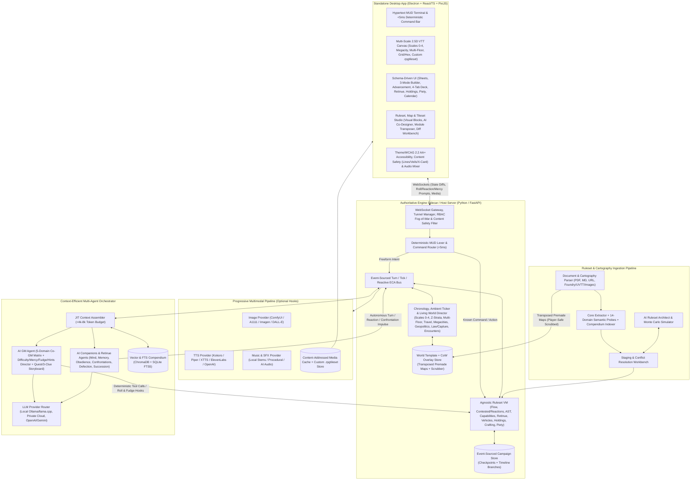

# System Architecture & Design Specification: Meddah — The Universal Story Engine

> [!IMPORTANT]
> **Design Complete — Awaiting Explicit Permission to Begin Development**
> Every branch of the system architecture has been mapped out and resolved through our design interview. No code or assets have been created yet.

---

## 1. Executive Summary & Core Philosophy

**Meddah: The Universal Story Engine** (CLI binary: `meddah`) is a standalone desktop application that blends a **Text-Based MUD** and a **Virtual Tabletop (VTT)**, powered by deterministic mechanics and orchestrated by context-efficient AI agents. Named after the classical dramatic storytellers who brought entire worlds, casts, and conflicts to life from a single stage, Meddah combines ancient oral storytelling heritage with modern, 100% deterministic ruleset virtual machine execution.

### Golden Rule #1: Zero-Assumption Agnosticism
The engine core knows **nothing** about "Hit Points", "Armor Class", "Strength", "Spell Slots", "Levels", "Classes", or "d20s". Instead, the engine is a **Universal State & Resolution Virtual Machine** that executes user-defined or AI-extracted **Ruleset Schemas**.
* Whether a ruleset uses d20 roll-over, d100 roll-under, dice pools with symbols/successes, 2d6 narrative tiers + progress clocks, resource bidding, or card draws, the engine processes it through universal building blocks.

### Golden Rule #2: 100% Deterministic & Zero-AI Usability Directive + Runtime Auto-Fallback
The **entire engine**—across all 14 phases (Contiguous MVP Phases 1–6 + Phase 2.5 Slice, and Post-MVP Modular Expansion Phases 7–14), Studios, Solo/GM modes, Multiplayer, World Simulation, Companions/Retinue, Quests, Encounters, Cartography, and Media—must be **100% usable, playable, and feature-complete deterministically with zero AI/LLM providers enabled (`Tier A / Play without AI`) OR when a configured AI provider becomes unavailable mid-session**:
* **Complete Deterministic Counterparts**: Every AI-assisted capability has a first-class deterministic engine counterpart (structured regex/table/FTS5 document parsers, 5-step parameterized ruleset/character wizards, deterministic verb/skill intent matchers, 1-click improvised stunt cards, topic-chip + FTS5 NPC dialogue brokers, structured `DeedFact` campaign ledgers, Solo RPG Oracle/Fate tables, persona-tagged dialogue/bark trees, procedural WFC/tileset JIT room generators, OpenCV `cv2.inpaint` map transposition, and OS-native/procedural SVG media fallbacks).
* **Seamless Runtime Circuit-Breaker Failover (`ai_fallback_router.py`)**: If a session is running with a Local (`Tier B`) or Cloud (`Tier C`) AI provider and that provider becomes unreachable, times out, returns `429`/`5xx`, or hits the user's token/cost budget cap, the **AI Fallback Router** immediately intercepts the failure, routes the request to the deterministic engine counterpart with zero turn loss or crash, displays a non-blocking `[AI Unavailable -> Using Deterministic Engine]` status pill in the top bar, and automatically recovers when the provider is healthy again.
* **Mandatory Per-Phase Enforcement**: Every single development phase is gated by a mandatory **Deterministic / Non-AI Test Suite (`pytest -m zero_ai`)** that runs with all AI providers disabled—plus circuit-breaker failover tests—verifying that every capability functions end-to-end without a single LLM or external model call.

### Golden Rule #3: `Tier B` (7–14B Local LLM via Ollama, 8–16GB VRAM) Reference Target & Zero-Stall Execution
When AI is enabled, **Meddah** is engineered specifically around a **`Tier B` (7–14B Local LLM via Ollama on an 8–16GB VRAM consumer GPU)** baseline—never requiring a `Tier C` Cloud / Frontier API:
* **4k–8k Token JIT Micro-Prompts & Grammar-Constrained Tool Calls**: All AI prompts are tightly bounded to 4k–8k tokens and use Ollama's native grammar-constrained JSON Schema (`format: <json_schema>`) for mechanical tool proposals paired with a streaming prose pass.
* **Zero-VRAM Default Retrieval (`SQLite FTS5 BM25`) & Single-GPU Resource Coordination (`gpu_resource_coordinator.py`)**: Compendium lookup defaults to `0`-VRAM SQLite FTS5 BM25 + entity/tag indexing across both `Tier A` and `Tier B`; on single-GPU systems, images default to instant Procedural SVGs and TTS to lightweight CPU/low-VRAM `Piper`/`Kokoro` (`~100–300MB`) so the 7–14B LLM stays hot in VRAM.
* **Deterministic-First, Zero-Stall Gameplay**: Companion combat turns (`<1ms` utility evaluator), unexpanded room/POI JIT stub entry (`<5ms` `procedural_jit_expander.py`), and scene-end memory digests (`<5ms` `DeedFact` ledger) always execute deterministically first so navigation and combat never stall waiting for local GPU inference—streaming `Tier B` prose embellishments, coalesced high-drama companion banter, and idle background memory consolidation asynchronously via `local_llm_queue.py`.

### Golden Rule #4: Modular, Opt-In & Dormant-Unless-Specified
Meddah is a **universal ruleset interpreter**, not a game, and it must **never invent mechanics a ruleset does not specify**.
* **Everything but the Core is a module**: Every subsystem is an independent, optional module (`MeddahModule` manifest, Technical Spec §1.0) that users can enable, disable, or customize individually or via shareable **Module Profiles**. Only the Ruleset VM, event store, deterministic parser, and module registry are non-optional.
* **Dormant unless the ruleset supplies the primitives**: A module whose required building blocks are absent is `dormant`—no commands, UI, events, prompts, or CPU cost. The engine never fabricates a fallback mechanic.
* **Ruleset-defined does not mean engine-mandated**: A Host can disable any module, even one the ruleset defines (audited `MODULE_OVERRIDE`); outcome-altering conveniences (roll fudging, rescues, safety nets) ship **off** unless a user picks them.
* **Graceful and reversible**: Disabling preserves event-sourced state, validates dependents, and unregisters all UI; re-enabling resumes exactly where play left off.

---

## 2. Complete Summary of Locked Design Decisions (All 50 Architectural Decisions Locked)

> [!TIP]
> **Modular Technical Specification Navigation**: To keep our documentation clean and easy to navigate, the deep-dive technical specifications are organized into a **Master Index & 14-Phase Implementation Plan** plus **5 Domain Technical Specification Volumes**:
> - **Master Index, Module Registry (§1.0), 14-Phase Roadmap (§2) & 77 Design Resolutions (§2.1)**: [technical_specification_and_plan.md](./technical_specification_and_plan.md)
> - **Volume 1 — Core Ruleset VM, Universal Layered Inventory & Ruleset Ingestion (§1.0–§1.2)**: [tech_spec_01_core_vm_and_ingestion.md](./tech_spec_01_core_vm_and_ingestion.md)
> - **Volume 2 — AI/Deterministic GM Director, Autonomous Companions, Quests & Retinue (§1.3–§1.4, §1.12, §1.19)**: [tech_spec_02_agents_companions_and_quests.md](./tech_spec_02_agents_companions_and_quests.md)
> - **Volume 3 — Living World, Cosmology, Travel, Law/Capture, Megacities, Geopolitics & Events (§1.5, §1.11, §1.20–§1.24)**: [tech_spec_03_world_cosmology_and_society.md](./tech_spec_03_world_cosmology_and_society.md)
> - **Volume 4 — Multiplayer, West Marches & Guild Server, Rich MUD/VTT UI, Audio/VFX, Safety & Cartography (§1.6–§1.10, §1.18, §1.25–§1.26)**: [tech_spec_04_multiplayer_ui_and_vtt.md](./tech_spec_04_multiplayer_ui_and_vtt.md)
> - **Volume 5 — Downtime, Crafting/Survival, Puzzles/Traps, Loot, Piety, Chases/Races, Competitions & Hit Locations (§1.13–§1.17, §1.27–§1.29)**: [tech_spec_05_gameplay_systems_and_anatomy.md](./tech_spec_05_gameplay_systems_and_anatomy.md)
> - **Engineering Workflow, Layer Boundaries, Linters & Headless Deployment**: [development_workflow_and_repository_standards.md](./development_workflow_and_repository_standards.md)

| # | Domain | Locked Design Resolution |
| :--- | :--- | :--- |
| **1** | **Application Delivery & Headless Server Mode** | **Dual Delivery Targets**: **(A) Full Standalone Desktop App** (`Electron + React/TypeScript + PixiJS`) managing either its own embedded local Python sidecar OR connecting as a remote Host/GM Studio workstation to a Headless Server; and **(B) Optional Headless / Server-Only Installation & Official Docker Image** (`meddah serve` via `uv` / `pipx` supporting standard table mode or `--mode guild-server` multi-tenant daemon + `Dockerfile.server` + `docker-compose.server.yml` with `ollama-nvidia`, `ollama-amd` ROCm, `ollama-vulkan`, `ollama-cpu`, `piper-tts`, and `tunnel` profiles + `meddah gpu-check` host setup tool) that installs **only** the Python backend server (zero Electron/GUI dependencies), manages a multi-campaign library with 1 hot-swappable active session, and serves the unified **Browser Guest/Light Client** (`--serve-web-client`) with role-gated Host/GM administration alongside full `meddah` CLI server management. |
| **2** | **Hybrid VTT Map Canvas** | **Dual-Scale Map View**: Macro **Node/Room Graph** (visual MUD rooms, exits, and backdrops) seamlessly zooming into a Micro **2D Tactical Square/Hex Grid** (tokens, measurement, walls/lighting fog-of-war). |
| **3** | **MUD Command Routing, Social DSL, Custom Host Commands/Emotes, Languages & Diegetic Comms** | **Two-Tier Command Router + Rich Roleplay DSL (`mud_social_dsl.py`) + Host-Created Custom MUD Commands & Emotes (`custom_commands.py`) + Diegetic Languages (`LanguageBlock`) + Communication Mediums (`CommunicationMediumBlock`)**: Standard MUD commands (`look`, `n/s/e/w`, `inventory`, `use <action>`, `roll`), **Core In-Game & OOC Communication** (`say`/`'`, `say to`/`to <target>`, `whisper <target>` [with non-interrupting passive/stance `Eavesdrop` checks], `shout`/`yell` [1–2 hop room bleed + dungeon alert ticks], `tell`/`ooc`/`//`, `act`/`emote`/`:`/`::`), **Mixed Action + Speech Interleaving**, **Vocal Prosody Emphasis** (`(tone)`, `*italics*`, `**bold**`, `...` pauses), **60+ Parameterized 3-Perspective Social Emotes with Semantic Valence Tagging**, **Host-Created Custom MUD Commands, Declarative `ECA` Action Chains & Custom Emotes (`CustomMudCommandBlock` & `CustomEmoteBlock`)** (allowing the Host or authorized GM to define custom 3-perspective social emotes and custom MUD commands wired to a 4-step sandboxed declarative `ECA` pipeline—*1. AST Precondition & Cost Gate $\rightarrow$ 2. Optional Skill Check / Contested Prompt / Table Roll $\rightarrow$ 3. Ordered Deterministic Payloads [3-perspective text/SFX/VFX, condition/pool/inventory updates, room contraption/clock/portal triggers, or handout/drawer popups] $\rightarrow$ 4. Optional Interruptible Channeling Condition*—with zero arbitrary code execution, plus player shorthand `> alias` macros and live `/` autocomplete sync), **Ruleset-Grounded Diegetic Languages, Dialects, Written Scripts & Secret Cants (`LanguageBlock`)** (per-seat fluency wire-filtering across `Fluent`, `Partial/Dialect`, and `Non-Speaker` phonetic ciphers + dual-layer *Thieves' Cant*), AND **Ruleset/World-Defined Diegetic Communication Mediums** (*Tactical Radio / Subspace Frequencies* with a **Three-Tier Alias Registry**, *Telepathic / Hive-Mind / Patron Links*, *Spell / Artifact Channels*, *Aetherchannels / Matrix / BBS Networks*, *Public Broadcasts*, and *Asynchronous Physical Couriers*, governed by per-medium `audibility_mode`, **Vocal/Somatic/Mental Condition Gating**, **Sealed-Helmet Isolation + Optional/Fine-Grained Suit PA Voice Modulation [`VoiceModulatorProfile`: `clean_natural`, `loud_hailer`, `booming_resonance`, `scrambled_anonymous`, `voice_mimic`]** & **`#vacuum`/`touch-helmet` Physics**, and a **Unified Comms & Channels Pill Bar**) resolve deterministically in `<5ms` (`0` LLM calls). |
| **4** | **Multimodal Hooks & 4-Bus Client Audio Engine** | **Optional Pluggable Providers + 4-Bus Web Audio Director (`audio_mixer/` & `SpatialAudioFilter.ts`)**: Pluggable hooks for **AI Image Generation** (Procedural Layered SVGs default in `Tier A`/`Tier B` + optional ComfyUI/A1111/Imagen/DALL-E), **Multi-Voice TTS** (local `Piper`/`Kokoro` ~100–300MB default in `Tier B` + optional XTTS/ElevenLabs/OpenAI, or OS Speech / **Retro CRPG Text-Blip Synth** / Silent Subtitles in `Tier A`), and **4-Bus Client Audio (`Music`, `Ambience`, `SFX`, `Voice`)** featuring: **(1) Live GM Soundboard & Custom Playlist DJ** (local `MP3/OGG/FLAC/WAV/OPUS` + `.m3u` import, Reactive Auto-DJ mood crossfading with TTS ducking, Manual GM DJ override with `[Dramatic Cut to Silence]`, and 1-click programmable SFX pads `> sfx <tag>`); **(2) Diegetic In-Room Emitters, 1-Hop Door Low-Pass Occlusion & Room/Helmet Acoustic DSP** (bards, jukeboxes, and radios sound muffled `~350 Hz` 1 room away through a closed door and sweep open when opened, plus room reverb presets and `#sealed_helmet`/`#vacuum` attenuation); **(3) Player-Broadcast Audio Clips & Bard Performances (`PlayerAudioBroadcaster.ts`)** (abilities, spells, and items bind customizable sound clips via `audio_clip_ref` in the Capabilities Deck with a Sound Binding Picker, authoritatively stored on the Host system under `.rpgcampaign/media/audio/player_clips/` with progressive peer caching, triggered via MUD `> play <clip_id>` or inline `> act [audio: <clip>] "..."` performance emotes, propagating diegetically in-room with 1-hop closed door low-pass occlusion and `#vacuum`/`#silence` gating, protected by Host table policies [`allow_player_audio`], automatic `-14 LUFS` EBU R128 loudness normalization, anti-spam concurrency caps, and per-player client volume/mute controls); and **(4) Independent Per-Player 4-Bus Mixer & Comfort Guards** (local volume/mute autonomy, local Voice vs. Text-Blip toggle, Night-Mode Dynamic Range Compression, and tinnitus-ringing suppression). |
| **5** | **Time & Turn Flow** | **Pluggable Flow Modes** defined by the ruleset: *Freeform/Real-Time* (Exploration), *Structured Turn-Order* (Initiative/Rounds), and *Popcorn/Phase-Based* (Narrative/PbtA/FitD), with automatic or GM-triggered transitions. |
| **6** | **Contested Rolls & Reactions** | **Explicit Reaction & Contested Windows**: Actions can pause mid-resolution to prompt the target (human or AI) with valid Reaction capabilities (e.g., Parry, Dodge, Counter, Resist) with optional auto-resolve/timeout settings. |
| **7** | **Inventory, Equipment & Universal Apparel/Cosmetic/Armor Layering** | **Composable Container & Universal Layered Attachment Graph (`inventory_graph.py`)**: Items/containers support ruleset-defined capacity models (Weight, Slots, 2D Grid, Bulk, Abstract Load), Named Equip/Attachment Nodes, and Passive Modifier Auras while equipped/carried. Includes **Universal Anatomical Slot Binding & Multi-Layer Stacking (`anatomical_slots_and_layering_mode: "abstract_slots" | "anatomical_layered"`)**—completely decoupled from the Hit Location Engine and not restricted to armor: when enabled, **clothing, fashion/cosmetic attire, disguises, jewelry/accessories, climate gear, utility rigs, AND armor** bind to anatomical body locations with multi-location coverage (`covered_locations`) and ordered layers (`undergarment` $\rightarrow$ `inner_clothing` $\rightarrow$ `mid_layer` $\rightarrow$ `protective_armor` $\rightarrow$ `outer_garment_cloak_coat` $\rightarrow$ `cosmetic_accessory_or_transmog_override`), driving paper-doll portrait visuals, social/disguise/concealment tags, climate protection, and armor mitigation. |
| **8** | **Character Creation & Advancement** | **Ruleset State-Graph Engine + 3-Mode Builder & Advancement GUI (`advancement.py` & `character_builder/`)**: **(1) 5 Creation Node Primitives (`creation_graph`)** (`point_buy_pool` with custom cost tables, `standard_array_assign`, `random_roll_assign` [in-order or pool], `package_pick` [Ancestry/Class/Occupation/Playbook bundles with prerequisites & sub-choices], and `lifepath_chain` [multi-term career/event rolls like *Traveller/Cyberpunk*], plus Starting Loadout/Shop & Persona/Covenant setup); **(2) 5 Progression Paradigms (`advancement_graph`)** (**Tiered Level/Milestone Graph**, **Classless XP/Karma Point-Buy Store**, **Usage-Driven Skill Tick Marks & Roll-to-Improve** [e.g. *BRP/Call of Cthulhu*], **Narrative Playbook XP Triggers/Clocks** [e.g. *PbtA/FitD*], and **Diegetic In-World Training/Augmentation**); and **(3) Dual Creation & Progression GUI** (supports **Step-by-Step Guided Wizard** with live Derived-Stat Preview, **Conversational AI "Session Zero" Co-Creator**, and **Veteran Direct-Sheet Editor**, plus an in-campaign **Advancement Drawer** with Before $\rightarrow$ After stat diffing and Event-Sourced audit logging). |
| **9** | **Ruleset Ingestion Split** | **Hybrid Structured Mechanics + 14-Domain Semantic Lifecycle Probes + Indexed Compendium**: Core stats, dice mechanics, conditions, and primary actions compile immediately into strict VM blocks; a dedicated **14-Domain Semantic & Lifecycle Probe Pass (`lifecycle_probes.py`)** actively scans ingested sources for *(1) Vitality/Dying/Death*, *(2) Stabilization/Resurrection/Restoration*, *(3) Rest/Downtime/Recovery*, *(4) Character Creation & Advancement*, *(5) Tactical Spatial/Cover/2.5D Elevation*, *(6) World Cosmology/Scales 0–4/Z-Strata/Megacities*, *(7) Social/Morale/Sanity/Faction Rep*, *(8) Spells/Stances/Reactions/Resource Pools (Capabilities Deck)*, *(9) Retinue/Pets/Mounts/Drones/Minions*, *(10) Vehicles/Caravans/Setting Ontology*, *(11) Holdings/Strongholds/Mass Warfare*, *(12) Crafting/Traps/Survival/Economy*, *(13) Overworld Travel/Multi-Floor Dungeons/Random Tables*, and *(14) Deities/Piety/Oaths/Dreams & Law/Crime/Capture* (explicitly marking missing domains `none/absent` under the Zero-Assumption Guarantee); large catalogs index into Vector/FTS storage with **On-Demand JIT Compilation**. |
| **10** | **Ingestion Review & Merging** | **Interactive Staging & Diff Review Workbench**: Extracted rules display confidence scores, side-by-side source citations (page/section), and a visual conflict resolver (`Add`, `Merge`, `Override`, `Skip`) before committing. |
| **11** | **Player Roll Agency** | **Interactive Roll Prompts by Default**: Freeform checks adjudicated by the AI GM surface a clickable **Roll Prompt Card** in the MUD log/UI (allowing pre-roll luck/resource spends), with an optional "Auto-Roll Player Checks" toggle. |
| **12** | **Human GM + AI Co-GM Matrix** | **5-Domain Per-Subsystem Assistance Matrix**: Human GMs independently set AI autonomy (`Off`, `Suggest in Whisper`, `Auto-Execute`) across: *(1) Scene Descriptions, (2) NPC Dialogue/RP, (3) Combat Turn Execution, (4) Rules/Compendium Oracle, and (5) World/Encounter Generation*. |
| **13** | **AI Companion Tactical Autonomy** | **Hybrid Tactical + Persona AI with Dynamic Obedience**: Companions act autonomously using deterministic tactical heuristics + persona flair, follow player orders when Trust/Respect supports it, and can balk/improvise if an order violates core beliefs (with a Host override toggle for direct player combat control). |
| **14** | **AI Companion & NPC Inspection** | **Tiered Dossier Transparency**: Players view an immersive Character Dossier showing surface traits, observed quirks, qualitative disposition ("Guarded Ally"), and unlocked backstory memories as Trust grows; Host/GM can toggle full numeric values and raw memory logs. |
| **15** | **Living World & JIT Expansion** | **Faction Clocks + Lazy/JIT Expansion**: World threats/factions advance via Progress Clocks on rest/downtime ticks; stub regions/settlements expand On-Demand (JIT) when visited, stored in the Campaign Overlay with a "Bake to World Template" promotion tool. |
| **16** | **Multiplayer Split-Party, Networking & Universal West Marches Paradigm** | **Multi-Room Party Support + Zero-Config Tunnel/Invite Codes + Universal West Marches Expedition Paradigm**: Per-character room tracking allows split parties with isolated logs/fog-of-war; disconnected players hand off to Follow/AI-Autopilot/GM control; networking supports both Direct IP and one-click Tunnel/Invite Codes with a Host Waiting Room. Universal **West Marches Campaign Paradigm** (applicable to **any play mode or campaign**—Solo Play, GMless Co-Op, Private Host-Authoritative Multiplayer on Desktop/Web, or 24/7 Guild Server; because West Marches is the **only** campaign paradigm currently planned for Persistent Multi-Player Guild Server Mode, it also incorporates purpose-built server multiplayer optimizations that are enforced in `guild-server` mode and individually optional in solo/private campaigns): **(1) Scale-Elastic & Multi-Scale Hub Topology (`Scale 0` through `Scale 4`)** (expands the traditional frontier town hub concept across all Meddah scales: *Scale 4/3 District/Station Hubs* [safe megacity blocks, underground hacker speakeasies, orbital stations, citadel wards], *Scale 2 Regional/System Hubs* [demilitarized valleys, sovereign baronies, civilized solar systems/asteroid belts], *Scale 1 Continental & Core World Hubs* [planetary ecumenopolises, civilized core star sectors], and *Scale 0 Persistent Hub Timelines, Multiverse Universes & Pan-Dimensional Nexus Citadels* [immutable Prime Timelines, End-of-Time sanctuaries, and dimensional crossroads cities where expeditions venture into alternate timelines, parallel dimensions, or quantum branches, with emergency *Chronal/Dimensional Tether Retrieval*], plus *Hierarchical "Hub-and-Spoke" Nested Hub Networks* with shared or local merchandise registries and scale-aware cartography/travel watch engines); **(2) Hybrid Expedition Initiation** (accept targeted Bounty Contracts for bounded instances OR embark on open-ended **Frontier Scouting Expeditions** into overworld hexes with Travel Watches, survival navigation, push-your-luck danger scaling, and collective cartography mapping, strictly using ruleset-defined travel/sustenance rules or abstract ticks); **(3) Long Multi-Stage & Multi-Location Quests** with Stage Checkpoints in personal Quest Journals (parties can return to the hub between stages to resupply and bank progress, allowing substitute party members between sessions); **(4) Hub-Based Urban & Social Quests** (`QuestStateEvaluator` client-scoped quest overlays allowing shared-room NPC dialogue and clue inspections without collisions or despawning props); **(5) 4-Tier Item Scoping** (`persistent`, `instance_local`, `quest_objective`, `mission_reward`) protecting the persistent hub economy; **(6) Configurable Defeat Policy** (defaulting to "Guild Rescue & Recovery Debt" where fallen PCs wake in the Hub Infirmary with persistent gear intact and vitality restored per ruleset rest rules, but forfeit unbanked instance rewards and incur medical debt/recovery debuffs per campaign policy); **(7) Dual-Tier Housing & Facilities** (personal apartments/homes + shared Guild Halls with container permissions and facility boons); **(8) Housing to Mobile Vessel Conversion** (using the Unified Dual-Entity `HoldingArchetype` with `can_move: true` preserving 100% of interior decor, rooms, and storage, with hub mooring slips and mobile forward base capabilities); and **(9) Progression Tier Metric (`ProgressionTierMetric`)** (normalizing power levels across level-based, skill-tick, karma, and narrative playbook systems for quest gating). |
| **17** | **Rich MUD UI, Media Sync, Visual FX & Optional 3D Dice / Card Randomizers** | **Hypertext MUD Log + Progressive Media + Event-Sourced Branching + Post-MVP Kinetic VFX & Randomizers (`visual_fx/` & `dice_tray/`)**: Clickable entity/item/exit links and expandable roll cards in the MUD log; non-blocking progressive TTS/Image streaming; event-sourced checkpoints allowing turn rewind and "What-If" campaign timeline branching; bundled with **3 Showcase Sample Rulesets** (`d20`, `d100`, `2d6/Clock`). **Post-MVP Visual Polish (Phase 13)** adds: **(1) Multi-State Character Portraits & Universal Modular Condition Shaders (`ConditionVisualSpec`)** (`Tier A` Layered Paper-Doll SVG Composer, custom multi-expression packs, optional AI variants, Vitality state swaps [`Healthy -> Bloodied -> Critical -> Dead`], and a **Universal Composable Condition Shader Schema** built from 7 primitives—*Color Grade, Procedural Border, UV Distortion, Particle Emitter, Stack-Scaling Texture Mask, Transform Motion, and Custom GLSL/SVG*—that **priority cross-fades** cohesive condition shaders without slot-mixing when multiple conditions are active while displaying all active mini-icon badges); **(2) 3 Tactical VTT Token Styles Linked by Default to Portrait States/Shaders** (with optional custom sprite override); **(3) 100% Optional Authoritative 3D Physics Dice (`Three.js` + `Rapier3D`) & Multi-Scope Card-Deck / Hand Visualizer (`CardDeckVisualizer.tsx`)** (shared multiplayer sync for public rolls + private/blind roll masking, supporting `table_shared`, `per_entity`, and `encounter_local` decks with shrinking Draw Stacks, Discard Piles, and dynamic Fan-Layout Player Hands); and **(4) Dual-Tier VFX Toggles (`CampaignVisualPolicyBlock` + `ClientVisualPreferences`)**. |
| **18** | **Customizable Visual Theme Engine** | **Token-Driven Theme Architecture + 6 Pre-Made Genre Presets + Live Theme Editor**: Full GUI theming (colors, typography, panel borders/surfaces, CRT/parchment/glass effects, MUD syntax highlighting, and VTT grid aesthetics) with 6 built-in themes (*Obsidian Grimdark*, *Arcane Grimoire / Parchment*, *Phosphor CRT MUD*, *Cyberpunk Neon HUD*, *Astral Sci-Fi Glass*, and *Clean Daylight Tabletop*), custom user theme creation/export (`.rpgtheme`), and optional per-ruleset/per-world automatic theme binding. |
| **19** | **Advanced 2.5D Tactical VTT Engine, Dynamic Rescaling & Modular Cell Hazards** | **Ruleset-Driven Spatial, Verticality, Scale Rescaling, Hazard Primitives & Spatial Stress Fixtures**: Full support for 2D/2.5D Square, Hex (Flat/Pointy), and Gridless tactical maps featuring: **(1) Configurable Ruleset Defaults & Live Dynamic Rescaling** (rulesets declare native `cell_distance` [e.g. `5`, `1.5`, `1`, `30`], `distance_unit` [`"ft"`, `"m"`, `"yd"`, `"km"`], and topology, with on-the-fly live GM/Host rescaling via the VTT Scale Pill dropdown or 2-point canvas caliper tool instantly recalculating ranges, AoE stencils, and token movement speeds), **(2) Ray-Cast Line-of-Sight (LoS) & Vision Modes**, **(3) Dynamic Lighting & 3-State Fog of War**, **(4) Directional & Terrain Cover Calculator**, **(5) Interactive AoE Stencils**, **(6) Multi-Waypoint Path Tracing & Dynamic Rulers**, **(7) Vertical Distance / Elevation Representation**, **(8) Paradigm-Agnostic Modular Tactical Hazard Primitives (`TacticalHazardBlock`)** (purely optional GM/Solo tools never locked to any genre template, combining *Elevation/Pit Triggers*, *Progressive Track Zones*, *Directional Force Vectors*, *Scheduled/Rhythmic Triggers*, *Tag-Filtered Suppression/Conductivity Auras*, and *Arbitrary Property/State Mutation Zones* triggered by voluntary or **Forced Movement** and 100% grounded in the active `.rpgrules`), and **(9) Spatial Curveball & Edge-Case Stress Suite (`test_tactical_curveballs.py`)** (validating that generalized spatial primitives resolve unconventional topologies without bespoke engine hacks: *Micro-Arena Wrestling Rings* [elastic rope impulse rebound vectors, $Z+1 \rightarrow Z0$ apron drops, turnbuckles, dense multi-token grapple stacking], *Looping Race Tracks & Velodromes* [seamless seam traversal, cambered banked turns, pit-lane merge triggers, continuous high-velocity collision detection], *Regulation Sports Pitches* [polygon scoring endzones, out-of-bounds whistles, offside raycasts, and interactive 3-state loose/carried/in-flight objective ball tokens], *Colliding & Rotating Moving Platforms* [sub-grid relative velocity frames, moving chasms, rotating wall normals], and *Colossal Climbable Entities* [multi-cell tokens functioning simultaneously as combat targets and climbable 2.5D elevated terrain surfaces]). |
| **20** | **Content Safety, Trigger Boundaries & Visual Accessibility** | **First-Class Safety & Accessibility Suite**: **(1) Configurable Content Rating** (`E/Family`, `T/PG-13`, `M/Mature`, `Unrestricted/Custom` across Violence, Horror, Language, Romance, and Dark Themes), **(2) Tabletop Lines & Veils + Live X-Card / Rewind System** (anonymous multiplayer union of player triggers into Hard Boundaries/"Lines" and Fade-to-Black/"Veils" injected into AI GM/NPC/Image guardrails, plus one-click Pause/Rewrite), and **(3) Comprehensive Visual Impairment Aids** (Colorblind palettes + non-color pattern/icon encoding on VTT & MUD badges, OpenDyslexic & hyper-legible typography, 100%–200% UI/text scaling, WCAG 2.2 AA-verified (AAA where feasible) High-Contrast & Reduced Motion modes, and full ARIA Live Region screen-reader narration including keyboard-navigable VTT grid readout). |
| **21** | **Unified Live GM & Solo World, NPC, Dialogue & Encounter Builder Suite** | **Reuse World Studio Subsystems Pre-Game & Live In-Session (`desktop/src/components/world_studio/` — Core Builder in [MVP Phase 6])**: Exposes `world_gen`, `vtt`, and `compendium` both pre-game and **live mid-session** (writing to the Campaign CoW Overlay, baking to the Base World Template, or placing Spoiler-Free Solo Seed Pins) via an integrated 100% Zero-AI Builder Suite featuring: **(1) Multi-Scale Drag-and-Drop World & Multi-Floor Dungeon Graph Canvas (`WorldAndDungeonCanvas.tsx`)** (stamp regions, hexes, settlements, POIs, and multi-floor dungeon wings; wire portals/stairs/chasms; inspect cascading `SettingOntologyBlock` and `.rpgtileset` inheritance); **(2) Settlement, District & Establishment Builder** (shops with merchant containers & `UnlockedMerchandiseRegistry` scopes, taverns, temples/clinics, guildhalls, West Marches `HubTopologyBlock` config, and urban `safety_rating` danger zoning); **(3) No-Code NPC, AI Companion & Faction Designer (`NPCAndFactionStudio.tsx`)** (clone/customize statblocks, visually configure the **Mind Sheet** [personality/obedience sliders, core moral lines, likes/dislikes, tiered dossier secrets, paper-doll portrait & outfit presets, and per-entity `EntityLootConfigBlock` / `vitality_topology` overrides], and wire Faction disposition matrices, borders, and Progress Clocks); **(4) Zero-AI (`Tier A`) Dialogue Topic-Chip, Bark & Solo Oracle Table Designer (`DialogueAndOracleStudio.tsx`)** (visually author disposition-gated NPC conversation topic chips, social contest unlocks, FTS5 keyword triggers, personality-tagged companion barks, and custom Solo Fate/Meaning/Rumor/Sensory tables); **(5) Encounter Builder, 2.5D Tactical Stage Designer & Agnostic Threat Estimator** (100% manual per-instance overrides, traps/waves, and 1-click live deployment); and **(6) Automated World & Adventure Consistency Linter (`WorldValidationLinter.tsx`)** (graph reachability checks ensuring keys aren't locked behind their own doors, portal/staircase integrity checks, pinned ruleset reference checks, and 3-Clue Matrix bottleneck verification). |
| **22** | **Quest Engine, Emergent Side-Quests, Act/Arc Structuring & Episodic Session Planner** | **Hierarchical Quest State-Graph, Act/Arc Storyboard & Episodic Session Director (`quest_studio/` & `episode_director.py`)**: **(1) Multi-Tier Quest Architecture** (*Campaign Main Arcs $\rightarrow$ Multi-Stage Quests $\rightarrow$ Emergent Side-Quests & Companion Quests $\rightarrow$ Rumors/Leads*); **(2) Quest Builder with World Map POI Spawning**; **(3) Emergent RP Side-Quest Crystallization**; **(4) Fog-of-War Player Quest Journal**; **(5) Campaign Act/Arc Structuring & Episodic Session Director** (supports **3 Campaign Paradigms**: *(a) Multi-Act Serialized Epics [Seasons $\rightarrow$ Acts I–III $\rightarrow$ Chapters]*, *(b) TV-Style Episodic / Monster-of-the-Week Sessions [`EpisodeBlueprint` with Cold Open + "Previously On..." TTS Recap $\rightarrow$ Briefing/Prep $\rightarrow$ Midpoint Twist $\rightarrow$ Climax $\rightarrow$ Cliffhanger & Between-Episode Downtime Bridge]*, and *(c) Universal Open-Sandbox / West Marches Expeditions* [**the exact same Universal West Marches Campaign Paradigm detailed in Decisions #16 & #47 / §1.6.5**—usable in Solo, Co-Op, Private Hosted Multiplayer, and serving as the exclusive campaign paradigm for Persistent Multi-Player Guild Server Mode]; includes a visual **Act/Arc Thread-Weaving Board**, **1-Click Scene Beat Playlist**, **Real-Time/Turn Pacing Director**, **Fronts/Doomsday Clocks**, and **3-Clue Mystery Matrix**); and **(6) Side-Quest Abandonment, Party Vote & Companion Confrontation System**. |
| **23** | **Dynamic Party Roster Lifecycle, Mutiny, Defection & Recruitment** | **Generalized Companion Social-Consequence & Roster Engine**: **(1) Universal Event Reaction & Confrontation System** (any major player/party action—atrocities, betrayals, loot disputes, faction choices, dialogue—evaluates against all companions' values/memories, potentially triggering RP objections or Contested Social/Combat Checks); **(2) Permanent Departure & Nemesis/Rival Transformation** (if `Trust` drops below critical thresholds or too many negative Core Memories accumulate, a companion can permanently leave and persist in the Living World as a Rival adventurer, join an Enemy Faction, or ally with a Villain—retaining all memories, stats, and gear); **(3) Party Vote to Kick vs. Companion Mutiny** (players can vote to expel a companion with GM override; conversely, if a majority of AI companions despise the player(s), they can stage a **Mutiny** to expel the player(s) or seize the camp/ship/base without ending the campaign); **(4) Continuous Companion Recruitment & Capture/Rescue** (players can recruit new companions at taverns/factions or convert world NPCs when slots open due to death, departure, or capture—with captured companions generating dynamic Rescue Quests); and **(5) Temporary / Quest-Bound Party Members** (`temporary_guest` roster role for escort NPCs, guides, or quest allies who automatically depart when their join condition/quest concludes—or can be invited to join permanently if high Trust was earned). |
| **24** | **Player Death, Companion Resurrection & Campaign Succession** | **Ruleset-Agnostic Revival & Legacy Continuity Engine**: **(1) Emotional & Tactical Companion Reaction to PC Downed/Death** (grief/vengeance buffs, body recovery, or callous abandonment if hated); **(2) Autonomous Companion Resurrection Attempts** (if the active ruleset defines Actions/Items/Rituals tagged with `revive`/`resurrect` and `Trust`/`Respect` is sufficient, companions automatically attempt in-combat revival or carry the fallen PC to a temple/healer to pay for resurrection); and **(3) Non-Game-Over Solo & Multiplayer Succession** (permanent PC death never ends the campaign—the player can either **Create a New Successor Character** who joins the surviving party or enters the living world, **Assume Direct Control of a Surviving AI Companion** [Solo or GM-approved], or **Rewind via Timeline Checkpoints**—where **in Multiplayer sessions, any Timeline Rewind after character death is strictly gated and can only be initiated or approved with explicit permission from the GM or Host**). |
| **25** | **Ruleset-Defined Cosmology, Z-Strata & Traversal Building Blocks** | **Zero-Assumption Cosmology & Topology Building Blocks**: **No world scales, Z-strata, planes, or vehicle/hyperspace layers are ever assumed by default.** Instead, **World Scales**, **Z-Strata Layers**, **Dimensional Phases (Independent, Coterminous, or Transit/Hyperspace)**, **Mobile Vessel Archetypes**, and **Traversal Precondition Rules** are modular **Ruleset Building Blocks** actively extracted by the Ruleset Ingestor (or manually added/edited in the Ruleset Studio). A grounded single-level ruleset only shows a simple flat map, whereas a ruleset defining Underdark strata, Astral Planes, Cyberspace, or Hyperspace dynamically unlocks those exact UI controls and mechanics. |
| **26** | **Party Strongholds, Lairs, Space Stations & Large Vessels** | **100% Ruleset-Defined Unified Holdings & Vessel Engine**: **(1) Unified Dual-Entity Architecture** (both **Stationary Holdings**—*Keeps, Castles, Secret Underground Lairs, Guildhalls, Outposts, Orbital Space Stations*—and **Mobile Vessels**—*Airships, Galleons, Starships, Walking Cities*—share the exact same engine primitive: a **Ruleset Entity Archetype** paired with a **Persistent Interior Location Sub-Graph**; mobile vessels simply have `can_move: true` while stationary strongholds are anchored to a World/Region/Z-Stratum/Scale-0 coordinate); **(2) Strictly Ruleset-Defined Facilities & Downtime Mechanics** (the engine never assumes stronghold rules—if the active ruleset defines Bastion/Stronghold/Hideout stats like *Defense, Influence, Secrecy/Heat, Treasury, Garrison, Power Grid*, or modular **Facility Rooms** like *Arcane Sanctum, Forges, Medbay, Brig, Hydroponics, Spy Network*, they compile into `HoldingArchetype` and `FacilityBlock` building blocks; otherwise they function as rich narrative bases with persistent storage and resting); **(3) Acquisition & Construction** (Purchase/Land Grant, Clearing & Claiming a Dungeon/Ruin/Station, Building from Scratch via Progress Clocks, or Faction Conquest); and **(4) Base Staff, Garrison & Siege Defense** (assign idle AI Companions and hired NPC specialists to run facilities, generate passive downtime resources/intel, and defend the stronghold on its 2.5D tactical map if raided or besieged). |
| **27** | **Mass Combat, Sieges, Fleet Actions & Battlefield Hazards** | **Ruleset-Driven Multi-Scale Warfare, Formation & Modular Battlefield Hazard Engine**: **(1) Full Tactical Map Support Across Scales** (**Skirmish Scale** [5ft], **Battlefield / Grand Tactical Scale** [50yd–1km, Regiments/Formations/Siege Engines], and **Naval/Void Fleet Scale** [Warships/Strike Wings]); **(2) Optional Paradigm-Agnostic Battlefield Hazards (`BattlefieldHazardBlock`)** (purely optional GM/Solo tools built from universal terrain, obstacle, and AoE primitives—freely re-themeable for any setting as *Engineered Field Defenses* [stakes, trenches, minefields, orbital buoys], *Natural Terrain Hazards* [bogs, shoals, asteroid fields, gravity wells], or *Dynamic Mid-Battle Scarring* [crater zones, fire/smoke screens, drifting wreckage]); **(3) Commander Attachment & Dual-Layer Heroic Spotlight Zoom**; **(4) Offensive Sieges**; and **(5) 100% Ruleset-Grounded** (never locked to a genre paradigm and never forcing math/conditions not defined in the active `.rpgrules`). |
| **28** | **Rest, Wilderness Camping & Extended Downtime Engine** | **100% Ruleset-Defined Recovery, Interactive Camp/Haven RP, GM Safe-Haven Interruptions & Freeform Activity Engine**: **(1) Zero-Assumption Rest & Downtime Building Blocks** (`RestTierBlock` and `DowntimeActivityBlock` extracted by Ingestion Probe #3 or built in the Ruleset Studio); **(2) Context-Sensitive Rest Modes & Granular Settlement Zoning** (**Wilderness/Dungeon Camp** with Watch Shifts/Camp Roles vs. **Settlement/Haven Rest** split into 3 safety tiers: `safe_haven` private quarters with ambient monster suppression, `settlement_public` tavern/bazaar areas with urban disturbance pools, and `settlement_hostile` slum/dock/sewer sectors where active encounter tables and tension pools run continuously); **(3) Authoritative GM Agency & Safe-Haven Interruption Flow** (GMs, AI story pacing, and faction bounty/nemesis callbacks can initiate events and combat encounters anywhere—including nominally "safe" taverns or private bedrooms, such as bar brawls, midnight assassin infiltrations, or guard raids—automatically pausing rest, evaluating ruleset partial recovery if earlier rest tier thresholds were crossed, evaluating unarmored/sleeping readiness via ruleset tags, and offering `[Resume Rest]` or pursuit options); **(4) Interactive "Campfire / Haven Hangout" Phase (Player-Initiated & Companion-Initiated RP)** (before advancing the clock to sleep, the game enters an open-ended **Rest Scene** where players can approach any companion or player to initiate private or group RP conversations, share drinks/stories, gift items, or resolve party tensions); and **(5) Unstructured / Freeform Rest & Downtime Activities** (players and companions are never limited to pre-built buttons—they can type or describe *any* custom duty, hobby, ritual, patrol, or personal activity during rest or downtime, which the AI GM adjudicates narratively and optionally binds to a custom roll, temporary buff, project clock, or memory/relationship update). |
| **29** | **Crafting, Resource Gathering & Tiered Environmental Hazards** | **Ruleset-Defined Hostile Environments (Default-On, Host-Overridable) + Toggleable Survival Mode**: **(1) Ruleset-Defined Hostile Environments (Enforced by Default)** (inherently lethal or physics-altering environments defined by the active ruleset—such as *Hard Vacuum / Decompression*, *Underwater Submersion / Crush Depth*, *Extreme Radiation / Toxic Atmosphere*, *Zero-G / High-G Gravity*, *Magma / Planar Elemental Fire*—are enforced deterministically via Ruleset `ECA` hooks whenever the `environment_hazards` module is active, unless the character has the required protection/life-support; a Host may disable the module, recorded as an audited `MODULE_OVERRIDE`); **(2) 100% Ruleset-Defined Crafting, Merchant Purchasing & Rest/Downtime Foraging** (players and AI Companions can forage/refine materials during rests/downtime **AND purchase or trade for crafting materials, raw/refined components, provisions, and survival gear at appropriate settlement merchants and shops in both Standard and Survival Mode**); **(3) Standard Mode (Abstracted Materials & Rations)** (when Survival Mode is off, crafting inputs and shop stock use *Location Availability, Rarity, and Value Cost*, and sustenance uses simple abstract `"Days of Rations"`); and **(4) Optional Granular "Survival Mode" Toggle** (adds biome-native **Harvestable Resource Nodes** alongside **Itemized Merchant Stock** [so apothecaries, blacksmiths, general stores, and quartermasters stock specific herbs, ores, ingots, timber, and food items based on settlement economy/biome], **Terrestrial Weather/Seasonal Apparel Management**, and **Itemized Food, Water, Spoilage & Campfire Cooking**). |
| **30** | **Multi-Scale Cyclical Phenomena: Weather, Seasons, Cosmic, Oceanic & Geoactive Worlds** | **Cross-Scale Chronology, Cosmic, Oceanographic & Geoactive Simulation Engine**: **(1) Custom World Calendars, Multi-Scale Seasons & Seasonal Prose Modulation** (seasons, weather, festivals, and time-of-day dynamically shape **deterministic MUD room descriptions** via `seasonal_variants` & indoor/outdoor `exposure_type`, **AI GM & Companion descriptive prose** via a compact 1-line Chronology/Atmosphere stamp in the Micro-Prompt, **JIT room generation**, and **season-cached Scene Backdrops**); **(2) Biome- & Stratum-Aware Dynamic Weather**; **(3) Navigable Moons & Gas Giant Mini-Systems**; and **(4) Optional Paradigm-Agnostic Cyclical Phenomena (`CyclicalPhenomenonBlock`)**—purely modular GM/World-builder tools spanning every scale and Z-stratum, customizable to any setting and 100% grounded in the active ruleset (never assuming mechanics unless defined in `.rpgrules`): **[a] Scale-0 Cosmic, Interstellar & Planar Cycles** (*Hyperspace/Warp Storm Seasons, Rogue Bodies, Binary-Star Seasons, Planar Conjunctions*); **[b] Scale 1–4 Geoactive & Shifting Landscapes** (*Lava Flows/Cooling Crusts, Rising Islands, Shifting Dunes, Glaciers, Seismic Faults*); **[c] Sub-Aquatic (`Z-1 / Z-2`) Oceanographic Cycles** (*Shifting Currents, Thermoclines, Bioluminescent Blooms, Hydrothermal Vents*); and **[d] Subterranean & Sky Strata Cycles** (*Underdark Tides, Spore Blooms, Sky Jetstreams*). |
| **31** | **Modular Puzzle & Trap Generator, Dynamic Topology & Catastrophic Wavefronts** | **100% Ruleset-Grounded Contraption, Map Mutation & Multi-Phase Environmental Engine**: **(1) Zero Forced Outcomes, Math, or Conditions** (no puzzle, trap, flood, gas cloud, or terrain change ever assumes hardcoded damage types, saving throws, movement multipliers, or status conditions like "Prone" or "Difficult Terrain"—every stage strictly binds to `ResolutionMechanics`, `Actions`, `Conditions`, and `TerrainRules` defined in the active `.rpgrules` schema, or executes purely as a spatial/narrative state change if the ruleset defines no mechanical modifier for that terrain); **(2) Modular Building Blocks** (`Sensors -> Logic Gates -> Payloads`); **(3) Dynamic Dungeon & Local Map Layout Mutation** (rotating chambers, collapsing corridors, extending bridges, sliding walls, opening `Z-1` floor pits); **(4) Progressive & Multi-Phase Environmental Sequences** (*Stage 1 [Acute Surge]* $\rightarrow$ *Stage 2 [Peak]* $\rightarrow$ *Stage 3 [Persistent Residual Aftermath]* like a Dam Collapse leaving persistent ankle-deep water, evaluated 100% through the active ruleset's defined mechanics); and **(5) Visual Contraption Studio & Spoiler-Free Solo Generator**. |
| **32** | **Loot, Loot Tables & Multiplayer/Companion Loot Distribution** | **100% Ruleset-Grounded Loot & Distribution Engine**: **(1) Zero-Assumption Loot Representation** (supports itemized gear/currencies, abstract Wealth/Payoff ratings like *Blades in the Dark / Call of Cthulhu*, or zero-loot narrative rulesets—strictly per the active `.rpgrules`); **(2) 5 Universal Loot Generation Sources with Per-Entity & Per-Creature-Type Overrides (`EntityLootConfigBlock`)** (resolved via a 3-tier hierarchy: *Individual Spawned Entity Override $\rightarrow$ Creature Type / Archetype Profile $\rightarrow$ Campaign Default*, allowing multiple loot methods to coexist in the same campaign and encounter: e.g., armed humanoids configured as **Pure WYSIWYG Equipped Drops** [dropping only the actual weapons, armor, clothing, and remaining ammo they carried], beasts/constructs configured as **Skinnable / Harvestable / Salvageable** via ruleset skill/tool checks, bosses/apparitions configured to **Roll Ruleset Nested Loot Tables or Dynamically Spawn Interactive Loot Containers/Chests** when defeated/looted, **GM/Solo Hand-Placed Containers**, and **Quest-Completion Treasure Bundles & Merchant Unlocks (`loot_mode: "treasure_bundles"`)** available across all play modes); **(3) Configurable Multiplayer Distribution Modes** (*Shared Party Treasury + Claim Mode*, *Need / Greed / Pass Roll-Off*, *GM / Party Leader Master Looter*, *Free-for-All / First-Click*, or *Per-Participant Quest Treasure Bundle Payout*); and **(4) AI Companion Loot Desires, Sharing & Dispute Reactions** (companions express interest in items matching their build/personal goals, gain `Trust`/`Affection` when gifted upgrades, and lose `Trust` or trigger a **Contested Confrontation** if a player ninjas/hoards a promised relic or personal quest item). |
| **33** | **Deterministic Atmospheric & Sensory MUD Ticker** | **Zero-LLM Scheduled Multi-Layer Sensory Emotes (`ambient_ticker.py`)**: **(1) Varying Jittered Schedules & Anti-Spam Gating** (the deterministic Python MUD engine runs per-room background timers on customizable jittered intervals—e.g., `35s–75s` in a bustling market vs. `120s–240s` in a quiet tomb—automatically pausing during active combat turns, dialogue streaming, or user typing, with client frequency presets `Frequent / Normal / Rare / Off`); **(2) 5 Composable Context-Filtered Sensory Pools** (**[a] Room & 1-Hop Neighbor Bleed Micro-Sensory Pool** [*smell of fresh-baked bread from an oven, brine-and-offal stench of a fishmarket, crackle of a hearth*], **[b] Settlement / District Crowd & Time-of-Day Pool** [*bustling crowd jostling past, a merchant's hawking cry at midday, a stray dog barking in a midnight alley*], **[c] Weather, Season & Exposure-Aware Pool** [*rain pattering on slate roofs, autumn wind swirling dry leaves, oppressive summer heat shimmer*], **[d] Living Entity / Companion Idle Emote Pool** [*the blacksmith pumping bellows, a companion sharpening a blade or flipping a coin*], and **[e] Stratum / Vessel / Facility Hum Pool** [*cavern water drips, starship reactor thrum, distant arcane hum*]); and **(3) Dynamic Variable Interpolation & Live Authoring** (messages interpolate present NPCs/items/weather, never repeat consecutively via an LRU ring buffer, are auto-seeded during World/Town/Room generation, and are 100% editable in the Live GM & Solo Room/Town Builder). |
| **34** | **Vehicles, Mounts, Shuttles, Trains, Caravans & Setting Transit Ontology** | **Multi-Tier Vehicle Spectrum & Setting-Aware Transit Guardrails (`vehicles_and_mounts.py`)**: **(1) Tier-1 Personal & Open-Top Craft (`token_mounted`)** (*Motorcycles, Speeder Bikes, Mounts, Rowboats, Canoes*); **(2) Tier-2 Cabin Craft, Wagons & Shuttles (`cabin_or_token`)** (*Wagons, Stagecoaches with Draft Animals, Sports Cars, Hover Cars, Hot Air Balloons, Orbital Shuttles*—dual 2.5D multi-cell footprint + 1-room MUD cabin + Parent $\leftrightarrow$ Child Docking); **(3) Coupled Trains (`linked_consist`) & Multi-Vehicle Caravans (`multi_vehicle_convoy`)** (**Trains** are linear chains of modular coupled Car Nodes `[Locomotive <-> Tender <-> Coach <-> Vault Car]` moving along `rail_track` edges with roof traversal and live car uncoupling on scrolling rail maps; **Caravans/Convoys** are linked formations of multiple Tier-1/Tier-2 wagons/vehicles and outriders acting as a mobile camp in travel and deploying in Marching or "Circle-the-Wagons" formation on the 2.5D grid); and **(4) Hierarchical Setting & Transit Ontology (`SettingOntologyBlock`)** (when `.rpgrules` does not define vehicle catalogs, the **World $\rightarrow$ Region $\rightarrow$ Settlement/District Ontology** defines `transit_paradigm`, `local_vehicle_catalog`, and `forbidden_anachronisms`—guaranteeing the deterministic spawner, Ambient Ticker, and AI GM Scene Context Header spawn **Hover Cars** in a cyberpunk city and **never** a horse-drawn wagon, while supporting mixed-tech worlds per region/stratum). |
| **35** | **Divine Piety, Otherworldly Patrons, Pacts & Dream Visitations** | **100% Ruleset-Grounded Higher-Power & Covenant Engine (`piety_and_pacts.py`)**: **(1) Paradigm-Agnostic Higher Powers (`HigherPowerBlock`)** (models *Deities, Pantheons, Warlock Patrons, Great Old Ones, Ancestral Spirits, Rogue AI Overminds, or Syndicate Sponsors* strictly when present in `.rpgrules` or the World Template, with zero forced religion mechanics in secular rulesets); **(2) Dynamic Approval/Piety & Disapproval/Anathema Evaluator** (player actions matching an entity's **Edicts/Tenets** or **Taboos/Anathema** deterministically shift `@covenant.piety` / `@covenant.disapproval`, emit atmospheric omens, unlock tiered ruleset boons, or—when Disapproval reaches critical ruleset thresholds—trigger **Power/Spell Withholding, Divine Curses/Disapproval Tables, Patron Enforcers, or Pact Reckonings**); **(3) Calling Upon Them in Need (`Divine Intervention / Invoke Patron`)** (crisis invocation rolls using ruleset formulas or immediate **In-the-Moment Patron Bargains**); **(4) Dream Visitations & Pact Discussions** (during Rest/Sleep, entities can pull the character into an atmospheric **Dream/Vision Vignette** to discuss/renegotiate their pact or issue **Covenant Quests**); and **(5) Prayer, Rituals & Temple/Sanctum Gameplay** (perform daily devotions/offerings or seek out Churches, Temples, Shrines, and Cult Sanctums for `@spatial.consecrated_ground` bonuses, oracle guidance, Atonement quests, or conversion). |
| **36** | **Spellbooks/Grimoires, Special Actions, Feats, Passive Boons & Reactive Triggers UI** | **4-Tab Schema-Driven Capabilities Deck & Tactical Action Bar (`capabilities_deck/`)**: **(1) Adaptive Grimoire / Power Manager** (adapts to the active `.rpgrules` magic/power paradigm: *Vancian Slot/Preparation Workbench*, *Mana/Strain/RAM Pool Gauges*, *Roll-to-Cast/Drain*, physical Spellbook/Cyberdeck item binding, Scribe/Learn workflows, Upcasting/Metamagic selectors, and an active **Concentration/Sustained Banner**); **(2) Non-Spell Special Actions, Martial Maneuvers & Active Feats Tab** (grouped by ruleset Action Economy & Category with interactive `1/Rest`, `Recharge`, or Stamina/Ki/Edge pips and drag-to-pin **Bottom Tactical Hotbar `1–0`**); **(3) Passive Boons, Stances & Aura Inspector** (surfaces Innate/Feat Passives, Divine/Patron Boons, Equipment Auras, and Timed Buffs/Conditions with **1-Click Stance/Trade-Off Toggles** [e.g., *Power Attack / Sharpshooter / Thermal Optics*] and hover Formula Breakdown tooltips); and **(4) Reactive Triggers & Interrupt Policy Manager** (lists all `on_targeted / on_hit / on_move / on_spell_cast` reactions with per-ability prompt policies: `Always Ask`, `Ask Only When It Changes Outcome`, `Auto-Trigger`, or `Disabled`). |
| **37** | **Permanent Pets, Familiars, Mounts, Drones & Minions** | **5-Category Ruleset-Grounded Retinue Engine (`pets_mounts_minions.py` & `retinue_panel/`)**: **(1) Five Retinue Archetypes** (**[a] Narrative Mascots/Pets** [sheltered from combat AoEs by default + ambient emotes & camp interactions], **[b] Familiars, Spirit Totems & Recon Drones** [perched/pocketed vs. deployed states, remote Line-of-Sight/FoW scouting link, and ruleset resummon/repair], **[c] Bonded Combat Companions** [Ranger beasts, Eidolons, Battle Automatons, Cyber-Hounds that scale with owner progression and equip barding/modules], **[d] Permanent Mounts & Steeds** [composite mounted token merging, `Z+1` aerial/special movement, saddlebag container offloading, and `Hitched Outside Dungeon` persistence], and **[e] Permanent Minions, Undead Thralls, Golems & Retainers** [ruleset control-pool caps, Individual vs. **Squad/Swarm Token Grouping** to prevent turn bloat, and town social reaction tags]); **(2) Pluggable Turn Economy & Control** (supports Owner-Action Command, Shared Initiative, or Independent Turn, toggleable between **Direct Player Control** and **Smart Stance Autopilot**); and **(3) Nested Retinue Sub-Portrait UI**. |
| **38** | **Dual-Mode Overworld Travel: Hex-Crawl & Narrative Point-to-Point** | **Unified Hex-Crawl & Point-to-Point Journey Engine (`overworld_travel.py` & `overworld_map/`)**: **(1) Mode 1 — Regional / Sector Hex-Crawl Exploration** (interactive hex grid with **Explicit Border Hexes & Frontier Crossings to Neighboring Regions** preserving coordinate continuity across borders, 3-state Hex Fog-of-War [`Uncharted`, `Vantage-Revealed`, `Surveyed`], ruleset travel-watch movement costs by terrain/weather/vehicle, **Party Travel Roles** [*Navigator, Scout, Forager, Quartermaster, Lookout*], and per-hex Navigation/Discovery/Encounter rolls); **(2) Mode 2 — Narrative Point-to-Point Journey Sequencer** (plots multi-leg travel between known POIs/towns/regions with an animated route progress marker, scheduled **Roadside Camp & Rest Stops** [Section 1.13], **Mid-Journey Companion RP Vignettes & Roadside Hooks**, and **Random/Scripted Encounter Interceptions** that pause the journey at the exact route coordinate to resolve in MUD or 2.5D Tactical Grid before clicking `[Resume Journey]`); and **(3) Seamless On-the-Fly Mode Switching** (switch between Point-to-Point road travel and off-road Hex-Crawl at any time). |
| **39** | **Law, Crime, Bounties, Punishments & Full-Party Enemy Capture** | **100% Ruleset-Grounded Justice & Captivity Engine (`law_and_justice.py` & `captivity_and_breakout.py`)**: **(1) Zero Telepathic Guards & Strict Witness/LoS Detection** (unwitnessed crimes out of 2.5D Ray-Cast LoS/hearing never auto-flag bounties; supports **Disguises / Masked Personas** and a **Witness Reaction Window**); **(2) Jurisdiction-Scoped Legal Codes (`JurisdictionLawBlock`)**; **(3) 5-Option Guard Confrontation Flow** (`Pay Fine`, `Bribe`, `Pull Rank / Persuade`, `Flee / Chase`, or `Fight`); **(4) Non-Game-Over Punishment, Trials & Playable Prison Breaks** (**Interactive Trials**, **Evidence Locker Gear Recovery**, **Downtime Sentence Time-Skips**, or **Playable `Scale 4` Prison Breaks**); and **(5) Full-Party Capture by Enemy Factions / Monsters ("Fail-Forward Defeat")** (reuses the exact same **Jailbreak & Captivity Engine** when a party is defeated/captured by bandits, slavers, cultists, enemy ships/trains, or monsters with `defeat_disposition: "capture_alive"`—waking up in the **Enemy Lair/Stockade/Ship Brig/Web Cocoons** with party gear intact in the **Captor Armory (`ContainerNode`)**, concealed-item smuggle checks, split-cell/interrogation room RP, Familiar/Pet/Patron aid, Gladiator/Labor Yard scenes, or switching to **Stationed Home-Base AI Companions ["The B-Team"]** to stage an outside-in rescue!). |
| **40** | **Megacities, Arcologies, Mega-Structures & Space Citadels** | **Elastic Multi-Scale Urban & Mega-Structure Engine (`megacity_and_citadel_engine.py`)**: **(1) City-as-World Scale Elasticity** (a sprawling *Fantasy/Planar Metropolis [Waterdeep/Sigil/Sharn/Doskvol]*, *Cyberpunk Megacity/Hive-Spire*, or *Sci-Fi Space Citadel/Ringworld/Generation Ship* can exist as a `Scale 2/3` hub inside a larger world **OR** promote to the top-level `Scale 1` campaign map divided into **Boroughs/Sectors/Ring-Arms [`Scale 2`] $\rightarrow$ Wards/Neighborhoods/Decks [`Scale 3`] $\rightarrow$ Street Blocks & Interiors [`Scale 4`]** with Lazy/JIT street & building expansion); **(2) 5-Layer Vertical Urban Z-Strata** (`Z+2 Upper Spires/Command Rings` $\leftrightarrow$ `Z+1 Sky-Bridges/Monorails` $\leftrightarrow$ `Z0 Street/Promenade` $\leftrightarrow$ `Z-1 Sewers/Subways/Maintenance Tubes` $\leftrightarrow$ `Z-2 Underhive/Buried Ruins/Reactor Core`); **(3) Directional Overworld $\leftrightarrow$ Megacity Gateway Transitions** (multi-hex/multi-vector approach mapping where *North Road $\rightarrow$ Northgate Ward*, *Sea Route $\rightarrow$ Harbor Docks*, *Rail $\rightarrow$ Central Terminus*, *`Z+1/Z+2` Flight/Orbit $\rightarrow$ Sky-Docks/Orbital Ring*, and *`Z-1` Sewers/Underdark $\rightarrow$ Smuggler Outfall*, with gatehouse customs/tolls, mount/wagon stabling, and 1-click outbound journey plotting); **(4) Intra-City Transit & Faction Turf Overlay**; and **(5) Space Citadel Systems** (Docking Bays/Customs, per-sector Life Support/Gravity/Bulkhead isolation). |
| **41** | **Geopolitics, Shifting Empire Borders, Contested Cities, Occupations & Rebellions** | **Dynamic Sovereignty, Frontline Warfare & Insurgency Engine (`geopolitics_and_rebellion.py`)**: **(1) Shifting Nation/Empire Boundaries** (`de_jure_sovereign_id` vs. `de_facto_controlling_faction_id` across `Scale 0` star sectors, `Scale 1` continents, and `Scale 2` regional hexes, dynamically redrawing political border polygons, frontier checkpoints, and blockades on the Copy-on-Write Campaign Overlay as regions or fortresses change hands); **(2) Contested Settlements, Cities & Districts ("Split-Control Frontlines")** (divided towns, megacities, or space citadels where Faction A holds certain wards/sectors while Faction B or Rebel Insurgents hold others, separated by **Barricaded No-Man's-Land Streets**, **Sniper Alleys**, and contested **`Z-1` Sewer/Subway Tunnels**); **(3) Military Occupation Mechanics** (automatic swap to **Occupation Martial Law** `JurisdictionLawBlock` with curfews, travel passes, weapon bans, requisitioned shop scarcity, underground resistance black markets, and occupation ambient ticker cues); **(4) 4-Stage Rebellion & Revolt Lifecycle** (`Simmering Discontent` $\rightarrow$ `Underground Insurgency & Sabotage` $\rightarrow$ `Open Street Uprising / City-Wide Siege` $\rightarrow$ `Liberation vs. Brutal Lockdown`); and **(5) Multi-Angle Quest & RP Hooks** (supporting *Freedom Fighter/Rebel*, *Imperial Counter-Insurgency/Peacekeeper*, *Double Agent/Mercenary Profiteer*, or *Kingmaker* playstyles plus AI Companion homeland loyalty/defection stakes). |
| **42** | **Random Encounters, Dynamic World Events & Emergent Situations** | **Context-Aware Random Encounter & Dynamic Event Director (`random_encounter_and_event_director.py`)**: **(1) 6 Trigger Contexts with Settlement Danger Zoning** (*Overworld Hex-Crawl/Point-to-Point Travel*, *Rest & Night-Watch Interruptions [Wilderness & Haven/Tavern GM Events]*, *Dungeon/Derelict Tension Pool & Wandering Monsters*, *Urban/Megacity Street Events [differentiating `safe_haven` sanctuaries, `settlement_public` social pools, and `settlement_hostile` dangerous districts with full random combat tables]*, *Vehicle/Maritime/Rail/Void Transit*, and *Downtime/Stronghold/Calendar Events*); **(2) 6-Category Non-Trash Taxonomy** (not just combat: **[a] Hostile/Tactical Combat**, **[b] Social/Traveler/Merchant**, **[c] Discovery/Mini-POI Seeds**, **[d] Weather/Environmental Hazards**, **[e] Living Campaign/Faction/Bounty/Companion Callbacks**, and **[f] Atmospheric Omens & Weird Vignettes**); **(3) Pre-Encounter Scouting, Distance, Evasion & Reaction Rolls** (Scout/Lookout spotting distance + pre-engagement choice card [`Observe`, `Evade/Detour`, `Set Ambush`, `Parley`, `Attack`] + ruleset **Monster Reaction/Disposition Rolls** so creatures aren't mindlessly suicidal); **(4) Stateful Ecosystem Depletion** (unique/finite table entries cross off on the Campaign Overlay once slain, befriended, or resolved); and **(5) Configurable Pacing & Anti-Slog Cooldowns**. |
| **43** | **Premade Map & Module Cartography Ingestion, Vision Transposition & World Splicing** | **Multi-Format Map Ingestor, Dual MUD+VTT Transposition Studio & Multi-Floor Engine (`map_and_module_cartography_ingestor.py` & `multi_floor_dungeon_graph.py`)**: **(1) Multi-Format Map & Module Import** (extracts embedded maps + keyed room descriptions directly from **PDF Adventure Modules**, standalone **Image Maps [`PNG/WEBP/JPG/SVG`]**, and native **VTT Cartography Formats [`.dd2vtt / .uvtt`, Foundry Scene JSON, Watabou/Azgaar JSON, Tiled `.tmj`]** with pre-built walls/lights/doors); **(2) Dual MUD + 2.5D VTT Transposition** (auto-calibrates square/hex grids via FFT/3-point drag, traces 2.5D walls/doors/local elevation, runs OCR/VLM on numbered room keys [`1`, `2`, `14a`] to segment **VTT Room Bounding Polygons $\leftrightarrow$ Navigable MUD Room Nodes & Exits**, and binds module read-aloud text, traps, loot, and `.rpgrules` monsters); **(3) Player-Safe Map Scrubber** (auto-inpaints/masks GM-only `"S"` secret door markers, `"T"` trap icons, and room numbers on the Player Canvas while keeping them clickable on the GM Layer); **(4) Multi-Scale World Splicing** (drop an imported dungeon onto any Overworld Hex/City Block, replace a `Scale 3` town map, or stitch a `Scale 1/2` regional hex map onto a neighboring border with 1-click faction/lore adaptation); and **(5) Arbitrary-Depth Multi-Floor Traversal Without Changing `Z-Strata`** (decouples macro planetary `Z-Strata` [`Z-2..Z+2`] from local `Scale 4` **Dungeon/Tower Floor Graphs [`floor_index: 1..N / B1..BN`]**, supporting both **Same-Canvas Side-by-Side Multi-Floor Maps** and **Linked Multi-Floor Deck Stacks** with cross-floor stair/shaft Line-of-Sight and split-party floor tracking—all inside the same `Z-Stratum`). |
| **44** | **Custom Map Tilesets, Smart Auto-Tiling & Semantic Prop Packs** | **Universal `.rpgtileset` Studio, Auto-Tiler & Procedural Palette Engine (`tileset_and_autotile_engine.py` & `tileset_studio/`)**: **(1) Multi-Format Tileset Import & Slicer** (supports portable `.rpgtileset` bundles, `PNG/WEBP/SVG` sprite sheets with an interactive cell/padding slicer, **Flat/Pointy Hex Tilesets** with 2.5D overhang toppers, **Top-Down / 2.5D Oblique / Isometric** tiles, and direct import of **Tiled `.tsx/.tsj`**, **LDtk**, and **Wang / Blob-47 / 16-Tile** auto-tile sets); **(2) Smart Bitmask Auto-Tiling, Variants & Animated/State-Reactive Tiles** (automatic wall/corner/shoreline blending, weighted Perlin variants to prevent checkerboard repetition, animated water/lava/torches, and state-mutating tiles [`intact <-> destroyed`, `closed <-> open`]); **(3) "Smart Tile" Dual VTT+MUD Metadata** (each tile/prop pre-binds 2.5D Line-of-Sight occlusion, cover grade, movement cost, point lighting, and `TacticalHazardBlock` triggers **plus** MUD sensory tags and `Interactable/ContainerNode` templates); and **(4) Procedural/JIT Generation Binding & 1-Click Biome Palette Swapping** (cascading `World -> Region -> Settlement/Dungeon` tileset assignment so procedural/JIT rooms build with your custom tilesets and can re-skin palettes in one click). |
| **45** | **Visual Ruleset Studio GUI, Compendium Catalog Manager, Dependency Explorer, Inline Documentation Hub, Balance Simulator & Optional AI Ruleset Architect** | **100% Zero-AI Visual Ruleset IDE (`desktop/src/features/ruleset_studio/` — [MVP Phase 6]) + Opt-In AI Ruleset Co-Designer (`ruleset_ai_architect.py` & `RulesetCoDesignerDrawer`)**: **(1) Visual Drag-and-Drop Primitive Palette & Sheet Layout Designer** (searchable 7-category palette of all universal building blocks and 1-click subsystem pattern macros wired onto a `React Flow` node canvas with a no-code Visual Formula & Condition Clause Builder, synchronized YAML/JSON split view, integrated Drag-and-Drop Character Sheet/HUD Layout Designer tab, and safe in-campaign ruleset hot-reloading with auto-checkpoint); **(2) Visual Compendium, Item/Apparel, Capability & Bestiary Catalog Manager (`CompendiumCatalogStudio.tsx`)** (dual guided-card inspector and high-speed spreadsheet data-grid with CSV/Markdown-table copy-paste for bulk-authoring items, layered clothing/cosmetics/armor [`WearableLayerSpec`], spells/maneuvers/feats/stances/reactions [`CapabilityBlock`], conditions [`ConditionVisualSpec`], rollable loot/encounter tables, and Bestiary monsters with a 1-click `"Clone & Variant"` builder and per-creature loot/vitality topology overrides); **(3) Interactive Dependency Graph Explorer & Live §1.0 Module-Readiness Inspector** (highlights upstream/downstream references, propagates property renames safely across all formulas, flags broken/circular links, and displays a live checklist of which `MeddahModule` subsystems transition from `dormant` $\rightarrow$ `available`); **(4) Contextual Inline Documentation Hub & 7-Paradigm Showcase Example Cloner** (auto-generated field-by-field guides paired with a *"How Other Rulesets Do This"* side-by-side comparison tab across the 7 conformance rulesets and a 1-click `[Insert Example as Template]` button); **(5) Interactive Single-Block Test Scratchpad & Monte Carlo Balance Simulator** (mock `@self`/`@target` sliders, deterministic `explain_ast_deterministically()` plain-English walkthrough, live dice probability curve plotter, and `<500ms` 1,000-round headless combat/TTK simulations); and **(6) Strictly Optional, Diff-Gated AI Ruleset Co-Designer** (can be turned completely off for `0`-LLM visual authoring, or used for conversational system drafting, homebrew injection, and plain-English $\leftrightarrow$ AST formula translation staged through the Diff Review Workbench). |
| **46** | **AI GM Difficulty Scaling, Roll Fudging, Hints & Anti-TPK Director** | **Configurable GM Leniency, Pacing & Mercy Engine (`gm_difficulty_and_mercy_director.py` — Defaults to Rules as Written)**: Strictly defaults to **`Rules as Written (RAW) / Unmodified Referee [Default]`** across all five controls (with *Balanced Tabletop GM*, *Story-First / Merciful*, and *Tactical Challenge* as opt-in presets): **(1) 3 Encounter Scaling Modes** (`Static World-Authentic / Rules as Written [Default]`, opt-in `Bounded Regional Band Scaling`, or opt-in `Party-Balanced Budget Scaling`); **(2) Dice Visibility & Roll Fudging** (`Open Table / Zero Fudging [Default]`, `Hidden Screen / Honest Rolls`, or opt-in `Merciful GM Screen` with trash-mob lethal-crit dampening, bad-luck streak breakers, and ruleset minimum-survivable state clamping); **(3) Multi-Tier Hint & Warning System** (`Rules as Written Passive/Active Checks Only [Default]`, opt-in diegetic Companion/Familiar puzzle nudges & *"Are you sure?"* lethality warnings, and opt-in `[Ask GM for a Hint 💡]` 3-stage hints); **(4) Enemy Tactical Behavior** (`Archetype-Authentic / Rules as Written [Default]`, or opt-in `Wargame Ruthlessness` / `Tabletop Cinematic` / `Pulp Forgiving`); and **(5) Anti-TPK Policy** (`Rules as Written / No Artificial Intervention [Default]`, or opt-in **Fail-Forward Capture/Surrender Offers** [Section 1.21.5], **Villain Objective / Morale Exits**, or **Patron/Cavalry Miracles** with narrative debt). |
| **47** | **Headless Persistent Guild Server Daemon, Multi-Tenant Architecture & Zero-Trust Security Profile** | **Dedicated Headless Server Mode (`meddah serve --mode guild-server` [Post-MVP Phase 14]) — Runs the Universal West Marches Campaign Paradigm**: While the West Marches paradigm can be used in any play mode (Solo, Co-Op, Hosted Table), it is the **only** campaign paradigm currently planned for `guild-server` mode and therefore provides dedicated multi-tenant server optimizations: **(1) Server-Authoritative Character Vault** (characters are created and stored on the server to prevent offline stat/item tampering; read-only PDF/sheet export allowed); **(2) Hybrid Account Authentication** (native self-hosted username/Argon2 + passkeys out-of-the-box with optional Admin Invite Codes, plus pluggable OAuth2 [Discord/OIDC] for community role sync and smurf prevention); **(3) Instance Supervisor & Concurrency Pooling** (manages server-configurable concurrent ephemeral expedition child branches [`max_concurrent_instances`, default: `10`], with configurable idle orphan reaping [`instance_idle_timeout_seconds`, default: `1800s` / 30m], and live SQLite WAL snapshots without disconnecting players); **(4) Deterministic Companion Architecture** (**Common Guild Hirelings** [public instance-local clones with standard tactical stances] vs. **Personal Retinue** [account-bound, settlement-phase relationship/deed reconciliation, zero in-dungeon mutiny], supporting 100% **Solo Expeditions with NPC Parties** with admin-configurable party size [`max_party_size`, default: `4`, range: `1..N`] and companion allowances [`max_companions_per_party`, default: `3`]); **(5) Deterministic Disconnect Handling** (configurable reconnect grace window [`reconnect_grace_seconds`, default: `600s` / 10m] $\rightarrow$ party vote to substitute from a roster of common NPC companions controlled 100% deterministically via the Zero-AI Ruleset VM [0 LLM compute] or safely extract to town); **(6) "Treasure Bundles & Merchant Unlock" Loot Mode (`loot_mode: "treasure_bundles"`)** (zero in-dungeon persistent gear drops; performance-based bounty bundles convert to ruleset-defined primary currency/wealth tokens and campaign guild renown marks at Atomic Settlement, while discovered items write to the party's `UnlockedMerchandiseRegistry` enabling all completing players to purchase/commission them at Hub Quartermasters); **(7) Multi-Scale Hub Services, Persistent Afflictions & Infinite/Tiered Merchant Stock** (operable across all Scale 0–4 Hub topologies; downtime services are strictly ruleset-defined, spawning only facilities defined in `.rpgrules` such as enchanting, tech repair, chronal paradox realignment, or trauma surgery with zero hardcoded genre assumptions; conditions tagged `persistent_condition_flag` do not auto-clear and require specialized temple/medical/chronal healing or player rituals; merchants have non-depleting base stock with per-PC unlock tiers based on quests, faction rep, and progression tier); **(8) Non-Aggression Safe Zones & Zoned PvP** (theft, pickpocketing, and PvP aggressive actions disabled by default in hubs; permitted only in designated `@spatial.pvp_enabled: true` arena/sparring nodes); **(9) Player Economy & Trading Safeguards** (`bind_on_pickup` tags for quest rewards, tier-gated trading, transaction audit logs); **(10) Multi-Guild, Multi-House & Multi-Faction Support** (independent faction reputations, exclusive quartermaster unlocks, and distinct Guild Halls); **(11) Dynamic 4-Axis Social & Diegetic Channel Creation** (`channel create` via GUI/MUD with scope, eligibility gates, OOC vs diegetic physics, and moderation policies) + prebuilt Guild Chat, Global OOC, Newbie/Help, and Hub LFG/Trade channels; **(12) Zero-Trust Hardened Security Profile (`ZeroTrustServerProfile`)** (all limits are server-admin configurable in `server.toml` with defaults: player audio broadcasts OFF by default, SVG paper-doll portraits default, parameterized SQL queries, HTML/URI escaping against XSS in MUD hypertext, AI prompt-injection bounding tags, `max_connections_per_ip: 3`, `rate_limit_per_second: 3`, `account_disk_quota_bytes: 2MB`); and **(13) Private Moderation Hierarchy** (Admin $\rightarrow$ Marshal $\rightarrow$ Guide $\rightarrow$ Player RBAC, `> mute`, `> detain/jail`, `> ban`, `> report` with configurable context capture lines [`report_context_lines`, default: `50`], private mod queue, instance-scoped X-Card). |
| **48** | **Universal Chase, Pursuit, Race & Moving-Battle Engine** | **Ruleset-Agnostic Dual-Mode Pursuit & Racing Architecture (`chase_engine.py` & `ScrollingTacticalPursuit.tsx`)**: **(1) Dual-Mode Resolution with Auto-Detection & 1-Click Toggle** (foot chases/races, rooftops, sewers, and dungeon escapes default to the **Abstract Pursuit Track** with lead bands/splits and procedural obstacle cards; mounted cavalry, highway battles, train shootouts, regattas, and dogfights default to the **2.5D "Scrolling Conveyor" Tactical Canvas** with infinite scrolling terrain and procedural road hazards drifting downfield, with 1-click live GM/player view switching); **(2) Race Mode, Track Topologies & Timing Checkpoints** (supports both asymmetrical chases and symmetrical/staged races across **Point-to-Point Sprints** [with sequential timing gates, mandatory control checkpoints, branching shortcut forks, and endurance service bivouacs] and **Closed-Circuit Lap Tracks** [looping sector graphs with `current_lap` counters, live Sector Split Times $\Delta t$, and deterministic photo-finish tiebreakers]); **(3) Interactive Pit Stops & Maintenance Bays** (racers can diverge into pit lanes, paying a deterministic time/position cost to execute ruleset crew skill checks for hull/vehicle repair, tire/gear swaps, engine cooling, or mount stamina/exhaustion recovery); **(4) Strict Golden-Rule Grounded Maneuvers & Tactics** (zero hardcoded math: *Drafting/Slipstreaming* hooks into ruleset-native circumstance modifiers; *Blocking* executes as native Contested Actions; *Pushing/Overclocking* invokes native ruleset stress/strain/push hooks or complication stunts; *Weaponized Racing* executes native ruleset combat actions and damage formulas); **(5) Configurable Party Chase Stances** (**"Stick Together"** [moves at slowest member's speed with mutual assist advantage on obstacle rolls and buff/carry actions] vs. **"Scatter! Every Man for Himself"** [splits into independent tracks forcing pursuers to divide forces by proximity or bounties]); **(6) Three Pluggable Action Economy Modes** (Two-Phase Round, Full Action-Tradeoff Economy, or Dynamic Choice Menu); **(7) AI Companion Persona Heuristics & Deterministic Rearguard Sacrifice ("Hold the Line")** (`Trust >= 80` + `loyal_guardian` tag + `threat_level: lethal` prompt card); and **(8) Multi-Faction Relationship Matrix & Roaming Apex Hazards** ($N$ independent entities/factions plus wandering mobile hazards). |
| **49** | **Universal Competition, Minigame & Festival Circuit Engine** | **Ludological Contest Primitives & Modular Minigame Architecture (`competition_engine.py` & `CompetitionStageModal.tsx`)**: **(1) Six Universal Mechanical Contest Paradigms (`CompetitionEventBlock`)** covering virtually all sports, festival contests, and tavern minigames: *Opposed Tug / Balance Meter* (arm wrestling, tug-of-war, debate), *Score / Target Accumulator* (archery, darts, axe throwing, ski tricks, eating contests), *Elimination Bracket Tournament* (jousting, martial sparring, duels), *Escalating Attrition / Last Man Standing* (drinking contests, cold plunges, endurance trials), *Micro-Spatial 2.5D Board* (billiards, pool, shuffleboard, curling, bocce), and *Wager Card & Dice Table* (poker, liar's dice, craps, shell games); **(2) Multi-Event Festival & Decathlon Circuits (`FestivalCircuitBlock`)** (groups multiple minigames under a unified festival schedule, calculating overall Championship Points while players freely explore festival grounds); **(3) First-Class "Foul Play" & Sabotage Pipeline** (covert cheating, spiked drinks, rigged gear, and sleight of hand via contested ruleset checks [Stealth/Thievery vs. Referee & Spectator Perception], risking disqualification, fines, or tavern brawl escalation); **(4) Integrated Spectator Wagering & Sideline Agency** (non-competing party members and spectators place bets via an automated Bookmaker HUD with fixed or pari-mutuel odds, while taking active sideline actions: cheering for morale buffs, heckling rivals, or casting subtle spells); **(5) Dual Resolution for Spatial Boards** (interactive 2D aim/physics vector canvas on desktop/web scaled by character skill modifiers, paired with a deterministic ruleset skill check fallback for headless servers, Terminal MUD mode, or pure tabletop preference); **(6) Autonomous Companion Festival Agency & Dynamic Rivalries** (companions proactively enter contests matching their archetypes, form playful rivalries against PCs, and update episodic memories and relationship affinity deterministically in Zero-AI mode); and **(7) Strict Golden-Rule Grounding & Live Studio** (zero hardcoded math or genre terms; binds strictly to native `.rpgrules` capabilities; `<5ms` deterministic resolution; 1-click GM Studio creation). |
| **50** | **Granular Hit Locations, Deep Wounds, Anatomical Equipment Slots, Field Surgery & Prosthetic Retrofits** | **Universal Body Topology, Wound & Medical Engine (`hit_location_engine.py` & `HitLocationSilhouetteHUD.tsx`)**: **100% Modular, Customizable & Optional Architecture**: Designed as a suite of decoupled, independent opt-in building blocks that scale across ruleset tones—from light-hearted/narrative games (*Toon, Ryuutama, Avatar Legends*, where amputations are strictly disabled, surgery is bypassed, and damage is purely temporary/comedic or simplified rest) to gritty simulationist systems (*Cyberpunk, Warhammer Fantasy, Battletech, RuneQuest*): **(1) Modular Hit Location Topology (`HitLocationTopologyBlock`)** (supports three declarative vitality topologies across Humanoids, Quadrupeds, Avians, Mechs/Vehicles, and Eldritch entities: (a) *Monolithic* [single global vitality pool], (b) *Independent Locations* [pure per-limb health pools with vital location incapacitation], and (c) *Composite Dual* [tracks **both** total entity vitality and individual limb health pools with declarative damage coupling policies such as direct mirroring, excess overflow, or vital-only spillover]); **(2) Untargeted Hit Distribution vs. Called Shots** (declarative dice distribution tables [e.g. `1d20` or reversed percentile digits] for standard attacks + called-shot penalty modifiers); **(3) Universal Anatomical Slots, Clothing/Cosmetic/Armor Layer Stacking & Durability Ablation** (integrates with `inventory_graph.py`'s `anatomical_slots_and_layering_mode: "abstract_slots" | "anatomical_layered"`—usable even when `hit_locations` is disabled: clothing, cosmetics, disguises, accessories, climate gear, and armor bind to body location nodes with multi-location coverage and ordered layer stacking, driving paper-doll visuals, concealment/disguise tags, climate protection, and localized or aggregate armor DR/ablation); **(4) Deep Wounds, Critical Injury Tables & Capability Gating** (customizable: `"none"`, `"cinematic_conditions"` [temporary non-lethal statuses like `#dazed` or `#winded`], or `"granular_tables"` [location-specific trauma]; exceeding major wound thresholds automatically gates dependent capabilities on the Capabilities Deck); **(5) Modular Medical Care & Field Surgery Pipeline** (customizable: `"none"` [arcade/narrative], `"simplified_rest"` [standard rests clear injuries], or `"tiered_surgery"` [active Field Triage, Rest/Downtime surgical checks, and hospital recuperation]); **(6) Decoupled Amputation & Prosthetic Sockets** (`amputation_mechanics: "disabled" | "cinematic_reversible" | "permanent_hardcore"`; narrative/lighthearted games disable permanent limb loss entirely, while gritty systems expose modular prosthetic sockets for peg-legs, clockwork limbs, or cybernetics); and **(7) Dynamic Anatomical Silhouette HUD** (automatically hidden for monolithic/narrative games; displays interactive body-part paper-doll, localized health/armor bars, and visual shaders when hit locations are active). |

---

## 3. High-Level System Architecture

