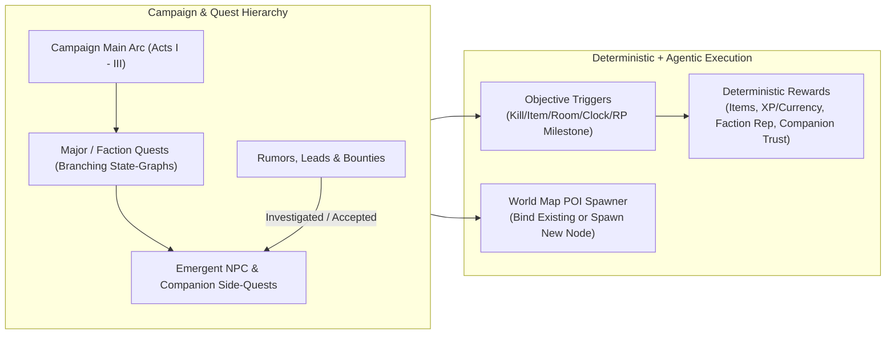
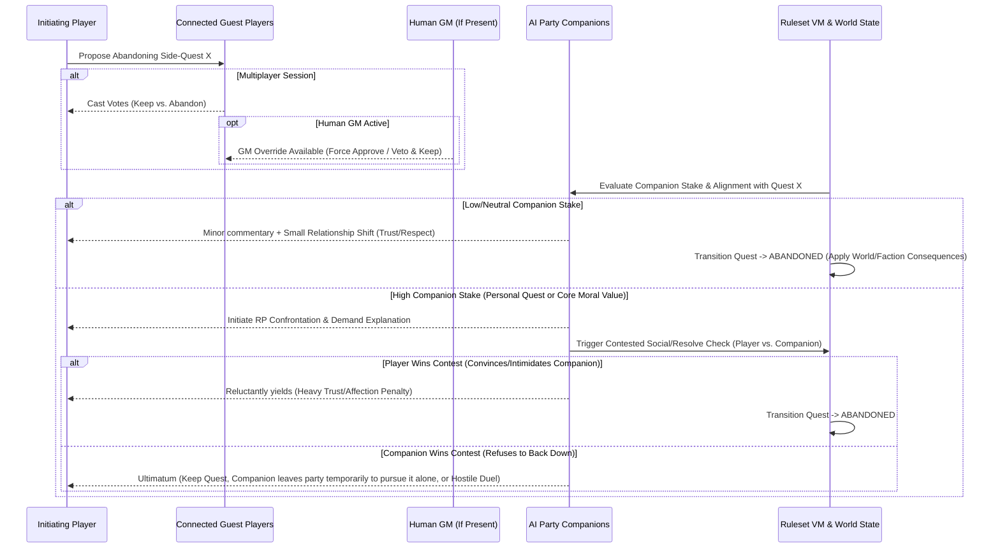

# Meddah Technical Specification — Volume 2: AI & Deterministic GM Director, Autonomous Companions, Quests & Permanent Retinue (§1.3–§1.4, §1.12, §1.19)

> [!TIP]
> **Modular Technical Specification Navigation**:
> - **Master Index, Module Registry (§1.0), 14-Phase Roadmap (§2) & 77 Design Resolutions (§2.1)**: [technical_specification_and_plan.md](./technical_specification_and_plan.md)
> - **High-Level Architecture, 4 Golden Rules & 50 Locked Decisions**: [system_design_specification.md](./system_design_specification.md)
> - **Vol 1 — Core Ruleset VM, Layered Inventory & Ingestion (§1.0–§1.2)**: [tech_spec_01_core_vm_and_ingestion.md](./tech_spec_01_core_vm_and_ingestion.md)
> - **Vol 2 — AI/Deterministic GM, Companions, Quests & Retinue (§1.3–§1.4, §1.12, §1.19)**: [tech_spec_02_agents_companions_and_quests.md](./tech_spec_02_agents_companions_and_quests.md)
> - **Vol 3 — World, Cosmology, Travel, Law/Capture, Megacities & Geopolitics (§1.5, §1.11, §1.20–§1.24)**: [tech_spec_03_world_cosmology_and_society.md](./tech_spec_03_world_cosmology_and_society.md)
> - **Vol 4 — Multiplayer, West Marches/Guild Server, MUD/VTT UI, Audio/VFX, Safety & Maps (§1.6–§1.10, §1.18, §1.25–§1.26)**: [tech_spec_04_multiplayer_ui_and_vtt.md](./tech_spec_04_multiplayer_ui_and_vtt.md)
> - **Vol 5 — Downtime, Crafting/Survival, Puzzles/Traps, Loot, Piety, Chases, Competitions & Hit Locations (§1.13–§1.17, §1.27–§1.29)**: [tech_spec_05_gameplay_systems_and_anatomy.md](./tech_spec_05_gameplay_systems_and_anatomy.md)

---

### 1.3 AI GM, Deterministic GM Director Fallback, 5-Domain Co-GM Matrix & Interactive Roll Prompts (`backend/app/agents/`)
1. **Runtime AI Circuit Breaker (`ai_fallback_router.py`), Deterministic GM Director (`deterministic_gm_director.py`) & Bidirectional Hot-Swap Continuity**:
   - **Zero-AI Mode (`AI_PROVIDER=none`) & Automatic Runtime Failover**: Whether a player launches the game with no AI provider configured (`Tier A`) **or** a configured Local (`Tier B`) / Cloud (`Tier C`) AI provider becomes unavailable mid-session (network drop, timeout, `429` rate-limit, `5xx` error, or user token/cost budget cap reached), the **AI Fallback Router (`ai_fallback_router.py`)** automatically trips its per-provider circuit breaker, routes the turn seamlessly to `deterministic_gm_director.py` with zero crash or lost state, displays a non-blocking `[AI Unavailable -> Using Deterministic Engine]` status badge in the top bar, and auto-recovers once health checks pass.
   - **Seamless Mid-Campaign Bidirectional Hot-Swapping (`Tier A <-> Tier B <-> Tier C`)**: Because every deterministic action, check, dialogue branch, and world state change writes structured canonical events and `DeedFact` records (`canonical_deed_ledger.py`) directly into the SQLite event log, players can start a campaign in `Tier A` (Zero-AI) on an offline laptop and switch to `Tier B` (Local 7–14B LLM) or `Tier C` (Cloud) later—or drop from `Tier B/C` down to `Tier A` mid-dungeon—with zero state desync and full AI recall of everything that occurred while in Zero-AI mode.
   - **Built-In Solo RPG Oracle & Mythic-Style Fate Engine**: For Solo and Co-GM play without AI, `deterministic_gm_director.py` includes a full **Solo RPG Oracle Deck & Fate Resolver** (configurable Yes/No probability matrix by *Chaos/Tension Factor* + `Action / Theme / Descriptor / Twist` meaning tables + automatic scene complication triggers).
2. **5-Domain Human-to-AI Co-GM Assistance Matrix (With Per-Domain Deterministic Fallbacks)**:
   Each domain can be independently set to `OFF`, `SUGGEST_WHISPER` (drafts a private clickable card for the Human GM to approve/edit), or `AUTO_EXECUTE`—and every domain has an automatic deterministic engine fallback if AI is disabled or unavailable:
   - **Domain 1: Scene & Sensory Descriptions**: AI prose generation $\rightarrow$ *Deterministic Fallback*: **Template & Sensory-Tag Room Assembler** combining room `seasonal_variants`, `time_variants`, `exposure_type`, visible entities/props, and `ambient_ticker.py` sensory pools.
   - **Domain 2: NPC Dialogue & Roleplay (`deterministic_dialogue_broker.py`)**: AI persona roleplay $\rightarrow$ *Deterministic Fallback*: **Interactive Topic-Chip & FTS5 Keyword Dialogue Broker**:
     1. **Dynamic Topic Chips**: Automatically populates clickable conversation chips in the MUD log / dialogue panel derived from the NPC's `knowledge_tags`, local rumors, merchant inventory, active quests, and the **3-Clue Investigation Matrix** (e.g., `[Ask about: The Old Mill]`, `[Rumor: Missing Caravan]`, `[Show Item: Bloodstained Signet]`, `[Trade / Barter]`).
     2. **Ruleset Social Contest Buttons**: Exposes 1-click social skill actions (`[Persuade]`, `[Intimidate]`, `[Deceive]`, `[Bribe]`) wired directly to the NPC's `Trust / Respect / Fear` disposition thresholds and `persuasion_clocks`.
     3. **Freeform Question Keyword & FTS5 Matcher**: When a player types a freeform question (`> ask the blacksmith where the cultists fled`), `deterministic_dialogue_broker.py` runs an instant **SQLite FTS5 BM25 + synonym stem match** against the NPC's unlocked knowledge entries, local rumors, and faction lore—returning the matching disposition-parameterized response (or a temperament-specific *"I don't know anything about that"* bark if unmatched).
   - **Domain 3: Combat & Tactical Turn Execution**: AI tactical narration $\rightarrow$ *Deterministic Fallback*: **Deterministic Tactical Utility Evaluator** (scoring legal actions, cover, range, and threat) + **Template Combat Narrator** interpolating weapon/spell tags, hit location/severity, and roll margins.
   - **Domain 4: Rules & Compendium Oracle**: AI RAG rule explanations $\rightarrow$ *Deterministic Fallback*: **SQLite FTS5 BM25 Rulebook & Compendium Citation Lookup** returning exact rule excerpts, page citations, and deterministic AST formula breakdowns.
   - **Domain 5: Dynamic World & Encounter Generation**: AI JIT synthesis $\rightarrow$ *Deterministic Fallback*: **Seeded Procedural Graph, Biome Table & `.rpgtileset` Generator** spawning rooms, loot tables, and side-quests from ruleset/world templates.
3. **Interactive Player Roll Prompt Flow, Freeform Intent Matcher & 1-Click Improvised Stunt Card (`intent_skill_matcher.py` & `improvised_stunt_resolver.py`)**:
   - When a player submits a freeform action (`> leap across the chasm and grab the frayed rope`), the active GM director calls `propose_skill_check(actor_id, mechanic_id, stat, difficulty, stakes_summary)`:
     - *When AI is active*: The LLM maps the freeform action to the ruleset's skill/stat and difficulty.
     - *When AI is absent or unavailable*: The **Deterministic Action-Verb & Skill Intent Matcher (`intent_skill_matcher.py`)** matches verb/noun synonyms (`leap/jump/climb` $\rightarrow$ *Athletics/Acrobatics*, `pick/disarm` $\rightarrow$ *Thieves' Tools/Tinker*, `convince/bribe` $\rightarrow$ *Persuasion/Sway*) against `.rpgrules` skill/capability tags and the target room/prop's `obstacle_dc` or region danger tier.
     - **1-Click Improvised Stunt & Rule-of-Cool Resolver (`improvised_stunt_resolver.py`)**: If a player types an unrecognized creative stunt (`> swing from the chandelier and kick the cultist into the brazier`) or triggers `/stunt`, the engine **never** rejects the input with `"Unknown command"`. Instead, it pops up an inline **Improvised Stunt Card** pre-selecting the closest matching Ruleset Skill/Stat + target entity/prop difficulty rating and letting the player (or Human GM) pick 1 of 4 ruleset-legal **Success Outcomes** before rolling:
       1. *Improvised Damage + Push / Prone* (uses the ruleset's improvised/environmental damage die + knockback/prone condition),
       2. *Inflict Tactical Condition* (any `ConditionBlock` the ruleset defines, e.g. `Blinded`, `Off-Balance`, `Grappled`, `Distracted`),
       3. *Create Advantage / Situational Bonus* (whatever the ruleset's native circumstance mechanic is, e.g. a flat modifier, a re-roll, an extra die, or a narrative tag), or
       4. *Traverse Obstacle / Reposition* (move across hazard/elevation without provoking reactions).
   - Instead of rolling silently (unless the player enabled *Auto-Roll Player Checks*), the server emits a `ROLL_PROMPT_CREATED` event to the player's MUD log & HUD.
   - The player can toggle any applicable situational modifiers/resources (e.g., *Spend 1 Luck / Push Roll*) and click **[Roll Now]** (or type `roll`). The VM executes the roll deterministically and triggers the AI GM's (or Template Narrator's) outcome pass.
4. **AI GM Difficulty Scaling, "Behind-the-Screen" Roll Fudging, Hint Director & Anti-TPK Safety Nets (`backend/app/agents/gm_difficulty_and_mercy_director.py`)**:
   In strict accordance with **Golden Rule #1** and **Golden Rule #4**, Meddah **defaults to Rules as Written (RAW)**—never silently rescaling encounters, fudging dice, or altering combat defeat outcomes unless the Host/GM/Solo Player explicitly opts into a leniency setting or GM Style Preset. To support every tabletop playstyle, the engine provides **4 One-Click GM Style Presets** (**`Rules as Written / Authentic Referee [Default]`**, *Balanced Tabletop GM*, *Story-First / Merciful*, and *Tactical Challenge*) backed by **five granular Difficulty & Leniency controls** (all defaulting to Rules as Written):
   * **A. Three Encounter & World Difficulty Scaling Modes (`EncounterScalingMode`)**:
     1. **`Static World-Authentic / Rules as Written` (Zero Automatic Rescaling — [Default])**:
        - Every region, dungeon floor, module encounter, and faction garrison uses its exact authored or ruleset-generated threat tier and roster. If a lowest-tier party marches into an apex predator's lair, the encounter is not scaled down. (Optional **Threat Telegraphing** can be toggled on via `gm_hint_policy` to surface environmental danger cues before engagement.)
     2. **`Bounded Regional Bands` (`[Min_Tier, Max_Tier]` Hybrid — Opt-In)**:
        - Each region or dungeon defines a threat band (e.g., *Ash Borderlands: Tier 1–3*, *Sunken Citadel: Tier 4–7*). Encounters scale smoothly to match the party within that band, preserving the reward of outgrowing early zones while keeping endgame zones dangerous.
     3. **`Party-Balanced Dynamic Budget` (Ruleset-Legal Scaling — Opt-In)**:
        - When generating or populating encounters, the deterministic **Encounter Budget Calculator** evaluates active party size (including solo vs. full party), character progression tier, and **Current Party Attrition** (remaining vitality, resource pools, consumables, conditions) and scales the encounter using ruleset-legal levers:
          - *Roster & Minion Count Adjustment*: Scales enemy numbers or swaps between *Minion / Standard / Elite* variants from the `.rpgrules` compendium.
          - *Dynamic Wave Throttling*: Holds reserve enemies in adjacent rooms as "Wave 2"—and quietly cancels or reduces Wave 2 if the party takes heavy casualties in Rounds 1–2.
          - *In-World Condition Pre-Modifiers*: In narrative/solo modes, overpowered bosses can enter the scene *Wounded from a prior battle*, *Exhausted*, or *Missing an armor plate* rather than arbitrarily altering ruleset math.
   * **B. Dice Visibility & "Behind the GM Screen" Roll Fudging (`gm_roll_fudging_policy`)**:
     - **`Open Table / Rules as Written (Zero Fudging)` [Default]**: All GM/enemy rolls execute openly in the MUD log with full die faces and formula breakdowns. The dice and ruleset formulas are absolute law (`0%` roll manipulation).
     - **`Hidden GM Screen — Honest Rolls` (Opt-In)**: Enemy rolls happen behind the virtual GM screen (players see narrative & damage outcomes without seeing raw enemy stat modifiers until identified), still with `0%` roll manipulation.
     - **`Merciful GM Screen — Opt-In Roll Fudging` (Opt-In)**:
       - Emulates a sympathetic human GM rolling behind a screen via deterministic `MercyDirector` rules (which can be disabled for Boss fights if desired):
         1. **Lethal Crit Dampening**: If a minor/non-boss enemy rolls a random lethal Critical Hit that would drop or kill a player character early in an encounter, downgrades the crit Behind the Screen into a normal hit or grazing blow.
         2. **Bad-Luck Streak Breaker ("Cold Dice Pity")**: Tracks rolling statistical variance (`session_luck_delta`); if the party suffers an extreme cold streak (e.g., 5+ consecutive failed checks at $\ge 65\%$ odds) while enemies roll consecutive high rolls, subtly nudges behind-the-screen enemy saves or glancing damage toward the mean.
         3. **Massive-Damage Survival Clamp (Opt-In, Ruleset-Bounded)**: Once per rest, if an un-telegraphed single hit would cause instant permadeath via massive damage overflow, clamps the outcome to the ruleset's own *minimum-survivable state* (its lowest non-lethal vitality value or its `dying`/`incapacitated` condition). Unavailable if the ruleset defines no such state.
   * **C. Proactive Hints, Telegraphing & "Are You Sure?" Blunder Prevention (`gm_hint_policy` — 100% Deterministic + Optional AI Flair)**:
     - **`Rules as Written Only (Passive/Active Checks as Defined by Ruleset)` [Default]**: Clues, hazards, and warnings surface strictly when a character's ruleset-defined passive or active perception, investigation, instinct, or lore check succeeds.
     - **`Diegetic In-World Nudges` (Opt-In)**:
       - **Puzzle & Investigation Stall Detector**: If the party spends $N$ turns stuck in a puzzle room (`ContraptionNode`) or mystery without uncovering a primary clue, the Director triggers an AI Companion, a Familiar/Pet, or a passive character intuition check to surface the next entry in the puzzle/clue's structured `hint_ladder` (rendered either via AI roleplay or deterministic companion observation templates).
       - **"Are You Sure?" Common-Sense Check (Deterministic Lethality Pre-Check)**: Before executing an action, the deterministic **Lethality & Blunder Evaluator** checks if the target entity's Threat Tier exceeds the party by a **configurable threshold** (`lethality_warning_margin`, a ruleset-tier delta), if a targeted consumable/prop carries a `lethal_hazard` / `poison` / `acid` tag, or if a movement/jump crosses a fatal fall/vacuum/lava threshold—pausing automatically (`"Your character's survival instincts warn that this is almost certainly fatal. Do you still want to proceed?"`) even when no AI provider is running!
     - **`On-Demand Progressive Hint Button ([Ask GM for a Hint 💡] / /hint)` (Opt-In)**:
       - Players can request a hint at any time to receive a **3-Stage Progressive Reveal** (*Stage 1: Subtle Atmospheric Clue $\rightarrow$ Stage 2: Suggested Skill/Capability to Use $\rightarrow$ Stage 3: Direct Mechanical/Puzzle Solution*) read deterministically from the active `ContraptionNode.hint_ladder` or `MysteryClueMatrix`.
   * **D. Enemy Tactical Behavior (`enemy_tactical_ruthlessness`)**:
     - Defaults to **`Archetype-Authentic / Rules as Written` [Default]** (enemies act strictly according to their ruleset statblock intelligence, instinct/morale tags, and faction doctrine), with opt-in table overrides for **`Wargame Ruthlessness`** (focus-firing wounded healers and striking downed PCs to confirm kills), **`Tabletop Cinematic`** (enemies switch targets once a PC falls incapacitated unless fighting a mindless devourer or contracted assassin), or **`Pulp Forgiving`** (enemies favor cinematic shoves, grapples, and taunts over lethal focus-fire).
   * **E. Anti-TPK (Total Party Kill) Safety Nets (`anti_tpk_policy`)**:
     When a combat spirals toward a Total Party Kill ($\ge 75\%$ of the party incapacitated or the party's remaining vitality resources are critical per the ruleset), the `MercyDirector` follows the campaign's chosen policy:
     1. **`Rules as Written / No Artificial Intervention` [Default]**: Combat resolves strictly according to the active ruleset's incapacitation, death, and morale mechanics; if the party is wiped out, play transitions to **Campaign Succession** (Section 1.4.7) or Host Checkpoint Rewind.
     2. **`Fail-Forward Surrender / Capture Pivot` (Opt-In — Integrates with Section 1.21.5)**:
        - Intelligent enemies halt and demand surrender (*"Throw down your steel, or your friends bleed out!"*) or knock the final defenders out with non-lethal strikes—pivoting seamlessly into the **Full-Party Enemy Capture & Jailbreak Engine** (`captivity_and_breakout.py`) instead of ending the story!
     3. **`Villain Objective Completion / Enemy Morale Exit` (Opt-In)**:
        - Instead of spending 3 rounds slaughtering incapacitated PCs, the antagonist seizes the quest MacGuffin, triggers a tunnel collapse to cover their escape, or bruised beasts retreat with their prey—leaving the battered party alive with a personal vendetta.
     4. **`Diegetic Miracle / Cavalry / Patron Intervention` (Opt-In, Carries Narrative Cost)**:
        - Triggers a once-per-arc lore-grounded rescue: a Deity/Patron intervenes in exchange for a binding **Pact Debt / Geas** (Section 1.17), an allied faction patrol or stationed **Stronghold "B-Team" Companion** charges into the fray, or an environmental catastrophe splits the battlefield so survivors can flee.
5. **Zero-AI (`Tier A`) Dialogue Topic-Chip, Companion Bark & Solo Oracle Table Designer (`desktop/src/components/world_studio/DialogueAndOracleStudio.tsx` — [MVP Phase 6])**:
   To ensure that narrative, investigative, and roleplay-heavy modules authored without AI are just as expressive as AI-assisted sessions, Meddah provides a visual **Zero-AI Narrative & Dialogue Authoring Workbench** integrated into the World & Ruleset Studios:
   * **A. Visual NPC Topic-Chip & Knowledge Graph Editor (`DialogueTopicEditor.tsx`)**:
     - Lets GMs and module authors visually build deterministic NPC conversation trees for `deterministic_dialogue_broker.py` without writing JSON:
       1. **Topic Chip & Prompt Node Builder**: Add conversation topics (`[Ask about: The Sunken Crypt]`, `[Rumor: Missing Patrol]`, `[Show Evidence: Signet Ring]`, `[Bribe / Persuade]`) with disposition-tiered response variants (*Hostile / Guarded / Neutral / Friendly / Trusted*).
       2. **Visibility & Social-Contest Unlock Gates**: Visually bind a topic chip or secret disclosure to prerequisite gates—requiring a discovered clue, an item in inventory, a faction reputation tier, a minimum `Trust / Respect / Fear` threshold, or winning a ruleset social skill check / filling a `persuasion_clock`.
       3. **Freeform Keyword & Synonym Stem Binder (`SQLite FTS5 BM25`)**: Assign keyword/synonym tags to each knowledge entry so typed MUD questions (`> ask the blacksmith where his apprentice went`) deterministically resolve in `<5ms` with `0` LLM calls.
       4. **Deterministic Outcome Wiring**: Link any dialogue topic to engine actions—revealing a **3-Clue Matrix** lead, crystallizing a side-quest, unlocking a secret merchant tier (`UnlockedMerchandiseRegistry`), handing over a key/handout, or applying a `Trust / Respect` delta.
   * **B. Personality-Tagged Companion & NPC Bark Matrix Editor (`BarkLibraryEditor.tsx`)**:
     - Visual table and live previewer for authoring and customizing deterministic `Tier A` barks across trigger contexts (*Combat Crit/Kill, Ally Downed/Stabilized, High-Threat Telegraphing, Campfire Hangout, Loot Upgrade Request, Moral Objection/Confrontation*) filtered by persona temperament tags (`cynical`, `chivalrous`, `scholarly`, `zealous`, `pragmatic`, `jovial`) and interpolated with `DeedFact` variables.
   * **C. Customizable Solo RPG Oracle, Fate & Sensory Table Designer (`OracleAndSensoryEditor.tsx`)**:
     - Allows solo players, GMs, and world authors to inspect, weight, import/export (CSV/Markdown/YAML), and customize the deterministic **Solo Fate Yes/No & Complication Matrices**, **`Action + Theme + Descriptor` Meaning Decks**, regional **Tavern Rumor Decks**, and room **`ambient_ticker.py` Sensory Emote Pools** per world or ruleset.

---

### 1.4 AI Party Members: Tactical Obedience, Generalized Confrontations, Roster Lifecycle & Tiered Dossiers (`backend/app/agents/ai_npc.py` & `party_lifecycle.py`)

1. **Hybrid Tactical + Persona AI with Dynamic Obedience**:
   - On an AI companion's turn, a fast **Deterministic Utility Evaluator** scores available legal actions (healing low allies, attacking high-threat targets, taking cover, using buffs).
   - If a player issued a vocal/command order (`"Vane, cover the door!"`), the engine checks the companion's **Obedience Score** (`f(Trust, Respect, MoralAlignmentWithOrder)`):
     - *High Obedience*: Prioritizes the player's requested action and replies in-character (`"On it. Keep your head down."`).
     - *Conflict / Low Trust*: If an order clashes with core beliefs (e.g., ordering a merciful healer to execute a prisoner), the companion can refuse, argue, or take an alternative action.
     - *Host Override Toggle*: The Host/GM can enable `"Force Direct Player Control in Combat"` at any time for pure tactical tabletop control.

2. **Generalized Companion Reaction, Core Memory & Confrontation System**:
   - Companion reactions, relationship shifts, and contested rolls apply **across all game events**—not just quest abandonment.
   - Whenever a significant event occurs (e.g., *committing a moral atrocity, sparing or executing a boss, stealing from innocents, siding with a hated faction, hoarding promised loot, betraying an ally, or reckless leadership causing a party member's near-death*), the **Moral & Personal Stake Evaluator** runs across all present companions:
     - **Relationship & Core Memory Formation**: Events that deeply resonate with or violate a companion's `morals`, `likes/dislikes`, or `goals` shift `Trust`, `Respect`, `Affection`, and `Resentment`, and crystallize a permanent **Core Memory Node** (`valence: negative | positive`, `weight: 1-10`, e.g., *"Burned the refugee caravan at Ash Crossing"`).
     - **Live Contested Confrontations (Any Event)**: If a player attempts an action in the world that crosses a companion's **Hard Moral Boundary** or threatens someone/something they care about, the companion can step in *before* or *immediately after* the action to force a **Contested Social or Physical Check** (e.g., *Persuasion/Intimidate vs. Resolve*, or physically drawing a weapon to block the player).

3. **Permanent Departure, Rivalry & Enemy Faction Defection (The "Nemesis" Lifecycle)**:
   - Companions are never deleted if they leave the party; they transition from `role: "party_member"` back to an autonomous **World Agent (`role: "world_npc" | "rival" | "faction_lieutenant"`)** keeping their exact character sheet, inventory, skills, and memories of the party:
     - **Standard Departure**: If `Trust` falls below the departure threshold (e.g., `-50`) and a final reconciliation check fails, the companion leaves the party at the next logical beat or immediately walks away.
     - **Rival / Enemy Faction Defection**: If a companion leaves with high `Resentment`, multiple negative Core Memories, or an ideological clash that aligns with an opposing faction or villain:
       - The **Living World Engine** reassigns them based on their personality and goals: they may form an independent **Rival Adventuring Party** competing for the same artifacts/bounties, defect to an **Enemy Faction**, or become a **Villain's Lieutenant** (bringing insider knowledge of the player's tactics and weaknesses to future encounters!).

4. **Party Vote to Expel vs. Companion Mutiny (Campaign Continues Either Way)**:
   - **Dismissing / Voting to Kick an AI Companion**:
     - A Solo Player (or Multiplayer Party via a **Party Vote** with **Human GM Override**) can choose to dismiss or kick an AI companion from the party at any time.
     - Depending on the companion's personality, `Trust`, and how they are dismissed (amicable parting at a tavern vs. hostile exile in the wilderness), they may part ways peacefully (remaining available at a home base/tavern to re-recruit later) or react with hostility/grudge formation.
   - **AI Companion Mutiny & Player Expulsion**:
     - AI companions also have inter-companion relationships (`Companion A <-> Companion B`). If multiple AI companions share critically low `Trust`/`Respect` toward the player(s) and high solidarity with each other, they can conspire and trigger a **Party Mutiny Scene**.
     - If the player(s) fail the ensuing Contested Leadership/Social Check (or combat standoff), the mutinous companions **expel the player(s) from the group** (or claim the shared camp/vehicle/ship and strike out on their own).
     - **Non-Game-Over Continuity**: A mutiny **never** ends the campaign! The expelled player(s) continue their campaign from their current location as solo/small-group survivors—now with a deeply personal narrative hook to rebuild a new party and eventually confront their former companions.

5. **Dynamic Party Roster: Recruitment, Capture/Rescue & Temporary Quest Allies**:
   ```mermaid
   stateDiagram-v2
       [*] --> World_NPC: Exists in Tavern / Faction / Encounter
       World_NPC --> Temporary_Guest: Joins for Specific Quest / Escort / Dungeon
       Temporary_Guest --> World_NPC: Quest / Escort Condition Completed
       Temporary_Guest --> Full_Party_Member: Invited after Earning High Trust
       World_NPC --> Full_Party_Member: Recruited via RP / Contract / Guild
       Full_Party_Member --> Captured_Hostage: Defeated / Kidnapped (Spawns Rescue Quest)
       Captured_Hostage --> Full_Party_Member: Rescued by Party
       Captured_Hostage --> Rival_or_Turned: Abandoned Too Long (Clock Expires)
       Full_Party_Member --> Departed_Ally: Amicable Dismissal (Can Re-Recruit)
       Full_Party_Member --> Rival_or_Turned: Low-Trust Defection / Mutiny / Hostile Kick
       Full_Party_Member --> Fallen_Memorial: Permanent Death (Opens Roster Slot)
   ```
   - **Recruiting New Companions**: Whenever the party has open roster capacity (or after a companion dies permanently, is captured, defects, or is dismissed), players can recruit new companions in three ways:
     1. **Tavern / Guild / Faction Recruitment**: Hire or recruit generated or pre-made companions at settlements.
     2. **Organic World NPC Promotion**: Convince almost any compatible World NPC (a friendly guard, a redeemed bandit, a grateful scholar) to join the party through roleplay and a recruitment check; the engine promotes their `EntityState` and `MindState` into a full AI Party Member.
     3. **Custom Companion Creator**: In Solo or GM mode, manually design or AI-generate a new companion archetype and introduce them into the current scene.
   - **Captured / Incapacitated Companions**: If a companion is captured rather than killed in an encounter (or taken hostage during a failed quest), their roster status shifts to `CAPTURED`, automatically spawning a time-sensitive **Rescue Side-Quest** bound to a World Map POI and a Faction Progress Clock.
   - **Temporary / Quest-Bound Party Members (`role: "temporary_guest"`)**:
     - NPCs can join the party temporarily with an explicit **`duration_condition`** (e.g., `until_quest_complete: "escort_scholar_to_ruins"`, `until_region_exit: "ash_wastes"`, or `duration_days: 3`).
     - Temporary members appear in a distinct **"Guest / Escort"** section of the Party Dock, participate in dialogue and combat according to their capabilities, and automatically depart when their condition is met—unless the party has built high enough `Trust` to offer them a permanent spot on the roster!
   - **Configurable Active Party Size Caps & Exclusions (`PartyCapacityConfig`)**:
     - The Host, GM, or Solo Player can configure active party limits at any time (with optional ruleset defaults):
       - **`max_active_party_size`**: Maximum active field slots for **Human PCs + Active AI Party Members** combined (e.g., `1` for *Lone Wolf Solo*, `4` for classic tabletop, `6` for large party, or `Unlimited`).
       - **`max_active_ai_companions`**: Optional sub-cap specifically on how many **AI Party Members** can travel in the active field party at once (or bound to a ruleset formula such as `@leader.max_henchmen`).
     - **Strict Exclusions (Never Count Against Active Party Cap)**:
       1. **Temporary / Quest-Bound Party Members (`role: "temporary_guest"`)**: Reside in the separate **"Guest / Escort"** bucket (`counts_toward_active_cap: false`) so picking up an escort NPC mid-dungeon never forces a core companion out. (Only promoting a guest to a permanent `Full_Party_Member` checks against `max_active_party_size`).
       2. **Retinue Entities (`RetinueEntity`, Section 1.19)**: Pets, Familiars, Recon Drones, Bonded Combat Beasts, Steeds/Mounts, and Minion Squads attach to their owner (`owner_entity_id`) and obey `.rpgrules` retinue/minion control pools—never consuming an Active Party Member slot.
       3. **Reserve / Stationed Companions (`roster_state: "reserve_at_base"`, Section 1.5.5.D)**: Recruiting a new companion when active slots are full (`4/4`) never blocks recruitment; it opens a **1-Click Party Swap / Send to Reserve Modal** letting you send the new recruit (or swap an active companion) to your Reserve Roster.
   - **Where Reserve Companions Stay: Physical World Persistence vs. Transit Dispatch (`reserve_availability_mode`)**:
     - Because Meddah simulates a living persistent world, reserve companions do not magically teleport into every tavern by default—each reserve companion tracks an explicit **`stationed_location_id`** (the specific **Tavern/Inn**, **Party Stronghold/Secret Lair**, or **Mobile Vessel/Caravan** where they were stationed), governed by a 3-mode campaign setting:
       1. **Mode 1 — `Diegetic Physical Location + Dispatch Transit` (Default)**:
          - **Stationed at a Specific Tavern, Stronghold, or Vessel**: A companion left at *The Rusty Anchor in Port Vane* physically stays at *The Rusty Anchor* (where you can see and chat with them if you visit that room!), or—if you own a **Stronghold/Lair** or **Mobile Ship/Caravan (Section 1.5.5)**—you can instruct them to travel to and stay at your Stronghold or aboard your Mobile Vessel (meaning companions stationed on your Ship/Caravan travel *with* you from port to port!).
          - **"Send Word / Summon Companion" from Another Tavern (`in_transit`)**: If you are in a *different* town (`Oakhaven`) and want a reserve companion who is back in `Port Vane` or at your `Keep`, you can click **`[Summon / Send Word to <Companion>]`** at any Tavern, Guildhall, Courier Post, Comms Terminal, or via a ruleset *Sending / Animal Messenger* capability. The engine calculates deterministic overland/sector travel time (`overworld_travel.py`) and places them in `roster_state: "in_transit"` (arriving in $N$ watches/days, or immediately if using ruleset Teleportation/Portal travel!).
          - **"Travel Ahead & Meet Us At..."**: When swapping a companion to Reserve, you can also instruct them to travel ahead to a known destination settlement so they are waiting at the local tavern when the party arrives.
       2. **Mode 2 — `Strict Local Presence Only` (Hardcore / Old-School)**:
          - Reserve companions can only be swapped into the active party by physically visiting the exact Tavern, Stronghold, or Vessel where they are currently stationed.
       3. **Mode 3 — `Shared Tavern / Camp Hub` (Cinematic CRPG Convenience)**:
          - For groups that prefer zero logistics friction, any reserve companion can be swapped into the active party immediately at *any* Safe Haven Tavern, Inn, or Campfire ("they caught up with your trail").

6. **Tiered Dossier Transparency**:
   - Every AI companion and major NPC exposes a **Dossier View** filtered by the viewer's role and current `Trust` tier:
     - *Tier 0 (Stranger)*: Portrait, Apparent Archetype, Voice, Observed Surface Traits.
     - *Tier 1 (Acquaintance)*: Known Likes/Dislikes, Observed Quirks, Qualitative Disposition Badge (`"Cautious Ally"`).
     - *Tier 2+ (Trusted Companion)*: Unlocked Backstory Chapters, Personal Quest Goals, Key Shared Memories.
     - *Host/GM View*: Full numeric relationship matrices, Core Memory weights, mutiny/defection risk indicators, and raw memory inspector.

7. **Player Character Death, Companion Resurrection Autonomy & Campaign Succession**:
   When a Player Character falls (`incapacitated`/`dying` or `dead` as defined by the active ruleset's ECA hooks), the engine orchestrates a dramatic, ruleset-aware sequence rather than an abrupt "Game Over" screen:

   ```mermaid
   flowchart TD
       PCDown["Player Character Falls (Dying / Dead State Triggered)"]
       CheckRules{"Does Active Ruleset Define\nStabilize / Resurrection Mechanics?"}
       EvalTrust{"Evaluate Surviving Companions'\nTrust, Respect & Morals"}
       CombatRevive["Immediate Tactical Revival\n(Use Heal/Revivify/Defibrillator Action)"]
       WorldRevive["Post-Scene Recovery Vignette\n(Carry PC Body to Temple/Clinic & Pool Gold/Favors)"]
       AbandonOrLoot["Low Trust / Cynical Companion\n(Leaves Body, Takes Relic, or Retreats)"]
       PermDeath["Permanent Character Death Confirmed\n(Fallen PC Recorded in Memorial & World Lore)"]
       Succession["Campaign Continuation Choice (Campaign Never Ends)"]
       NewPC["Option A: Create New Character\n(Joins Surviving Party or Starts at Local Settlement)"]
       PromoteComp["Option B: Assume Direct Control of a\nSurviving AI Party Member as New Main PC"]

       PCDown --> CheckRules
       CheckRules -->|"Yes"| EvalTrust
       CheckRules -->|"No (Grim/Permadeath Ruleset)"| PermDeath
       EvalTrust -->|"High/Moderate Trust & Has Capability"| CombatRevive
       EvalTrust -->|"High Trust & Settlement Temple/Service Exists"| WorldRevive
       EvalTrust -->|"Hostile / Very Low Trust"| AbandonOrLoot
       CombatRevive -->|"Roll Succeeds"| Restored["PC Revived in Scene"]
       CombatRevive -->|"Roll Fails / No Resources"| WorldRevive
       WorldRevive -->|"Ritual Succeeds"| Restored
       WorldRevive -->|"No Funds / Ritual Fails / Player Declines"| PermDeath
       AbandonOrLoot --> PermDeath
       PermDeath --> Succession
       Succession --> NewPC
       Succession --> PromoteComp
   ```

   - **Immediate Emotional & Tactical Companion Reactions**:
     - When a PC drops to a `dying` or `dead` state in an encounter, surviving AI companions immediately react based on their `Relationship` and `Persona`:
       - **High Trust / Affection**: Cries out in alarm/grief, forms a high-weight Core Memory, and shifts their tactical utility priority to **Emergency Stabilization / Body Protection** (moving adjacent to shield the fallen PC, using healing/stabilization items, or triggering a temporary *"Vengeance / Desperate Resolve"* narrative impulse).
       - **Low Trust / Self-Preserving**: Prioritizes their own survival or tactical retreat; a particularly ruthless/resentful companion with negative `Trust` may even grab a quest-critical item from the fallen PC and flee!
   - **Ruleset-Agnostic Resurrection & Recovery Autonomy**:
     - Remember our Golden Rule: the engine never assumes resurrection exists unless the active `.rpgrules` schema defines capabilities, items, or settlement services tagged with `effect_tag: "stabilize" | "revive" | "resurrect"` (e.g., *Revivify / Raise Dead* in a Fantasy ruleset, *Trauma Team / Defibrillator / Clone Sleeve* in Cyberpunk/Sci-Fi, or *None* in realistic Call of Cthulhu).
     - If revival mechanics **do** exist in the active ruleset and at least one surviving companion has sufficient `Trust`/`Respect` (or moral duty):
       1. **In-Scene Revival**: If a companion possesses a revival spell, medkit, or item and can pay its ruleset precondition cost, their tactical evaluator assigns **top priority** to reviving the player on their very next turn.
       2. **Post-Encounter Temple / Clinic Recovery Scene**: If the battle ends (or the companions are forced to retreat carrying the fallen PC's body) and no one in the party can cast resurrection directly, loyal companions will **autonomously carry the player's body back to the nearest Settlement Temple/Clinic/Re-sleeving Facility**, pool party funds (or take on a debt/favor quest with the local priest/ripperdoc!), and execute the ruleset's resurrection ritual check.
       3. **Player Choice (`Accept Resurrection` vs. `Let Character Rest`)**: Even when a resurrection attempt succeeds, the player is prompted so they can choose whether their character's soul returns or if they feel this was a fitting narrative end for that character.
   - **Non-Game-Over Solo & Multiplayer Campaign Continuity (`SuccessionFlow`)**:
     - If a Player Character permanently dies (whether in Solo or Multiplayer, or even if the entire party wipes), **the campaign never ends**.
     - The fallen character's sheet, deeds, and cause of death are enshrined in the **Hall of the Fallen** (and persist in the world—surviving companions mourn them, remember them in future dialogue, and can carry on their unfinished personal quests, while their gear remains at their death site or with the surviving party).
     - The player is presented with the **Campaign Succession Modal**:
       1. **Generate / Create a New Character**: Launch the ruleset's **Character Creation Wizard** (at a configurable starting XP/tier matching the campaign's current progression). The AI GM—or, when AI is absent/unavailable, the **Deterministic Succession Scene Assembler**—seamlessly weaves an **Introduction Scene** where the new character meets the surviving companions (e.g., as a fellow survivor in the dungeon, a mercenary hired at the nearest tavern, or an investigator following the fallen hero's trail).
       2. **Promote a Surviving AI Companion to Player Character**: In Solo mode (or with GM/Host permission in Multiplayer), the player can choose to take direct permanent control of one of the surviving AI companions as their new protagonist!
       3. **Timeline Checkpoint Rewind (Solo Instant / Multiplayer Requires Explicit GM or Host Permission)**:
          - In **Solo Mode**, the player can directly rewind to a prior Event-Sourced Timeline Checkpoint if they prefer to undo the death rather than continue the legacy timeline.
          - In **Multiplayer Sessions**, a Guest Player **cannot** unilaterally rewind the session timeline! The option either stays hidden for guests or appears as **`[Request Timeline Rewind from GM/Host]`**, which sends a private prompt to the **Human GM / Host**—only the GM or Host has the authority to approve and execute a timeline rewind for the session.
   - **Deterministic Companion Persona Bark, Dialogue-Tree & `Tier B` Coalesced High-Drama Micro-Prompt Engine (`deterministic_companion_dialogue.py`)**:
     - **Zero-Bottleneck Tactical Turn Execution (`<1ms`)**: Even when `Tier B` (Local 7–14B LLM) is active, active combat never fires a separate LLM call per companion turn. Every companion's legal mechanical action, target selection, positioning, and dice roll executes in `<1ms` via the **Deterministic Tactical Utility Evaluator** (`ruleset_vm`) paired with instant persona-tagged combat barks (`temperament: stoic | sardonic | devout | ruthless | compassionate` + `Trust/Respect` tier).
     - **Coalesced `Tier B` High-Drama & Roleplay Micro-Prompts**: In `Tier B`, the local LLM is invoked only as a **single coalesced micro-prompt** on high-drama narrative beats (critical hits/fumbles, a party member dropping to `dying`/`dead`, moral boundary confrontations, campfire scenes, or direct player-to-companion conversation)—falling back seamlessly to the **Persona-Tagged Bark & Contested Roll Confrontation Card Engine** in `Tier A` or during failover.

---

### 1.12 Quest Engine, Emergent NPC Side-Quests, Map POI Spawning & Campaign Arc Planner (`backend/app/agents/quest_director.py` & `desktop/src/components/quest_studio/`)

To support everything from quick tavern bounties to sprawling multi-act campaigns without bloating the AI GM's context window, quests are modeled as **Hierarchical Branching State-Graphs (`QuestGraph`)** integrated directly with the **World Map**, **Ruleset VM Event Bus (`ECA`)**, and **AI Agent Tooling**.



#### 1. How Larger, Complex Quests & Campaign Objectives Are Designed
Large quests and overarching campaign objectives are structured as a **Directed Acyclic / Branching Stage Graph** (rather than a simple flat checklist):
* **4-Tier Hierarchy**:
  1. **`Campaign Main Arcs`**: High-level overarching story acts (e.g., *Act I: The Plague in Ashfall $\rightarrow$ Act II: The Sunken Cathedral $\rightarrow$ Act III: The Usurper's Throne*).
  2. **`Major Quests / Storylines`**: Multi-stage branching quests with mutually exclusive paths (e.g., *Side with the Smugglers* **OR** *Expose them to the Magistrate*), optional sub-objectives, and fail-forward states (where failing a roll or running out a Faction Clock doesn't dead-end the game, but routes to a harder/altered stage).
  3. **`Side Quests & Companion Personal Quests`**: Self-contained 1–3 stage quests tied to local settlements, factions, or an AI Party Member's `long_term_goal` (unlocked when their `Trust` crosses a threshold).
  4. **`Rumors & Unverified Leads`**: Lightweight hooks heard in taverns or found in lore documents that convert into active Quests when investigated.
* **Hybrid Objective Triggers (Deterministic VM + Narrative AI)**:
  Each objective node in a quest stage can advance via:
  - **Deterministic VM Triggers**: Automatically completes the instant an engine event matches (`on_entity_defeated: "boss_necromancer"`, `on_item_acquired: "cipher_of_ur"`, `on_room_entered: "sunken_sanctum_04"`, or `on_clock_filled: "ritual_disrupted"`).
  - **Narrative / RP Milestone Triggers**: Evaluated by the AI GM (or clicked by the Human GM) when an open-ended roleplay condition is satisfied (e.g., *"Convince Captain Vane to reveal who hired him, by any means"*).

#### 2. How the AI GM & Deterministic Quest Synthesizer Generate Planned & Unplanned (Emergent) Quests
* **Planned / Procedural Generation (Seeded from World State)**:
  - When generating a World, Region, or Town—or when a Faction Progress Clock ticks forward—the AI GM (or the **Deterministic Procedural Quest Seed Synthesizer** when AI is absent/unavailable) inspects the local **Faction Tensions**, **NPC Goals**, and **Unexplored Map Stubs** to synthesize contextually grounded quests from parameterized `QuestSeedTemplates` (never generic disconnected fetch quests).
  - *Context-Budget Efficiency*: The AI GM's 4k-token Micro-Prompt only injects the **Active Stage Summary & Current Objectives** (~150 tokens) of quests relevant to the party's current region/NPCs, keeping token overhead minimal.
* **Unplanned / Emergent Quests from Live NPC Roleplay or Rumor Hooks (`Crystallize Quest` Flow)**:
  - **Yes—unplanned side-quests can emerge organically at any time during RP or exploration, with or without AI!**
  - Suppose a player is chatting with a random tavern blacksmith who wasn't originally a quest-giver, and the blacksmith mentions his apprentice went missing in the Old Quarry. If the player says, *"Stay here, we'll find your apprentice and bring him back,"* the AI GM detects the **Narrative Commitment / Hook** (or, in Zero-AI / Failover mode, the player clicks **`[+ Crystallize Quest from Rumor / NPC Hook]`** on any NPC rumor/dialogue line or MUD lead, triggering the **Deterministic Hook-to-Quest Template Synthesizer**).
  - The engine invokes `propose_emergent_quest(...)`, which synthesizes a structured `QuestGraph`:
    - Creates the Quest title, description, and initial stage (*"Search the Old Quarry for the missing apprentice"*),
    - Spawns or binds a **Quest POI** (`Old Quarry`) on the regional map (seeded as a JIT location stub with a pending encounter/NPC),
    - Links the reward to the blacksmith's `Relationship/Trust` and inventory.
  - **Solo / Full AI GM vs. Human Co-GM Control**:
    - In **Solo / Auto-Execute Mode**, the quest immediately crystallizes, chimes in the UI, and adds to the Player Quest Log & World Map.
    - In **Human GM / Suggest Mode** (Domain 5 of the Co-GM Matrix), a private **`[Emergent Quest Proposal]`** card pops up in the Human GM's Director Dock—allowing the GM to inspect, edit, approve with one click, or dismiss it.

#### 3. Quest Builder & World Map POI Spawner (GM / Solo Player Tool)
Accessible both pre-game and live in-session inside the **GM & Solo Builder Suite**:
* **Visual Stage & Branch Editor (100% Manual + Optional AI Assist)**:
  - Manually create quests, stages, branching outcomes, preconditions, deterministic/narrative triggers, and rewards (items, XP/advancement currency, faction reputation, companion trust), or click `[AI Draft Stages from Hook]` and manually refine every node.
* **Integrated World Map POI Spawning**:
  - Any quest objective can be bound to the World Map in three ways:
    1. **Bind to Existing Node**: Link the objective to an existing Region, Town, or MUD Room.
    2. **Spawn New Map POI (Direct Placement)**: Click **`[+ Spawn Quest POI on Map]`** to click-place a new Point of Interest (e.g., *Bandit Hideout*, *Crashed Airship*, *Ancient Shrine*) directly onto the World/Region Node-Graph, linking it with travel exits and an optional Encounter Blueprint.
    3. **Procedural / Spoiler-Free Seed Spawn (Ideal for Solo Players)**: Tell the Quest Builder *"Spawn a hidden Quest POI somewhere in the Northern Marshes (Lazy JIT)"*—the engine places a fog-of-war POI pin that only generates its interior rooms and encounters when the solo player arrives.

#### 4. Campaign Planning, Act/Arc Structuring & Episodic Session Director (`campaign_planner.tsx` & `episode_director.py`)
For designing overarching campaigns, structuring long narrative arcs, or running self-contained TV-style episodic sessions, the **Campaign Planner Studio** provides both **structure paradigms** and **live director tooling** usable by Human GMs and (with Spoiler-Free Seeds) Solo Players:

* **A. Three Selectable Campaign Structure Paradigms (`campaign_structure_mode`)**:
  1. **Multi-Act Serialized Epic (`serialized_acts`)**:
     - Hierarchical **Seasons / Books $\rightarrow$ Acts (Act I, II, III) $\rightarrow$ Story Arcs $\rightarrow$ Sessions**.
     - Each Act node defines its *Core Dramatic Question*, *Entry & Climax Milestone Triggers*, *Act-Finale World Mutations* (e.g., shifting world season, flipping regional faction control, unlocking new map zones/cosmology gates), and parallel **Plot Thread Ribbons** (Main Plot, Faction Plots, Companion Personal Arcs, Patron Covenant Arcs).
  2. **Episodic / "Monster-of-the-Week" / TV-Series Format (`episodic_series`)**:
     - Structures each session as a self-contained **`EpisodeBlueprint`** (e.g., *"Season 1, Episode 4: The Lighthouse at Devil's Reef"*) driven by a **5-Beat Episodic Pacing Machine**:
       - **Beat 1 — Cold Open & "Previously On..." Recap**: Launches the session with an auto-compiled **"Previously On..."** title banner + optional TTS narrator voiceover, then drops directly into an inciting hook or crisis.
       - **Beat 2 — Briefing, Investigation & Loadout Prep**: Gathering leads, choosing gear/spells/vehicles at the Stronghold or Ship, and locking in the episode goal.
       - **Beat 3 — Escalation & Midpoint Twist**: Triggered when the episode reaches ~50% pacing progress (e.g., rival arrives, betrayal revealed, storm isolates the lighthouse).
       - **Beat 4 — Episode Climax / Showdown**: The central investigation reveal, heist payoff, or 2.5D tactical set-piece.
       - **Beat 5 — Epilogue, Post-Credits Stinger & Between-Episode Bridge**: Resolves episode stakes, fires **End-of-Episode XP / Playoff / Skill-Tick Rolls**, runs an interactive **Between-Episode Downtime & Calendar Time-Skip Bridge** (resting, crafting, stronghold upkeep, Fronts ticking), and optionally unveils a serialized **Season-Arc Cliffhanger** leading into the next episode!
  3. **Universal Open Sandbox / "West Marches" Expedition Mode (`open_sandbox_west_marches`)**:
     - **Unified Architecture with Decisions #16 & #47 ([Volume 4, §1.6.5](./tech_spec_04_multiplayer_ui_and_vtt.md))**: This third campaign paradigm is the **exact same Universal West Marches Campaign Paradigm** used by both private/solo sandbox campaigns and Persistent Multi-Player Guild Server Mode (`meddah serve --mode guild-server`).
     - Each session is structured as a self-contained **Expedition** (either a targeted Bounty Contract or an open-ended Frontier Scouting Hex-Crawl) deploying out of—and settling back into—a scale-elastic persistent Hub (`HubTopologyBlock` across `Scale 0` through `Scale 4`), supporting rotating player rosters, personal Quest Journal Stage Checkpoints, collective cartography reveals, Quest-Completion Treasure Bundles & `UnlockedMerchandiseRegistry`, and dual-tier housing/guild halls.
     - While Solo, GMless Co-Op, and Private Hosted tables can freely choose any of the 3 campaign paradigms (`serialized_acts`, `episodic_series`, or `open_sandbox_west_marches`), **Persistent Multi-Player Guild Server Mode (`guild-server`) exclusively runs `open_sandbox_west_marches`** with its multi-tenant concurrency and economy optimizations active.

* **B. Visual Act/Arc & Episode Director Tools**:
  1. **Visual Act, Arc & Thread-Weaving Storyboard**: Drag-and-drop kanban and node-graph canvas linking Seasons, Acts, Multi-Session Arcs, and Episodes with color-coded **Plot Thread Ribbons** (tracking where clues, villains, or ex-companions seeded in Episode 1 pay off in Act II). Includes **Spoiler-Free Solo Seed Mode** so Solo players can specify episode length, tone, and arc constraints while letting the AI GM conceal twists and monsters until encountered.
  2. **1-Click Scene Beat Playlist (`SceneBeatDeck`)**: Pre-stage an ordered playlist of Scene Cards for tonight's session—each card pre-binding a target MUD Room/POI, a pre-built 2.5D Tactical Encounter, key NPCs, an `AudioDirector` music/ambience stem, and Player Handouts/Clues—for instant **`[Launch Next Scene]`** transitions mid-game.
  3. **Real-Time / Turn Pacing Director**: Optional target session budget (e.g., *"2 Hours"* or *"40 Turns"*) that helps the Human Co-GM or AI GM adjust encounter cadence and clue delivery so the episode reaches its Climax naturally on schedule.
  4. **Fronts, Threats & Doomsday Clocks**: Inspired by narrative tabletop prep (*Apocalypse World / Blades in the Dark Fronts*)—define major threats/villains, their **Impending Doom**, and step-by-step **Grim Portents** bound to Progress Clocks that tick forward between episodes if left unaddressed.
  5. **Mystery & Clue / Revelation Matrix (The "Three-Clue Rule" Tracker)**: Map core secrets to $\ge 3$ redundant **Clue Sources** (NPCs, items, rooms, rumors) so a missed roll never stalls an investigation or one-shot episode.
  6. **1-Click "Wrap Episode" Chronicle & Recap Generator (AI + Deterministic Event-Log Compiler)**: Compiles the Event-Sourced session log (`campaign_events`) into a formatted **Episode Chronicle** (with MVP/highlights, crits rolled, quests completed, loot earned, and relationship shifts) and drafts next session's **"Previously On..."** opener—using LLM narrative synthesis when AI is enabled, or the **Deterministic Event-Log Chronicle Assembler (`deterministic_chronicle_compiler.py`)** when AI is absent or unavailable.

#### 5. The Player Quest Log & Journal UI (`desktop/src/components/quest_log/`)
Players have a dedicated **`[Quest Journal]`** tab in their UI dock (and can type `quests` or `journal` in the MUD terminal):
* **Structured Categories**:
  - **Main Campaign Objectives** (pinned with gold/accent banners),
  - **Active Quests** (Side Quests, Faction Contracts, Companion Quests),
  - **Rumors & Leads** (unconfirmed hooks discovered in conversation or lore),
  - **Completed & Resolved Archive** (preserving a full narrative chronicle of choices made and outcomes).
* **Strict Fog-of-War Stage Filtering**:
  - Players **only** see the title, lore summary, completed past steps, and *currently revealed* objectives of a quest. Future branches, hidden twist stages, and unrevealed rewards are stripped by the server until triggered.
* **Interactive Map Pin Tracking**:
  - Clicking **`[Track on Map]`** on any quest objective highlights the target Region, Town, or spawned Quest POI on the Node-Graph Canvas with a pulsing quest marker and compass direction indicator.

#### 6. Side-Quest Abandonment, Multiplayer Party Voting & AI Companion Confrontations
Players can propose abandoning any non-locked Side Quest, Faction Contract, or Companion Quest from the **Quest Journal (`[Abandon Quest]`)** or via the MUD terminal (`quest abandon <quest_name>`). Rather than silently deleting the quest entry, abandonment is treated as a **meaningful narrative and social event**:



1. **Solo vs. Multiplayer Governance (Party Vote + Human GM Override)**:
   - **Solo Mode**: Initiating abandonment immediately proceeds to the **AI Companion Stake Evaluation** step.
   - **Multiplayer Session (`PartyVoteManager`)**:
     - When a player clicks `[Abandon Quest]`, a live **Party Vote Banner** (`"Kira proposes abandoning 'The Missing Apprentice' — [Vote Abandon] / [Vote Keep]"`) broadcasts to all connected players with a configurable timer (e.g., 60s) and majority/unanimous threshold rule.
     - **Human GM Override**: At any point during or after the vote, the Human GM has explicit **`[GM Force Abandon]`** and **`[GM Veto / Lock Quest]`** controls that immediately override the party vote.
2. **AI Companion Reactions, Relationship Shifts & Contested Confrontations**:
   - Every Quest carries optional `stakeholders` metadata (linking to specific NPCs, Factions, or AI Party Members' `goals`, `likes`, and `morals`).
   - When a quest is slated for abandonment, the **Impulse & Stake Evaluator** checks every active AI Party Member:
     - **Tier 1 — Minor Disagreement (`Stake: Low`)**: If abandoning the quest goes against a companion's general preferences (e.g., breaking a paid contract when a companion values professionalism), they voice a brief complaint in the MUD log and apply a deterministic **Relationship Delta** (e.g., `Respect: -5`, `Trust: -5`).
     - **Tier 2 — Moral Objection (`Stake: Medium`)**: If abandoning the quest leaves innocents in danger or violates a core belief, the companion initiates an immediate **RP Interjection**, applies a larger relationship penalty (`Trust: -15`, `Affection: -10`, adds memory tag `"Walked away from the Quarry survivors"`), and gives the player a chance to reconsider.
     - **Tier 3 — Critical Stake / Personal Quest (`Stake: High` $\rightarrow$ Contested Roll Confrontation)**:
       - If the quest is the companion's **Personal Quest**, directly ties to their `long_term_goal`, or crosses an unforgivable moral line, the companion **refuses to quietly drop it** and initiates a live **Contested Confrontation** using the active Ruleset's social/willpower resolution mechanic (e.g., *Player's Persuasion/Command/Intimidate vs. Companion's Resolve/Willpower*, modified by their current `Trust`/`Respect` score):
       - **If the Player Wins the Contest**: The companion begrudgingly stands down (`"Fine. We do it your way. Search your own conscience tonight."`), the quest transitions to `ABANDONED`, and a significant relationship scar is recorded.
       - **If the Companion Wins the Contest**: The companion refuses to abandon the objective—presenting a dramatic tabletop branch: the party must either **Keep the Quest**, allow the companion to **Temporarily Split/Leave the Party** to handle it themselves (or permanently depart if `Trust` drops below the betrayal threshold), or escalate to an in-character standoff.
3. **Living World & Quest-Giver Consequences (`on_quest_abandoned`)**:
   - Abandoning a quest moves it to the **`Abandoned / Unresolved`** section of the Quest Archive rather than erasing history.
   - Any associated **World/Faction Progress Clocks** continue ticking unopposed (e.g., the bandits complete their raid, or another mercenary group claims the bounty), and the original NPC quest-giver remembers the broken promise if the party returns to that settlement later.

---

### 1.19 Permanent Pets, Familiars, Mounts, Drones & Minions (`backend/app/systems/retinue_engine.py` & `desktop/src/components/retinue_panel/`)

Yes—every character and party can maintain persistent **Pets, Familiars, Bonded Combat Companions, Mounts/Pack Beasts, and Permanent Minions/Drones/Retainers** bound to their owner (`owner_entity_id`) via the Event-Sourced Campaign Store so they travel seamlessly from room to room, persist across camps and rests, and operate strictly according to the active `.rpgrules`.

#### 1. Five Ruleset-Grounded Retinue Categories (`RetinueEntity`)
* **Category A — Narrative Mascots & Non-Combat Pets (`role: "mascot_pet"`)**:
  - *Examples*: Adopted stray hound, shoulder raven, ship's cat, pocket sprite.
  - Default to `combat_immunity_rule: "narrative_sheltered"` (tucked out of combat targeting/AoEs unless explicitly commanded into harm's way), trigger charming ambient emotes via `ambient_ticker.py`, and participate in **Campfire/Haven RP** interactions.
* **Category B — Familiars, Spirit Totems & Recon Micro-Drones (`role: "familiar_or_drone"`)**:
  - Toggle between **`Perched / Pocketed / Docked`** (occupying the owner's cell) and **`Deployed`** (`1x1` independent token).
  - Supports ruleset **`remote_sense_link`** (letting the owner scout adjacent rooms and pierce 2.5D Fog-of-War using the familiar/drone's vision mode), touch-spell/hack delivery, and ruleset pocket-dimension resummoning or toolkit repair if reduced to `0 HP`.
* **Category C — Bonded Combat Companions, Automatons & Eidolons (`role: "combat_companion"`)**:
  - Full ruleset entity sheets bound to `owner_entity_id` whose Hit Dice, stats, attack bonuses, tricks, or chassis upgrades **automatically scale with the owner's `advancement_graph`**. Supports barding, collars, and module slots in the `Composable Container Graph`, plus a `Bond / Loyalty` tracker.
* **Category D — Permanent Mounts, Steeds & Pack Beasts (`role: "steed_mount"`)**:
  - *Examples*: Warhorse, Dire Wolf, Griffon, Pegasus, Giant Riding Lizard, Pack Mule.
  - **Composite Mounted Token vs. Dismounted Token**: `mount <steed>` merges rider and steed into a single **Composite Mounted Token** using the steed's grid footprint (`2x2`), speed, and special traversal (`Z+1 Flight`, `Charge`, ruleset Mounted Combat / Ride checks); `dismount` splits them cleanly back into separate tokens.
  - **Saddlebags & Dungeon Hitching (`location_state: "hitched_outside"`)**: Mounts carry persistent **Saddlebag / Pack Containers** for party loot and rations. When entering narrow dungeon doors or vertical shafts, oversized mounts automatically transition to **`Hitched Outside / At Camp`** (or stow inside a magical Figurine/Summon item if `.rpgrules` provides one) and automatically rejoin when the party exits.
* **Category E — Permanent Minions, Undead Thralls, Golems & Retainers (`role: "minion_squad"`)**:
  - *Examples*: Raised skeletons/zombies, bound elementals/demons, security drones, golems, squires/torchbearers.
  - **Ruleset Control Caps & Upkeep**: Enforces `@self.minion_control_pool` or daily wage/slot/spell-maintenance hooks defined in `.rpgrules`.
  - **Individual Tokens vs. "Squad / Swarm Grouping" Toggle**: Players commanding multiple minions can group $N$ identical minions into a **Single Squad/Swarm Token** on the 2.5D map and Initiative Tracker so large necromancer or drone turns resolve cleanly in seconds without turn bloat.
  - **Settlement Visibility & Social Tags**: Minions carrying tags like `ostentatious_undead` or `restricted_war_construct` deterministically trigger town guard inspections or NPC hostility when walked openly into settlements unless veiled, disguised, or ordered to wait outside the gates.

#### 2. Pluggable Action Economy & Smart Control Modes
* **Ruleset Action Economy Compliance**: Adapts automatically to the active ruleset—supporting *Shared Initiative + Owner Bonus/Command Action*, *Pathfinder-style 2-Action Minion Command*, or *Independent Initiative Rolls*.
* **Per-Entity Control Toggle (`Direct Control` vs. `Smart Stance Autopilot`)**: Players can control any pet/mount/minion directly on the VTT grid OR set an autonomous stance (`Guard Owner`, `Aggressive`, `Heel / Follow`, `Stay Hidden`) executed deterministically on their turn.

#### 3. Nested Retinue Sub-Portrait UI (`desktop/src/components/retinue_panel/`)
* Displays compact, expandable **Sub-Portrait Pips** tucked directly beneath the Owner's card on the Party Sidebar and Initiative Queue (with vitality/status bars and 1-click `[Mount / Dismount]`, `[Deploy / Pocket]`, `[Saddlebags / Mini-Sheet]`, `[Group Squad / Split]`, and `[Stance]` buttons) so extra pets never crowd out the core party sidebar.

---

