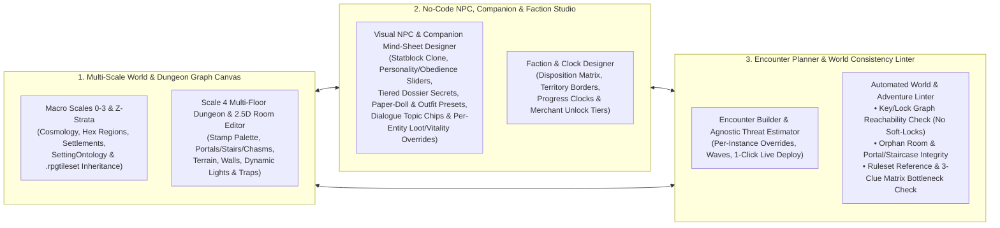
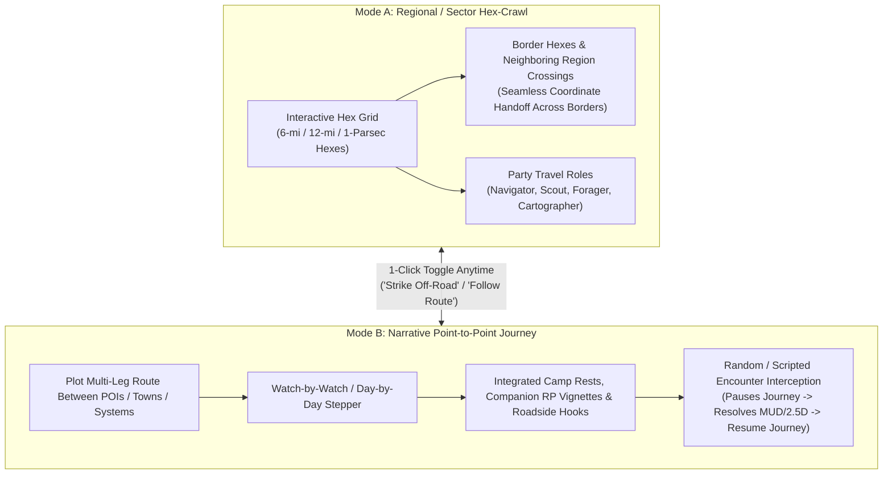
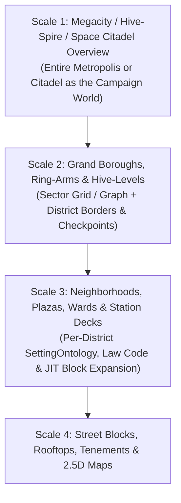

# Meddah Technical Specification — Volume 3: Living World, Multi-Scale Cosmology, Overworld Travel, Law/Capture, Megacities, Geopolitics & Dynamic Events (§1.5, §1.11, §1.20–§1.24)

> [!TIP]
> **Modular Technical Specification Navigation**:
> - **Master Index, Module Registry (§1.0), 14-Phase Roadmap (§2) & 77 Design Resolutions (§2.1)**: [technical_specification_and_plan.md](./technical_specification_and_plan.md)
> - **High-Level Architecture, 4 Golden Rules & 50 Locked Decisions**: [system_design_specification.md](./system_design_specification.md)
> - **Vol 1 — Core Ruleset VM, Layered Inventory & Ingestion (§1.0–§1.2)**: [tech_spec_01_core_vm_and_ingestion.md](./tech_spec_01_core_vm_and_ingestion.md)
> - **Vol 2 — AI/Deterministic GM, Companions, Quests & Retinue (§1.3–§1.4, §1.12, §1.19)**: [tech_spec_02_agents_companions_and_quests.md](./tech_spec_02_agents_companions_and_quests.md)
> - **Vol 3 — World, Cosmology, Travel, Law/Capture, Megacities & Geopolitics (§1.5, §1.11, §1.20–§1.24)**: [tech_spec_03_world_cosmology_and_society.md](./tech_spec_03_world_cosmology_and_society.md)
> - **Vol 4 — Multiplayer, West Marches/Guild Server, MUD/VTT UI, Audio/VFX, Safety & Maps (§1.6–§1.10, §1.18, §1.25–§1.26)**: [tech_spec_04_multiplayer_ui_and_vtt.md](./tech_spec_04_multiplayer_ui_and_vtt.md)
> - **Vol 5 — Downtime, Crafting/Survival, Puzzles/Traps, Loot, Piety, Chases, Competitions & Hit Locations (§1.13–§1.17, §1.27–§1.29)**: [tech_spec_05_gameplay_systems_and_anatomy.md](./tech_spec_05_gameplay_systems_and_anatomy.md)

---

### 1.5 Living World Simulation, Multi-Strata Z-Levels, Scale Shifting & Campaign Timelines (`backend/app/world_gen/` & `storage/`)
1. **Faction Clocks & Instant Deterministic-First Lazy/JIT World Expansion (`procedural_jit_expander.py`)**:
   - Worlds define **World/Faction Progress Clocks** (e.g., *"The Crimson Cult Ritual: 3/6"*). When time advances (rests, travel ticks, or scene transitions), active world clocks evaluate their advancement rules and emit world events.
   - Unexplored map nodes can be created as **Seed Stubs** (name, biome tag, 1-sentence hook).
   - **Instant `<5ms` Deterministic-First Expansion + Optional Async `Tier B` Polish**: When any party member moves into an unexpanded stub node, the engine **ALWAYS** expands the room's exits, tactical layout, props, hazards, NPCs, and template sensory description in `<5ms` using the **Seeded Deterministic Procedural Expander (`procedural_jit_expander.py`)** (Binary Space Partitioning / cellular-automata / room-graph layouts, `.rpgtileset` Wang auto-tiling, and `SettingOntologyBlock` tables) into the **Campaign Overlay**—so room navigation and map rendering **never** stall waiting for an LLM! If `Tier B` / `Tier C` AI is active, an optional non-blocking async atmospheric prose pass streams in afterward (or triggers on 1-click `[Enrich with AI]`), with a `[Bake to Base World Template]` button for the GM.
2. **Event-Sourced Checkpoints & "What-If" Timeline Branching**:
   - Campaign state is stored as an **Append-Only Event Log (`campaign_events`)** paired with periodic state snapshots (`campaign_checkpoints`).
   - At any point, the Host/GM can open the **Timeline Scrubber** to:
     - **Undo / Rewind** the last $N$ turns or rolls,
     - **Fork Timeline** from any historical checkpoint into a new parallel branch (e.g., *"Branch B: What if we Negotiated with the Dragon?"*) while preserving the original timeline intact.
2.5. **Handouts, Shared/Private Journals & Discovery-Gated Lore Codex (`backend/app/storage/handout_store.py` & `desktop/src/components/handouts_codex/`)**:
   - **Rich Multi-Format Handouts (`HandoutBlock`)**: GMs, adventure modules, and declarative Custom MUD Commands (`§1.7.4.G`) can store and reveal structured handouts in `handout_store.py`:
     - *Supported Types*: **Formatted Letters/Documents** (supporting inline `LanguageBlock` script/cipher gating so only fluent readers see the decoded text while non-speakers see the ciphered script), **Images & Treasure Maps** (with optional pin markers), **Audio Recordings / Holotapes** (routed through the 4-bus audio player), and **Structured Clues** (linked directly to the **3-Clue Mystery Matrix** in §1.12).
     - *Per-Seat Visibility & Live Reveal*: Every handout carries `visible_to_seats: "gm_only" | "all_party" | list[seat_id]` enforced server-side. GMs can click **`[Reveal to Party]`** or **`[Whisper Handout to @Player]`** to trigger a non-blocking toast/modal preview on authorized clients and file it permanently in their **Handouts Drawer**.
   - **Three-Tier Campaign Notes & Journals**:
     - **Private Player Scratchpad** (visible only to that player seat), **Shared Party Journal** (collaborative Markdown notebook editable by all party seats with clickable `@entity`, `@location`, and `@handout` backlinks), and **GM-Only Prep Notes** (strictly filtered out of guest/spectator state snapshots).
   - **Discovery-Gated Lore Codex & Bestiary Knowledge (`LoreCodexStore`)**:
     - Automatically builds a searchable, fog-of-war **Campaign Codex** (`NPCs`, `Locations`, `Factions`, `Bestiary / Threats`, `Artifacts`) as the party actually encounters, inspects, or researches them in play—never spoiling unread world-template secrets or unrevealed monster statblocks.
     - *Progressive Bestiary Unlocks*: Defeating, observing, or passing a ruleset-defined *Knowledge / Appraisal / Scan* check against a creature archetype unlocks specific observed traits (e.g., discovered resistances, vulnerabilities, or signature capabilities) in the party's Bestiary Codex entry while keeping undiscovered traits masked as `???`.

3. **Ruleset-Driven Cosmology, Z-Strata, Dimensional Phases & Traversal Building Blocks (`world_topology.py`)**:
   - **Zero-Assumption Topology Rule**: The engine **never** assumes that a game has a Scale-0 Star Sector, Planar Wheel, Underdark, Orbit, Cyberspace, or even multiple Z-Strata unless those **Topology Building Blocks** are present in the active `.rpgrules` schema!
     - If a ruleset only defines a single surface world scale (`Region -> Settlement -> Room`), then the Scale-0, Z-Strata, and Dimension Phase UI switchers stay completely hidden and unassumed.
     - In the **Visual Ruleset Studio**, users can freely add, remove, or customize modular **Topology & Traversal Building Blocks** (`ScaleBlock`, `ZStratumBlock`, `DimensionPhaseBlock`, `TraversalModeBlock`, `EnvironmentRuleBlock`)—or let the **Ruleset Ingestor (Probe #6)** automatically extract them from a rulebook or setting guide!
   - When enabled by the active ruleset's building blocks, the **Macro World, Region, and Settlement Exploration Maps** operate as a **3D Multi-Strata & Multi-Scale Directed Graph**:

   ```mermaid
   flowchart TD
       subgraph Scales["Seamless Multi-Scale Zoom Hierarchy"]
           S0["Scale 0: Cosmos / Star Sector / Planar Wheel\n(Hyperspace Lanes, Astral Realms, Star Systems)"]
           S1["Scale 1: World / Planetary / Continental\n(Oceans, Continents, Orbital Rings)"]
           S2["Scale 2: Regional Map\n(Biomes, Roads, Rivers, Sea Routes, POIs)"]
           S3["Scale 3: Settlement / Mega-Structure\n(City Districts, Space Station Decks, Dungeon Complex)"]
           S4["Scale 4: Local MUD Room Graph & 2.5D Tactical Grid"]
           S0 <--> S1 <--> S2 <--> S3 <--> S4
       end

       subgraph Strata["Vertical & Dimensional Z-Strata (At Any Map Scale)"]
           Z_Orbit["Z +2: High Orbit / Star System Space (Stations, Capital Ships)"]
           Z_Sky["Z +1: Atmospheric / Sky Layer (Floating Islands, Moving Airships)"]
           Z_Surf["Z 0: Surface Overworld (Land, Rivers, Coastal Ports, Ocean Surface)"]
           Z_Sub1["Z -1: Shallow Subterranean / Shallow Sea (City Sewers, Catacombs, Coral Reefs)"]
           Z_Sub2["Z -2: Deep Underdark / Abyssal Ocean Floor (Underdark Cities, Sunken Shipwrecks, Aquatic Civilizations)"]
           Z_Plane["Dimension / Plane Overlay: Feywild, Shadowfell, Warp/Hyperspace, Cyberspace"]
           Z_Orbit <--> Z_Sky <--> Z_Surf <--> Z_Sub1 <--> Z_Sub2
           Z_Surf <-->|"Planar Portal / Jump Drive"| Z_Plane
       end
   ```

   - **Stacked Z-Strata at World, Region & Settlement Scales**:
     - Every map scale (World, Region, or Settlement) supports arbitrary **Named Z-Strata (`z_stratum`)** and **Dimensional Overlays (`dimension_id`)**.
     - *Examples*:
       - A **City Settlement** can have `Z+1: Sky-Dock & Hovering Airship`, `Z0: Surface Street Districts`, `Z-1: The Undercity Sewers & Smuggler Tunnels`, and `Z-2: Ancient Catacombs & Mind-Flayer Caverns`—aligned to the same $(X, Y)$ footprint so you can toggle or ghost-overlay strata with the **Map Strata Switcher**!
       - A **Maritime Region** can have `Z0: Stormy Ocean Surface (Shipping Lanes)`, `Z-1: Sunken Galleon Reef`, and `Z-2: Abyssal Trench & Merfolk Citadel`.
   - **Mobile Vessel Nodes (Airships, Naval Ships, Spelljammers, Starships)**:
     - A settlement, base, or dungeon node can be flagged as a **`mobile_vessel: true`** entity (e.g., an *Airship floating at `Z+1` above a city*, a *Pirate Brigantine on `Z0` ocean*, or a *Frigate in `Z+2` High Orbit*).
     - The vessel itself contains an internal sub-graph of MUD Rooms and Tactical Maps (Bridge, Engine Room, Cargo Hold), while its external node moves across the World/Region/Sector graph!
   - **Precondition-Gated Traversal Edges (`TraversalRequirement`)**:
     - Every exit or travel route connecting two nodes, scales, or Z-strata can define deterministic **Ruleset Preconditions & Travel Modes** required to traverse it:

     | Route / Z-Transition Example | Traversal Edge Precondition (`traversal_rule`) | How the Engine Enforces It |
     | :--- | :--- | :--- |
     | **Crossing a River, Lake, or Ocean** | `requires_tag: ["boat", "ferry_ticket", "aquatic_mount", "swim_check"]` or `requires_vessel_class: "seafaring"` | Blocks bare-foot movement across deep water unless the party charters a ferry, owns/boards a naval vessel, casts *Water Walk*, or passes swimming/survival checks. |
     | **Reaching a Floating Airship or Sky Citadel (`Z0 -> Z+1`)** | `requires_any: ["docked_sky_tower", "vehicle:airship", "capability:flight", "spell:teleport"]` | If the airship is hovering un-docked above a town, ground-bound characters can see it overhead (`look up`) but cannot board without flight, a sky-skiff, or grappling hook. |
     | **Descending to Abyssal Ocean Floor (`Z0 -> Z-2`)** | `requires_any: ["submersible", "capability:water_breathing"]` + `environment_tag: "high_pressure_underwater"` | Validates both the transit method AND triggers continuous **Environmental Sustenance Checks** (water breathing, diving suit integrity, pressure resistance) via Ruleset `ECA` hooks while in that stratum. |
     | **Surface to Orbit (`Z0 -> Z+2`) & Interstellar Void (`Scale 1 -> Scale 0`)** | `requires_vessel_capability: "orbital_thrusters"` (for Orbit) and `requires_vessel_capability: "hyperspace_drive"` + `fuel_cost` (for Hyperspace Lanes) | Walking/ground vehicles cannot enter orbital nodes; an orbital shuttle can reach the orbital station, while jumping across empty parsec lanes requires a hyperdrive-equipped starship and nav-computer check. |
     | **Traversing Between Planes / Dimensions** | `requires_any: ["interactable:active_planar_portal", "capability:plane_shift", "item:tuning_fork"]` | Shifts the party's active `dimension_id` to the target Plane (e.g., *Astral Sea, Shadow Plane, The Warp*), swapping visual/audio themes and applying any planar traits defined by the ruleset. |

   - **Seamless UI Scale & Strata Shifting**:
     - The VTT Map Header features a **Breadcrumb Scale Bar** (`Sector: Helios -> Planet: Ur -> Region: Ash Coast -> City: Port Vane -> Room: Dockside Tavern`) and a **Vertical Z-Strata / Plane Selector** on the right edge of the canvas.
     - Clicking any breadcrumb or Z-layer smoothly zooms or slices the map view, showing vertical connector shafts/portals (e.g., sewer grates, anchor chains, orbital elevators, hyperspace jump points, planar rifts) linking the layers together.

4. **Deep-Dive into Scale 0: Cosmic, Interstellar & Planar Cosmology Engine (`scale_zero_cosmology.py`)**:
   **Scale 0** is the highest macro-layer of the World Graph—the **"Meta-World / Cosmology Layer"** that holds multiple Worlds, Planets, Moons, Deep-Space Sectors, or Planes of Existence together inside a single campaign template. Because the engine is ruleset- and genre-agnostic, a World Template can configure Scale 0 using one of **4 Cosmology Topologies** (or a hybrid):

   | Scale 0 Topology | Genre Examples | What Nodes Represent | What Edges / Routes Represent |
   | :--- | :--- | :--- | :--- |
   | **1. Astrometric Star Sector / Galaxy** | *Traveller, Starfinder, Warhammer 40k, Mothership, Hard Sci-Fi* | Star Systems, Binary Stars, Nebulae, Black Holes, Deep-Space Listening Posts, Dyson Spheres, Derelict Hulks. | **Hyperspace / Jump Lanes** (graded by stability/distance), **Sub-Light Corridors**, **Wormholes**, or **Warp Routes**. |
   | **2. Planar Cosmology / Great Wheel / World Tree** | *D&D Planescape, Spelljammer, Pathfinder, Mythic Fantasy* | Material Worlds, Inner/Elemental Planes, Outer Alignment Realms, Astral Citadels, Dead Gods floating in the Astral Sea. | **Planar Portals**, **Color Pools**, **Yggdrasil World-Roots**, **River Styx Branches**, or **Wildspace / Phlogiston Currents**. |
   | **3. Coterminous / Mirror Dimension Stack** | *World of Darkness (Umbra), Stranger Things, Cyberpunk (Realspace + Deep Net)* | Parallel versions of the *same* geography (`Prime Material` $\leftrightarrow$ `Shadowfell / Feywild` $\leftrightarrow$ `Ethereal` $\leftrightarrow$ `Deep Cyberspace Grid`). | **Thin Places / Veil Tears**, **Shadow Crossings**, **Astral Projection Tethers**, or **Neural Jack-In Terminals**. |
   | **4. Single-World Terrestrial (Scale 0 Hidden/Optional)** | *Grounded Historical, Classic Low-Fantasy, Single-City Noir* | A single planet/world node (plus optional Moons/Sky-Realms if unlocked later). | Scale 0 stays tucked away unless the campaign introduces planar/cosmic travel! |

   - **Internal Structure of a Star System or Planar Realm at Scale 0 $\rightarrow$ Scale 1**:
     - Clicking into a **Star System Node** at Scale 0 reveals its **System Orbital Map**:
       - The primary Star(s), Inner Rocky Worlds, Habitable Worlds (each of which is a full **Scale 1 Planetary Map** with its own continents, oceans, and Z-strata!), Gas Giants with Moon systems, Asteroid Belts (mining colonies/pirate bases), Lagrange-Point Space Stations, and the **System Jump Limit / Mandeville Point** (where ships must travel to before engaging a Hyperspace Drive).
     - Clicking into a **Planar Node** at Scale 0 reveals that Plane's **Realm Map**—along with its **Planar / Environmental Traits** (e.g., *Subjective Gravity*, *Timeless*, *Fire-Dominant*, *Wild Magic*, *Warp Corruption*, or *Zero-G Vacuum*) which automatically bind to Ruleset VM `ECA` hooks while the party is there.
   - **How the 3 Spatial Axes Work Together (`Scale` vs. `Z-Stratum` vs. `Dimension`)**:
     To ensure there is zero confusion or overlap between "Parallel Planes at Scale 0" and "Strata on a local map", every location in the engine is addressed by **3 orthogonal coordinates**: **`(Scale, Z-Stratum, Dimension_ID)`**:

     ```mermaid
     flowchart TD
         subgraph Cosmology["Scale 0: The Cosmology Registry (Defines All Dimensions & Star Systems)"]
             Prime["Dimension: Prime Material\n(Star Systems & Planets)"]
             Coterm["Coterminous Mirror Dimensions\n(Shadowfell, Feywild, Ethereal, Cyberspace)\n[Locked 1:1 to a Host Planet's X,Y]"]
             Indep["Independent Outer / Elemental Planes\n(Astral Sea, Hell, Plane of Fire)\n[Have Their Own Separate Geography]"]
             Transit["Transit Medium Dimensions\n(Hyperspace, The Warp, Slipstream)\n[Compressed Travel Corridors]"]
         end

         subgraph LocalMap["How They Manifest on Scales 1 - 4 (Planet -> Region -> City -> Room)"]
             AxisZ["Physical Z-Strata (Altitude / Depth)\nZ+2 Orbit | Z+1 Sky | Z0 Surface | Z-1 Sewers | Z-2 Underdark"]
             AxisDim["Active Dimension Phase Switcher (Same X,Y,Z Footprint!)\nSwitch Phase: [Prime] <-> [Shadow Mirror] <-> [Ethereal] <-> [Cyberspace]"]
         end

         Prime --> AxisZ
         Coterm -->|"Overlays 1:1 on Host Planet"| AxisDim
         Indep -->|"Entered via Portal at Any Scale"| OwnGeo["Loads That Plane's Own Scale 1-4 Map & Z-Strata"]
         Transit -->|"Entered via Jump Drive / Gate"| Corridor["Fast-Travel Corridor Connecting Distant Scale 0/1 Nodes"]
     ```

     1. **Axis 1 — `Scale (0 to 4)` (Zoom Level)**: Controls *granularity* (`0: Cosmos/Multiverse` $\leftrightarrow$ `1: Planet/Realm` $\leftrightarrow$ `2: Region` $\leftrightarrow$ `3: Settlement` $\leftrightarrow$ `4: Room/Tactical Grid`).
     2. **Axis 2 — `Z-Stratum` (Physical Altitude / Depth)**: Strictly represents **physical vertical elevation** within the *current* world/plane (`Z+2: Orbit`, `Z+1: Sky`, `Z0: Surface`, `Z-1: Shallow Underground/Sea`, `Z-2: Deep Underdark/Abyss`).
     3. **Axis 3 — `Dimension_ID` (Planar / Reality Phase)**: Registered at **Scale 0**, every Dimension/Plane has a `coupling_mode` that determines how it interacts with physical maps at Scales 1–4:
        - **Mode A — `Independent Plane` (Separate Geography)**:
          - *Examples*: *The Nine Hells, The Elemental Plane of Fire, a distant Star System*.
          - *How it works*: It lives as a separate node on the **Scale 0 Cosmology Map**. It does **not** overlay onto the Prime planet's city map. When the party steps through a planar gate into the Nine Hells, the map loads the Nine Hells' *own* Scale 1–4 geography and its *own* physical `Z-Strata` (e.g., `Z+1: Iron Sky`, `Z0: Stygian Wastes`, `Z-1: Blood Caverns`).
        - **Mode B — `Coterminous Mirror Dimension` (1:1 Coordinate-Locked Phase)**:
          - *Examples*: *Shadowfell, Feywild, The Umbra, Ethereal Border, Augmented/Cyberspace Matrix*.
          - *How it works*: Defined at Scale 0 as `coterminous_with: "planet_ur"`, it acts as a **Phase Overlay** across Scales 1–4 of that planet!
          - Because it shares the exact same $(X, Y, Z)$ coordinate grid as the Prime world, when you are viewing **Port Vane (Scale 3)** at **Surface (`Z0`)**, the UI's **Dimension Phase Switcher** lets you toggle between `[Phase: Prime Material]` and `[Phase: Shadowfell]`.
          - Each node in the Prime world can either **auto-project** into the Mirror Dimension (with an atmospheric style/description modifier, e.g., the bustling tavern appears as a decaying haunted ruin in the Shadowfell) **or** have explicit Mirror-only rooms/exits (e.g., a broken bridge in the Prime world is intact in the Ethereal plane, allowing the party to phase into the Ethereal, walk across the bridge at `(X, Y, Z0)`, and phase back!).
          - **Split-Phase Party Support**: Because each character tracks both `z_stratum` and `dimension_id`, a Netrunner jacked into `dimension: cyberspace` or a Wizard using *Etherealness* (`dimension: ethereal`) can stand in the exact same room `(X, Y, Z0)` as the rest of the party—seeing ghosted outlines of the Prime room while interacting with Ethereal ghosts or IC firewalls that the Prime party members cannot see!
        - **Mode C — `Transit Medium / Hyperspace` (Compressed Corridor Dimension)**:
          - *Examples*: *Sci-Fi Hyperspace / Subspace, Warhammer 40k Warp, Astral Conduit*.
          - *How it works*: Bridges Scale 0/1 distances. When a starship engages its Hyperdrive at a planet's orbital jump point (`Scale 1, Z+2, Dimension: Prime`), the vessel shifts into `Dimension: Hyperspace`. On the **Scale 0 Map**, the ship moves along the compressed Hyperspace Lane between Star Systems while inside the ship (`Scale 4`), the crew can walk around the decks and handle mid-jump Warp/Hyperspace events until the ship drops back into `Dimension: Prime` at the destination star system!

5. **Unified Party Holdings Engine: Strongholds, Secret Lairs, Space Stations & Large Vessels (`holdings_and_vessels.py`)**:
   **Yes!** In fact, **Stationary Bases** (*Strongholds, Keeps, Secret Underground Lairs, Thieves' Guild Hideouts, Wizard Towers, Cyberpunk Safe-Houses, Orbital Space Stations*) and **Mobile Vessels** (*Airships, Galleons, Starships, Walking Cities*) are two sides of the **exact same architectural coin** in our engine:
   - Both are **Party-Owned Holdings (`HoldingEntity`)** that pair a **Ruleset-Defined Entity Sheet** with a **Persistent Interior Location Sub-Graph** (`Scale 3/4` rooms and 2.5D tactical maps).
   - The only difference is a single property: a **Stronghold / Lair / Space Station** is anchored to a fixed `(Scale, X, Y, Z-Stratum, Dimension_ID)` coordinate (e.g., *Keep on the Surface `Z0`, Secret Lair in the City Sewers `Z-1`, Asteroid Base in `Scale 0`, or Sanctum in a Demiplane*), whereas a **Vessel** has `locomotion_mode: "mobile"`!
   - Even better, this unified model naturally supports **Hybrid Mobile Strongholds** (like a *Flying Castle*, a *Walking Steampunk City*, or a *Mobile Carrier Space Station*) simply by toggling `locomotion_mode: "mobile"` on a Stronghold!

   #### A. 100% Ruleset-Defined Stronghold & Vessel Mechanics (Zero Assumptions)
   The engine makes **zero** built-in assumptions about what stats a stronghold or vessel has:
   - **How the Universal Building Blocks Model Any Holding or Vessel**:
     In the Universal Ruleset Schema, a base or ship uses the **`HoldingArchetype`** and **`FacilityBlock`** building blocks:
     - **Stronghold / Bastion Rulesets** (e.g., *D&D Bastions / Strongholds & Followers, Pathfinder Kingmaker, Forbidden Lands, Ars Magica Covenants*): The ruleset defines holding properties like `Fortification / Defense Rating`, `Garrison Size`, `Treasury`, `Influence`, `Morale`, and `Upkeep Cost`.
     - **Secret Lair / Criminal Turf Rulesets** (e.g., *Blades in the Dark Lairs, Cyberpunk Safe-Houses, World of Darkness Havens, Superhero HQ*): The ruleset defines properties like `Secrecy / Concealment`, `Heat / Wanted Tracker`, `Security Systems`, `Surveillance Grid`, and `Ward Rating`.
     - **Space Station / Outpost Rulesets** (e.g., *Traveller, Starfinder, Mothership, Coriolis*): The ruleset defines `Life Support Capacity`, `Power Grid Output`, `Docking Bays`, `Point-Defense Turrets`, and `Hull Integrity`.
     - **Rulesets With Zero Base-Building Mechanics**: If an ingested ruleset has no mechanical base stats at all, a Keep, Lair, or Station still works out of the box as a **Persistent Narrative Home Base** with customizable rooms, item storage vaults, trophy halls, and a safe resting hub!
   - **Ingestion Discovery**: During PDF ingestion, **Probe #6** actively searches the rulebook for *stronghold, bastion, base-building, hideout, haven, domain management, garrison, upkeep, and vehicle/ship rules*, compiling them into modular `HoldingArchetype` and `FacilityBlock` building blocks (which can also be added or edited manually in the **Ruleset Studio**).

   #### B. Modular Facility Rooms & Construction / Upgrade Projects
   Every room inside a Stronghold, Secret Lair, Space Station, or Large Vessel can be upgraded or designated as a **Functional Facility (`FacilityBlock`)**:
   - **Examples of Ruleset-Defined Facilities**:
     - *Fantasy Keep / Wizard Tower*: **Smithy / Forge**, **Alchemical Lab**, **Arcane Sanctum / Teleportation Circle**, **Library / Lore Archive**, **Barracks / Watchtower**, **Dungeon / Prisoner Cells**, **Tavern / War Room**.
     - *Secret Lair / Safe-House*: **Hidden Smuggling Dock**, **Disguise & Forgery Workshop**, **Encrypted Comms Hub**, **Escape Tunnel**, **Vault**.
     - *Space Station / Starship*: **Medbay / Cryo-Pods**, **Hydroponics Bay**, **Shuttle Hangar**, **Sensor Array**, **Brig**, **Reactor Core**, **Torpedo Tubes**.
   - **How Facilities Interact with the Engine (`ECA` & Downtime Hooks)**:
     1. **Crafting & Action Preconditions**: A ruleset action like *Forge Masterwork Blade* or *Synthesize Stim-Pack* can check `@room.has_facility("forge")` or `@room.has_facility("medbay")`, granting the facility's tier bonus (`+2` or extra dice) to the player's roll!
     2. **Construction & Expansion Clocks**: Adding a new room or upgrading a facility (e.g., *"Upgrade Ruined Watchtower $\rightarrow$ Fortified Keep"*, or *"Excavate Level 2 of Secret Underground Lair"*) creates a **Construction Project** that consumes ruleset resources/currency and fills a **Progress Clock** over downtime ticks—visually adding or updating the room on the base's Node-Graph and 2.5D Tactical Map when completed!
     3. **Periodic Upkeep & Production (`on_downtime_tick`)**: Facilities can automatically generate resources (income, rations, potions, rumors/intel) or require upkeep payments on rest/calendar intervals as defined by the ruleset.

   #### C. How the Party Acquires a Stronghold, Lair, Space Station, or Vessel (6 Paths)
   | Acquisition Path | Stationary Stronghold / Lair / Station Examples | Mobile Vessel Examples |
   | :--- | :--- | :--- |
   | **1. Starting Asset / Patron Grant** | Starting with a *Hidden Underground Haven*, *Guild Basement*, or *Frontier Outpost* during campaign setup. | Starting with a mortgaged *Tramp Freighter* or *Pirate Sloop*. |
   | **2. Purchase, Lease, or Construction** | Buying a building in a city, leasing an asteroid bay, or paying engineers to construct a Keep on an empty World Map hex/node. | Buying or commissioning a ship at a Shipyard / Spaceport. |
   | **3. Quest Reward / Title / Noble Land Grant** | A grateful monarch grants the party a *Barony & Border Keep*, or a crime boss deeds them a *Safe-House*. | Awarded a *Sky-Frigate* or *Starship* for completing a major arc. |
   | **4. Conquest / Clearing & Claiming ("Clear the Dungeon, Keep the Castle")** | If the party clears a *Bandit Keep*, *Abandoned Wizard Tower*, *Underdark Outpost*, or *Pirate Space Station*, they can click **`[Claim Location as Party Stronghold]`**—converting that exact dungeon/POI into their persistent home base! | Boarding an enemy Galleon or Starship and claiming it as a prize. |
   | **5. Derelict Discovery & Restoration** | Discovering a ruined ancient fortress, flooded bunker, or powered-down orbital station and repairing its breached walls/reactors over time. | Repairing a crashed airship, sunken vessel, or dormant walking city. |
   | **6. Charter / Shared Faction HQ** | Renting a wing inside an allied Faction's citadel or station before owning one outright. | Booking passage on an NPC-captained vessel. |

   #### D. Staffing, Idle AI Companions, Crew Stations & Base Siege Defense
   - **The "Home Base Roster" for Extra AI Companions & Hired Staff**:
     - What happens when the player recruits more AI Companions than they want to bring into a single dungeon (e.g., you have 7 companions recruited, and bring 3 on an adventure)?
     - Idle AI Companions stay at the party's **Stronghold, Lair, Space Station, or Ship**!
     - You can assign idle AI Companions (and hired NPC specialists like a *Castellan, Quartermaster, Blacksmith, Spymaster, or Station Chief*) to specific **Facilities or Stations**:
       - While you are away adventuring, companions stationed at the base run downtime projects, gather rumors, craft items, guard prisoners in the brig, or repair the hull/walls using their character sheet skills!
       - Returning to your Keep, Lair, or Ship lets you walk from room to room (`Scale 4`), find your companions hanging out in the Tavern/Mess Hall/Lab, and trigger camp/home-base RP scenes.
   - **Crew Stations & Defense Emplacements (`@operator + @holding`)**:
     - Just like a starship's *Helm* and *Turrets*, a Keep or Space Station can have interactive **Defense Stations** (*Ballista Tower, Gatehouse Murder-Holes, Ward Control Crystal, Orbital Point-Defense Grid, Security Camera Room*) where `@operator` skills combine with `@holding` stats.
   - **Base Raids, Infiltrations & Siege Defense**:
     - If a Faction Threat Clock fills up (or the party's Secret Lair `Heat / Exposure` maxes out), an enemy faction can launch a **Raid, Infiltration, or Siege** against the party's Stronghold, Lair, or Station!

   #### E. Deep-Dive: Base Raids, Infiltrations & Sieges (`holding_defense.py`)

   ```mermaid
   flowchart TD
       subgraph Triggers["1. How & When Base Threats Trigger (3 Paths)"]
           Det["A. Deterministic Ruleset / Clock Trigger\n(Heat/Exposure Track Full, Faction War Clock = 6/6,\nor Ruleset Bastion Event Roll on Downtime Tick)"]
           Narr["B. Narrative / Emergent RP Consequence\n(Taunting a Villain, Stealing a Relic, Leaving a Trail,\nor a Defected Ex-Companion Leading Enemies to the Lair!)"]
           Manual["C. Human GM / Solo Director Manual Trigger\n(Pre-Staged Siege Quest or One-Click Encounter Deploy)"]
       end

       subgraph CheckRules{"2. How Does the Active Ruleset Define Base Defense?"}
           MacroRules["Ruleset Has Abstract Siege / Domain / Raid Rules\n(e.g. Garrison vs. Attack Force Roll, Bastion Defense Dice)"]
           TacticalRules["Ruleset Uses Standard Character/Vehicle Tactical Combat\n(2.5D Tactical Map of the Base + Emplacements/Traps)"]
           HybridRules["Two-Phase Hybrid (Macro Outer Siege -> Breach Encounter)"]
       end

       Triggers --> Warn["Early Warning / Scout / Sensor Check\n(Determines Prep Time vs. Surprise Infiltration)"]
       Warn --> CheckRules
       CheckRules --> MacroRules
       CheckRules --> TacticalRules
       CheckRules --> HybridRules
   ```

   ##### 1. When Do Raids, Infiltrations, or Sieges Occur? (Both Deterministic AND Narrative!)
   A base attack is **never** random annoying spam; it only occurs through **three meaningful, transparent trigger channels**:
   - **Channel A — Deterministic Ruleset & Clock Triggers (`ECA` Hooks)**:
     - **Ruleset Downtime / Bastion Tables**: If the active ruleset explicitly defines periodic stronghold/lair event rolls (e.g., *"Roll on the Bastion Event Table each downtime turn"* or *"When Crew `Heat >= 9` and `Wanted Level >= 3`, trigger an Entanglement/Raid"*), the Ruleset VM evaluates that trigger deterministically on the downtime tick.
     - **Faction Threat & Retaliation Clocks**: If an enemy Faction has an active Progress Clock (e.g., *"Baron's Spy Network Locates Secret Lair: 4/4"* or *"Orc Warhost Marches on Border Keep: 6/6"*), filling the final segment deterministically triggers the Infiltration or Siege event!
   - **Channel B — Narrative & Emergent Story Consequences (Invoked by AI GM / Co-GM or Deterministic World Event Hooks)**:
     - Base threats can also be invoked **narratively** as a direct consequence of roleplay and player choices—and when AI is absent/unavailable, by **Deterministic World Consequence Event Hooks** (`on_witness_escaped_to_faction`, `on_boss_taunted`, `on_companion_defected_to_enemy`)!
     - *Examples*:
       - The party steals a powerful artifact and fails to cover their tracks (or leaves a surviving witness who saw their airship's crest).
       - The party openly challenges a crime lord or dragon in dialogue.
       - **The Defected Companion Twist**: Remember how an AI Companion who leaves with low `Trust` or mutinies retains all their memories? Because they *know* the exact location and secret passages of the party's Lair/Keep, if they join an Enemy Faction, they can deterministically or narratively lead a targeted strike team against the base!
     - *Safety & Pacing Guardrail*: In **Solo / Full AI GM Mode**, narrative base attacks respect a configurable **Base Threat Frequency Setting** (`Never / Safe Haven Only`, `Rare / Major Story Climaxes Only`, or `Dynamic Living World`). In **Human Co-GM Mode**, any AI-proposed raid appears first as a whisper suggestion for the Human GM to approve or veto.
   - **Channel C — Manual GM / Solo Director Trigger**:
     - The Human GM or Solo Player can manually design, schedule, or trigger a Siege, Heist Defense, or Boarding Action at any time from the **Encounter Builder**.

   ##### 2. Early Warning, Scouting & Preparation Window
   Before enemies ever reach the gates or airlocks, the engine checks the base's **Detection / Intelligence Capabilities** (defined by the ruleset or stationed companions):
   - **High Warning** (*Watchtowers, Spy Network, Long-Range Radar, Scrying Wards* succeed vs. Enemy Stealth): The party receives advance notice (*"Scouts report an Imperial strike force 2 days' march from the Keep"*). This opens a **Preparation Window** to recall the adventuring party (via messenger/comms/teleport), seal blast doors, arm traps, or rally allied factions!
   - **Failed Warning (Infiltration)**: Stealthy enemies (*Assassins, Shadow-Runners, Saboteurs*) bypass outer alarms, starting the encounter as a stealth **Infiltration** inside the base's perimeter.

   ##### 3. How Do Defenses Work? (100% Grounded in the Active Ruleset)
   In strict accordance with our **Zero-Assumption Golden Rule**, the engine never invents its own hardcoded "tower defense minigame." Instead, all base defenses map directly onto the **active ruleset's existing mechanics** across three layers:

   | Defense Layer | How It Maps to the Active Ruleset's Building Blocks | Examples Across Different RPG Systems |
   | :--- | :--- | :--- |
   | **1. Passive Structural Defenses (Map & Stat Modifiers)** | Maps directly to **2.5D Spatial Cover/Walls**, **Locked/Reinforced Portals**, and **Passive Modifier Auras** defined by the ruleset. | *Battlements & Arrow Slits* grant `@spatial.three_quarters_cover` and `@spatial.has_high_ground (+10ft)` on the tactical map; *Arcane Wards / Blast Doors* have ruleset `Hardness / HP` or `Lock/Hack Difficulty` checks required to breach. |
   | **2. Active Emplacements, Traps & Security Systems** | Modeled as standard **Ruleset Actions (`StationActions`)** and **Triggered `ECA` Hooks** placed in rooms/cells of the base. | *Ballistae, Boiling Oil Cauldrons, Automated Laser Turrets, Poison Gas Traps, Glyphs of Warding, Security IC*—each uses the active ruleset's exact attack/save/damage formulas! |
   | **3. Garrison NPCs & Stationed AI Companions** | Modeled as either **Individual Combatant Tokens** (using ruleset NPC stat blocks) or a **Garrison Resource Pool / Swarm Unit** if the ruleset uses abstract mass-combat rules. | Your stationed **AI Companions** and hired **Guards / Mercenaries / Droids** fight alongside you on the tactical grid (or roll their ruleset defense pool if resolved abstractly). |

   ##### 4. How the Siege or Raid Resolves (3 Ruleset-Selectable Modes)
   Depending on what the active `.rpgrules` schema defines (and how the player/GM wants to play it out), a base defense can resolve in one of three ways:
   1. **Mode 1 — Pure Ruleset Abstract / Domain Resolution (If Defined by Ruleset)**:
      - If the active ruleset has a dedicated abstract mechanic for strongholds (e.g., *Roll `Garrison Dice` vs. `Attacker Threat Rating`*, or a *Mass Battle Progress Clock*), the Ruleset VM executes that exact formula and applies the ruleset's outcome table (e.g., *Repelled Unscathed*, *Facility Damaged (Requires Repair)*, or *Treasury Plundered*).
   2. **Mode 2 — Full 2.5D Tactical Map Defense (Skirmish / Infiltration)**:
      - For smaller raids, infiltrations, or boarding actions, the encounter plays out turn-by-turn directly on the **party's actual 2.5D Tactical Map of their Stronghold/Lair/Station**—where players and stationed AI Companions use the walls, elevation ledges, traps, and turrets they built!
   3. **Mode 3 — Hybrid "Outer Siege $\rightarrow$ Spotlight Breach Encounter" (Best of Both Worlds)**:
      - If a massive army besieges a Keep or a fleet attacks a Space Station, the outer battle runs as a **Background Siege Clock** modified by the base's `Fortification` and `Garrison` stats, while zooming the camera into a **Spotlight Tactical Scene** for the party (e.g., *"Hold the Breached Gatehouse for 4 Rounds!"* or *"Defeat the Enemy Commander's Boarding Pod in the Hangar Bay!"*). Winning the spotlight scene turns the tide of the outer siege!
   - **What Happens If the Party Is Away When a Raid Starts?**
     - If the party is 50 miles away in a dungeon when their base is raided, they can either:
       - **Rush Back / Teleport** (if they have fast travel/magic/vehicles and enough Warning Time),
       - **Play Out the Defense as Their Stationed AI Companions!** (Temporarily controlling the companions and garrison left behind at the base!), **or**
       - **Auto-Resolve via the Ruleset's Garrison/Defense Formula** and discover the aftermath report when they return.

   #### F. Pilotable Vehicles, Mounts, Shuttles, Trains, Caravans & Setting Transit Ontology (`vehicles_and_mounts.py`)
   While **Section 1.5.5** covers large multi-room vessels (*Starships, Airships, Galleons*), the engine also natively supports **smaller pilotable vehicles, animal-drawn conveyances, coupled trains, multi-vehicle caravans, and short-range shuttles** across a **Multi-Tier Vehicle Spectrum (`VehicleArchetype`)**:

   | Vehicle Tier | `interior_mode` | Concrete Examples | Spatial & MUD Representation |
   | :--- | :--- | :--- | :--- |
   | **Tier 1: Personal & Open-Top Tactical Craft** | `token_mounted` | *Motorcycles, Speeder Bikes, Riding Horses/Mounts, Rowboats, Canoes, Jetpacks, Power Exosuits* | Composite `1x1` to `2x3` VTT token inside standard `Scale 4` rooms & tactical maps; exposes `Driver/Pilot`, `Pillion/Passenger`, and `Gunner` seat slots directly on the grid. |
   | **Tier 2: Cabin Vehicles, Draft Wagons & Shuttles** | `cabin_or_token` | *Wagons, Stagecoaches, Sports Cars, Vans, Hover Cars, Hot Air Balloons, Submersible Pods, Orbital Shuttles / Dropships* | **Dual Mode**: On a 2.5D tactical map, renders as an interactive `2x3` to `3x5` vehicle footprint (seats, doors, windows, roof boarding, trunk inventory, hitched **Draft Animals**). In the MUD or overland travel, exposes a **1-Room Cabin Interior** for mid-trip RP & cargo access, plus **Parent $\leftrightarrow$ Child Docking**. |
   | **Tier 2.5: Caravans & Multi-Vehicle Convoys** | `multi_vehicle_convoy` | *Merchant Wagon Trains, Desert Camel Caravans, Post-Apocalyptic War-Rig Convoys, Armored Motorcades* | **Composite Linked Formation**: Coordinates a group of multiple Tier-1/Tier-2 wagons/vehicles, draft beasts, and outriders along one shared route. Acts as a **Mobile Camp / Micro-Settlement** during rest/travel and deploys on the 2.5D grid in **Road Column** or defensive **"Circle the Wagons" Laager** formation. |
   | **Tier 3A: Coupled Trains & Rail Consists** | `linked_consist` | *Steam Locomotives, Armored War-Trains, Mag-Lev Bullet Trains, Eberron Lightning Rails, Subterranean Mine-Carts* | **Linear Doubly-Linked Chain of Modular Car Nodes** (`[Locomotive] <-> [Tender] <-> [Coach] <-> [Dining Car] <-> [Armored Vault Car] <-> [Caboose]`) locked to `rail_track` network edges; supports fore/aft vestibule walking in MUD, exterior roof traversal (`z_level: +10ft`), and live car uncoupling. |
   | **Tier 3B: Multi-Room Capital Vessels** | `multi_room_graph` | *Galleons, Sky-Frigates, Starships, Carrier Airships, Fleet Submarines* | Full multi-room `Scale 4` interior sub-graph + modular Facilities & Crew Stations (Section 1.5.5 A–E). |

   1. **Key Architectural Capabilities for Small Craft, Trains & Caravans**:
      - **Composite Seat Graph & Directional Cover**: Each Tier-1/Tier-2 vehicle defines named seats (`driver`, `shotgun`, `rear_bench_left`, `stagecoach_roof`, `balloon_gondola`), assigning passengers ruleset-grounded cover tags (`@spatial.half_cover`, `@spatial.three_quarters_cover`), firing arcs, and `dismount / hijack / board` interaction handles. Wagons and stagecoaches support `propulsion: "draft_entities"` so individual horses/oxen remain targetable or unhitchable tokens in combat.
      - **1-Room MUD Cabin & Cargo Trunk (`ContainerNode`)**: Entering a stagecoach, hover car, or orbital shuttle lets the party and AI Companions hold private conversations, access stowed gear in the trunk/saddlebags, and run `look window` to see scrolling terrain prose during overland or orbital travel.
      - **Trains (`linked_consist` & `locomotion_mode: "rail_network"`)**:
        - Each rail car is a persistent `Scale 4` room/2.5D map module linked via fore/aft vestibule exits and optional roof hatches (`z_level: +10ft`) so gunfights or stealth infiltrations flow seamlessly inside compartments and atop windswept train roofs.
        - **Live Car Uncoupling (`disconnect_coupling`)**: Uncoupling a pin or plasma latch splits the doubly-linked consist list—immediately decoupling the trailing cars so they coast off a **2.5D Scrolling Rail Conveyor** map or stop in the previous region node!
        - Trains navigate deterministic `rail_track` edges across World/Region/Underground maps (including scheduled timetables between stations or hijackable player control).
      - **Caravans & Convoys (`multi_vehicle_convoy`)**:
        - Tracks the lead scout, individual cargo wagons/trucks, pack animals, and flanking outriders as a unified party/NPC fleet without flattening them into one token.
        - During overland travel or camp rests, players can walk between convoy wagons to visit the quartermaster, guard prisoners, or hold campfire RP; when ambushed, the convoy auto-deploys into either an elongated **Marching Column** or a defensive **"Circle the Wagons" Laager** on the 2.5D tactical grid.
      - **Parent $\leftrightarrow$ Child Vessel Docking (`docked_in_holding_id`)**: Smaller craft natively nest inside larger Holdings or Vessels (*an Orbital Shuttle inside a Starship's Hangar Bay, a Rowboat hung from a Galleon's davits, or a Motorcycle/Sports Car parked in a Lair's Garage*). Launching detaches the child craft into its own independent `(Scale, Z-Stratum, Dimension_ID)` coordinate!
      - **Z-Stratum, Altitude & Terrain Traversal Unlocks**:
        - *Rowboats & Canoes*: Cross `Z0` rivers, swamps, and coastal waters, interacting with water currents and tides.
        - *Hot Air Balloons & Hover Cars*: Adjust 2.5D vertical altitude (`z_level: +0ft` to `+200ft`) in combat (e.g., sniper platform, high-ground loitering, drifting with `@weather.wind_speed`) AND transition across macro `Z0 Surface <-> Z+1 Sky`.
        - *Orbital Shuttles*: Bridge `Z0 Surface <-> Z+1 Atmosphere <-> Z+2 Orbit` to ferry characters between planet surfaces, moons, orbital stations, and capital ships.
   2. **100% Grounded in the Active Ruleset & Dual-Mode Chases / Moving Battles**:
      - **Zero Forced Vehicle Math**: The engine never invents hardcoded MPH, Armor Points, or Crash Tables if the active `.rpgrules` has no vehicle subsystem. When vehicle stats and piloting/driving skills exist in `.rpgrules` (*Cyberpunk, Call of Cthulhu, Shadowrun, Traveller, D&D Infernal War Machines, GURPS*), Probe #6 / Ruleset Studio binds those exact properties and skill actions (`Drive`, `Pilot`, `Boating`, `Animal Handling`). Otherwise, vehicles operate cleanly as ruleset-safe traversal unlocks, storage trunks, and spatial cover/elevation platforms.
      - **Two Supported Chase & Moving-Battle Modes**:
        - **Ruleset Abstract Chase Track**: If the ruleset resolves chases via abstract range bands or progress clocks, the UI renders a sleek Chase Track above the MUD log.
        - **2.5D "Scrolling Conveyor" Tactical Map**: For tactical vehicle fights (stagecoach/train robberies, cyberpunk highway chases, hover-car dogfights), terrain tiles scroll backward by relative speed each round while vehicles weave between spawning road/river/rail obstacles, trade gunfire, or perform leap-and-board maneuvers!
   3. **When Vehicles Aren't Defined in `.rpgrules`: Hierarchical Setting & Transit Ontology (`SettingOntologyBlock`)**:
      - Mechanics live in `.rpgrules`, **but genre, tech level, and transit identity live in the World Template (`SettingOntologyBlock`)**—which cascades hierarchically from **World Default $\rightarrow$ Region Override $\rightarrow$ Settlement / District / Stratum Override**:
        - **`era_and_genre_profile`**: e.g., `medieval_fantasy`, `gaslamp_steampunk`, `cyberpunk_megacity`, `hard_scifi`, `weird_west`.
        - **`transit_paradigm`**: Allowed propulsion & conveyance families for that locale (e.g., `["repulsor_hover", "maglev_rail", "orbital_shuttle", "cyber_bike"]` vs. `["animal_draft", "equestrian", "wind_sail"]`).
        - **`local_vehicle_catalog`**: Auto-generated by the World/Theme Builder during world creation (or imported/customized in World Studio) with thematic **Tier 1–3 Vehicle Archetype templates** (*hover-taxis, neon streetbikes, mag-lev trams* vs. *ox-carts, armored stagecoaches, steam trains*) including visual sprites, ambient sensory lines, and capacity.
        - **`forbidden_anachronisms`**: Explicit blocklist of out-of-era tags (e.g., `["horse_drawn_wagon", "wooden_cart", "medieval_galley"]` inside a cyberpunk megacity, or `["hover_car", "internal_combustion"]` inside a classic medieval kingdom).
      - **Two-Layer Anti-Anachronism Enforcement (Deterministic + AI GM)**:
        1. **Deterministic Spawners, Town Builder & Ambient Ticker**: Whenever the engine generates street traffic props, Tactical Grid cover obstacles (parked vehicles), caravan/ambush encounters, dealer/livery shop stock, or scheduled `ambient_ticker.py` city sounds/smells, it queries `node.get_effective_ontology().local_vehicle_catalog`. Thus, a cyberpunk downtown **deterministically spawns parked Hover Cars, AV landing pads, and Mag-Lev stations** while filtering out forbidden tags—**never** a horse-drawn wagon!
        2. **AI GM & JIT Room Expander Prompt Stamp**: Every Micro-Prompt Context Header injects a concise 1-line **`[Setting & Transit Stamp]`** (e.g., `[District: Neo-Veridia Upper Spire | Allowed Transit: Repulsor Hover-Cars, Streetbikes, Mag-Lev, Orbital Shuttles | Forbidden: Animal-Draft / Pre-Industrial Vehicles]`). This guarantees both the AI GM prose and JIT room expansions match the district—while allowing **deliberate mixed-tech worlds** to shine cleanly per region or Z-stratum (e.g., *Hover Cars* gleaming in the Upper Spire vs. *Rust-Truck Convoys* in the Badlands vs. *Pack-Lizard Caravans* in a Low-Tech Fringe Colony)!

6. **Chronology, Dynamic Weather, Seasons, Night-Sky Star Charts & Cyclical Phenomena (`celestial_weather_engine.py`)**:
   **Yes!** Every World Template (and planetary body at `Scale 1`) includes a configurable **Chronology, Meteorology & Astrometric Simulation Engine** that connects directly to the **Ruleset VM (`@weather`, `@season`, `@celestial`)**, the **2.5D Tactical Canvas**, the **AI GM's sensory descriptions**, and the **Audio Director**:

   ```mermaid
   flowchart LR
       subgraph Clock["World Chronology & Calendar"]
           Time["Time of Day\n(Dawn, Day, Dusk, Night)"]
           Season["Seasonal Cycle\n(Spring/Summer/Autumn/Winter\nor Custom World Seasons)"]
       end

       subgraph Sky["Celestial & Night-Sky Engine"]
           Moons["Multi-Moon Orbits & Phases\n(New, Crescent, Full, Blood Eclipse)"]
           Stars["Dynamic Star Chart & Constellations\n(Zodiac Ascendancy, Planetary Conjunctions, Comets)"]
       end

       subgraph Atmos["Dynamic Weather & Cyclical Events"]
           Weather["Biome-Aware Weather Fronts\n(Clear, Fog, Rain, Blizzard, Sandstorm, Mana/Ion Storm)"]
           Cycles["Cyclical World Events\n(Tides, Planar Alignments, Solar Flares, Migrations)"]
       end

       subgraph Impact["Deterministic Engine & VTT Impact"]
           VTT["2.5D Tactical Grid\n(Ambient Light, Vision Range, Wind/Rain Shaders, Terrain)"]
           VM["Ruleset VM Variables & ECA Hooks\n(@weather, @celestial.moon_phase, @season)"]
       end

       Clock --> Sky
       Clock --> Atmos
       Sky --> Impact
       Atmos --> Impact
   ```

   #### A. Custom World Calendars, Seasonal Cycles & Seasonal Prose Modulation
   - **Custom Calendar Schema**: A world can use a standard 365-day / 4-season calendar or define custom hours per day, days per week, named months, holidays/festivals, and custom seasons (e.g., *Spring / Summer / Autumn / Winter*, or setting-specific seasons like *The Monsoon*, *The Ash-Fall*, *The Long Night*, or *Orbital Perihelion*).
   - **Visible UI Element — Top-Bar Chronology Pill & Interactive World Calendar Modal (`desktop/src/components/calendar_modal/`)**:
     - The World Calendar is a **first-class visible UI element** (not just behind the scenes), presented in two tiers:
       1. **Persistent Top-Bar Chronology & Sky Pill**: Displays the current Date, Season badge, Time-of-Day / Sun-or-Moon icon, and active local Weather at a glance (e.g., `14th of Frost-Fall, Year 842 | Dusk | Cold Drizzle 🌧️ | 🌒 Waxing Crescent`), and can also be queried in the MUD terminal via `time`, `date`, `calendar`, or `weather`. (If a setting, planar layer, or GM intentionally obscures time—such as being trapped in a timeless plane or deep underground without a timepiece—the player pill can switch to subjective time like `"Time Unknown | Deep Subterranean"` while the engine still tracks exact ticks under the hood.)
          - **Themeable & `.rpgworld`-Configurable Diegetic Timepiece Widget (`TimepieceWidget.tsx`)**: Paired inside the Top-Bar Chronology Pill (and expandable cleanly), an animated SVG/Canvas timepiece reflects the exact in-game time across arbitrary custom day lengths (e.g., `10h` decimal days, `24h` days, or `36h` planetary rotations). The visual instrument inherits its skin by default from the active `.rpgtheme` (*Sundial / Celestial Orrery*, *Gothic Pocket Watch / Moon-Dial*, *Digital / Nixie Chronometer*, *Phosphor ASCII Clock*, or *Minimalist Time Ring*) and can be overridden per `.rpgworld` (`timepiece_style: "sundial" | "orrery" | "analog_clock" | "digital_chronometer" | "hourglass_watch" | "custom_svg"`) or automatically masked (`"No Timepiece Signal / Subterranean"`) when configured by a setting/GM when characters lack chronometry underground or in timeless realms.
          - **Time-of-Day Ambient Color-Shifting & Lighting LUT (`TimeOfDayColorLUT`)**: Smoothly interpolates configurable `.rpgworld` and `.rpgtheme` color-grading ramps across **Dawn $\rightarrow$ Midday $\rightarrow$ Golden Hour / Dusk $\rightarrow$ Night** (tinted by the active world's multi-sun/multi-moon hues and eclipse states) across 2.5D VTT tiles, terrain, and scene backdrops. Strictly respects each room's `exposure_type` (`outdoor`, `semi_sheltered`, `deep_indoor`) so sealed subterranean rooms (`deep_indoor`) stay completely insulated from sky color shifts and rely solely on local light sources; optional subtle UI chrome tinting is toggleable and automatically disabled/clamped under WCAG 2.2 AA High-Contrast mode.
       2. **Full Interactive World Calendar, Almanac & Journal Modal** (opened by clicking the Top-Bar Chronology Pill):
          - **Month / Season Grid View**: Renders the world's custom months, weeks, and days; highlights **Today**, season transition dates, known **Festivals & Holidays**, **Lunar Phase icons / Predicted Eclipses**, and known **Cyclical Phenomena** (e.g., predicted *King Tides*, *Monsoon onset*, or *Planar Conjunctions*).
          - **Campaign History, Quest Deadlines & Player Day-Notes**: Automatically pins past campaign milestones (*"Day 4: Cleared the Sunken Crypt"*) and known **Quest Deadlines / Downtime Project Completion Dates** onto calendar days, and lets players click any date to add personal **Calendar Reminders / Journal Notes**.
          - **Fog-of-War Player View vs. GM Time-Director Controls**: Players only see *known* festivals, public deadlines, and their own notes (hidden villain/faction clocks remain secret). For the **Human GM / Solo Builder**, the Calendar Modal also reveals hidden **World Clocks & Scheduled Events** on future dates and provides one-click **Time Advancement Controls** (`+10 Min`, `+1 Hour`, `Next Watch`, `Next Dawn`, `Jump to Date`) that deterministically advance clocks, weather, rests, and cyclical phenomena.
   - **Seasonal World Impact**:
     - Changes biome temperature baselines, daylight duration (short winter days vs. long summer days), harvestable resource node availability (*summer herbs* vs. *winter ice-moss*), mountain pass snow-blockages, and seasonal monster/wildlife migrations.
   - **How Seasons, Weather & Time of Day Shape Room Descriptions & Descriptive Prose**:
     1. **Deterministic MUD Room Descriptions (`look` Command — 0ms Latency)**:
        - Every Room/Location schema supports optional **`seasonal_variants`** (`spring`, `summer`, `autumn`, `winter`, or custom season IDs like `ash_fall`) and **`time_variants`** (`day`, `night`, `eclipse`), alongside dynamic **Sensory Tag Overlays** (`sensory_tags` updated automatically by the active season and weather).
        - **Indoor vs. Outdoor Exposure Awareness (`exposure_type: "outdoor" | "semi_sheltered" | "deep_indoor"`)**: Outdoor and semi-sheltered rooms (streets, forests, courtyards, ship decks, windowed halls) automatically weave in active seasonal and weather clauses (e.g., *frost-rimed cobblestones* or *blooming hedgerows*), while sealed underground rooms (`Z-1 / Z-2`) remain insulated unless connected via shafts or vents.
     2. **AI GM & AI Companion Descriptive Prose (JIT Micro-Prompt Context)**:
        - The AI GM's **Scene Context Header** always includes a compact 1-line **Chronology & Atmosphere Stamp** (e.g., `[Season: Late Autumn (Frost-fall) | Time: Dusk | Weather: Cold Drizzle | Sky: Crescent Moon]`).
        - The AI GM naturally weaves seasonal sensory details into **room entry prose**, **combat narration** (*"Your boots skid through wet crimson leaves as you parry"*), **camp/travel scenes**, and **NPC/Companion banter** (*"Winter's coming early to these hills"*).
        - When a settlement is celebrating a **Seasonal Festival or Holiday** on the World Calendar, the AI GM and Town NPCs automatically reflect the decorations, crowds, and seasonal wares!
     3. **JIT Room Generation & Multimodal Backdrop Caching**:
        - When the **Lazy/JIT Room Expander** generates a new room or settlement, it seeds both the base description and seasonal variants.
        - The **Image Generation Service** appends the active season, time of day, and weather to scene backdrop prompts (and caches backdrops by `(room_id, season, time_band)` so revisiting a summer town in the dead of winter renders its snow-covered variant!).

   #### B. Biome- & Season-Aware Dynamic Weather State Machine
   - **Procedural Markov Weather Fronts + GM Override**:
     - Each Region/Biome links to a **Seasonal Weather Transition Table** (so weather shifts naturally over hours/days—e.g., *Clear $\rightarrow$ Overcast $\rightarrow$ Heavy Rain $\rightarrow$ Morning Mist*—rather than jumping erratically from blizzard to heatwave). The GM/Solo Player can also lock or change the weather with one click in the Director Dock.
     - Supports both **Natural Weather** (*Clear, High Winds, Dense Fog, Thunderstorm, Blizzard, Sandstorm, Heatwave*) and **Setting/Ruleset Anomalous Weather** (*Arcane Mana-Storm, Acid Rain, Radioactive Fallout Cloud, Psychic Ash-Squall, Ion Storm*).
   - **Direct Mechanical & Visual Integration**:
     - **2.5D Tactical VTT**: *Dense Fog* or *Blizzard* automatically clamps Line-of-Sight vision radius; *Night / Eclipse* dims global ambient lighting (making darkvision and torches critical); *Heavy Rain / Mud* or *Deep Snow* applies ruleset difficult-terrain movement multipliers; *High Winds* expose `@weather.wind_speed` to ranged attack/flight formulas.
     - **Audio & Visual Atmosphere**: Smoothly crossfades rain/wind/thunder ambient stems in the `AudioDirector` and renders optional subtle weather overlays (toggleable via the *Reduced Motion* accessibility setting).

   #### C. Dynamic Night Sky, Multi-Moon Phases, Star Charts & Navigable Moons
   - **Multi-Body Celestial Mechanics**:
     - Worlds can define **1 to $N$ Suns and Moons** (each with its own name, color tint, and orbital period in days, e.g., *Luna [28 days]* and *Morrslieb [irregular/88 days]*), plus **Wandering Planets**, **Constellations / Zodiac Houses**, and periodic **Comets / Meteor Showers**.
   - **Moons & Celestial Bodies Are Fully Navigable Worlds (`CelestialBody <-> Scale 1 Node`)**:
     - **Yes!** A Moon in the night sky is not just a 2D skybox decoration—every Moon (or Ring-Station / Asteroid / Wandering Planet) registered in the Celestial Engine is a **Dual-Bound Celestial & World Node**:
       1. **How Players Reach a Moon (Ruleset-Gated Traversal)**:
          - **Spacecraft / Orbital Shuttle / Spelljammer**: Ascending from the planet's surface (`Z0 -> Z+2 High Orbit`) and flying across the **Cis-Lunar Orbital Route** (`requires_vessel_capability: "orbital_thrusters" | "spelljamming_helm"`).
          - **Magical / Planar Lunar Portals**: Stepping through an ancient **Moon-Gate**, *Planar/Lunar Bridge* (which might only activate when `@celestial.moon_phase == "full"`!), or casting *Teleport / Interplanetary Teleport / Astral Projection*.
       2. **What Happens When You Land on or Portal to a Moon (`Scale 1 -> Scale 4`)**:
          - Clicking into the Moon loads (or **Lazy/JIT-Expands** on first arrival!) the Moon's own **Scale 1 Lunar Map**, complete with its own **Scale 2 Regions** (*Sea of Dust, Crater Tycho, Dark-Side Ice Caverns*), **Scale 3 Settlements/Bases** (*Lunar Mining Dome, Selenite Citadel, Ancient Watcher Ruins*), **Z-Strata** (`Z+1: Lunar Orbit`, `Z0: Cratered Surface`, `Z-1: Sub-Lunar Lava Tubes`), and **Scale 4 MUD Rooms & 2.5D Tactical Maps**!
          - Automatically applies the Moon's **Tier-1 Environmental Traits** as defined by the ruleset or world setting (e.g., *Hard Vacuum + Low-G [1/6th Gravity]* on an airless sci-fi moon, or *Breathable Aether + Weird Gravity* on a mythic fantasy moon)—and looking up at the sky from the Moon's surface shows the **Prime Planet** hanging in the lunar sky with its own phase!
       3. **Gas Giant Planetary Systems ("Jovian Mini-Systems" Where Moons Are Full Worlds)**:
          - In many sci-fi and science-fantasy settings (like *Star Wars' Yavin / Endor*, *Avatar's Pandora*, *Expanse's Jupiter/Saturn systems*, or *Traveller* gas-giant refueling hubs), a **Gas Giant (`body_type: "gas_giant"`)** is the primary gravitational anchor, and its **Moons are full-fledged habitable, oceanic, icy, or volcanic worlds**!
          - **How the Engine Models a Gas Giant System**:
            - **The Gas Giant Orbital Hub (`Scale 0.5 / Jovian System Map`)**: Clicking a Gas Giant opens its **Moon & Ring System Map**, containing:
              - **Full-World Moons (`Scale 1 Worlds`)**: Each major moon is a complete **Scale 1 World** with its own atmosphere, continents/oceans, biomes, civilizations, weather, and Z-strata (e.g., *Moon I: Sulfuric Volcanic Forge-World*, *Moon II: Sub-Glacial Ocean World with `Z-2` Abyssal Cities under an `Z0` Ice Crust*, *Moon III: Lush Jungle Moon with Floating Mountains*!).
              - **Navigable Planetary Ring Belts**: Ice/rock ring fields around the gas giant that host *Smuggler Asteroid Bases, Ring-Mining Rigs, and Derelict Hulks* (providing sensor cover on Fleet-Scale tactical maps).
              - **The Gas Giant's Own Atmospheric Z-Strata (No Solid `Z0` Ground!)**: The Gas Giant itself is also navigable—modeled purely through **Atmospheric Z-Strata**:
                - `Z+2: High Orbit & Magnetosphere Radiation Belt` (fuel skimming routes & orbital shipyards),
                - `Z+1: Upper Cloud Layer / Breathable Stratum` (home to **Floating Cloud Cities**, **Tibanna/Helium-3 Gas-Mining Platforms**, and **Sky-Leviathan Hunting Grounds**!),
                - `Z-1: Storm-Wracked Deep Atmosphere` (extreme wind shear & lightning hazards),
                - `Z-2: Crushing Metallic-Hydrogen Abyss` (**Tier-1 Lethal High-G + Crush Pressure** that destroys unshielded hulls!).
            - **Unique Gas Giant Celestial & Cyclical Phenomena**:
              - **Daily Gas-Giant Eclipses ("The Great Shadow")**: When a Moon passes behind its massive Gas Giant parent, the sun is eclipsed in the middle of the day—plunging the moon's surface into a scheduled 2-hour *"Eclipse Night"* tracked deterministically by the Celestial Engine!
              - **Sister-Moon Conjunctions & Extreme Tidal Flexing**: Standing on one Moon lets you see the colossal banded Gas Giant filling 30° of the sky alongside 3–4 neighboring Sister Moons, driving intense **Tidal/Geothermal Cycles** and **Magnetosphere Radiation Storms**.
   - **Interactive Night-Sky & Star-Chart Widget**:
     - Clicking the **Sky / Chronology Badge** in the top bar (or typing `look sky` / `use telescope` / `check star chart` in the MUD terminal) opens a visual **Celestial Dome & Star-Chart View** showing the current position of the sun(s), moon phase(s), visible constellations, and upcoming conjunctions/eclipses (and lets you click any Moon to inspect or plot a course/portal to it if unlocked!).
   - **Ruleset & Gameplay Binding (`@celestial` Hooks)**:
     - Exposes `@celestial.is_night`, `@celestial.moon_phase("<moon_name>")`, `@celestial.is_eclipse`, and `@celestial.ascendant_constellation` directly to the **Ruleset VM** and **Quest Engine**:
       - *Lycanthropy & Night Creatures*: `ECA` hooks trigger transformations when `@celestial.moon_phase("Silver_Moon") == "full"`.
       - *Astrological / Lunar Magic*: Rulesets like *Dragonlance* (High Sorcery moons), *Elder Scrolls* (Birthsigns), or *Ars Magica* automatically modify spellcasting pools based on which moon or constellation is ascendant!
       - *Puzzle Doors & Hidden Portals*: A secret dungeon door or planar rift that only opens *"when the Twin Moons align at midnight"* or *"under the Eye of the Serpent constellation"* works deterministically out of the box!
       - *Celestial Navigation*: Navigating across open oceans (`Scale 2`) or desert wastes at night checks the navigator's *Astrogation / Survival* skill against `@weather.sky_visibility` and `@celestial.stars_visible`.

   #### D. Multi-Scale Cyclical & Dynamic Phenomena: Cosmic, Oceanographic, Subterranean & Geoactive Worlds
   Every scale and Z-stratum—not just terrestrial surface weather—can define **`CyclicalPhenomenonBlock`** rules that evolve over the World Calendar, lunar/orbital periods, or GM triggers:

   1. **Scale 0: Cosmic, Interstellar & Planar Cycles**:
      - **Hyperspace / Warp Storm Seasons & Shifting Jump Lanes**: Periodic cosmic turbulence alters Scale-0 edge traversal difficulties, increases fuel/navigation check requirements, temporarily severs certain jump corridors, or opens rare seasonal slipstream shortcuts between star systems.
      - **Binary-Star / Eccentric-Orbit Seasons & Rogue Bodies**: Worlds orbiting binary stars or following long elliptical orbits experience multi-year *"Long Winters"* or *"Dual-Sun Scorch Seasons"* across their `Scale 1` continents—while periodic *Comets* or *Rogue Planets* enter perihelion for a single season, unlocking temporary orbital or portal nodes.
      - **Planar Tides, Waxing/Waning & Conjunctions**: Coterminous and Outer Planes (*Feywild, Shadowfell, Ethereal, The Warp*) wax and wane on cosmic cycles, shifting planar environmental traits and spawning temporary planar bleed zones or seasonal gateways.
      - **Solar Cycles & Magnetosphere Flares**: Sector-wide radiation/ion flare seasons that degrade starship sensors, comms, and unshielded habitats across a star system.

   2. **Scale 1–4: Geoactive, Tectonic & Morphing Landscapes (`GeoactiveWorldEngine`)**:
      Designed for volcanically, tectonically, or magically volatile worlds where the physical map itself evolves over time:
      - **Dynamic Route & Node Morphing**:
        - *Lava River Flows & Crust Cooling*: Volcanic channels shift between impassable molten flows (`requires_heat_shielding` / aerial transit) and cooled, traversable basalt bridges during dormant cooling phases—then re-flood during eruption cycles!
        - *Rising / Submerging Volcanic Islands & Calderas*: Seismic activity can raise new coastal/oceanic islands (`Z0`) or submerge low atolls (`Z-1`).
        - *Shifting Desert Dune-Seas & Advancing Glaciers*: Seasonal wind storms bury old caravan routes and uncover ancient ruins on a predictable or Markov cycle; glacial cycles freeze straits into walkable ice-bridges in winter and calve them open in summer.
      - **Seismic & Ash-Fall Seasons**: Periodic tectonic tremors trigger local dungeon layout shifts (`Scale 4`), open or seal underground fissures connecting `Z0` to `Z-1 / Z-2`, or blanket regions in volcanic ash.

   3. **Sub-Aquatic (`Z0 / Z-1 / Z-2`) Oceanographic & Current Cycles**:
      - **Shifting Deep-Sea & Abyssal Currents**: Underwater currents act as **Directional Vector Highways / Barriers** on the `Z-1 / Z-2` Regional Map—boosting vessel/swimmer travel speed along the flow while demanding higher propulsion or stamina checks against it, and periodically reversing or shifting course with seasonal/lunar cycles!
      - **Tidal Cycles (`Low Tide` $\leftrightarrow$ `High Tide` $\leftrightarrow$ `King Tide`)**: Driven by the world's moons—coastal caves, smuggler coves, tidal causeways, and shallow shipwrecks at `Z0 / Z-1` flood and drain cyclically.
      - **Thermoclines, Upwellings & Bioluminescent Blooms**: Seasonal warm/cold water layers and nutrient upwellings that dynamically alter underwater visibility (`2.5D LoS`), sonar/sensor acoustics, harvestable marine resource nodes, and *Abyssal Leviathan Migrations*.
      - **Hydrothermal Vent & Brine-Pool Cycles**: Deep ocean floor (`Z-2`) volcanic vents cycling between dormant phases (rich mineral nodes / warm oases in freezing depths) and active superheated toxic plumes.

   4. **Subterranean (`Z-1 / Z-2`) & Sky (`Z+1`) Strata Cycles**:
      - **Underdark Groundwater & Magma Tides**: Subterranean caverns that periodically flood and drain with deep aquifers or magma pressure, alongside *Fungal Spore-Bloom Seasons* that alter cavern visibility and air quality.
      - **Sky-Stratum Jetstreams & Floating Island Orbits (`Z+1`)**: High-altitude wind currents and drifting sky-islands whose relative map positions and airship travel times shift across the calendar.

   5. **100% Grounded in the Active Ruleset**:
      - Every `CyclicalPhenomenonBlock` is strictly a state carrier: it only invokes mechanical checks, `TraversalRequirement` gates, `TerrainRuleBlock` modifiers, or `ECA` hooks if those mechanics are defined in the active `.rpgrules` schema—otherwise operating purely as rich World Graph, visual VTT, and narrative state transitions without forcing unrequested math.
   - **Scale 0 Navigation, Hazards & Ship/Spelljammer Encounters**:
     - **Transit Mechanics**: Moving along a Scale 0 edge (e.g., jumping across a 3-parsec Hyperspace Lane or sailing the Astral Sea) consumes ruleset-defined resources (*Hyperdrive Fuel, Nav-Computation rolls, Life Support / Rations, Sanity/Warp checks*) and advances Campaign Clocks by the travel duration (hours, days, or weeks).
     - **Deep-Space & Astral Interdiction / Encounters**:
       - If an encounter triggers mid-transit between stars or planes (e.g., *Pirate Dreadnought interdiction*, *Void Kraken*, *Githyanki Astral Skiff*, or *Hull Breach crisis*), the engine drops the party into a **Scale-0 Void Encounter**:
       - This can be resolved either at the **Ship-to-Ship Tactical Scale** (where tokens on the 2.5D Hex/Square Grid represent entire Starships/Spelljammers maneuvering in 3D space using the ruleset's `Vehicle/Starship` archetype!) **OR** zoom directly into the party's **Mobile Vessel Interior Decks** for a boarding action!

---

### 1.11 Unified GM & Solo Builder Suite: Live World Editor, Town Builder, No-Code NPC/Faction Designer, Encounter Planner & World Consistency Linter (`backend/app/world_gen/` & `desktop/src/components/world_studio/` — Core Builder in [MVP Phase 6])

Rather than building duplicate editors for pre-game world creation vs. live session management, the **World Generator (`world_gen`)**, **Spatial & VTT Engine (`vtt`)**, **Dialogue/Oracle Designer (`DialogueAndOracleStudio.tsx`)**, and **Ruleset Compendium (`CompendiumCatalogStudio.tsx`)** are exposed through a unified **GM & Solo Builder Suite** accessible both from the main menu *and* as a live collapsible **GM Director Overlay** during an active game session—operating **100% deterministically in `Tier A (Zero-AI Mode)`** with optional `Tier B/C` AI generation hooks.



#### 1. Dual-Target Persistence (Session Overlay vs. Base World Template)
Whenever the Host, GM, or Solo Player creates or edits a region, town, room, NPC, faction, or encounter during an active session:
* **Default (`Save to Current Session Overlay`)**: Changes apply immediately to the live Campaign CoW Overlay without altering the pristine Base World Template used by other campaigns.
* **One-Click Promotion (`[Bake to Base World Template]`)**: If the GM builds a great new town or dungeon mid-session and wants it permanently added to the reusable World Template for future campaigns, a single toggle promotes those nodes to the base template.
* **Solo Player "Spoiler-Free / Seed" Mode**: When a Solo Player uses these tools, they can either edit every detail openly *or* drop a high-level **Seed Pin** (e.g., *"Add a Haunted Mining Town in the Northern Crags, Danger: High"*) and let the AI GM—or the **Deterministic Procedural JIT Expander (`procedural_jit_expander.py`)** when AI is disabled/unavailable—flesh out the hidden interiors and encounters lazily so the solo player can still be surprised when exploring it.

#### 2. Multi-Scale Drag-and-Drop World, Region & Multi-Floor Dungeon Graph Canvas (`WorldAndDungeonCanvas.tsx`)
Integrates directly with the Macro Node-Graph and Micro 2.5D VTT Canvas:
* **Categorized Location & Dungeon Stamp Palette**: Drag and drop pre-wired or blank **Regions**, **Hexes**, **Settlements**, **Points of Interest (POIs)** (ruins, dungeons, landmarks, anomalies), and **Multi-Floor Dungeon Wings** (entry halls, crypts, barracks, puzzle chambers, boss arenas) directly onto the canvas.
* **Visual Portal, Staircase & Chasm Wiring**: Drag connection edges between nodes to create directional exits (`n/s/e/w`), vertical `floor_index` transitions (`stairs_up/down`, `ladder`, `elevator`, `chasm_fall_target`), or cross-scale/cross-stratum portals (with visual pickers for lock difficulty, required `key_item_id`, hidden/secret detection difficulty, or skill-gated traversal).
* **Cascading Ontology, Tileset & Environment Inspector**: Visually inspect and override how `SettingOntologyBlock`, `.rpgtileset` visual palettes, weather/climate bands, `world_z_stratum` traits, and `ambient_ticker.py` sensory pools cascade from `World -> Region -> Settlement/Dungeon -> Room`.

#### 3. Settlement, District & Establishment Builder
Since settlements are hierarchical sub-graphs inside the World schema (`Region -> Settlement -> Districts -> Establishments/Rooms -> Resident NPCs`), the **Town Builder** provides a dedicated structured view for creating and editing villages, cities, outposts, space stations, or **West Marches Hubs (`HubTopologyBlock`)**:
* **Settlement Profile & Urban Danger Zoning**: Name, scale (Hamlet, Town, Metropolis, Orbital Station, Scale 0 Nexus), governing faction, economy/wealth tier, law/security level, `safety_rating` danger zoning (`safe_haven`, `patrolled_ward`, `lawless_slums`), and architectural visual style.
* **Districts & Establishments Manager**:
  - Rapidly add or stamp **Shops / Markets** (bound to a merchant inventory container, `UnlockedMerchandiseRegistry` scope tags, and price/barter modifiers), **Taverns / Inns** (rumor decks + rest recovery rules), **Temples / Clinics** (`@spatial.consecrated_ground` or surgical medbays), **Guildhalls / Bounty Boards**, and **Guard Posts / Jails**.
* **Hybrid Authoring**: 100% manual form/graph editing, deterministic procedural template stamping (`0` LLM calls), or optional AI-assisted expansion.

#### 4. No-Code NPC, AI Companion & Faction Designer (`NPCAndFactionStudio.tsx` — [MVP Phase 6])
Gives users a complete visual workbench for authoring memorable NPCs, full AI Party Members, and living Factions without writing raw JSON or requiring an LLM:
* **Visual Statblock & Archetype Customizer**: Pick or clone any Compendium creature/NPC archetype (or build from the active ruleset's `creation_graph`), customize attributes, skills, capabilities, and inventory, and configure per-entity **`EntityLootConfigBlock` overrides** (WYSIWYG drops, skinning/salvage, or spawned chests) and **`vitality_topology` overrides**.
* **No-Code Companion & NPC Mind-Sheet Designer**:
  - **Persona & Values Sliders/Tags**: Visually configure temperament tags (`cynical`, `compassionate`, `mercenary`, `honorable`), core moral lines (what triggers a Warning or Contested Confrontation), `likes` / `dislikes`, and tactical obedience weighting.
  - **Relationship & Tiered Dossier Builder**: Set starting `Trust / Respect / Affection / Fear` scores and author **Tiered Character Dossier Chapters** (surface traits visible immediately vs. backstory chapters and hidden secrets that unlock when `Trust >= threshold`).
  - **Paper-Doll Portrait, Voice & Outfit Preset Composer**: Assemble deterministic layered SVG paper-doll portraits (or upload custom portrait packs), select local/cloud TTS or retro text-blip voice profiles, and save multi-layer **Outfit / Loadout Presets** (`WearableLayerSpec`).
  - **Integrated Zero-AI Dialogue & Bark Tab**: Embeds `DialogueTopicEditor.tsx` and `BarkLibraryEditor.tsx` ([Vol 2, §1.3.5](./tech_spec_02_agents_companions_and_quests.md)) directly inside the NPC sheet so every topic chip, social contest gate, FTS5 keyword trigger, and personality bark can be authored and tested in one place.
* **Visual Faction & Progress Clock Designer**: Create factions, edit the **Faction-to-Faction Disposition Matrix** (`Allied / Neutral / Rival / At War`), draw regional territory control, and wire deterministic **Progress Clocks** (*"Cult Summoning Ritual: 0/6"*) with tick triggers and completion world mutations.

#### 5. Encounter Builder, Stage Planner & Live Director
Integrates the **Ruleset Compendium**, the **Dynamic Entity Editor**, and the **2.5D Tactical Grid/Hex Canvas**, supporting **100% manual authoring and editing** alongside optional Compendium lookups and AI assistance:
* **Full Manual Authoring & Per-Instance Customization**:
  - **Create Entities from Scratch & Per-Instance Overrides**: Pull baseline creatures from the Compendium (e.g., *3x Ash Cultist*) and customize each individual instance—editing its name, portrait, starting resource pools, equipped weapons/clothing layers, custom actions, per-instance loot/key drops, or tactical behavior tags.
  - **Manual Trap, Trigger & Objective Editor**: Visually place `ContraptionNode` traps/puzzles (`Sensor -> Gate -> Payload`), reinforcement waves (*"Spawn 2 Guards at Door B on Round 3"*), victory/defeat conditions, and custom loot containers.
  - **Live Mid-Encounter Manual Editing**: Add/remove combatants on the fly, drag-reposition tokens, override stats/conditions, or edit terrain/walls/lighting in real time.
* **Combatant & Hazard Roster + Agnostic Threat Estimator**:
  - Evaluates the encounter's aggregate resource pools, action economy, and average damage/effect output against the active party's stats (or uses the ruleset's custom `threat_formula`) to display a clear **Relative Difficulty Meter** (*Trivial / Balanced / Deadly / Overwhelming*).
* **Manual Tactical Map Stage Designer & 1-Click Live Deployment**:
  - Paint grid cells/hexes, set exact numeric cell elevations (`z_level`), draw 2.5D LoS walls, doors (open/closed/locked/secret), cover objects, and dynamic light sources, and click **`[Deploy Encounter to Current Room]`** (or save to the **GM Encounter Palette**).

#### 6. Automated World, Dungeon & Adventure Consistency Linter (`WorldValidationLinter.tsx` — [MVP Phase 6])
Just as the Visual Ruleset Studio statically validates ruleset math and dependencies, the World Studio includes a **1-Click World & Adventure Consistency Linter** (`0` LLM calls) that catches adventure-breaking bugs before or during play:
1. **Key, Lock & Puzzle Reachability Graph Check (Zero Accidental Soft-Locks)**: Traverses the world/dungeon room graph from the starting entry node to verify that every locked door, portal, or chest has its required `key_item_id` or `ContraptionNode` lever placed in an *upstream reachable* room/NPC inventory (flagging if a key is accidentally placed behind the door it unlocks!).
2. **Portal, Staircase & Multi-Floor Topology Integrity**: Flags orphaned rooms with no inbound exit, asymmetrical exits (unless explicitly marked `one_way_chute: true`), or multi-floor chasm fall targets whose destination `floor_index` coordinates are solid wall cells.
3. **Pinned Ruleset & Compendium Reference Validation**: Flags any placed NPC, monster, trap hazard, merchant item, or dialogue skill check that references a `Property`, `CapabilityBlock`, `ConditionBlock`, or `Item` ID missing from the campaign's pinned `.rpgrules` package.
4. **3-Clue Investigation Matrix Bottleneck Check**: Scans every active mystery or investigation quest ([Vol 2, §1.12](./tech_spec_02_agents_companions_and_quests.md)) and warns if any critical clue node has fewer than 3 discovery sources (NPC dialogue topic chips, room props, or handouts), ensuring mysteries can never deadlock in `Tier A (Zero-AI Mode)`.

---

### 1.20 Dual-Mode Overworld & Inter-Region Travel Engine (`backend/app/world_gen/overworld_travel.py` & `desktop/src/components/overworld_map/`)

To support both old-school sandbox exploration and cinematic road-trip/expedition storytelling, the engine runs a **unified Overworld Travel system** supporting **Hex-Crawl Exploration** and **Narrative Point-to-Point Journeys** on top of the exact same world coordinates—allowing seamless switching at any time.



#### 1. Mode A — Regional & Sector Hex-Crawl Exploration (`travel_mode: "hex_crawl"`)
* **Interactive Hex Grid Across Regions, Sectors & Strata**:
  - Renders `Scale 1 / Scale 2` regions (or `Scale 0` star sectors / `Z-1` Underdark strata) as an interactive hex canvas with configurable hex scale (e.g., *6-mile exploration hexes*, *24-mile kingdom hexes*, or *1-parsec space sectors* defined by `.rpgrules` or the World Template).
* **Explicit Border Hexes & Neighboring Region Continuity**:
  - Perimeter hexes render labeled **Neighboring Region Borders & Frontier Crossings** (*North Ridge Border $\rightarrow$ Frostcrag Mountains*, *East River Crossing $\rightarrow$ Barony of Oakhaven*, *Rimward Jump-Buoy $\rightarrow$ Vega Sector*).
  - Stepping onto or crossing a border edge smoothly transitions the map to (or **Lazy/JIT-expands**) the neighboring region while preserving directional coordinate continuity (`[North Border Hex 04]` $\leftrightarrow$ `[South Entry Hex 04]`) and triggering border checkpoints, customs/tolls, or regional climate/faction shifts!
* **3-State Hex Fog-of-War (`Uncharted`, `Vantage-Revealed`, `Surveyed`)**:
  - `Uncharted`: Shrouded parchment/sensor hexes (optionally seeded with rough rumor sketches if the party bought a regional map).
  - `Vantage-Revealed`: Terrain silhouettes and major landmarks revealed from peaks, watchtowers, flight (`Z+1`), or orbital scans (`Z+2`).
  - `Surveyed`: Actively visited or thoroughly scouted hexes revealing hidden ruins, lairs, ambush signs, and resource nodes.
* **100% Ruleset-Grounded Hex Movement & Party Travel Roles**:
  - Traversing each hex advances the World Calendar by ruleset **Travel Watches / Hours**, modified by terrain, `@weather`, `@season`, and active conveyance (*On Foot, Mounted, Wagon/Caravan, Rowboat/Ship, Hover-Car/Airship*).
  - **Assignable Party Roles (Players + AI Companions)**: *Navigator* (checks against getting lost/veering), *Scout/Lookout* (detects ambushes 1 hex ahead), *Forager* (gathers rations/herbs), *Cartographer* (surveys & logs POIs), and *Rear Guard*.

#### 2. Mode B — Narrative Point-to-Point Journey Sequencer (`travel_mode: "point_to_point_journey"`)
* Ideal for traveling along known highways, shipping lanes, rail lines, or narrative campaigns where hex-by-hex clicking isn't desired:
  1. **Route Selection & Preparation Summary**: Pick a known destination (city, dungeon, orbital station); displays estimated duration, road danger rating, required rations/fuel, and active `SettingOntology` transit options.
  2. **Leg-by-Leg / Watch-by-Watch Progression**: Animates the party token along the route spline (with an optional **`[Fast-Travel Safe Route]`** skip if no events proc).
  3. **Scheduled Camp Rests & Hangouts**: Multi-day journeys automatically (or manually) pause at dusk to enter **Wilderness Camp / Roadside Inn / Ship Watch (Section 1.13)**—running watch shifts, Survival/crafting duties, **Campfire RP Hangouts**, and **Dream Visitations**.
  4. **Dynamic RP Hooks & Roadside Vignettes**: Between legs, the AI GM or seeded world deck can trigger lightweight interactive moments—a broken merchant wagon blocking the ford, companion campfire banter reflecting recent decisions, strange monoliths by the road, or wandering pilgrims carrying rumors.
  5. **Random & Scripted Encounter Interceptions**: Rolls the route's seasonal/regional `EncounterTableBlock` per leg. If an ambush, hazard, or discovery triggers, the journey **pauses cleanly at that exact coordinate**, dropping into the MUD or **2.5D Tactical Grid** (including a **Scrolling Road/Conveyor** battle if mounted or in a wagon/hover-car!). Once resolved, click **`[Resume Journey]`** to continue toward the destination.

#### 3. Seamless On-the-Fly Mode Switching
* Because both modes run on the same regional coordinate state, a party can begin a **Point-to-Point Journey** down the Coast Road, pause midway when a scout spots smoke rising from the hills, and click **`[Switch to Hex-Crawl / Strike Off-Road]`** to explore the neighboring uncharted hexes—then hop back onto a road or point-to-point route later.

---

### 1.21 Law, Crime, Witnesses, Bounties & Punishment Engine (`backend/app/world_gen/law_and_justice.py`)

Rather than spawning omniscient "telepathic guards" the instant a player steals a fork behind closed doors, law enforcement is simulated as a **100% ruleset-grounded, jurisdiction-scoped, witness-driven World Subsystem**:

#### 1. 100% Ruleset-Grounded & Jurisdiction-Scoped Legal Codes (`JurisdictionLawBlock`)
* **Ruleset Binding**: If the active `.rpgrules` defines explicit crime, heat, or legal mechanics (*Blades in the Dark `Heat / Wanted + Entanglements / Incarceration`*, *Traveller `Law Level 0–9+` weapon & armor bans*, *Cyberpunk NCPD/Corporate Security Tiers*), **Ingestion Probes #6/#7** (or the Ruleset Studio) bind those exact tracks and response tables directly into the VM. Otherwise, justice operates cleanly through jurisdiction reputation, local laws, and standard Ruleset Social/Stealth/Combat checks without forcing unrequested math.
* **Per-Jurisdiction Scope & Setting Taboos**: Warrants and bounties belong to a specific **`jurisdiction_id`** (*City of Port Vane*, *Solaris Empire*, *Corporate Sector 4*, vs. *Lawless Badlands*). Each jurisdiction configures its legal profile—covering both universal offenses (*Theft, Assault, Murder, Arson, Trespassing*) and setting-specific laws (*Openly carrying heavy weapons/armor under high Law Level*, *Unlicensed magic/psionics*, *Walking undead/illegal war-constructs into town*, *Smuggling contraband*, or *Restricted subnet intrusion*).

#### 2. Strict Witness-Only Detection, Disguises & Witness Intervention
* **Zero Telepathic Guards (Layer-0 `awareness_map` + `CovertOpsConfigBlock` — ADR-0134)**: A crime only attaches to the player if observed through **2.5D Ray-Cast Line-of-Sight**, ruleset-declared **Stealth / Detection checks** tracked in per-observer `SceneState.awareness_map`, or **Security Sensors / Arcane Wards (Section 1.15)**—**and** successfully reported by a surviving witness! Unwitnessed thefts discovered later (such as expired `PendingMissingItemNotice` countdowns from `covert_ops.py`) raise the district's **Investigation / Alert Level** without magically identifying the culprit unless forensic, arcane, or snitch clues point back to them.
* **The Witness Reaction Window**: When an NPC catches the player committing a crime, a short interactive window lets the player **Bribe, Intimidate, Charm, Distract, Jam Comms, Knock Out, or Flee** before the witness reaches a guard patrol or rings an alarm bell.
* **Disguises, Masks & Alias Heat (`ActiveDisguiseState`)**: Crimes committed while wearing a *Disguise Kit, Mask, Illusion, or Spoofed Digital Identity* (`ActiveDisguiseState.alias_id` resolved per observer via `resolve_perceived_identity()`, ADR-0134) attach Heat/Bounties to that **Masked Alias** rather than the character's true identity—unless `seen_through_by` or `blow_disguise()` unmasks them in front of witnesses!

#### 3. Wanted Escalation Tiers & The 5-Option Guard Confrontation Flow
* **Progressive Enforcement Tiers**:
  - **Tier 1 (Minor Infraction / Misdemeanor)**: Citation/fine or confiscation of unlicensed/contraband gear at checkpoints.
  - **Tier 2 (Active Warrant / Wanted)**: Patrols attempt arrest on sight; legitimate shops close doors or tip off the watch while black-market NPCs offer back-alley aid.
  - **Tier 3 (High Bounty / Most Wanted)**: Wanted posters appear in taverns, lockdown gates shut, and named **Bounty Hunters / Corporate Strike Teams** enter the regional encounter pool.
* **Interactive 5-Option Guard Confrontation**: When cornered by Watchmen, Peacekeepers, or Enforcers, players choose (via HUD modal or MUD command):
  1. **`[Pay Fine / Surrender Stolen Goods]`** or **`[Attempt Bribe]`** (checked against the officer's `corruption` / `loyal` personality traits),
  2. **`[Talk Out / Pull Rank / Present Credentials]`** (Persuasion, Deception, Law check, Noble/Faction Immunity, or Forged Papers),
  3. **`[Surrender Peacefully]`** (proceeds cleanly to Trial or Custody),
  4. **`[Flee / Evade]`** (launches a Ruleset Chase Track or 2.5D Rooftop/Alleyway Escape), or
  5. **`[Resist Arrest / Fight]`** (enters 2.5D Tactical Combat with a visible **Backup / Reinforcement Arrival Clock**).

#### 4. Non-Game-Over Punishments: Trials, Evidence Lockers, Prison Breaks & Pardons
* **Interactive Trials & Tribunals**: For major crimes or political framing, the game can stage a **Magistrate, Noble Court, or Corporate Tribunal Scene** where the accused player—and AI Companions acting as advocates or character witnesses—argues facts, exposes planted evidence, rolls social/law checks, cashes in Faction Favor, or invokes *Trial by Combat*.
* **Incarceration — Serve Time vs. Playable Prison Break!**:
  - **Evidence Locker Persistence**: Confiscated gear is never deleted—it is stored intact inside the precinct's **`Evidence Locker` (`ContainerNode`)**.
  - **Path A — `[Serve Sentence / Downtime Time-Skip]`**: Advances the **World Calendar** (and living-world Faction Clocks!), rolls any ruleset *Incarceration / Prison Event Table* (forming a cellmate contact, picking up underworld rumors, or surviving harsh conditions), returns legal gear upon release, and clears the warrant.
  - **Path B — `[Play Out Prison Break / Outside Companion Rescue Heist!]`**: Drops directly into the **`Scale 4` Prison / Brig / Detention Block Map**! Locked-up characters can pick cell doors, craft shivs, bribe trustees, start a distraction, recover their gear from the Evidence Locker, and slip out through `Z-1` sewer grates—while free Party Members or loyal AI Companions on the outside coordinate a simultaneous **Rescue Infiltration**!
* **Clearing Records, Fencing & Penal Pardons**: Fence `stolen` goods with **Underworld Thieves' Guilds / Fixers**, bribe clerks or hack warrant databases to wipe bounties, or accept a **"Suicide / Penal Pardon Quest"** from local authorities to earn full amnesty.

#### 5. Full-Party Capture by Enemy Factions, Villains or Monsters ("Fail-Forward Defeat" & Unified Breakout Engine, `captivity_and_breakout.py`)
Yes—the **exact same jailbreak primitives** (`Scale 4` cell/constraint map, Evidence Locker containerization, split-room communication, and outside rescue hooks) power **Full-Party (or Partial-Party) Capture by an Enemy Faction, Villain, or Larder-Monster**!
* **How Capture Triggers Instead of an Abrupt TPK**:
  - Intelligent enemy factions (*Bandits, Slavers, Cultists, Enemy Military, Space Pirates, Megacorps, Bounty Hunters*) and capturing monsters (*Giant Spiders, Trolls, Mind-Flayers*) carry `defeat_disposition: "capture_alive"`. When a party drops in combat, succumbs to sleep/paralysis gas, or surrenders, the campaign shifts seamlessly into a **Captivity & Breakout Scene** inside the captor's base, stockade, or moving vessel!
* **How the Unified Jailbreak Mechanics Apply**:
  1. **Themed Captivity Maps (`Scale 4` Lair / Brig / Arena)**:
     - *Bandit/Warlord Stockade* or *Cult Ritual Dungeons* (optionally paired with a live **Sacrifice / Eclipse Doom Clock `0/6`** ticking up pressure!),
     - *Moving Enemy Galleon / Starship / Train Brig* (locked in the brig while the Tier-3 enemy vessel actively travels across the World/Sector map!),
     - *Slaver Mine / Gladiator Arena* (alternating between holding cells, forced labor/scouted escape routes, and **Arena Pit Bouts**), or
     - *Monster Lair* (trapped in elevated *Web Cocoons* or bone cages).
  2. **Gear Intact in the `Captor Armory` + Concealed-Item Smuggle Checks**:
     - Stripped weapons, packs, and spellbooks/cyberdecks move intact into a nearby **`Captor Armory / Warden's Safe` (`ContainerNode`)** on the map (and signature trophies may be worn WYSIWYG by the Enemy Captain!).
     - Items placed in `concealed_slots` (boot knives, hidden lockpicks, subdermal implants) automatically roll a ruleset *Stealth / Sleight of Hand vs. Search* check upon capture to smuggle inside the cell.
  3. **Multi-Room Split-Cell RP, Villain Interrogations & Pet/Patron Assists**:
     - Uses our **Multi-Room Split-Party Engine** so captives in adjacent cells can whisper or pass smuggled tools through bars/vents while one character is escorted to the **Villain's Interrogation Room** for tense bluffing, defection offers, or parley.
     - **Sheltered Pet / Familiar / Drone Assist (Section 1.19)**: Any `mascot_pet` or `familiar_or_drone` that slipped away during capture can be commanded remotely to steal keys, chew ropes, or scout guard patrols.
     - **Deity / Patron Crisis Plea (Section 1.17)**: Captives can pray or strike a **Desperate Crisis Bargain** with their Deity or Patron in the dark.
  4. **Four Breakout & Resolution Paths**:
     - **Stealth / Force Breakout**: Pick locks/slip bonds, ambush guards, loot back your gear from the **Captor Armory**, and escape.
     - **Parley, Ransom, Double-Agent Geas, or Turning a Jailer**: Cut a deal with the villain (coerced heist, ransom wired from the **Party Stronghold Treasury**), or flip a sympathetic guard / rival ex-companion.
     - **Cellblock Riot / Arena Uprising**: Rally fellow NPC prisoners to break out together.
     - **"Call in the B-Team" (Home-Base AI Companions Outside Rescue!)**: If the party left **Idle AI Companions or Retainers stationed at their Stronghold, Lair, or Ship (Section 1.5.5.D)**, the player(s) can temporarily **switch direct control to their Home-Base Companions** to track the captors and launch an **Outside-In Rescue Raid**!

---

### 1.22 Megacities, Arcologies, Mega-Structures & Space Citadels (`backend/app/world_gen/megacity_and_citadel_engine.py`)

Yes—our **Elastic Multi-Scale Hierarchy** is explicitly built so a massive *Fantasy Metropolis* (*Waterdeep, Sigil, Sharn, Doskvol*), *Cyberpunk Megacity / Hive-Spire*, *Ringworld / Generation Ship*, or *Sci-Fi Space Citadel* can exist either as a single dense POI inside a planetary/sector campaign **OR encompass the entire campaign world at `Scale 1`** without hitting memory limits or flat map fatigue.



#### 1. Elastic "City-as-World" Scale Promotion (`structural_mode: "megastructure"`)
* **Elastic Hierarchy**: Instead of cramming 40 districts into one cramped list, promoting a Megacity or Space Citadel to `Scale 1` maps the **City/Citadel itself** across the top 4 scales:
  - **`Scale 1` (Metropolis / Citadel Overview)**: Shows the macro silhouette—continental city sprawl, orbital ring-arms, hive-spire elevation cross-section, or planetary hub.
  - **`Scale 2` (Boroughs / Sectors / Ring-Arms)**: Explorable via **Urban Sector Hex-Crawl** or **Borough Node-Graph**, complete with **Neighboring District Borders, Customs Checkpoints, Toll Gates, and Blast Bulkheads**.
  - **`Scale 3` (Wards, Neighborhoods & Station Decks)**: Each district carries its own cascading **`SettingOntologyBlock`** and **`JurisdictionLawBlock`**—so stepping from an opulent *Corporate/Noble Spire* into the *Rust-Sump Undercity* immediately flips local vehicle spawns (Hover-Limousines $\rightarrow$ Scrap-Bikes), legal taboos, guard tiers, and `ambient_ticker.py` sensory atmosphere!
  - **`Scale 4` (Establishments, Streets, Rooftops & Interiors)**: Generated via **Lazy/JIT Block Expansion**—pre-seeding flagship campaign landmarks while generating side-alleys, apartment blocks, and shops only when the party visits them.

#### 2. Deep Verticality: 5-Layer Urban & Citadel Z-Strata (`UrbanStrataStack`)
Every Borough/Sector stacks cleanly along vertical Z-strata aligned to the same $(X, Y)$ footprint:
* **`Z+2`**: *Upper Spires, Sky-Palaces, Executive Penthouses, Citadel Command Ring, Aerial Traffic Lanes*.
* **`Z+1`**: *Sky-Bridges, Rooftop Catwalks, Elevated Monorails, Upper Promenade Balconies*.
* **`Z0`**: *Main Concourse, Street Grids, Grand Bazaars, Hab-Commons*.
* **`Z-1`**: *Subway/Mag-Lev Tubes, Sewers, Smuggler Canals, Maintenance Conduits, Bilge Decks*.
* **`Z-2`**: *The Underhive, Buried Ancient City Ruins, Catacombs, Geothermal/Fusion Reactor Cores*.

#### 3. Intra-City Transit & Urban Dual-Mode Travel
* Adapts the **Dual-Mode Overworld Travel Engine (Section 1.20)** to dense urban/station topology:
  - **Transit Infrastructure Edges**: *Mag-Lev Metros, Turbolifts / Grav-Shafts, Canal Gondolas, Sky-Taxis, Express Cableways, Teleport Circles*.
  - **Street-Crawl vs. Point-to-Point Commute**: Crawl block-by-block through contested gang turf OR plot a **Point-to-Point Commute** across districts—resolving ticket fares, ID/contraband checkpoint scans, overheard faction rumors, and mid-transit ambushes.

#### 4. Interactive Faction Turf Overlay & Dynamic District States
* **Multi-Faction Turf Map**: Toggle a visual overlay coloring every district and Z-layer by **Controlling Faction** (supporting 5–20+ overlapping Guilds, Noble Houses, Megacorps, Street Gangs, Cults, and Wardens), **Influence %**, and **Security Tier**.
* **Dynamic District States**: Faction Clocks and player actions shift neighborhoods through live states (*Prosperous, Labor Strike, Gang War Crossfire, Martial Lockdown Curfew, Arcane/Viral Quarantine, Power Blackout*)—dynamically altering patrol density, shop prices, contraband availability, and district border gates.

#### 5. Space Citadel & Mega-Structure Engineering Systems
* **Starship Docking Rings & Customs Bays**: Dedicated perimeter sectors where external `Scale 0 / Scale 1` starships or spelljammers physically dock, clear customs/quarantine, refuel, and load cargo.
* **Sectorized Life Support, Artificial Gravity & Blast Bulkheads**: Ring-arms and hab-sectors track independent *Atmosphere, Gravity, and Power Grid* states. Sabotage or hull breaches in *Sector 7* seal heavy blast bulkheads and trigger **Tier-1 Hard Vacuum / Zero-G rules (Section 1.14)** strictly inside the compromised zone while adjacent sectors remain intact.

#### 6. Overworld Map $\leftrightarrow$ Megacity Gateway Transitions (`megacity_transition_gateways.py`)
* **Multi-Vector Perimeter Gateway Mapping**:
  - On a Regional Overworld Map, a Megacity occupies either a single hub hex or a **Multi-Hex Footprint** whose directional edges and Z-Strata map 1:1 to named **Entry Gateways** inside the Megacity's perimeter Boroughs:
    - *North / West / South Overland Roads (`Z0`)* $\leftrightarrow$ *Northgate Caravan Ward / West Garrison Gate / South Shantytown*.
    - *Sea / River Shipping Lanes (`Z0 Water`)* $\leftrightarrow$ *Harbor District & Customs Piers*.
    - *Rail / Mag-Lev Network (`Z0 / Z-1 Rail`)* $\leftrightarrow$ *Grand Central Rail Terminus*.
    - *Aerial / Orbital Approach (`Z+1 Sky / Z+2 Orbit`)* $\leftrightarrow$ *Upper Spire Sky-Docks (`Z+1`) / Orbital Docking Ring (`Z+2`)*.
    - *Subterranean / Smuggler Approach (`Z-1 / Z-2`)* $\leftrightarrow$ *Sewer Outfall / Sea-Caves / Underhive Tunnels* (bypassing surface walls and toll gates!).
* **Inbound Transition (`Overworld -> Megacity`)**:
  1. **Skyline Vignette & Entry Vector Choice**: Crossing into the city hex presents a seasonal/weather-aware **Skyline Vignette** and lets players select their entry approach (*Main Gate Tollhouse*, *Bribe Postern Guard*, *Smuggle Inside Cargo Wagon*, *Slip into `Z-1` Drainage Grate*, or *Land at Sky-Dock*).
  2. **Gatehouse Customs, Law Checks & Livery Stabling**: Evaluates the city's `JurisdictionLawBlock` at the gate (tolls, warrant/ID checks, peace-bonding weapons, contraband scans, or concealing undead/construct minions) and offers 1-click **Gatehouse Livery / Garage Stabling** for overland caravans, wagons, or oversized mounts.
  3. **Seamless Zoom & Breadcrumb Handoff**: Smoothly zooms the VTT Canvas from the **Overworld Hex/Node Map** into the **Megacity Borough Map**, placing the party at the exact matched Entry Gateway and updating the Top Breadcrumb Bar (`Region -> Megacity -> Borough -> Ward -> Room`).
* **Outbound Transition (`Megacity -> Overworld`)**:
  - **Physical Perimeter Exit**: Walking or riding transit out any Gate, Harbor Pier, Rail Terminus, Sky-Dock, or `Z-1` Tunnel transitions back onto the matching directional Overworld hex (automatically retrieving stabled mounts/wagons).
  - **Direct Outbound Journey Plotting Anywhere Inside the City**: Opening the Overworld Map from an inn or stronghold inside the city and clicking **`[Depart City & Begin Journey]`** automatically routes out the nearest clear perimeter gate—unless the city is under **Martial Lockdown / Siege** or the party has a **Tier-3 Wanted Warrant** at the gates (prompting them to disguise, bribe a gate captain, or slip out through an unguarded `Z-1` smuggler tunnel first).

#### 7. Megacity Enclaves & Space Citadel Wards as Multi-Scale West Marches Hubs
* **Enclave Hub Anchoring**:
  - Rather than forcing an entire megacity to be a safe haven (which contradicts dystopian cyberpunk or war-torn hive cities), GMs or module authors can designate individual safe wards, corporate sanctuaries, or fortified bunkers as **Scale 4 / Scale 3 West Marches Hubs** (`HubTopologyBlock`, Section 1.6.5).
  - Characters stage expeditions out of the safe enclave directly into surrounding street combat zones, corporate spires, or hazardous Underhive `Z-1` levels, returning to the enclave to bank bounties, trade, and resupply.

---

### 1.23 Geopolitics, Shifting Empire Borders, Contested Territories, Occupations & Rebellions (`backend/app/world_gen/geopolitics_and_rebellion.py` & `frontline_and_occupation_director.py`)
To support living geopolitical sandboxes, wartime campaigns, divided frontline cities, foreign or authoritarian occupations, and revolutionary uprisings across any genre (*Fantasy Empire vs. Rebel Kingdom*, *Sci-Fi Sector Secession / Fleet Blockade*, *Cyberpunk Corporate Annexation*, or *Post-Apocalyptic Faction Turf War*), every spatial node (`Scale 0` Star Sector, `Scale 1` Nation/Province, `Scale 2` Region Hex, `Scale 3` Settlement/District/Ward, and `Scale 4` Strategic Keep/Facility) tracks a **Dynamic Sovereignty & Conflict State** on the Copy-on-Write Campaign Overlay:

#### 1. Dynamic Sovereignty & Shifting Nation / Empire Boundaries
* **Dual Sovereignty Tracking (`SovereigntyStateBlock`)**:
  - `de_jure_sovereign_id`: The historical, ancestral, or legally recognized homeland faction/nation (e.g., *The Free Duchy of Valen*, *Belt Miners' Coalition*).
  - `de_facto_controlling_faction_id`: The faction that currently holds military/administrative control on the ground (e.g., *The Iron Solariate Empire*, *Earth-Mars Security Fleet*).
  - `territory_status`: `"core_homeland"` (`de_jure == de_facto`, stable), `"contested_frontline"` (active multi-faction warfare inside the node), `"military_occupation"` (`de_jure != de_facto`, held by an occupying force), `"under_siege_or_blockade"`, `"open_rebellion"`, or `"demilitarized_neutral_zone"`.
* **Live Shifting Borders on the Overworld & Sector Maps**:
  - **Dynamic Political Border Polygons**: The 2.5D VTT Overworld/Sector Map renders faction territory overlays (`Political Borders Map Layer`) computed directly from the `de_facto_controlling_faction_id` of each region hex or star system, using solid borders for recognized boundaries, **hatched/striped dual-color overlays** for contested regions or occupied homelands, and **pulsing frontline markers** where rival territories meet.
  - **How Boundaries Shift**:
    1. **Background Faction War Clocks (`faction_turn_scheduler.py`)**: Between acts or during downtime/travel, rival empires or factions advance military offensive clocks (`"Imperial Invasion of the Riverlands"`). When an offensive clock fills—and if the party did not intervene to bolster the defenders—control of the target border hexes, fortresses, or star systems flips on the Campaign Overlay, shifting the frontier line and generating a **World Almanac News Dispatch**.
    2. **Player-Driven Sieges, Mass Battles & Sabotage**: When the party spearheads a fortress assault, defends a city gate in **Multi-Scale Mass Battle Mode** (Section 1.9.7), destroys an orbital defense platform, or assassinates a warlord, the region or settlement immediately updates its `de_facto_controlling_faction_id` and redraws the map borders.
    3. **Border Fortifications, Military Checkpoints & Naval/Orbital Blockades**: Whenever two hostile factions share a border (`NeighborRegionPortal`), the engine automatically spawns **Fortified Frontier Checkpoints**, **Trench/Shield Lines**, or **Orbital Blockade Fleets** at the border crossings—requiring travel permits, smuggling runs, stealth bypasses, or frontline breakthroughs to cross (integrating with Section 1.20 Overworld Travel).

#### 2. Contested Settlements, Cities & Districts ("Split-Control Frontlines")
* **Divided Cities, Megacities & Space Citadels (`territory_status: "contested_frontline"`)**:
  - Rather than forcing an entire city or space station to flip all at once, a settlement (`Scale 3`) or Megacity (`Scale 1/2`, Section 1.22) can exist in a **Split-Control State** where different Districts, Wards, or Decks are held by opposing forces:
    - *Example (Fantasy Siege / Urban War)*: The **Invading Vanguard** controls the *Harbor Ward* and *Lower Market*, the **Royal Garrison** holds the *High Citadel* and *Temple Ward*, and a **Lawless Deserter Gang** controls the burned-out *Slums*.
    - *Example (Sci-Fi / Cyberpunk)*: **Corporate SecForces** hold the `Z+1/Z+2` *Executive Spires* and *Docking Ring*, while **Striking Union Insurgents** have welded the bulkheads shut and control the `Z0` *Hab-Blocks* and `Z-1` *Engineering Core*.
* **Frontline Boundary Mechanics Between Districts**:
  - **Barricaded Streets & No-Man's-Land**: District transit edges between hostile wards convert into **Active Frontline Checkpoints** or **Rubble-Choked No-Man's-Land Zones** with skirmish hazards (Section 1.9.7 *Artillery Barrage*, *Sniper Crossfire*, *Collapsing Masonry*, or *Auto-Turret Killzones*).
  - **Multi-Strata Flanking (`Z-1` & `Z+1` War Tunnels)**: When `Z0` street bridges between districts are blown or heavily fortified, parties can navigate contested cities vertically—crawling through **`Z-1` Sewers, Catacombs, or Maintenance Ducts** (risking tunnel ambushes or sappers) or crossing **`Z+1` Rooftops and Sky-Bridges** to slip behind enemy lines.
  - **Live District Control Tug-of-War (`DistrictControlMeter: 0-100%`)**: Completing missions inside a contested district (capturing a command post, silencing mortar batteries, rallying local militia, or cutting enemy supply lines) shifts that district's control meter until it flips to the winning side, physically moving the street barricades forward to the next ward.

#### 3. Military Occupation Mechanics (`territory_status: "military_occupation"`)
When an invading empire, rival megacorp, or authoritarian regime conquers a settlement or region (`de_facto_controlling_faction_id != de_jure_sovereign_id`), the engine automatically transforms the local social, legal, and economic simulation:
* **Automatic Swap to Occupation Martial Law (`JurisdictionLawBlock` Override)**:
  - Integrates directly with **Section 1.21 (Law & Justice)**: The settlement's native laws are suspended and replaced by an **Occupation Martial Law Profile**:
    - **Curfews & Travel Papers**: Moving through `Z0` streets after dark (`Night` phase on the World Calendar) or crossing district gates without forged or official `TransitPapers` triggers immediate patrol stop-and-frisks.
    - **Strict Contraband & Weapon/Magic Bans**: Openly carrying military weapons, casting unlicensed magic, displaying the old homeland's insignia, or possessing rebel pamphlets is classified as a `Tier-2/Tier-3 Treason & Sedition` offense.
    - **Summary Military Tribunals & Requisition Prisons**: Arrested characters or NPCs are sent to military stockades, prisoner-of-war camps, or interrogation citadels rather than civilian courts.
* **Occupied Economy, Scarcity & Underground Black Markets**:
  - Standard merchants suffer **Military Requisition Scarcity** (reduced stock, `+50%`–`+200%` wartime inflation on food, medicine, fuel, and weapons, and heavy imperial tariffs).
  - Simultaneously, the engine spawns hidden **Resistance Quartermasters & Smuggler Black Markets** accessible via underworld passphrases, faction reputation, or `Z-1` cellars.
* **Occupation Atmosphere & NPC Disposition Shift**:
  - The **Deterministic Ambient MUD Ticker (`ambient_ticker.py`, Section 1.7.3)** swaps peaceful town cues for occupation sensory details (*"Ironclad occupation patrols march past in lockstep; torn propaganda posters flutter on the boarded-up tavern wall"*).
  - Local NPCs split into **Oppressed Citizens** (fearful until trusted), **Underground Sympathizers**, and **Regime Collaborators / Informants** who will report suspicious player inquiries to the secret police if a social check fails significantly.

#### 4. Rebellion, Revolt & Insurgency Lifecycle (`RebellionStateMachine`)
Any occupied territory—or any homeland suffering under high tyranny/taxation—tracks two competing dynamic meters on its Campaign Overlay: **`OccupationGrip (0-100)`** (Garrison Strength, Surveillance, Fear) and **`UnrestAndResistance (0-100)`** (Popular Defiance, Rebel Organization, Supply Cache), progressing through a **4-Stage Rebellion Lifecycle**:
1. **Stage 1: Simmering Discontent (`Unrest 0–29`)**:
   - Quiet resentment, whispered rumors in taverns, scattered graffiti, and isolated arrests. Any fledgling resistance is fractured, under-equipped, and hiding in deep cover.
2. **Stage 2: Underground Insurgency & Guerrilla Sabotage (`Unrest 30–69`)**:
   - Organized resistance cells form (`Scale 4` hidden safe-houses in `Z-1` cellars/sewers). Sabotage bombings, supply train ambushes, secret printing presses/broadcasts, and targeted assassinations of collaborators occur regularly; the occupying regime responds with sweeping raids, checkpoints, and hostage-taking.
3. **Stage 3: Open Street Uprising / City-Wide Revolt (`Unrest 70–99`)**:
   - Citizens throw up street barricades, general strikes paralyze industry, defectors from the local town watch join the rebels, and outer districts flip into **`contested_frontline`** status. The city or region enters active urban warfare.
4. **Stage 4: Resolution — Liberation & Border Restoration vs. Brutal Crackdown (`Unrest 100` or `Grip 100`)**:
   - **Liberation (`Unrest 100` + Citadel/Command Hub Captured)**: The occupying garrison is driven out or surrenders; `de_facto_controlling_faction_id` flips back to the liberated homeland (or a new Revolutionary Republic/Junta depending on which rebel sub-faction led the charge); political borders redraw on the Overworld map; martial law lifts; and the city celebrates with permanent player statues/titles.
   - **Crushed Uprising (`OccupationGrip 100` + Rebel Leadership Eliminated)**: The revolt is broken; safe-houses are burned; martial lockdown tightens; and surviving rebels scatter into wilderness exile or prisoner convoys (generating rescue hooks).

#### 5. Multi-Angle Quest & RP Hooks (Freedom Fighter, Regime Enforcer, Double Agent, or Kingmaker)
Because the engine is morality- and alignment-agnostic, the **Dynamic Quest Weaver (Section 1.12.3)** and **AI GM** generate structured questlines and RP dilemmas regardless of which side the party chooses to support—or exploit:
* **Path A: Pro-Rebellion / Liberation Hooks ("The Freedom Fighters")**:
  - **Gun-Running & Blockade Running**: Smuggle crates of weapons, spell-scrolls, or medical supplies past naval/orbital blockades and city gate inspections (integrating with Section 1.20 Travel & Section 1.22 Gateways).
  - **Prison Trains & Citadel Breakouts**: Ambush an armored prisoner transport train (Section 1.5.5.F) or infiltrate the occupation stockade (Section 1.21) to rescue a captured rebel general before their public execution on the World Calendar.
  - **Guerrilla Sabotage & Propaganda**: Blow up a munitions depot, hijack a broadcast tower/bell-spire to air a revolutionary speech, or expose a beloved noble as a regime collaborator.
  - **Uniting Fractured Rebel Cells**: Mediate tense ideological summits between rival resistance factions (*Idealistic Reformers* vs. *Ruthless Extremists* vs. *Criminal Syndicate Allies*)—where how the party wins the revolution determines whether the post-liberation government is a just republic or a new reign of terror.
* **Path B: Pro-Empire / Counter-Insurgency / Peacekeeper Hooks ("Order & Stability")**:
  - **Rooting Out the Underground (3-Clue Investigation)**: Track down rebel safe-houses, decode intercepted cipher messages, and capture or eliminate insurgent ringleaders before they detonate a catastrophic device.
  - **Convoy Escort & VIP Protection**: Guard military supply caravans through guerrilla-infested mountain passes or protect a reform-minded Imperial Governor from extremist assassins during a public festival.
  - **Winning Hearts & Minds (Reform vs. Iron Fist)**: Suppress `Unrest` either through harsh military crackdowns (raising `OccupationGrip` but deepening long-term hatred) **OR** by rooting out corrupt imperial tax-collectors, restoring food rations, and brokering a peaceful autonomy treaty with moderate local leaders.
* **Path C: Double Agent, Mercenary Profiteer, or Third-Party Kingmaker**:
  - Sell weapons and intelligence to both the Occupation Commander and the Rebel Cell Leader, evacuate wealthy refugees for high fees, or wait until both sides exhaust each other in Stage 3 and seize the city/fortress for the party's own **Stronghold / Barony / Syndicate** (Section 1.5.5).
* **AI Companion Homeland & Ideological Stakes (Section 1.4)**:
  - Companions whose `Mind & Persona Sheet` ties them to an occupied homeland, a rebel movement, or the imperial military react intensely to occupation and rebellion quests—offering insider safe-house contacts, pleading with the party to intervene when their hometown is besieged, or triggering **Dramatic Confrontations / Defections** if the party aids the oppression or slaughter of their people.

---

### 1.24 Random Encounters, Dynamic World Events & Emergent Situations (`backend/app/world_gen/random_encounter_and_event_director.py`)
Rather than treating "random encounters" as repetitive, out-of-nowhere trash-mob fights, the engine implements a **Context-Aware Random Encounter & Dynamic Event Director** that unifies deterministic ruleset encounter tables (`EncounterTableBlock`), living Campaign Overlay callbacks, pre-engagement player agency, and AI GM contextual weaving across **six gameplay contexts**:

#### 1. The Six Trigger Contexts
1. **Overworld & Sector Travel (`Scale 0 / 1 / 2`)**:
   - **Hex-Crawl Mode**: Evaluates encounter/event checks per hex entered or per ruleset travel watch (`4h / 6h / 8h`), modified by terrain danger tier, road quality, and party travel pace (*Stealthy* `-20%` chance vs. *Forced March* `+25%` chance).
   - **Point-to-Point Journey Mode**: Evaluates encounter checks along each route leg, pausing the animated route marker at the exact interception coordinate when an encounter or roadside event triggers (Section 1.20).
2. **Rest, Campfire & Night-Watch Interruptions (Section 1.13)**:
   - Evaluates per-watch nocturnal/ambush or camp-visitor checks during Short/Long Rests in wilderness/dungeon rooms (`safety_rating: "hazardous" | "wilderness"`) or hostile urban sectors (`safety_rating: "settlement_hostile"`), modified by campsite concealment, campfire visibility (`lit_fire` attracts intelligent scouts/bandits while deterring non-magical beasts), and active sentry perception (`Lookout` / `Familiar` / `Recon Drone`).
   - In safe havens (`safety_rating: "safe_haven"`), ambient rolls are suppressed, but **authoritative GM narrative events** (Human GM via Director Dock, AI GM dramatic beats, or faction nemesis/bounty callbacks) can trigger targeted interruptions (e.g. barroom brawls, midnight assassin infiltrations, or guard raids)—pausing rest, calculating ruleset partial recovery if an earlier rest tier threshold was met, and handling sleeping gear readiness.
3. **Dungeon, Ruin & Derelict Exploration ("Wandering Monsters & Tension Pools", `Scale 4`)**:
   - Supports classic OSR time-turn checks (*"Roll `1d6` every 3 dungeon turns; encounter on `1`"*) **AND** modern **Tension Pool / Threat Escalation Dice** where time-consuming or noisy actions (picking locks, searching rooms, smashing doors, loud gunfire/spells) add dice to a visible **Dungeon Alert / Tension Pool** that triggers wandering patrols or environmental shifts when rolled.
4. **Urban, Megacity & Space Citadel Street Events (`Scale 2 / 3`, Section 1.22)**:
   - Moving between wards, resting, or loitering in a district triggers district-flavored events weighted by time of day, wealth tier, and `Occupation/Unrest` state, governed by the room or district's `safety_rating`:
     - `safety_rating: "safe_haven"`: Private secure quarters; ambient wanderers suppressed (`0%`); targeted GM/faction narrative events only.
     - `safety_rating: "settlement_public"`: Bustling public venues (taprooms, markets, plazas) running low-lethality **Urban Public Social & Disturbance Pools** (cutpurse attempts, guild turf brawls, noble processions, sudden martial-law paper checks, street preachers, merchant swindlers).
     - `safety_rating: "settlement_hostile"`: Dangerous urban underbellies (Lowtown slums, smuggler docks, crime syndicate turf, sewers, undercity ruins) running **active combat encounter tables, tension pools, and nocturnal ambushes** just like wilderness/dungeon rooms. Resting here defaults to Mode A camp watch rules.
5. **Vehicle, Maritime, Rail & Void/Hyperspace Transit (Section 1.5.5.F)**:
   - Triggers transit-specific encounters: *highway coachmen holdups, train roof-boarders, pirate boarding grapples, sea-serpent attacks, uncharted distress beacons, or hyperspace/planar drift anomalies*.
6. **Downtime, Stronghold & World Calendar Events (Sections 1.5.5 & 1.5.6)**:
   - Triggers periodic events during multi-day downtime or scheduled calendar phenomena (*visiting petitioners at the party's Stronghold, sudden tax collectors, festival tournaments, planar conjunction surges, or rival syndicate sabotage*).

#### 2. Six-Category Encounter & Event Taxonomy (Not Just Combat!)
Every regional or dungeon `EncounterTableBlock` distributes rolls across **six distinct categories** so that travel and exploration feel alive, varied, and surprising:
* **Category A — Hostile / Tactical Combat Encounters**:
  - Predators, monster packs, enemy war-bands, pirate interceptors, or security patrols—always initialized with **Spotting Distance, Terrain Context, and Initial Disposition** rather than automatic locked combat.
* **Category B — Social, Traveler & Merchant Encounters**:
  - Wandering peddlers with rare curios or rumors, pilgrim caravans, wounded couriers, rival adventuring parties returning from a dungeon, refugees fleeing a frontline warzone (Section 1.23), or stranded travelers needing repairs/healing.
* **Category C — Discovery, Mystery & Mini-POI Seeds**:
  - Unmarked overgrown shrines, crashed escape pods, fresh battlefields with clues, mysterious standing stones, or hidden smuggler caches. Players can investigate immediately (`Scale 4` pop-up scene) or click **`[Pin to Overworld Map for Later]`**.
* **Category D — Environmental, Weather & Hazard Events**:
  - Sudden blizzards, flash floods, rockslides, arcane/radiation storms, collapsed bridges, or toxic spore clouds—resolved via ruleset skill challenges, vehicle piloting checks, or shelter-seeking.
* **Category E — Living World, Faction, Bounty & Companion Callbacks**:
  - Dynamically injected entries pulled from the **Copy-on-Write Campaign Overlay**:
    - *Bounty Hunters / Law Posse* tracking a party with an active `Tier-2/3` warrant (Section 1.21).
    - *Vengeful Survivors / Rival Faction Hit-Squads* from a quest resolved earlier in the campaign.
    - *Deity/Patron Omens or Messengers* (Section 1.17) or *Companion Backstory NPCs* (Section 1.4).
* **Category F — Weird, Atmospheric & Omen Vignettes**:
  - Brief, evocative non-combat moments (a spectral army marching across the mist, a shooting star made of warpstone, an ancient automaton rusted mid-salute) that build setting atmosphere and foreshadow campaign arcs.

#### 3. Ruleset-Grounded Tables & Dynamic Context Weighting
* **Native Ruleset Randomizers (`EncounterTableBlock`)**:
  - Supports flat `1d20 / d100` tables, **weighted bell-curve tables (`2d6` / `3d6`)** where common patrols sit near the middle (`6–8`) and rare apex threats/dragons sit on the extremes (`2` or `12`), or card-draw event decks.
* **Dynamic Context Modifiers**:
  - The engine dynamically filters and weights candidate entries by:
    1. **Biome, Scale & Z-Stratum** (*Forest Z0* vs. *Underdark Z-1* vs. *Cloud-Layer Z+1*) + **Setting Ontology (`SettingOntologyBlock`)** so zero anachronistic creatures or vehicles ever spawn.
    2. **Time of Day, Season & Weather** (e.g., *undead/nocturnal stalkers at Night*, *hibernating beasts absent in Winter*, *lightning elementals during Thunderstorms*).
    3. **Geopolitical & Occupation State (Section 1.23)** (when a region enters `contested_frontline` or `military_occupation`, peaceful merchant rolls automatically swap to *Refugee Columns*, *Occupation Checkpoints*, and *Rebel Ambush Teams*).

#### 4. Pre-Encounter Scouting, Evasion & Monster Reaction Rolls (Player Agency Before Initiative)
To prevent frustrating "teleport-into-combat" ambushes when a party is traveling carefully, every creature encounter runs through a **3-Step Pre-Engagement Resolution**:
1. **Spotting Distance & Detection Check**:
   - Compares the party **Scout / Lookout** (`TravelRole`, Section 1.20) + active **Familiar/Drone Recon** (Section 1.19) against the encountered group's Stealth and terrain/weather visibility to determine **Initial Encounter Distance** (e.g., *Far: 300 ft*, *Medium: 90 ft*, *Close/Ambush: 25 ft*) and whether either side has **Surprise / Awareness**.
2. **Pre-Encounter Tactical Choice Card (When Party Spots First or Mutually at Range)**:
   - Instead of rolling initiative immediately, the party is presented with a **Pre-Encounter Banner** in the MUD/VTT:
     - **`[Observe & Study]`**: Roll ruleset Lore/Perception to identify creature stats, behavior, or what they are guarding.
     - **`[Evade / Detour Around]`**: Roll group Stealth/Survival/Piloting to bypass the encounter completely (or pay the ruleset-defined time/resource cost to take a wide detour).
     - **`[Set Up Ambush / Prepare Buffs]`**: Cast pre-combat buffs, hide in terrain cover, and launch a surprise round on the 2.5D Tactical Grid.
     - **`[Approach Openly / Parley / Toss Food or Bribe]`**: Initiate social interaction before weapons are drawn.
     - **`[Engage Immediately]`**: Transition straight into combat.
3. **Ruleset Monster Disposition & Reaction Roll (`MonsterReactionFormula`)**:
   - Unless an enemy is explicitly flagged `always_hostile` (e.g., mindless constructs or sworn assassins), the engine evaluates the ruleset's **Creature Reaction Roll** (such as an OSR `2d6 + CHA` reaction check or behavior tag):
     - *Hostile / Charging*, *Territorial / Warning Display (will attack if approached)*, *Hungry / Demanding Toll or Ration*, *Wary / Retreating*, or *Curious / Open to Trade*.

#### 5. Stateful Ecosystem Depletion, Pacing Controls & AI GM Weaving
* **Stateful Table Depletion & Persistence (`depletable_entries`)**:
  - Encounter table entries can be marked `finite_population: N` or `unique_entity: true` (e.g., *"The Wandering Cyclops Herd [1 remaining]"* or *"Bounty Hunter Vex"*). If the party slays, captures, or recruits them, the Copy-on-Write Campaign Overlay permanently decrements or replaces that slot on the regional table—so clearing out bandits or monsters visibly makes the region's roads safer!
* **AI GM Grounded Narrative Skinning**:
  - The deterministic engine rolls the exact `EncounterTableBlock` entry, spawns the verified `.rpgrules` stat-blocks (`EntityTemplate`), and sets the distance/weather; the **AI GM** then narrates the sensory hook and handles freeform parley, bribery, or clever evasion without ever inventing ungrounded stats or overriding dice rolls.
* **Configurable Frequency & Anti-Slog Pacing (`EncounterPacingProfile`)**:
  - Players and GMs can set the campaign's random encounter pacing at any time:
    - **`Story-Only / Disabled`**: Only hand-placed or quest-critical encounters trigger.
    - **`Cinematic / Low`**: Maximum 1 meaningful encounter or roadside vignette per journey leg, with an **Anti-Slog Cooldown Timer** preventing back-to-back combat interruptions.
    - **`Standard Ruleset`**: Follows the active `.rpgrules` check frequency.
    - **`Gritty Hex-Crawl / OSR High`**: Unforgiving per-hex and per-turn dungeon hazard checks with zero pity timer.

---

