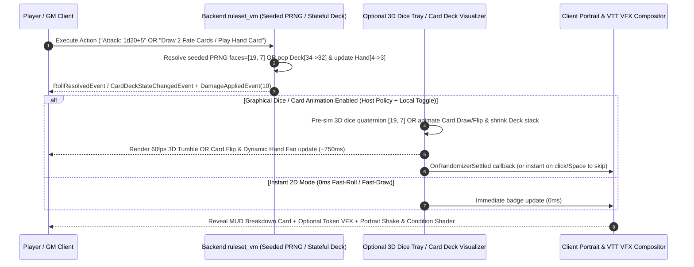
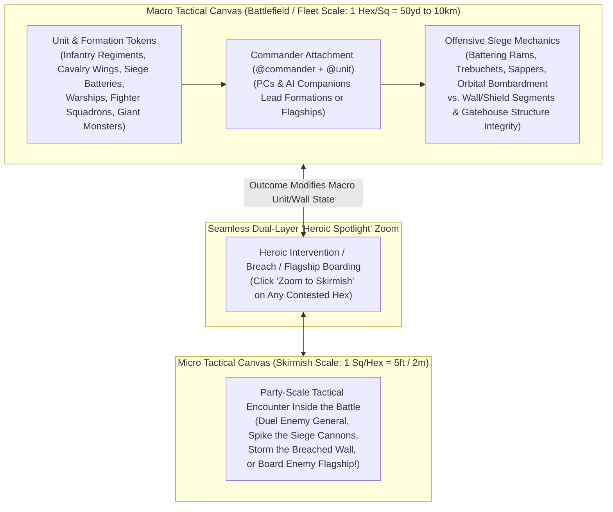

# Meddah Technical Specification — Volume 4: Multiplayer, Universal West Marches & Guild Server, Rich MUD/VTT UI, Audio/VFX, Safety & Cartography (§1.6–§1.10, §1.18, §1.25–§1.26)

> [!TIP]
> **Modular Technical Specification Navigation**:
> - **Master Index, Module Registry (§1.0), 14-Phase Roadmap (§2) & 77 Design Resolutions (§2.1)**: [technical_specification_and_plan.md](./technical_specification_and_plan.md)
> - **High-Level Architecture, 4 Golden Rules & 50 Locked Decisions**: [system_design_specification.md](./system_design_specification.md)
> - **Vol 1 — Core Ruleset VM, Layered Inventory & Ingestion (§1.0–§1.2)**: [tech_spec_01_core_vm_and_ingestion.md](./tech_spec_01_core_vm_and_ingestion.md)
> - **Vol 2 — AI/Deterministic GM, Companions, Quests & Retinue (§1.3–§1.4, §1.12, §1.19)**: [tech_spec_02_agents_companions_and_quests.md](./tech_spec_02_agents_companions_and_quests.md)
> - **Vol 3 — World, Cosmology, Travel, Law/Capture, Megacities & Geopolitics (§1.5, §1.11, §1.20–§1.24)**: [tech_spec_03_world_cosmology_and_society.md](./tech_spec_03_world_cosmology_and_society.md)
> - **Vol 4 — Multiplayer, West Marches/Guild Server, MUD/VTT UI, Audio/VFX, Safety & Maps (§1.6–§1.10, §1.18, §1.25–§1.26)**: [tech_spec_04_multiplayer_ui_and_vtt.md](./tech_spec_04_multiplayer_ui_and_vtt.md)
> - **Vol 5 — Downtime, Crafting/Survival, Puzzles/Traps, Loot, Piety, Chases, Competitions & Hit Locations (§1.13–§1.17, §1.27–§1.29)**: [tech_spec_05_gameplay_systems_and_anatomy.md](./tech_spec_05_gameplay_systems_and_anatomy.md)

---

### 1.6 Multiplayer Split-Party, Drop-In/Out & Networking (`backend/app/multiplayer/`)
1. **Multi-Room Instance Support**:
   - Each character tracks their own `current_room_id`.
   - The WebSocket broadcaster scopes narrative events, MUD room descriptions, TTS audio, and tactical grid fog-of-war **per room**, so a rogue scouting 3 rooms ahead only sees and hears their own room while the rest of the party converses in the tavern (with a GM overview showing all active party rooms).
   - **Tightened Hybrid Synchronized Time (`time_skip.py` — ADR-0135)**: All rooms in a single campaign/party share one monotonic `SceneState.elapsed_world_seconds` clock paired with non-blocking `ActiveTimedActivity` countdowns and `TimeSkipProposal` voting/concurrent scheduling (`approve`, `hold_act_first`, `keep_exploring`). Split rooms never freeze one another while switches, doors, patrols, and world-wide synchronous comms stay 100% causally consistent; only separate multi-party CoW expeditions (`§1.6.5`) track independent timelines and queue cross-branch comms until Atomic Settlement (`resolve_cross_branch_comm_delivery_mode`).
2. **Seamless Drop-In / Drop-Out Handoff**:
   - If a Guest disconnects, their Seat transitions to a configurable fallback mode (`Follow Party Leader`, `AI Companion Autopilot`, or `Host/GM Manual Control`). When they reconnect with their Seat Token, control is seamlessly restored and their missed room log is synced.
3. **Zero-Config Tunnel & Invite Codes**:
   - Supports **Direct LAN / Port-Forwarded IP:Port** AND an integrated **Tunnel/Relay connector** (e.g., built-in Cloudflare Quick Tunnel / pyngrok / WebSocket relay helper) that generates a shareable **Invite Code / URL** (`RPG-XXXX-YYYY`) paired with a **Host Waiting Room** where the Host approves incoming guests and assigns them to a character seat.
4. **Client Architecture Boundaries, Orthogonal Admin vs. Seat Role Matrix & "Host-as-Player" GMless Co-Op Mode (3 Clients Total — Only ONE Browser Web Client)**:
   To eliminate any ambiguity across phases, Meddah has **strictly three client interfaces** (and **only ONE browser-based web client**, never a separate "text-only browser"):
   1. **Terminal CLI Client (`meddah` / `meddah attach` — Phase 2.5)**: Pure terminal/SSH text MUD & server administration CLI. Zero browser or Electron required.
   2. **Unified Browser Web Client (`--serve-web-client` — Single React Web Bundle)**: One single static web application served directly by the Python FastAPI backend (`meddah serve --serve-web-client`). It starts from the **Browser Guest Client** foundation (Hypertext MUD terminal, Character Sheet, 4-Tab Capabilities Deck, Roll/Reaction prompts, Handouts, Journal, and lightweight VTT view) and dynamically unlocks capabilities along **two orthogonal axes** (both enforced server-side):
      - **Axis A — Server Administrative Privilege (`is_server_admin: bool`)**: Unlocked via `MEDDAH_ADMIN_TOKEN` (or local host session). Grants access to the **Server & Session Admin Drawer** (Multi-Campaign Library switcher, Session Lifecycle `Start / Wrap-Up / End / Checkpoint / Rewind / Backup`, Waiting-Room Seat Approval, Invite Generator, Kick/Revoke, `.rpgrules`/`.rpgworld`/`.rpgcampaign` package uploads, and `Tier A / B / C` AI Provider & Cost Budget settings) **without forcing the admin to see GM spoilers**.
      - **Axis B — In-Game Table Perspective (`seat_role: spectator | player | host_player | co_gm | gm`)**: Controls what in-world state the server sends over the WebSocket:
        - **`Host-as-Player` Mode (`is_server_admin: true` + `seat_role: "host_player"`, GMless Co-Op with AI GM / Solo Oracle)**: When the Host wants to play **as a normal Player Character alongside friends** while the **AI GM (`Tier B/C`) or Deterministic GM Director / Solo Oracle (`Tier A`)** runs the campaign (just like Solo Player mode, scaled to a multiplayer party!), the server enforces **strict Player-Level Fog-of-War & Spoiler Shielding** on the Host's WebSocket stream (hiding unrevealed map areas, secret doors, trap icons, NPC hidden agendas, and GM-only notes, while locking the Live GM Dock behind an explicit `" Spoilers Hidden (Host-as-Player Mode) — Click to Peek"` guard) while keeping the **Server & Session Admin Drawer** and **Shared Solo Oracle Drawer** 100% accessible!
   3. **Electron Desktop App (`desktop/` — Full Local Sidecar OR Remote Studio Workstation)**: Wraps the shared React UI (including full support for **Host-as-Player** Spoiler-Shielded mode!) plus the **Heavy Authoring Studios** (*Visual Ruleset Node-Graph Studio & 14-Probe Diff Workbench*, *Premade Map & `.rpgtileset` Auto-Tiler Studio*, and *Full World-Graph Builder*). It can either run its own embedded local Python sidecar OR connect to a remote Headless Server (`https://...` + `MEDDAH_ADMIN_TOKEN`) to push/sync `.rpgrules`, `.rpgworld`, and `.rpgcampaign` packages.

   ```mermaid
   flowchart TD
       subgraph Server["Authoritative Python Backend (`meddah serve` — Local Sidecar, Bare-Metal Daemon, or Docker)"]
           API["FastAPI + WebSocket JSON-RPC Gateway\n(Server-Side RBAC & Fog-of-War State Filter)"]
           UDS["Local UNIX Domain Socket\n(`/run/meddah/admin.sock`)"]
       end

       subgraph TermCLI["1. Terminal CLI (`meddah` — Phase 2.5)"]
           CLIMUD["`meddah attach`\nInteractive Terminal MUD"]
           CLIAdmin["`meddah campaign | session | seat | ruleset | gpu-check`\nZero-Friction Local Admin via UNIX Socket\n(or Remote Admin via `--server` + `MEDDAH_ADMIN_TOKEN`)"]
       end

       subgraph WebClient["2. Unified Browser Web Client (`--serve-web-client` — ONE Single Web App)"]
           direction TB
           AuthGate{"How Did the Browser User Authenticate?"}

           TierSpectator["🔒 Spectator Invite (`seat_role: spectator`)\n• Read-Only Public or Party MUD Log & VTT\n• Shared Handouts & Public Dice Rolls\n• Optional 0–120s Stream Delay | No Chat"]

           TierPlayer["🔓 Player Seat Invite (`seat_role: player`)\n• Interactive Hypertext MUD Terminal & Command Bar\n• Assigned Character Sheet, Inventory & Advancement\n• 4-Tab Capabilities Deck & Roll/Reaction Prompts\n• Per-Seat Fog-of-War VTT View, Journal & X-Card"]

           TierCoGM["🗝️ Co-GM Invite (`seat_role: co_gm`)\n• Everything in Player View PLUS:\n• Live GM Dock Drawer (Omniscient Map/NPC/Encounter/Clock Controls)\n• 5-Domain Co-GM Matrix & Whisper Suggestions\n• Difficulty/Mercy/Fudge Toggles & Handout Reveals"]

           AdminSplit{"`MEDDAH_ADMIN_TOKEN` / Host Login\nWhich Table Mode Did the Host Choose?"}

           TierHostPlayer["🛡️👑 Host-as-Player Mode (`is_server_admin: true` + `seat_role: host_player`)\n[AI GM or Deterministic Solo Oracle Runs the Game for the Party!]\n• Full Player Seat View + Shared Solo Oracle Drawer\n• STRICT Server-Side Fog-of-War & Spoiler Shield (No Hidden Traps/Plots Leaked!)\n• Live GM Dock Locked Behind Spoiler Guard\n• Full Server & Session Admin Drawer Unlocked (Campaign Switcher, Seat Approval,\n  Invites, Lifecycle, Checkpoints/Rewind, Package Upload, AI Tier & Budgets)"]

           TierHostGM["👁️👑 Host-as-GM Mode (`is_server_admin: true` + `seat_role: gm`)\n[Human GM + Optional 5-Domain AI Co-GM]\n• Everything in Co-GM View (Omniscient Live GM Dock & Map Layer)\n• Full Server & Session Admin Drawer Unlocked"]

           AuthGate -->|"Spectator Link"| TierSpectator
           AuthGate -->|"Player Seat Link"| TierPlayer
           AuthGate -->|"Co-GM Seat Link"| TierCoGM
           AuthGate -->|"MEDDAH_ADMIN_TOKEN / Host Link"| AdminSplit
           AdminSplit -->|"Play as PC (AI GM / Solo Oracle Directs)"| TierHostPlayer
           AdminSplit -->|"Run Table as Human GM"| TierHostGM
       end

       subgraph DesktopApp["3. Electron Desktop App (`desktop/` — Local Sidecar or Remote Studio)"]
           DesktopCore["All Host-as-GM, Host-as-Player (Spoiler-Shielded) & Player Views\n+ Full 60fps Multi-Scale 2.5D VTT Authoring"]
           HeavyStudios["🎨 Heavy Authoring Studios (Desktop-Only)\n• Visual Ruleset Node-Graph Studio & 14-Probe Diff Workbench\n• Premade Map Scrubber & `.rpgtileset` Wang Auto-Tiler Studio\n• Full Multi-Scale World-Graph & Megacity Builder\n(Can sync `.rpgrules` / `.rpgworld` directly to Headless Server via `MEDDAH_ADMIN_TOKEN`)"]
       end

       CLIMUD <-->|"StdIO / WSS"| API
       CLIAdmin <-->|"Local UNIX Socket (No Token Needed Locally)"| UDS
       CLIAdmin <-->|"HTTPS + MEDDAH_ADMIN_TOKEN (Remote)"| API
       WebClient <-->|"HTTPS / WSS (Role- & Spoiler-Filtered Payloads)"| API
       DesktopApp <-->|"Local Sidecar OR Remote HTTPS + MEDDAH_ADMIN_TOKEN"| API
   ```

5. **Universal West Marches Campaign Paradigm (Any Play Mode) & Persistent Multi-Player Guild Server Architecture (`backend/app/multiplayer/guild_server/` — [Post-MVP Phase 14])**:
   Meddah cleanly distinguishes between the **West Marches Campaign Paradigm** (a campaign structure and module set) and **Persistent Multi-Player Guild Server Mode** (`meddah serve --mode guild-server`, a multi-tenant network execution mode), while explicitly documenting how they connect:
   * **Architectural Relationship Between West Marches & Guild Server Mode**:
     1. **Applicable to ANY Play Mode or Campaign**: The **West Marches Campaign Paradigm** (`west_marches_hubs` module) is **not** locked to headless servers. It can be enabled in **any** play mode—including **Solo Play** (a solo player managing a roster of characters and companions at a Hub, running bounty or frontier scouting expeditions), **GMless Co-Op**, or **Private Host-Authoritative Multiplayer** (a rotating friend group hosting from the Desktop App or Web Client with a Human or AI GM).
     2. **The Exclusive Campaign Paradigm for Multi-Player Guild Server Mode**: Conversely, when running Meddah in **Persistent Multi-Player Guild Server Mode (`meddah serve --mode guild-server`)**, **West Marches is the only campaign paradigm currently planned to be supported**. A 24/7 multi-tenant community server where dozens of players log in asynchronously, form ad-hoc expedition parties, and return to a shared persistent world inherently requires a hub-and-expedition architecture.
     3. **Built-In Server Multiplayer Optimizations**: Because West Marches is the foundation for `guild-server` mode, the West Marches specification includes **purpose-built multi-player server optimizations** that do not exist in traditional linear/narrative campaign paradigms—such as **Atomic Expedition Settlement** over isolated Copy-on-Write child branches (routing cross-branch comms via `resolve_cross_branch_comm_delivery_mode() -> "queue_until_settlement"` per `ADR-0135` so asynchronous expeditions never send future spoilers across timelines), **`loot_mode: "treasure_bundles"` + `UnlockedMerchandiseRegistry`** (preventing ninja-looting and boss-camping), **4-Tier Item Scoping** (`persistent`, `instance_local`, `quest_objective`, `mission_reward`), **Client-Scoped Hub Quest Overlays (`QuestStateEvaluator`)**, **Hub Non-Aggression Safe Zones & `bind_on_pickup` Economy Guards**, and **Deterministic Disconnect Hireling Substitution**. In `guild-server` mode these optimizations are enforced automatically for concurrency and anti-griefing safety; in Solo or Private Table West Marches campaigns, every one of these optimizations is **individually toggleable** so private groups can mix and match (e.g., using West Marches hubs and frontier scouting while keeping traditional physical loot drops).
   - **Universal West Marches Campaign Paradigm (Available Across Solo, Co-Op, Hosted Table & Guild Server Modes)**:
     - **Scale-Elastic & Multi-Scale Hub Topology (`Scale 0` through `Scale 4`) & Nested Hub Networks (`HubTopologyBlock`)**:
       In strict alignment with Meddah's multi-scale spatial architecture and **Golden Rule #1 (Zero-Assumption Agnosticism)**, the West Marches paradigm is never constrained to a single traditional fantasy frontier town (`Scale 3`). Instead, hubs are **first-class scale-elastic graph nodes** (`HubTopologyBlock`) operable across all 5 spatial scales:
       1. **Scale 4 / Scale 3 — District, Mega-Block, Station & Enclave Hubs**:
          - *Archetypes*: Cyberpunk fortified mega-blocks, corporate safe enclaves, underground hacker speakeasies, orbital free-ports (e.g. *Deep Space 9*, *Omega*), subterranean fallout shelters, or space citadel wards.
          - *Expeditions*: Venturing into surrounding street combat zones, corporate spires, irradiated badlands, sewer levels (`Z-1`), or quarantined reactor decks.
          - *Evacuation & Defeat Policy*: Street clinic rescue, trauma team extraction, or station airlock retrieval.
       2. **Scale 2 — Regional Enclave, Valley & Star System Hubs**:
          - *Archetypes*: The classic fantasy demilitarized barony or sacred valley (*The Shire*, *Rivendell*), civilized solar systems (*The Sol System Inner Planets*, asteroid belt trading hubs), or an archipelago of free merchant islands.
          - *Expeditions*: Regional hex-crawls into haunted mountain ranges, pirate-infested seas, or outer-system asteroid jump points.
          - *Evacuation & Defeat Policy*: Overland search party, coastal rescue cutter, or system patrol ship.
       3. **Scale 1 — Continental Empire, Planetary World & Void Sector Hubs**:
          - *Archetypes*: Civilized continents behind fortified border garrisons, planetary capitals / ecumenopolises (*Coruscant*, *Earth*, *Trantor*), or civilized core star sectors.
          - *Expeditions*: Planetary expeditions across unmapped oceans, drop-pod scouting onto hostile exoplanets, or expeditions into unmapped void sectors.
          - *Evacuation & Defeat Policy*: Orbital recovery shuttle, planetary dropship extraction, or naval hospital flagship.
       4. **Scale 0 — Persistent Hub Timelines, Multiverse Universes & Pan-Dimensional Nexus Citadels**:
          - *Temporal Hubs*: An immutable **Prime Hub Timeline** or **End-of-Time Citadel** (*Chronopolis*, *The Citadel at the End of Time*). Expeditions use time-vessels or chronal rifts to jump into diverging history branches, alternate timelines, or paradoxical epochs. Returning to the Prime Hub Timeline banks temporal artifacts, heals chronal paradoxes, and prevents timeline collapse.
          - *Planar / Multiversal Hubs*: A pan-dimensional crossroads city or cosmic sanctuary (*Sigil: City of Doors*, *The Infinite Nexus*, *Plane of Concordance*, *Astral Sea Haven*). Expeditions step through dimensional portals into elemental planes, fiend-realms, alien quantum dimensions, or parallel universes.
          - *Evacuation & Defeat Policy*: **Chronal Anchor Tether / Dimensional Recall Sigil**—when a party is wiped or incapacitated across the multiverse/timeline, an emergency beacon collapses the local quantum wave and snaps surviving consciousness/bodies back to the Prime Timeline Infirmary or Astral Nexus Cloning Vat, incurring temporal sickness or paradoxical debt per campaign settings.
       5. **Hierarchical "Hub-and-Spoke" Nested Hub Networks**:
          - Expeditions are not confined to a single hub. A **Scale 0 Prime Multiverse Citadel** can establish **Scale 1 Core Planetary Hubs**, which in turn branch into **Scale 2 Regional Outposts** or **Scale 3 Frontier Forward Bases**.
          - *Synchronized vs. Local Scopes*: GMs configure whether the `UnlockedMerchandiseRegistry` and `Guild Vault` inventories are network-wide (e.g. an alien blueprint found on a frontier world unlocks at all guild quartermasters across galaxies) or localized to each hub tier.
          - *Inter-Hub Transit*: Hubs link via ruleset-appropriate transit mediums (stargates, planar portals, hyperlanes, leyline conduits, or overland caravans) with configurable transit costs, cooldowns, or clearance requirements.
       6. **Scale-Aware Cartography, Travel Watches & Fog of War**:
          - Collective cartography reveals fog of war at the expedition's operational scale: Scale 4 street/room floorplans, Scale 2 regional overland hexes, Scale 1 planetary/continental landmasses or void sectors, and Scale 0 **Branching Timeline Trees** (interactive chronological graphs) or **Cosmological Astral Charts**.
       7. **Persistent Social Hub Real-Time Channels & Rapid Transit**:
          - Players gather in persistent hub nodes (taverns, markets, orbital plazas, council chambers) with real-time MUD social channels and LFG party recruitment. Multiple discovered hubs within an unlocked network are interconnected via instant or fee-based **Quick Travel** routes outside of active combat.
     - **Hybrid Expedition Initiation**:
       - *Targeted Bounty Contracts*: Parties select registered missions, contracts, or rumors from the Guild Board to spin up bounded dungeon/POI instances.
       - *Frontier Scouting Expeditions*: Parties embark on open-ended wilderness hex-crawls into the unmapped frontier using the Travel-Watch survival engine (Section 1.20). Moving hexes advances time, consumes supplies/sustenance per the active `.rpgrules` schema (or abstract travel ticks if undefined), and rolls navigation/hazards based on assigned party roles (*Navigator, Scout, Quartermaster, Lookout*). Deeper hexes scale danger tiers and reward **Scouting Intel Points** alongside **Unmapped POI Stubs** (*Ancient Barrow, Dragon's Roost, Sunken Galley*). Returning to the Cartographer's Guild permanently reveals surveyed hexes on the **Server Overworld Map** for all players and registers discovered POIs on the Bounty Board as new community quests!
     - **Long Multi-Stage & Multi-Location Quests with Dynamic Roster Support**: Long, complex episodic storylines feature **Stage Checkpoints** tracked in each participant's personal Quest Journal. Parties can return to the hub between stages to resupply, bank rewards, and heal without losing campaign progress—and can resume subsequent stages with new or substitute party members.
     - **Hub-Based Urban & Social Quests (`QuestStateEvaluator`)**: Rich quests that take place entirely within shared city streets without spinning up an instance (*investigations, faction diplomacy, crafting work orders, dice tournaments*). Uses client-scoped quest overlays so NPCs offer unique quest dialogues and props reveal clues only to players currently on that quest stage, without collisions or despawning props for other hub occupants.
     - **Dual-Tier Housing, Guild Halls & Mobile Vessel Retrofits (`desktop/src/components/housing/`)**:
       - *Dual-Tier Holdings*: Players purchase personal apartments/homes (private storage/decor) AND pool reward currencies to establish shared Guild Halls/Lodges (shared treasury, trophy halls, facility boons) anchored to residential portal nodes.
       - *Housing to Mobile Vessel Conversion*: Leveraging the Unified Dual-Entity Architecture (Decision #26), players can undertake a dry-dock retrofit project to convert a stationary holding into a **Mobile Vessel** (*Sailing Galleon, Arcane Airship, Land Crawler, Void Sloop*). Because both share the same location sub-graph, **100% of placed furniture, trophies, storage stashes, and assigned staff transfer seamlessly**! Converted vessels dock at hub harbor slips/sky-docks and act as a mobile expedition forward base during overworld hex travel.
     - **"Treasure Bundles & Merchant Unlock" Loot Mode (`loot_mode: "treasure_bundles"`)**:
       - Replaces physical in-dungeon equipment drops with objective-driven **Treasure Bundles** awarded for primary and hidden/bonus objectives (puzzle solving, hostage rescue).
       - Bundles convert into the active ruleset's primary currency/wealth rating and campaign-defined Guild Renown marks during Atomic Settlement.
       - Discovered unique items write to the party's shared `UnlockedMerchandiseRegistry`, granting all completing party members the permanent right to purchase or commission that item at Hub Quartermasters—completely eliminating ninja-looting, toxic roll-offs, and repeat dungeon farming.
     - **Hub NPC Services & Deep Persistent Afflictions**:
       - Hubs feature dedicated NPC vendors for downtime services strictly defined in the active ruleset schema (spawning only facilities defined in `.rpgrules`, such as enchanting in fantasy, cyberware tuning in sci-fi, or surgical stabilization in gritty realism, with zero hardcoded genre assumptions).
       - While standard vitality/damage tracks recover per the ruleset's rest rules at the infirmary, severe ruleset conditions tagged `persistent_condition_flag: true` (*curses, mummy rot, cybernetic neural burnout, sanity loss, petrification, lycanthropy*) **persist across sessions** and require specialized temple/hospital healing or curative rituals cast by other skilled players.
       - *Persistent Static Merchant Inventories*: Base stock is infinite and non-depleting; specialty stock dynamically unlocks per-PC based on quest unlocks, faction reputation, and `ProgressionTierMetric`.
     - **Hub Non-Aggression Safe Zones & Zoned PvP**:
       - Theft, pickpocketing, and PvP aggressive actions are strictly disabled across all public hub cities by default.
       - Contested combat actions are restricted entirely to designated arena/sparring room nodes tagged `@spatial.pvp_enabled: true`.
     - **Player Economy & Trading Restrictions**:
       - High-tier quest rewards carry `bind_on_pickup` or `bound_to_character` tags.
       - Direct player-to-player trading supports optional tier-gated rules (`ProgressionTierMetric` parity) and transaction audit logging to prevent gold-selling and economy griefing.
     - **Multi-Guild, Multi-House & Multi-Faction Support**: The world supports multiple independent factions and player guilds with separate reputation tracks, exclusive quartermaster unlocks, and distinct Guild Halls.
     - **4-Tier Item Scoping (`persistent`, `instance_local`, `quest_objective`, `mission_reward`)**: Distinguishes permanent character gear from transient dungeon junk and keys, automatically evaporating scrap and keys at Atomic Settlement.
     - **Agnostic Progression Tier Metric (`ProgressionTierMetric`)**: Normalizes level-based, skill-tick, karma, and narrative playbook systems for quest gating.
     - **Configurable Defeat Policy**: Defaulting to "Guild Rescue & Recovery Debt" where fallen PCs wake in the Hub Infirmary with persistent gear intact and vitality restored per ruleset rest rules, forfeiting unbanked rewards and incurring medical debt/recovery debuffs.
   - **Persistent Multi-Player Guild Server Mode (`meddah serve --mode guild-server` — Headless Only)**:
     - **Server-Authoritative Character Vault**: Characters are created and stored on the server to prevent offline save-file tampering; players can export read-only PDF sheets or local backups, but cannot import externally edited characters.
     - **Hybrid Account Authentication**: Out-of-the-box self-hosted username/Argon2 + passkeys with optional Admin Invite Codes, plus pluggable OAuth2 (Discord / OIDC) for community role syncing and smurf prevention.
     - **Instance Supervisor & Concurrency Pooling (`InstanceSupervisor.py`)**: Manages server-configurable concurrent ephemeral expedition child branches (`max_concurrent_instances`, default: `10`), with automated idle orphan reaping (`instance_idle_timeout_seconds`, default: `1800s` / 30m), resource limits, and live non-blocking SQLite WAL snapshots. All instance parameters are fully configurable by server admins via `server.toml` or CLI flags.
     - **Two-Tier Companion Architecture & Deterministic Disconnect Handling**:
       - *Common Guild Hirelings*: Public mercenary pool with standard tactical stances, instanced as ephemeral clones across parties.
       - *Personal Retinue*: Account-bound persistent companions with settlement-phase deed/trust reconciliation and zero in-dungeon mutiny.
       - *Solo Play*: Players can embark on expeditions with **themself + NPC Companions** up to the server-configured party size (`max_party_size`, default: `4`, range: `1..N`) and companion allowance (`max_companions_per_party`, default: `3`, configurable by admin), retaining direct stance/combat command.
       - *Deterministic Disconnect Handling*: Configurable reconnect grace window (`reconnect_grace_seconds`, default: `600s` / 10m, configurable by admin) holding the character defensively; if timeout expires or on unanimous party vote, the party can substitute a companion from a roster of common NPC mercenaries controlled 100% deterministically via the Zero-AI Ruleset VM (`Tier A`, 0 LLM compute) or safely extract to town.
     - **Dynamic 4-Axis Social & Diegetic Channel Creation**:
       - Admins and GMs can create custom channels via GUI (`[+ New Channel]`) or MUD (`> channel create`) configured across: (1) *Nature* (Social OOC vs. Diegetic In-Character); (2) *Spatial Scope* (`server_wide`, `hub_only`, `district_scoped`, `instance_scoped`, `faction_scoped`); (3) *Access Gates* (Faction rep, Tier, Item/Cipher, Password, Language); and (4) *Permissions* (Two-Way Chat, Read-Only Broadcast, Moderated).
       - Ships with 4 prebuilt multi-player channels: **Guild Chat** (`> guild`), **Global OOC** (`> ooc`), **Newbie/Help Chat** (`> helpchat`), and **Hub LFG/Trade** (`> lfg`).
     - **Zero-Trust Hardened Security Profile (`ZeroTrustServerProfile`)**:
       - All security thresholds and rate limits are server-admin configurable in `server.toml` (defaults: `max_connections_per_ip: 3`, `rate_limit_per_second: 3`, `account_disk_quota_bytes: 2MB`).
       - Player audio broadcasts forced `OFF` by default; custom portraits restricted to SVG paper-dolls/approved packs (custom uploads require admin approval); attachment uploads disabled.
       - Complete SQL parameterization, MUD HTML/URI XSS sanitization, AI prompt-injection shielding via semantic bounding tags (`<untrusted_player_input author="...">`), path-traversal sandboxing.
     - **Private Moderation & Incident Reporting**:
       - RBAC hierarchy (Admin $\rightarrow$ Marshal $\rightarrow$ Guide $\rightarrow$ Player).
       - In-game disciplinary commands (`> mute`, `> detain / jail`, `> kick`, `> ban`).
       - Context-captured incident reporting (`> report <player> <reason>`) capturing the last `report_context_lines` (default: `50 lines`, configurable by admin) of room chat/actions into a private Marshal review ticket.
       - Personal client blocklists (`> ignore <player>`) and instance-scoped X-Card safety tool.

---

### 1.7 Rich Hypertext MUD UI & Progressive Multimodal Streaming (`desktop/`)
1. **Hypertext MUD Log**:
   - Narrative output supports semantic entity tagging (`[[entity:npc_vane_01|Vane]]`, `[[item:rusty_key|iron key]]`, `[[exit:north|Archway of Bone]]`).
   - Hovering shows a quick-inspect tooltip; clicking opens a radial/context menu (`Look`, `Talk`, `Attack`, `Take`, `Move`).
   - Dice rolls render as expandable interactive badges showing the exact formula, individual die faces, modifiers, and outcome tier.
2. **Non-Blocking Progressive Media Delivery (With 100% Deterministic Tier-A Media Fallbacks)**:
   - Text tokens stream to the MUD log at 0ms latency.
   - As each sentence completes, the `TTSService` synthesizes audio using the speaker's assigned `voice_profile` and streams audio chunks to the client's **Multi-Voice Audio Queue** (illuminating the active speaker's portrait ring). **When no neural TTS provider is configured or available**, `TTSService` automatically falls back to **OS Native Speech / Web Speech API (`window.speechSynthesis`)** (modulated by pitch/rate per speaker profile), optional **Retro MUD Text-Blip Synthesizer cues**, or clean silent subtitle mode.
   - Scene backdrops and portraits generate asynchronously via `ImageService` and smoothly fade in once cached, broadcasting to Guests who have Host Media Sync enabled. **When no AI Image provider is configured or available**, `ImageService` deterministically renders **Procedural Layered SVG Portraits & Faction Heraldry** for entities and **Tile-Composited / Biome-Gradient Atmospheric Scene Cards** (tinted by active season, time-of-day, and weather) so no missing-image placeholder ever appears.
3. **Deterministic Atmospheric & Sensory Ambient Ticker (`backend/app/world_gen/ambient_ticker.py`)**:
   - **Zero-Token Varying Schedule Engine**: Each active room with at least one connected player seat runs a lightweight `asyncio` ticker configured by the room's activity profile `interval_seconds: [min_sec, max_sec]` (e.g., `[35, 75]` for `high_activity` markets/docks/taverns, `[60, 140]` for `moderate` streets/camps, `[120, 240]` for `quiet` ruins/libraries/void). Each tick randomizes the next delay within that jittered range so prose cadence feels organic rather than robotic.
   - **Smart Suppression & Flow Hygiene**:
     - Automatically defers ticks while the room is in `round_initiative` combat (unless a hazard/battlefield ambient pool is explicitly enabled for turn boundaries), while the AI GM or an NPC is actively streaming dialogue/prose, while TTS audio is speaking, or while a player has typed in the command bar within the last `5 seconds`.
     - **AFK Anti-Flood Cap**: Limits consecutive unprompted ticks to `max_idle_consecutive_ticks: 3` until a player moves or enters a command, keeping idle session logs clean.
     - **Per-Client Frequency & Presentation Controls**: Players can individually adjust their Ambient Ticker cadence (`Frequent [0.6x interval]`, `Normal [1.0x]`, `Rare [2.0x]`, or `Muted/Off`) and visual styling (subtle muted-italic atmospheric MUD line vs. collapsible ambient cluster).
   - **Five Composable Context-Filtered Sensory Pools**: When a timer fires, `ambient_ticker.py` collects eligible entries weighted by relevance and strictly filtered by `time_of_day`, `season_id`, `weather_state`, `exposure_type`, `z_stratum`, and present entities:
     - **Pool A — Room Micro-Sensory & 1-Hop Neighbor Bleed (`room.ambient_pool`)**: Sights, sounds, temperatures, and smells anchored to the room (*"The warm, yeasty aroma of fresh-baked sourdough drifts from the bakery's stone ovens."*, *"A pungent stench of salted brine and fish offal hangs heavy over the wet cobblestones."*). Rooms tagged with strong emitters (`emit_scent`, `emit_sound`) can bleed directional cues across open/unsealed exits into adjacent rooms (*"From the [[exit:east|Oak-Door Bakery]] to the east comes the mouthwatering scent of fresh-baked bread."*).
     - **Pool B — Settlement / District Crowd, Commerce & Fauna (`district.ambient_pool`)**: Dynamically gated by `time_of_day` (`dawn`, `morning`, `midday`, `dusk`, `night`, `dead_of_night`), district tags, and alert/prosperity state (*Midday Market*: *"A merchant's booming cry—'Fresh spiced eels! Hot pies!'—rings out above the bustling crowd."* vs. *Midnight Alley*: *"A stray dog barks sharply somewhere down a darkened alleyway."*).
     - **Pool C — Weather, Season & Room Exposure (`weather_season.ambient_pool`)**: Filtered against the room's `exposure_type` (`outdoor`, `semi_sheltered`, `windowed_indoor`, `deep_indoor`) so indoor taverns hear muffled effects (*"Rain patters steadily against the leaded glass windowpanes."*) while streets feel direct elements (*"A sudden gust of crisp autumn wind sends dry leaves skittering across the cobbles."*).
     - **Pool D — Present NPC, Creature & Companion Idle Emotes (`entity.idle_emotes`)**: Zero-LLM idle micro-actions drawn from awake, non-hostile NPCs or AI Companions standing in the room (*"[[entity:npc_blacksmith|Garrick]] wipes soot from his brow and leans hard on the forge bellows."*, *"[[entity:comp_vane|Vane]] absentmindedly rolls a scarred brass coin across his knuckles."*).
     - **Pool E — Stratum, Holding, Vessel & Hazard Hum (`environment_hum.ambient_pool`)**: Ambient cues from Z-Strata, vehicles/ships, stronghold facilities, or active persistent hazards (*"A single droplet of mineral water falls from a stalactite, echoing softly in the dark."*, *"Beneath the deckplates, the starship's hyper-core thrums with a steady vibration."*).
   - **LRU Anti-Repetition, `<1ms` Interpolation & Live Authoring**: A per-room **LRU ring buffer** (tracking the last 10 emitted message IDs) guarantees no back-to-back repeats. Messages support deterministic token interpolation (`{active_merchant_name}`, `{adjacent_bakery_exit}`, `{companion_name}`, `{weather_noun}`), are auto-seeded during World/Town/JIT Room generation, and can be edited, weighted, or manually triggered via **"Trigger Ambient Line Now"** in the Live GM & Solo Room/Town Editor.
4. **MUD In-Game Communication, Mixed Action+Speech DSL, Vocal Emphasis & Parameterized Social Emote Library (`backend/app/mud_parser/social_dsl.py`)**:
   All communication, roleplay acting, and social emote commands resolve deterministically in `<5ms` (`0` LLM calls required to parse and broadcast, while automatically feeding targeted NPCs/Companions into `deterministic_dialogue_broker.py` in `Tier A` or the AI GM/Companion router in `Tier B/C`):
   * **A. Core MUD Communication Channels & Spatial/Acoustic Propagation**:
     1. **`say <message>` (or shorthand `' <message>` / `"<message>`)**:
        - Broadcasts in-character speech to all entities in the speaker's `current_room_id` (`[[entity:pc_kale|Kale]] says, "Watch the northern archway."`).
     2. **`say to <target> <message>` (or `to <target> <message>` / `ask <target> about <topic>` / `@<target> <message>`)**:
        - **Directed In-Room Speech**: Heard by everyone in the room (`[[entity:pc_kale|Kale]] says to [[entity:npc_garrick|Garrick]], "Did you forge this blade?"`), while explicitly setting `target_entity_id` so the addressed NPC or AI Companion knows they are being spoken to directly and responds immediately (via `deterministic_dialogue_broker.py` in `Tier A` or `ai_npc.py` in `Tier B/C`).
     3. **`whisper [to] <target> <message>` (or `wh <target> <message>`)**:
        - **Private Diegetic In-Room Whisper + Non-Interrupting Passive / Stance `Eavesdrop` Hook**: Delivers the full text only to the speaker, the `<target>` (if in the same room), and the GM. Other players/entities in the room see only the non-spoiler exterior observation (`"Kale leans in and whispers something quietly to Vane."`) and **never** have their chat flow interrupted by popup roll prompts. Instead, if the active `.rpgrules` defines an eavesdrop mechanic, the engine silently compares the whisper against nearby bystanders' **Passive Perception / Observation** (or rolls a silent background check if a character has actively toggled an `> eavesdrop @kale` stance or possesses a keen-hearing trait), leaking partial or full overheard text only on a pass!
     4. **`shout <message>` / `yell <message>`**:
        - **Multi-Room Acoustic Bleed (`1–2` Hops) & Stealth/Alert Integration**: Broadcasts in bold to the current room (`Kale shouts, "AMBUSH!"`) AND propagates across open/unsealed doors, corridors, and vertical shafts (`floor_index \pm 1`) into adjacent rooms (`"From the [[exit:north|Great Hall]] to the north, someone shouts, 'AMBUSH!'"`).
        - **Diegetic Consequence**: Automatically breaks active `Stealth / Hidden` conditions on the shouter and can tick nearby Dungeon Alert / Patrol Clocks (`Section 1.5`).
     5. **`tell <player_or_gm> <message>` / `ooc <message>` (or `// <message>`) / `party <message>` (`p <message>`)**:
        - **Out-of-Character (OOC) & Meta Channels**: `ooc <msg>` (or `// <msg>`) posts to the stylized OOC meta-channel (never triggering in-world NPC reactions or breaking stealth); `tell <seat> <msg>` sends a private player-to-player or player-to-GM direct message across any distance; `party <msg>` sends a party-chat message across split-party rooms (or uses in-world *Sending Stones / Comms Links* if configured as diegetic).
   * **B. Freeform Emoting & Mixed Action + Speech Interleaving (`act` / `emote` / `pose` / `:` / `::`)**:
     - **Standard Emote (`act <text>`, `emote <text>`, `pose <text>`, or `: <text>`)**: Prepends the actor's hypertext name (`> act wipes the blood from his dagger.` $\rightarrow$ *"Kale wipes the blood from his dagger."*). Possessive `:: <text>` (or `:'s <text>`) formats without a space (`> ::'s eyes narrow.` $\rightarrow$ *"Kale's eyes narrow."*).
     - **Mixed Action + Speech + Target Interleaving (MUSH/RPI-Style Multi-Beat Pose DSL)**:
       - Players can freely mix physical actions, `@target` entity references, `(mannerism)` modifiers, and `"quoted speech"` inside a single `act`, `emote`, or `say` command—or even across a multi-beat monologue:
         - *Input*: `> act (wearily) leans against the cracked pillar, glances at @vane, "We can't hold this bridge much longer," and draws his parrying dagger.`
         - *Rendered & Perspective-Adapted Output*:
           - To the room: `[[entity:pc_kale|Kale]] (wearily) leans against the cracked pillar, glances at [[entity:comp_vane|Vane]], "We can't hold this bridge much longer," and draws his parrying dagger.`
           - To Vane's client log: `...glances at **you**, "We can't hold this bridge much longer,"...`
       - **Audio / TTS Separation**: The parser automatically strips the narrative action beats from the quoted dialogue so `TTSService` speaks **only** the quoted speech (`"We can't hold this bridge much longer"`) in the character's voice while the Narrator voice (if enabled) reads the action clauses!
   * **C. Vocal Delivery Modifiers, Monologue Pacing & Prosody Emphasis**:
     - **Parenthetical Tone / Delivery Prefix**: Adding `(tone)` after `say`, `whisper`, `shout`, or inside a mixed `emote` (e.g., `say (sarcastically)`, `say (in a raspy whisper)`, `say (trembling with rage)`) formats the dialogue verb (`Kale says sarcastically, "..."`) and passes the tone tag to both `TTSService` (modulating pitch/speed/style) and the receiving NPC/AI GM context.
     - **Rich Inline Monologue Emphasis & Dramatic Pauses**:
       - `*italicized words*` $\rightarrow$ Rendered in literary italics + stressed vocal inflection in TTS.
       - `**bold words**` or `ALL CAPS` $\rightarrow$ Rendered with high-impact weight (and subtle shake on `shout`) + increased volume/intensity in TTS.
       - `...` or `--` (em-dash) or `[pause]` $\rightarrow$ Inserts a natural dramatic beat/pause (`300–600ms`) in progressive text streaming and TTS audio playback during a monologue.
       - `~tilde-wrapped text~` $\rightarrow$ Rendered as a musical/chanted/sung cadence for bards, rituals, and incantations.
   * **D. Built-In Library of 60+ Parameterized Social Emotes (`social_emote_library.py` + Custom `.rpgrules` Emotes)**:
     - Classic DikuMUD / RP-MUD style social verb library that automatically adapts grammar across **3 perspectives (`Actor / 2nd-Person`, `Target / 2nd-Person`, and `Room / 3rd-Person`)** and **4 invocation forms** (1: No target, 2: Target entity/item, 3: With adverb/modifier, 4: With attached `"speech"`):
       - *Categories Included Out of the Box*:
         - **Greetings & Respect**: `nod`, `bow`, `salute`, `curtsey`, `wave`, `handshake`, `kneel`, `toast`.
         - **Emotion & Expression**: `smile`, `grin`, `laugh`, `chuckle`, `cackle`, `sigh`, `frown`, `scowl`, `glare`, `wink`, `blush`, `wince`, `shiver`, `groan`, `cry`.
         - **Body Language & Gestures**: `shrug`, `point`, `beckon`, `clap`, `applaud`, `facepalm`, `foldarms`, `lean`, `pace`, `stretch`, `yawn`, `stare`, `ponder`, `strokechin`.
         - **Tactical & Atmospheric**: `taunt`, `threaten`, `cower`, `flinch`, `cheer`, `spit`, `bandage`, `inspect`, `warmhands`, `drink`, `eat`.
       - *Example Perspective Adaptation (`> glare @cultist coldly "Drop the key."`)*:
         - **To You (Actor)**: *You glare coldly at the Cultist Fanatic and say, "Drop the key."*
         - **To Target (Cultist)**: *Kale glares coldly at you and says, "Drop the key."*
         - **To Room (Observers)**: *Kale glares coldly at the Cultist Fanatic and says, "Drop the key."*
       - **Autocomplete & Custom Ruleset Emotes**: Typing `/` or `: ` in the MUD command bar shows a filterable autocomplete palette of all social emotes, and `.rpgrules` or `.rpgworld` packages can define setting-specific emotes (e.g., `make_sign_of_the_aquila`, `jack_in`, `blood_oath`).
        - **Semantic Social Valence Tagging Across Both `Tier A` & `Tier B/C`**: Every emote in the 60+ library and every vocal `(tone)` modifier carries structured **Semantic Valence Tags** (e.g., `respectful_greeting`, `hostile_intimidation`, `affectionate_comfort`, `sarcastic_taunt`, `deceptive_bluff`, `submissive_plea`). In `Tier A` (`0` LLM), `deterministic_dialogue_broker.py` uses these valence tags to deterministically shift NPC disposition/stance and select matching reaction templates; in `Tier B/C`, the exact parsed valence and tone metadata is injected into the NPC/Companion micro-prompt AND drives TTS prosody and portrait expression state swaps!
   * **E. Ruleset & World-Specific Diegetic Communication Mediums (`CommunicationMediumBlock` in `backend/app/mud_parser/diegetic_comms.py`)**:
     - **Physical Room Audibility (`audibility_mode`), Sealed Suit/Helmet Acoustic Isolation & Vocal/Somatic/Mental Condition Gating**:
       Every `CommunicationMediumBlock` declares both its **`audibility_mode`** (`"audible_speech" | "subvocal_whisper" | "silent_mental_or_text"`) and its **Input Modality Gates** (`requires_vocal_speech: bool`, `requires_somatic_input: bool`, `requires_mental_action: bool`), which the engine evaluates deterministically against the speaker's equipped gear, active status conditions, and room environment:
       1. **Vocal, Somatic & Mental Condition Gating (`Silence`, `Gagged`, `Paralyzed`, `Petrified`, `Deafened`)**:
          - **Vocal-Blocking Conditions (`#muted`, `#gagged`, `#silenced`, `#suffocating`)**: Block local `say`/`shout`/`whisper` AND block any medium with `requires_vocal_speech: true` (such as voice radio or verbal *Sending* spells)—either returning a clear diegetic notice or converting an attempted `say` while `#gagged` into a muffled struggle emote (*"Kale makes an urgent, muffled sound behind the gag!"*). However, non-vocal mediums remain usable: a `#gagged` or `#muted` character can still type on a **Text Terminal / Wrist-Pad / BBS** (`requires_somatic_input: true, requires_vocal_speech: false`), use **Visual Hand-Signs** (`> sign @vane "Two guards ahead"`, gated by Line-of-Sight), or transmit via **Telepathy / Subvocal Neural-Link** (`requires_mental_action: true, requires_vocal_speech: false`)!
          - **Full Physical Immobilization (`#paralyzed`, `#petrified`, `#stasis_locked`)**: Sets both `blocks_vocal_speech: true` and `blocks_somatic_input: true`—blocking local speech, emotes, hand-held radios, and text terminals, while **still allowing pure Mental / Telepathic / Neural-Implant / Patron Commune channels** (`requires_mental_action: true, requires_vocal_speech: false, requires_somatic_input: false`) so a paralyzed or stone-encased character can cry out over a mind-link (`> telepathy @party "Help! I can't move!"`) unless the condition also blocks mental actions (`#unconscious`, `#mind_stunned`)!
          - **Receiver Hearing Conditions (`#deafened`)**: A `#deafened` listener does not receive audible `say`/`shout` or speaker-radio transcripts in their log—seeing only visual lip-movement emotes (*"You see Kale's lips moving, but hear nothing."*—or partial decoded text if they possess a ruleset `Lip-Reading` trait/skill) while still receiving **Text / Matrix / Subtitled HUD / Telepathic** messages normally.
       2. **Sealed Enclosures, Space-Suit / Helmet Acoustic Isolation & Fine-Grained PA Voice Modulation (`#sealed_helmet` / `VoiceModulatorProfile`)**:
          - **Acoustic Isolation Inside the Helmet**: When a character wears a **Sealed Space Suit, EVA Helmet, Diving Rig, or Enclosed Mech Cockpit** (`equipment_tag: "sealed_helmet"` with `external_pa_speaker: off`), their voice is **acoustically isolated inside their helmet**: transmitting on their **Suit Radio (`> radio #party-tac ...`)** routes directly into their internal helmet mic with **`0` external room bleed** (bystanders in the room hear nothing outside the suit, or only see muffled visor lip movement if adjacent!).
          - **Optional & Intentional Fine-Grained External PA / Voice Modulation (`> suit voice <mode>` or `say (pa: <mode>)`)**:
            - When the character toggles their **Suit External PA Speaker (`> suit speaker on`)** to speak to people outside the suit, **any metallic/vocoder effect is 100% optional** (defaulting to `clean_natural` pass-through if the suit or client preference specifies natural reproduction).
            - Furthermore, when the active ruleset, helmet, cyberware, or spell grants **Voice Modulation / Acoustic Projection capabilities (`VoiceModulatorProfile`)**, the player has **intentional, fine-grained diegetic control** over how their PA or vocal unit modifies and broadcasts their voice across two dimensions:
              - **Projection & Volume Tier**: `whisper_amp` (directional close-range), `normal`, `loud_hailer` (projects `1–2` room hops like `shout` with zero vocal strain), or `booming_resonance` (if granted by a *Riot Hailer / Command Helm / Thaumaturgy* capability, applying ruleset intimidation/authority modifiers or triggering sonic/avalanche checks!).
              - **Timbre, Filtering & Identity Masking**: `clean_natural` (unfiltered natural voice), `metallic_vocoder` (optional classic helmet filter), `deep_dreadnought` (pitch-shifted bass modulation), `scrambled_anonymous` (conceals the speaker's identity in the MUD log as `[[entity:scrambled_voice|An Electronically Scrambled Voice]]` and applies DSP scrambling to TTS audio unless beaten by a ruleset *Audio Forensics / Decryption* check!), or `voice_mimic:@target` (when equipped with a ruleset *Vocal Mimicry Implant / Chameleon Helm / Actor Feat*, broadcasting in the exact cloned voice of a recorded NPC!).
       3. **Environmental Acoustic Medium Physics (`#vacuum`, `#magical_silence`, `#underwater`)**:
          - **`#vacuum` (Hard Vacuum / Depressurized Hull Breach)**: Because sound waves cannot propagate through a vacuum, open-room `say`/`shout` and external suit speakers produce **zero room audio** (`"There is no air to carry sound in a vacuum; use your suit radio ('radio #party-tac'), press helmets together ('touch-helmet @target'), or use visual hand signals ('sign @target')!"`). Speaking inside a sealed helmet over `#party-tac` radio works crystal-clear with `0` room bleed, and the engine natively supports the classic sci-fi **`> touch-helmet @target "<message>"`** conductive-vibration whisper when a suit radio is damaged or jammed!
          - **`#magical_silence` (Magical *Silence* Sphere)**: Suppresses all acoustic vibration inside the zone—blocking local speech, verbal spell components, and even voice-activated helmet mics inside the sphere, while leaving **Telepathy**, **Text/Matrix Pads**, and **Visual Hand-Signs** operational.
          - **`#underwater` (Submerged)**: Speaking without a sealed diving helmet/hydro-vox turns local speech into unintelligible bubble emotes (and triggers ruleset breath-holding checks if applicable), whereas sealed diving comms transmit cleanly.
     - **Unified "Comms & Channels Pill Bar" + Filterable MUD Stream Tabs**: In the GUI (Desktop & Browser Client), the MUD command bar includes a quick **Channel Selector Pill** (defaulting to Local Room `say`, or click/`Tab`-cycle to lock onto `#party-tac`, `#telepathy`, `Whisper`, or `OOC`), paired with a collapsible **Comms Tuner Widget** (showing tuned frequencies, signal strength/jamming status, suit speaker / earpiece / mute toggles, and party presets) and filterable MUD stream tabs (`All`, `In-Character`, `Comms/Radio`, `Combat/Rolls`, `OOC`).
     In keeping with our **Zero-Assumption Agnosticism Directive**, the engine never hardcodes a single sci-fi radio or fantasy spell—instead, `.rpgrules` and `.rpgworld` schemas define modular **`CommunicationMediumBlock`** primitives (discovered automatically during **Ingestion Probe #8 / #10** or added in the Ruleset/World Studio) that register their own custom MUD verbs, preconditions, range/scale limits, interception rules, and audio/visual styling across **6 Universal Medium Topologies**:
     1. **`Tuned Frequency / Multi-Channel Network` (Radio Channels, Commlinks, Vox-Casters, Subspace, Ham Radio)**:
        - **How It Works**: Requires an equipped/carried item or cyberware/vehicle station carrying the medium's capability tag (e.g., `has_equipped_tag("handheld_radio")` or `at_station("ship_comms_array")`).
        - **Human-Friendly Channel Aliases, Semantic Tags & Dial Presets (`ChannelPresetRegistry`)**:
          - **Zero Need to Memorize Numbers**: Every frequency or channel in a `.rpgrules` or `.rpgworld` package can preconfigure **human-friendly aliases and semantic tags** alongside its raw numeric frequency (e.g., `frequency: "142.8 MHz"` $\leftrightarrow$ `aliases: ["party", "squad", "alpha", "#party-tac"]`, or `frequency: "121.5 MHz"` $\leftrightarrow$ `aliases: ["distress", "mayday", "guard", "#emergency"]`).
          - **Effortless Shorthand Commands**: Players can transmit or tune using the friendly alias (`> radio party "Cover me!"`, `> radio squad "Moving in"`, or even bind the default `> party "Cover me!"` command directly to their active `#party-tac` radio preset!), while the MUD log renders both the friendly badge and the diegetic flavor (`[Radio • Squad Tac (142.8 MHz)] Kale: "Cover me!"`).
          - **Dynamic In-Game Discovery, Personal Contacts & Shared Party Presets (`ChannelPresetRegistry`)**: If the party loots an enemy comm-unit or intercepts an unknown broadcast on `88.45 MHz`, it initially displays as `[88.45 MHz — Unknown Signal]` until identified or until a player bookmarks it as a **Personal** or **Shared Party** preset (`> radio save syndicate-net 88.45MHz --party` or `--personal`), which persists in the campaign state and immediately appears in their Comms Tuner Widget and MUD command autocomplete!
        - **Range, Signal Degradation & Electronic Warfare**: Supports `max_range_scale` (e.g., `Scale 3` local settlement, `Scale 2` regional with a repeater tower/vehicle antenna, or `Scale 0` starship subspace), **Z-Strata & Environmental Attenuation** (e.g., deep underground `Z-2` caverns or ion storms degrade text into static `[...crackle... "Extr--tion t--m, c-me in!"]` unless boosted!), and **Encryption / Signals Intelligence (SIGINT) Interception** (enemies or players scanning frequencies can intercept unencrypted broadcasts or roll a ruleset *Cryptography / Electronic Warfare* check to crack encrypted channels!).
     2. **`Mental / Bonded Link` (Telepathy, Psionic Mind-Link, Warlock Patron Whisper, Familiar Bond, Hive-Mind)**:
        - **How It Works**: Gated by an active ruleset capability, condition, or `CovenantLink` (`> telepathy @vane "Don't move—there's a mimic behind you."`, `> bond @owl_familiar "Scout the courtyard"`, or `> pray / commune "O Patron, grant me sight"`).
        - **Silent & Stealth-Safe**: Produces **zero acoustic noise** in the physical room (never breaking `Stealth` or triggering audio eavesdropping!), though a ruleset can optionally define *Psionic / Arcane Detection* or *Mind-Shield* counter-hooks (`suppress_tag: "anti_psionic" | "lead_lined"`).
     3. **`Resource-Gated Spell / Artifact Transmission` (*Sending* Spells, Sending Stones, Palantír / Scrying Mirrors, Whispering Coins)**:
        - **How It Works**: Invoking `> send @archmage "The seal is broken; meet us at Ashfall"` (or `> use sending_stone "We're inside the vault"`) triggers the bound ruleset `Action`—automatically deducting the spell slot, mana, or daily item charge (`1/day`) via `ruleset_vm` and enforcing any ruleset constraints!
        - **Ruleset Constraint Enforcement**: If a spell like *Sending* specifies `max_words: 25` or a `5%` planar failure chance (`roll_d100 <= 5` when the sender and recipient are on different `DimensionPhase` planes!), the parser shows a live word-counter badge in the MUD input bar (`18/25 words`) and resolves the planar delivery roll deterministically!
     4. **`Persistent Network / Forum / Matrix Hub` (Aetherchannels, Arcane Weave-Nets, Cyberpunk BBS / Data-Term, Ship Logboards)**:
        - **How It Works**: Multi-subscriber diegetic chat rooms and bulletin boards (`> aether #guild-bounties "Anyone seen the Red Jackal?"` or `> bbs shadowland "Uploading corp security schematics"`).
        - Supports **Handle / Pseudonym Masking** (posting under a street handle/moniker `"Raven_09"` rather than your true character name unless traced via a ruleset *Hacking / Arcane Trace* contest!), channel membership permissions (Faction/Guild-gated channels), and persistent scrollable message history when jacking into a terminal or tuning an Aether-Stone.
     5. **`One-to-Many Public Broadcast & Media Feeds` (TV Stations, Radio Stations, Holo-Net News, Emergency Sirens, Town Criers, Tavern Broadsheets)**:
        - **How It Works & Context-Aware Station Aliases**: World- or Settlement/District-scoped broadcast channels (`broadcast_mode: "one_to_many"`). Broadcast stations support both **Named Station Aliases** (`aliases: ["n54", "night-city-news", "channel-7"]`) and **Location-Aware Semantic Tags** (`#local-news`, `#emergency-broadcast`, `#weather-beacon`, `#market-crier`).
          - Typing `> watch news` or `> listen local-news` automatically resolves to the active settlement or sector's `#local-news` station (e.g., *Channel 7: Port Vane Holo-News* (`Ch. 07`) in Port Vane, or *Wasteland Enclave Radio* (`94.3 FM`) in the Ashlands) without players ever needing to remember channel numbers!
          - Any room containing a receiver prop (`prop_tag: "tv_screen" | "radio_receiver" | "holo_projector" | "town_square_crier"`)—or any player tuning their personal receiver (`> watch news`, `> listen wasteland-radio`)—receives live broadcasts formatted as rich media cards in the MUD log!
        - **Dynamic World & Player Takeover**: Driven automatically by **World/Faction Clocks & `DeedFact` events** (so after the party robs the Clockwork Train or slays a dragon, the evening **TV News Broadcast / Town Crier / Broadsheet** reports on their deeds, complete with deterministic template headlines in `Tier A` or AI anchor commentary in `Tier B/C`!)—AND **players can physically infiltrate a TV/Radio Station, Bell Tower, or Comms Array room to hijack the broadcast** (`> broadcast news "Citizens of Sector 4, the Magistrate is lying to you!"`), triggering faction/unrest clock reactions across the city!
     6. **`Asynchronous Physical Courier & Messenger Dispatch` (Carrier Pigeons, Ravens, Guild Couriers, Runners, Pony Express, Starship Mail Drones)**:
        - **How It Works**: When instant magic or radio doesn't exist (or can't reach), players can send diegetic letters, parcels, or gold/items via `> courier @lord_varek "Send reinforcements to Oakhaven"` or `> raven @citadel "Winter has come"` (optionally paying a ruleset coin fee or using a *Messenger Bird / Animal Companion* retinue entity).
        - **Deterministic Travel Time & Interception**: The engine calculates the exact distance across the World Graph (`overworld_travel.py`), creates an `InTransitMessage(sender, recipient_id, origin_node, dest_node, eta_timestamp, attached_items)` ticked by the **World Calendar**, and delivers the letter (and any NPC reply!) when the travel clock completes—with optional ruleset hooks for **Courier Interception** if the route passes through a besieged hex, naval blockade, or hostile faction border!
   * **F. Ruleset-Grounded Diegetic Languages, Dialects, Written Scripts & Secret Cants (`LanguageBlock` in `backend/app/mud_parser/diegetic_languages.py`)**:
     In keeping with our **Zero-Assumption Agnosticism Directive**, if a ruleset does not define languages, all speech and comms are universally understood with zero friction. When a `.rpgrules` or `.rpgworld` package defines **`LanguageBlock`** building blocks (extracted by **Ingestion Probe #4 / #7** or authored in the Ruleset/World Studio—e.g., *Common, Elvish, Dwarvish, Undercommon, Thieves' Cant, Druidic, High Gothic, Belter Creole, Binary Machine-Code*), the communication engine enforces **per-seat fluency-gated comprehension** across **every** spoken and written medium (Local `say`/`whisper`/`shout`, Mixed Action+Speech, Radios, Telepathy, Spells, Aetherchannels, Broadcasts, Couriers, and In-World Signs/Inscriptions):
     1. **Inline & Comms-Bar Language Selection**:
        - Players (and NPCs/Companions) can switch their default active language in the **Comms & Channels Pill Bar (`[Lang: Elvish ▾]`)** or specify a language inline on any command (`> say in elvish "The merchant's scales are rigged."`, `> [dwarvish] "Hold the tunnel!"`, or `> radio #party-tac in binary "Target acquired"`).
     2. **Three-Tier Per-Listener Fluency & Anti-Metagame Wire Filtering**:
        - Before broadcasting a message to each connected client seat, the server checks the receiving character's fluency in the spoken `language_id` (`Fluent/Native`, `Partial/Related Dialect`, or `None`) plus any active translation buffs/gear (*Comprehend Languages*, *Tongues*, *Universal Translator Earbud*, *Protocol Droid Companion*):
          - **Tier 1 — Fluent Speakers (or Active Translator Spell/Implant)**: Receive the full plaintext tagged with the language badge (`Kale says in Elvish, "The merchant's scales are rigged."`).
          - **Tier 2 — Partial Fluency or Shared `family_group` Dialect (e.g., `d100 Language 45%` or knows *High Elven* while listening to *Wood Elven*)**: Preserve key root words while deterministically masking unfamiliar words into phonetic syllables (`Kale says in Wood Elven [Partial Comprehension], "The merchant's [ava'tel] are [mal-keth]."`), with an optional ruleset *Linguistics / Intelligence* check to piece together the full meaning.
          - **Tier 3 — Non-Speakers (`0` Fluency — Strict Wire Scrubbing)**: Never receive the raw plaintext over the WebSocket (preventing metagaming!). Depending on campaign/client preference, they see either a **Deterministic Phonetic Syllable Cipher** generated from the `LanguageBlock`'s `phonetic_syllable_profile` (`Kale speaks in melodic Elvish, "Quel'dorei astolasin tel'vandar..."`) or a clean narrative summary (`Kale says something in a melodic, unfamiliar tongue.`).
     3. **Secret Cants, Coded Double-Speak & Written Scripts (`is_secret_cant` & `script_alphabet`)**:
        - **Secret Cants (*Thieves' Cant, Druidic, Assassin Sign, Syndicate Street-Code*)**: Support dual-layer messages (`> say in thieves_cant "Lovely weather for a harvest" | "Ambush at the east gate at dusk"`). Bystanders without the cant hear only the innocent surface dialogue (`"Lovely weather for a harvest"`), while initiates see both the surface cover and the decoded subtext (`[Thieves' Cant: "Ambush at the east gate at dusk"]`)!
        - **Medium & Telepathy Comprehension Modes**: Radio intercepts, public broadcasts, and physical courier letters retain their spoken `language_id` or written `script_alphabet` (so an intercepted enemy dispatch in *High Imperial Cipher* still requires a speaker, linguist, or translator item to read!). Telepathic mediums declare `telepathic_comprehension_mode: "language_dependent" | "universal_conceptual"` so rulesets can distinguish between language-bound psionics (*Message*) and transcendent mind-links (*Great Old One / Telepathic Bond*).
   * **G. Host-Created Custom MUD Commands, Declarative `ECA` Action Chains, Custom Social Emotes & Player Shorthand Aliases (`backend/app/mud_parser/custom_commands.py` & `desktop/src/features/ruleset_studio/CustomCommandAndEmoteStudio.tsx` — [MVP Phase 1 & Phase 6])**:
     To let Hosts, GMs, and system/world designers extend the MUD command vocabulary and social emote library live at the table—without ever executing arbitrary, unsafe, or non-deterministic code—Meddah provides a declarative **Custom MUD Command & Social Emote Engine**:

     ```mermaid
     flowchart LR
         Cmd["1. Custom MUD Command & Args\n(e.g. > toss_coin @well\nor > duel @target)"] --> Gate{"2. Precondition & Cost Gate\n(AST Check: Room/Tag/Item/Role\n+ Optional Resource/Currency Cost)"}
         Gate -->|"Fails"| FailMsg["Emit Custom Requirement Notice\n('You need 1 Silver Coin')"]
         Gate -->|"Passes"| Roll{"3. Optional Roll / Contest / Table\n(Skill Check, Contested Prompt,\nor Random Table Lookup)"}
         Roll -->|"Success / Partial / Fail\n(or Unconditional)"| Payloads["4. Ordered Deterministic Payloads\n• 3-Perspective MUD Text + Audio/VFX Cue\n• Apply/Clear Condition or Modify Pool/Inventory\n• Trigger Room Contraption / Portal / Clock Tick\n• Open Handout/Drawer / Advance Quest / Log Deed"]
     ```

     1. **Live Host-Created Parameterized Social Emotes (`CustomEmoteBlock`)**:
        - Hosts (and Host-authorized GMs) can create, edit, or import custom 3-perspective social emotes live via the **Command & Emote Studio Drawer** or via MUD/CLI (`> emote create <verb>`):
          - **3-Perspective Grammar Templates**: Define the verb and aliases (`verb: "flourish"`, `aliases: ["twirlcape"]`) plus templates for *To Actor (2nd-person)*, *To Target (2nd-person)*, and *To Room (3rd-person)* across both untargeted and `@target` invocations, supporting `{actor}`, `{target}`, `{adverb}`, and `"{speech}"` interpolation.
          - **Semantic Valence & Prerequisite Gates**: Assign optional **Semantic Valence Tags** (`respectful_greeting`, `hostile_intimidation`, `affectionate_comfort`, `sarcastic_taunt`) so NPCs and AI Companions react deterministically in `Tier A` and `Tier B/C`, plus optional **AST Prerequisite Gates** (e.g., requires an equipped cloak, faction rank, or trait) and optional `audio_clip_ref` SFX or VTT token particle bursts.
     2. **Host-Created Custom MUD Commands & Declarative `ECA` Action Chains (`CustomMudCommandBlock` & `CommandActionPipeline`)**:
        - **100% Declarative `ECA` Step Chains (Zero Arbitrary Code Execution)**: Custom commands never execute raw Python, JavaScript, or shell scripts. Instead, they chain up to **4 deterministic Ruleset VM `ECA` step primitives** validated by `ruleset_vm`, using the scene's seeded RNG streams and committing standard append-only events to SQLite so timeline rewind and replay hashes remain 100% intact:
          - **Step 1 — Precondition & Cost Gate (`requires` & `costs`)**: Evaluates an AST condition against the actor, `@target`, room tags, combat state, or seat role (e.g., *"Must be in a room tagged `#shrine`"*, *"Must have `silver_coin >= 1`"*, *"Must not be `#in_combat`"*). If unmet, returns a custom diegetic or system notice; if met, optionally deducts a ruleset resource pool, currency amount, item charge, or action-economy unit.
          - **Step 2 — Optional Check, Target Confirmation, or Table Lookup (`resolution_step`)**: Can proceed unconditionally to payloads, **OR** trigger: (a) a ruleset `ResolutionMechanic` (unopposed skill/stat check or contested actor-vs-target check via the standard Interactive Roll Prompt), (b) a **Target Confirmation Prompt** (e.g., `> duel @target` prompting `@target` to click `[Accept] / [Decline]`), or (c) a deterministic roll on a `LootTableBlock` / custom random outcome table—branching cleanly into **`on_success`**, **`on_partial`**, and **`on_failure`** payload lists.
          - **Step 3 — Ordered Deterministic Payloads (`effects`)**: Executes an ordered sequence of existing engine actions:
            1. *Narrative, Audio & VFX*: Broadcast 3-perspective MUD hypertext + optional `AudioCueEvent` SFX or VTT particle burst.
            2. *Entity State Changes*: Apply or clear a `ConditionBlock`, modify a `ResourcePool` or property, or add/remove items in `inventory_graph.py`.
            3. *Room & World Mutations*: Fire a room `ContraptionNode` (open a secret door, toggle a lever), tick/reset a **Progress Clock**, move/teleport the actor or party to a target node (e.g., a West Marches `> recall` command), or spawn a Compendium prop/container.
            4. *Meta, Quest & UI Actions*: Pop up a pinned Handout card (`> houserules`), open a UI drawer (`> bounties` opens the Hub Bounty Board), advance a Quest objective trigger, or record a `DeedFact`.
          - **Step 4 — Optional Interruptible Channeling / Countdown Gate (`channel_duration`)**: Never blocks threads with `sleep()`. If a command takes time (e.g., `> recall` taking 1 round to channel), it attaches a standard ruleset **Channeling Condition** that completes deterministically on the target tick/turn and interrupts if the character moves or takes damage (when configured as interruptible).
        - **RBAC Governance, Scope & Live Autocomplete Sync**:
          - Controlled by the **Host (`is_server_admin / host`)** and GMs/Co-GMs explicitly granted `can_manage_custom_commands` by the Host.
          - Scoped to `room_or_poi_only`, `region_or_hub_only`, `campaign_overlay`, `guild_server_global`, or baked into reusable `.rpgrules` / `.rpgworld` packages, with eligibility filters (`all_players`, `requires_tag_or_faction`, `gm_only`, `host_admin_only`) and instant live sync to every eligible connected player's `<5ms` MUD lexer and `/` autocomplete palette.
     3. **Personal Player Shorthand Aliases (`ClientCommandAliases` — `> alias`)**:
        - Individual players can define client-side shorthand macros (e.g., `> alias eb = cast "Eldritch Blast" @1`) that expand into standard MUD commands before submission and still undergo 100% authoritative server-side validation.
   * **H. Covert Commands, Registered Disguise Wardrobe & Synchronized Time-Skip Proposal Bar (`covert_ops.py`, `time_skip.py`, `social_dsl.py` — ADR-0135)**:
     1. **Covert & Time MUD Verbs**: `COVERT_VERBS` (`hide`, `sneak`, `steal`, `plant`, `disguise`) and `TIME_VERBS` (`timeskip`, `wait`) route deterministically in `<5ms` (`disguise list`, `disguise save`, `disguise don <slot>`, `disguise swap <slot>`, `disguise remove`, `timeskip <duration>`, `timeskip approve`, `wait <duration>`).
     2. **Disguise Wardrobe / Slot Switcher UI (`disguise_wardrobe`)**: Surfaced cleanly on the Character Sheet / Quick-Action strip **only when** the active ruleset enables `CovertOpsConfigBlock.disguise` and the character has disguise access (`Golden Rule #4`). Players assemble, save, and 1-click swap registered `DisguisePreset` bundles (alias identity, presented tags, portrait/token overrides, voice modulation, required items, and optional linked `OutfitPreset`), automatically firing instant swap or ruleset-specified `don_duration_seconds` timed preparation (`don_disguise_preset`).
     3. **Non-Blocking Synchronized Time-Skip Proposal & Concurrent Activity Bar (`time_skip_proposal_bar`)**: When a player initiates a short/medium timed action (`1 min`, `10 min`, `1 hr`), other connected seats see a non-blocking banner showing requester/action/duration with **`[Approve]`**, **`[Hold — Act First]`**, **`[Keep Exploring]`** (dismisses table-wide pause while requester's `ActiveTimedActivity` ticks naturally on the shared `elapsed_world_seconds` clock), and a **`[Schedule Concurrent Activity]`** picker (*Keep Watch, Prep/Gear, Ruleset Activity, Freeform, Wait*). Authorized GMs/Hosts retain 1-click force-commit, manual trigger (`gm_trigger_time_skip`), and partial-progress `interrupt_time_skip` controls.

#### 5. Front-End Visual FX, Dynamic Status Portraits, Tactical Map Tokens & Optional 3D Dice / Card Randomizers (`desktop/src/components/visual_fx/` — [Post-MVP])
While Phase 6 [MVP] provides a crisp, fast 2D VTT canvas and instant 2D dice/card badges, **Phase 13 [Post-MVP]** adds a modular, hardware-accelerated **Front-End Visual FX, Dynamic Portrait & Graphical Randomizer Layer** across both the Electron Desktop Client and the Unified Browser Web Client. In keeping with our **Zero-AI Usability (`Tier A`)** and **Determinism (`Rule #38`)** guarantees, every visual effect is driven deterministically by `EventBus` state deltas and `.rpgrules` visual schemas with `0` AI calls required—and **every graphical randomizer and visual effect is 100% optional and independently toggleable by both the Host/GM (table-wide policy) and each individual player (local rendering preference)**.

1. **Character Portraits & Universal Modular Status Condition Shaders (`desktop/src/components/visual_fx/PortraitCompositor.tsx`)**:
   - **Three Composable Portrait Sources**:
     1. **100% Deterministic Layered Paper-Doll & Heraldic SVG Composer (`Tier A` / Default)**: Every PC, companion, and NPC automatically receives a rich, layered vector/paper-doll portrait assembled deterministically from their `Entity` tags (`ancestry_silhouette` + `body_build` + `hair_facial_features` + `equipped_armor_garb` + `held_implement_weapon` + `faction_heraldry_backdrop`, tinted to the active visual theme). Equipping new plate armor, a cyberpunk visor, or a cursed blade visually updates the paper-doll layers automatically!
     2. **User-Uploaded Custom Art & Multi-Expression Portrait Packs**: Players and GMs can upload a single static portrait or a multi-state expression pack (`idle`, `speaking`, `combat_focused`, `wounded_bloodied`, `critical_dying`, `triumphant`, `afflicted`) mapped to entity state triggers.
     3. **Optional AI Portrait & Expression Sheet Generator (`Tier B/C` On-Demand)**: When local ComfyUI/Diffusers (`Tier B`) or Cloud Image API (`Tier C`) is enabled, users can click **"Generate Portrait / Expression Variants"** to produce a base character portrait plus img2img / IP-Adapter state variants (`Healthy`, `Bloodied`, `Afflicted`) cached permanently in the campaign's `media/portraits/` folder.
   - **Layer A — Configurable Vitality / Resource Threshold State Swaps**:
     - Bound to any ruleset-designated primary or secondary `ResourcePool` (e.g., `HP`, `Vitality`, `Hull`, `Sanity`, `Stress`, `Humanity`), the portrait transitions across ruleset-configurable threshold bands:
       - `Healthy (>50%)`: Full color, calm/ready expression, clean frame.
       - `Bloodied / Battered (25%–50%)`: Scratched/weathered overlay, tense/gritted expression (or paper-doll bandage/scuff layer), subtle amber-crimson frame wear.
       - `Critical / Dying (1–24% or Unconscious/Dying condition)`: Heavy crimson edge vignette, slow heartbeat pulse shader (`0.8 Hz`), ragged/strained expression.
       - `Dead / Destroyed (0 + Dead condition)`: Desaturated memorial grayscale with a cracked frame or ruleset-specific death sigil.
   - **Layer B — Universal, Modular & Composable Condition Shader Schema (`ConditionVisualSpec` in `.rpgrules` — `0` AI Calls Required)**:
     - Condition shaders are **never** hardcoded or restricted to a fixed list of conditions. Instead, any `ConditionBlock` in `.rpgrules` (or user override in the **Visual Ruleset Studio** / **Theme Editor**) can define a declarative **`ConditionVisualSpec`** by combining **7 Universal Composable Shader Primitives**:
       1. **`color_grade`**: Parameterized color matrix (`tint_hex`, `tint_strength`, `saturation`, `contrast`, `brightness`, `sepia`, `invert`, `duotone_ramp`) with optional radial/linear vignette masking.
       2. **`procedural_border_frame`**: Parameterized bezel/edge generator (`pattern: "organic_veins" | "crystalline_rime" | "ember_flames" | "arcane_runes" | "scanline_hazard" | "cracked_glass" | "void_tendrils" | "metallic_ward" | "electric_arcs" | "heartbeat_vignette"`, `primary_color`, `secondary_color`, `pulse_hz`, `creep_depth_pct`).
       3. **`uv_distortion`**: Real-time displacement & lens shader (`wave_type: "heat_haze" | "water_ripple" | "digital_glitch_slice" | "double_vision_ghost" | "gravity_crush" | "radial_pinch" | "static_noise"`, `amplitude`, `frequency_hz`, `chromatic_aberration_px`).
       4. **`particle_emitter`**: Lightweight instanced 2D/WebGL emitter (`particle_shape: "bubbles" | "sparks" | "droplets" | "snow_motes" | "orbiting_stars" | "rising_runes" | "binary_digits" | "ash_flakes" | "nanite_hexes" | "feathers"`, `color_ramp`, `motion_vector`, `spawn_rate`, `size_range`).
       5. **`texture_mask_overlay`**: Procedural or custom SVG/PNG alpha masks (`pattern: "stone_grain" | "claw_slash" | "bandage_wrap" | "hex_energy_grid" | "cobwebs" | "rust_corrosion" | "slime_coat"`, `blend_mode`, and **Dynamic Stack/Severity Scaling** where `opacity = clamp(@condition.stacks / @condition.max_stacks, 0.2, 1.0)` so *Petrifying 1 $\rightarrow$ 4* or *Radiation 1 $\rightarrow$ 5* visually intensifies with each stack!).
       6. **`transform_motion`**: Spatial portrait/token posture modifiers (`tilt_deg`, `float_bob_hz` for *Levitation / Zero-G*, `tremor_jitter_px` for *Berserk / Fear*, `alpha_opacity` for *Invisibility / Astral Phasing*).
       7. **`custom_glsl_or_svg_stencil` (Open Modding Hook)**: Allows `.rpgrules` or `.rpgtheme` creators to attach custom GLSL fragment shaders or multi-layer SVG stencils for bespoke setting effects.
     - **Simultaneous Multi-Condition Priority Cross-Fading + All Active Mini-Icon Badges (No Franken-Slot Mixing)**:
       - When an entity is afflicted by multiple status conditions simultaneously (e.g., *Poisoned* + *Burning* + *Blessed*), the compositor **does not mix individual shader slots** from different conditions at the same instant. Instead, each active condition renders its complete, cohesive `ConditionVisualSpec` shader package and **smoothly priority-cross-fades** across the active conditions (weighted by condition severity/priority on a gentle cycle), while **every active condition simultaneously displays its crisp mini-icon badge** on the portrait bezel and VTT token ring!
     - **Built-In Semantic Starter Presets**: Out of the box, Meddah ships with a library of ready-to-use `ConditionVisualSpec` presets (which any ruleset condition can reference by tag or clone and customize in the Ruleset Studio):

| Starter Preset Tag | Example Conditions Across Genres | Composed `ConditionVisualSpec` Primitives (`PortraitCompositor`) |
| :--- | :--- | :--- |
| **`#poisoned` / `#irradiated`** | *Poisoned, Envenomed, Sickened, Radiation Sickness* | `color_grade(emerald/chartreuse)` + `border("organic_veins")` + `particles("bubbles", rising)`. |
| **`#burning` / `#overheating`** | *On Fire, Ignited, Overheating, Plasma Burn* | `border("ember_flames", orange)` + `particles("sparks", rising)` + `uv_distortion("heat_haze")`. |
| **`#bleeding` / `#hemorrhage`** | *Bleeding, Gored, Internal Injury, Ruptured* | `border("heartbeat_vignette", crimson)` + `texture_mask("claw_slash")` + `particles("droplets", falling)`. |
| **`#frozen` / `#cryo`** | *Frozen, Chilled, Hypothermic, Cryo-Stasis* | `border("crystalline_rime", cyan, creep=@stacks)` + `color_grade(desaturate_blue)` + `particles("snow_motes")`. |
| **`#petrified` / `#stasis`** | *Petrified, Turned to Stone, Carbonite / Stasis-Locked* | `texture_mask("stone_grain", opacity=@stacks)` + `color_grade(saturation: 1.0 -> 0.0)`. |
| **`#stunned` / `#emp_shocked`** | *Stunned, Dazed, Concussed, Flashbanged, EMP-Disrupted* | `uv_distortion("double_vision_ghost", chromatic_aberration: 3px)` + `particles("orbiting_stars")` / `border("electric_arcs")`. |
| **`#madness` / `#cyberpsychosis`** | *Insane, Eldritch Corruption, Panicked, Glitching* | `border("void_tendrils" | "scanline_hazard")` + `transform(tilt_deg: 4)` + `uv_distortion("digital_glitch_slice")`. |
| **`#blessed` / `#shielded`** | *Blessed, Hasted, Deflector Shields, Concentrating* | `border("arcane_runes" | "metallic_ward", gold/cyan)` + `texture_mask("hex_energy_grid")` + `particles("rising_runes")`. |
| **`#stealth` / `#zero_g`** | *Hidden, Invisible, Phased, Levitating, Zero-G Floating* | `transform(alpha_opacity: 0.65, float_bob_hz: 0.5)` + `uv_distortion("water_ripple", subtle_edge_refraction)`. |

2. **Tactical VTT Map Tokens & Dynamic Ring/Sprite System (`desktop/src/components/vtt/TokenRenderer.ts`)**:
   - **Linked Portrait $\leftrightarrow$ Token Synchronization + Optional Custom Token Art Override**:
     - By default, **Framed Portrait Ring** and **2.5D Billboard Standee** tokens are dynamically linked to the entity's `PortraitCompositor`—automatically mirroring active Vitality threshold swaps (`Healthy -> Bloodied -> Critical -> Dead`), paper-doll gear updates, and priority cross-faded `ConditionVisualSpec` shaders (scaled for small token readability), while allowing players or GMs to assign separate top-down or standee sprite art per entity whenever desired.
   - **Three Selectable Token Rendering Styles (`PixiJS`)**:
     1. **Framed Portrait Ring Tokens (Default)**: Auto-crops and centers the entity's active portrait inside a high-DPI circular, hexagonal, or octagonal metallic/theme token ring with a **Directional Facing Chevron**, faction color trim, and live `ConditionVisualSpec` shaders mirrored from their portrait.
     2. **Top-Down / Isometric / 2.5D Billboard Standee Sprite Tokens**: Supports multi-frame sprite sheets or 2.5D cardboard-standee tilt perspectives on the tactical elevation grid, complete with subtle idle breathing, attack lunge, hit-recoil, and prone/downed rotation.
     3. **Procedural Tactical Silhouette & NATO/Genre Icon Tokens (`Tier A` / High-Clarity Mode)**: Clean, high-contrast vector class/archetype emblems for tactical purists or huge `100+` unit skirmishes.
   - **Clutter-Free Radial Token Telemetry & Auras**:
     - **Curved Radial Resource Arcs**: Primary and secondary resource pools (e.g., `HP` and `Guard/Temp HP/Mana`) render as sleek curved arcs integrated directly into the token border ring so health bars never obscure neighboring grid cells.
     - **Orbiting Condition Micro-Badges & Elevation Pills**: Active conditions appear as crisp tooltip-enabled micro-icons along the top arc of the token ring, while airborne/climbing entities cast a dynamic offset drop-shadow on the ground cell below them with a floating **`▲ +15ft`** elevation badge.
     - **Ruleset Aura & Light Stencils**: Capabilities or items with an `aura_radius` (e.g., *Paladin Aura of Protection 10ft*, *Lantern 30ft*, *Suppressive Fire Cone*) project soft, theme-styled ground rings or directional cones onto the PixiJS terrain layer.

3. **Reactive Combat, Damage & Narrative Client Animations ("Game Feel / Kinetic Juice")**:
   - Triggered automatically by deterministic `EventBus` payloads (`DamageAppliedEvent`, `HealingAppliedEvent`, `AttackResolvedEvent`, `ConditionChangedEvent`, `CriticalRollEvent`):
     - **Directional Portrait & Token Hit-Shake + Hit-Stop**: When an entity takes damage, both their HUD Portrait and VTT Map Token execute a damped spring recoil/shake (`amplitude` scaled proportionally to `damage_dealt / max_hp`, capped for comfort) paired with a `90ms` white/crimson hit-flash and floating combat telemetry (`-18 Fire`, `CRIT!`, `Blocked (-6)`, `Evaded!`, `+12 Healed`).
     - **Attack Lunge & Procedural Capability VFX (`PixiJS` Particle/Shader Library)**: Executing a melee strike, ranged shot, or spell animates a snappy token lunge toward the target vector plus a procedural canvas effect bound to the capability's `visual_fx_tag`—including **`slash_arc`**, **`pierce_thrust`**, **`projectile_tracer`** (arrows, bolts, bullets, lasers), **`cone_breath`**, **`radial_blast`** (fireball, grenade, shockwave), **`chain_lightning`**, **`arcane_sigil_bloom`**, and **`healing_motes`**.
     - **Critical Roll & Turn-Start Flourishes**: Rolling a Critical Success (`Nat 20` / `6+6` / `10+ over DC` / `Joker Drawn`) triggers a celebratory golden shockwave across the Portrait frame, Capabilities Deck card, and MUD Roll Card; when an entity's turn begins in the Initiative Bar, a brief spotlight beacon pings their VTT token.
     - **Active Speaker Lip-Sync & Waveform Ring**: During AI/NPC TTS voice playback or player voice/MUD speech, the speaking character's Portrait and VTT Token ring pulse with a real-time audio-amplitude glow (and optional open/closed mouth expression toggle for multi-frame portraits).

4. **100% Optional Authoritative 3D Physics Dice & Interactive Card-Deck / Hand Visualizer (`desktop/src/components/dice_tray/` — [Post-MVP])**:
   - **100% Optional by Design + Shared Multiplayer Table Sync with Private/Blind Masking**:
     - Graphical dice and card animations are **completely optional**. At any time, the Host/GM (for the campaign) or any individual player (for their local client) can switch randomizer visualization to **Instant 2D MUD Badges (`0ms` Fast-Roll Mode)** or disable 3D overlays entirely without affecting ruleset execution.
     - **Multiplayer Table Synchronization**: Public rolls and card draws animate identically on every opted-in player's screen using the server-broadcast `physics_throw_seed`. Conversely, **GM-Screen or Secret/Blind Checks** (*Stealth, Perception, Hole Cards*) animate face-up only for the authorized seat(s), while optionally displaying a subtle mystery `"GM is rolling..."` shadow die or face-down card back (`[🂠]`) to other seats!
   - **Part A — Authoritative 3D Physics Dice (`Three.js` + `Rapier3D` WASM — "Pre-Simulated Quaternion Alignment")**:
     - **Strict Determinism Guardrail (Rule #38)**: Client-side physics **never** decides the outcome of a roll—every random number is generated authoritatively on the backend by `ruleset_vm`'s seeded cryptographic PRNG streams (`combat_rng`, `world_rng`, `loot_rng`).
     - **Zero-Latency Pre-Simulation Pipeline**:
       1. When a player or GM rolls (`1d20 + 5`, `4d6kh3`, or `8d6`), the backend `ruleset_vm` immediately resolves the exact seeded die faces (e.g., `faces=[17, 4]`) and broadcasts `RollResolvedEvent(roll_id, die_specs, authoritative_faces=[17, 4], physics_throw_seed)`.
       2. The client's **WebGL 3D Dice Engine (`Three.js` + `Rapier3D` WASM)** steps the rigid-body throw in a headless loop (`<1.5ms` before Frame 0 renders), observing which local mesh face naturally lands pointing up (`+Y`) after bouncing off the tray walls and other dice.
       3. Before rendering Frame 0, the engine applies an **exact face-mapping quaternion rotation** to each die mesh so the face that physically settles pointing up at the end of the tumble is **guaranteed to be the exact server-authoritative face (`17` and `4`)**!
     - **Supported Dice & Coin Mechanics**: Standard polyhedrals (`d4..d100`), **Exploding & Step-Dice** (flashing and spawning a bonus die mid-air in the tray when a max face lands!), **Custom Symbol-Face Narrative Dice** (dynamic `.rpgrules` texture atlases), and **3D Metallic Coin-Flips**, across 6 theme-synced PBR material sets.
   - **Part B — Multi-Scope Graphical Card-Draw, Live Depleting Deck & Dynamic Player Hand Visualizer (`CardDeckVisualizer.tsx`)**:
     - **Multi-Scope Named Decks in `.rpgrules` (`DeckBlock`)**: When the active `.rpgrules` uses **Playing Cards, Tarot Decks, Fate Decks, or Modifier Decks** for RNG, initiative, or resolution (such as our 7th Conformance Ruleset `resource_wager_card_draw`, or systems like *Savage Worlds / Deadlands*, *Through the Breach*, *His Majesty the Worm*, or *Gloomhaven*-style decks), it can define any number of named `DeckBlock` instances scoped to **`table_shared`** (central Fate/Action/Initiative/Tarot deck shared across the session), **`per_entity`** (personal player/enemy modifier or ability decks), or **`encounter_local`**, with the `CardDeckVisualizer` rendering a clean Deck Selector Pill whenever multiple decks are active:
       1. **Visual Draw Deck & Discard Pile with Dynamic Stack Thickness**: Displays a persistent or docked **Draw Deck Stack (`Draw: 34/54`)** whose physical 3D/layered card-stack height visibly shrinks as cards are drawn, paired with a face-up **Discard Pile (`Discard: 20`)** showing the top discarded card and full inspectable discard history (when permitted by the ruleset).
       2. **Animated Card Draw, Multi-Card Spread, Burn & Reshuffle Cascades**:
          - Triggering a card draw (`draw 1`, `draw 2 keep highest`, `flip fate card`, or dealing Action/Initiative cards to the turn tracker) animates the card(s) sliding off the top of the Draw Deck, flipping face-up with custom `.rpgrules` card illustrations or crisp **100% deterministic `Tier A` procedural vector Playing/Tarot Card faces**, and landing in the **Resolution Spread**, **Initiative Slot**, or **Player Hand**.
          - Drawing a **Wild Card / Joker / Critical Arcana** triggers a thematic card-foil shimmer and automatic reshuffle flag; when the deck reshuffles (on empty deck, Joker trigger, or `> shuffle`), a snappy riffle/cascade animation sweeps the Discard Pile back into a full Draw Deck stack!
       3. **Dynamic Player Hand Tray (`0..N` Held Cards)**:
          - Whenever a ruleset grants characters a persistent hand of cards (*Fate Hand, Twist Hand, Tactical Hand, Hole Cards*), a collapsible **Fan-Layout Hand Bar** docks along the bottom HUD (or inside the Capabilities Deck), dynamically expanding and contracting its fan spacing as cards are drawn, played, traded, or discarded (`Hand: 4/5 Cards`).
          - Supports **Hover-Zoom Inspection**, **Drag-to-Play / Click-to-Spend** (e.g., dragging a high-suit card from your hand onto an active Roll/Draw Prompt to *"Cheat Fate"* or *"Substitute Card"*, immediately shrinking your hand from `4` $\rightarrow$ `3` and animating the played card onto the table!), and **Face-Down "Hole Card" Privacy** (other players see your held card count and custom card-back art `[🂠 × 4]` until you play or reveal a card!).



5. **Dual-Tier Visual Effects Control: Host/GM Campaign Policy + Per-Player Local Rendering Overrides (`Section 1.10.3`)**:
   - Because every table and player has different preferences—ranging from minimalist text-first MUD purists to tactical wargamers to full CRPG spectacle fans—**every visual effect and graphical randomizer is governed by a Two-Tier Toggle Matrix**:
     - **Tier 1 — Host / GM Campaign Visual Policy (`CampaignVisualPolicyBlock` in Live GM Dock / Campaign Settings)**:
       - The Host or GM can select a **1-Click Table Atmosphere Preset**—*(a) Literature-First MUD (All Arcade VFX, Floating Numbers & 3D Overlays Off)*, *(b) Grounded Gritty Tabletop (Portraits, 3D Dice/Cards & Subtle Token Rings Only — No Floating Numbers or Spell Particles)*, *(c) Tactical VTT Standard*, or *(d) Full CRPG Kinetic Juice*—or configure each visual channel across three policy states:
         - `Enabled by Default` (players see it unless they turn it off locally).
         - `Opt-In Only (Off by Default)` (off for a clean table aesthetic, but individual players can toggle it on locally if they want).
         - `Force-Disabled for Campaign` (completely suppressed across the campaign if the GM finds floating damage numbers, 3D dice/card popups, or flashy shaders distracting or tonally wrong for the game they are running).
     - **Tier 2 — Per-Player Local Rendering Preferences & `Reduced Motion` (`ClientVisualPreferences`)**:
       - Every player (in both the Electron Desktop App and Browser Web Client) has a quick-access **Visual FX & Comfort Popover** in the top HUD bar (auto-initialized from OS `prefers-reduced-motion`) to independently override local rendering on their own screen without affecting anyone else at the table:

| Visual Channel | Host / GM Table Policy Options | Per-Player Local Rendering Options |
| :--- | :--- | :--- |
| **1. Dice Rolling Presentation** | `3D Overlay` / `Docked Tray` / `2D Badges Only` | `3D Viewport Overlay` \| `Docked 3D Tray` \| `Instant 2D MUD Badges (0ms)` |
| **2. Card Draw & Hand Visualizer** | `Animated Deck & Hand` / `Compact Badges Only` | `Animated 2.5D Deck & Fan Hand` \| `Compact Docked Hand Bar` \| `Text/Badge Cards Only (0ms)` |
| **3. Portrait Vitality State Swaps** | `Enabled` / `Opt-In` / `Force-Disabled` | `Full State Swaps (Healthy->Bloodied->Critical)` \| `Static Base Portrait Only` |
| **4. Modular Condition Shaders** | `Animated` / `Static Badges Only` / `Force-Disabled` | `Full Animated Shaders & Particles` \| `Static Frame Tint Only` \| `Clean Frame (Icon Badges Only)` |
| **5. Screen & Portrait Hit-Shake** | `Enabled` / `Opt-In` / `Force-Disabled` | `100%` \| `50% (Subtle)` \| `0% (Disabled — Smooth Border Highlight)` |
| **6. VTT Combat & Spell Particles** | `Enabled` / `Opt-In` / `Force-Disabled` | `Full Procedural VFX` \| `Minimal Target Line/Ping Only` \| `Off` |
| **7. Floating Combat Numbers** | `Enabled` / `Opt-In` / `Force-Disabled` | `Shown (-14 Fire, CRIT!)` \| `Off (MUD Log Only)` |
| **8. Hit-Stop & Strobe Flashes** | `Enabled` / `Photosensitive Safe Only` | `Enabled` \| `Soft Fade Only (Photosensitive Safe)` \| `Off` |

   - **Zero-Stall `60fps` GPU Budgeting**: Any channel disabled by the Host/GM or locally by the player completely bypasses WebGL shader/particle allocation (`0` GPU overhead), and active shaders automatically pause when a drawer/tab is collapsed or off-screen.

#### 6. Four-Bus Client Audio Director, Live GM Soundboard/DJ, Diegetic Room Acoustics & Per-Player Audio Mixer (`desktop/src/components/audio_mixer/` — [Post-MVP])
To match the visual layer with an equally deep, 100% deterministic tabletop soundscape (`0` AI calls required in `Tier A`, with optional local/cloud TTS and AI audio hooks in `Tier B/C`), the Web Audio API client pipeline is organized into **4 Independent Audio Buses** (`Music`, `Ambience`, `SFX`, `Voice/TTS`) plus four specialized tabletop audio subsystems:

1. **GM / Host Live Soundboard, Custom Playlist DJ & Local Music Folder Importer (`AudioStudio & Soundboard Drawer`)**:
   - **Local Music, Ambience & Playlist Import (`MP3 / OGG / FLAC / WAV / OPUS` + `.m3u`)**: GMs, worldbuilders, and solo players can import or link local music/SFX folders into a `.rpgworld` or `.rpgcampaign` (content-addressed under `media/audio/`), tag tracks by mood, biome, or encounter tier (`exploration`, `tavern`, `stealth_tension`, `combat_skirmish`, `combat_boss`, `victory_stinger`, `camp_rest`, `cyberpunk_club`, `void_drift`), and build ordered or shuffled playlists alongside the bundled open-licensed stem library (`assets/PROVENANCE.md`).
   - **Reactive Auto-DJ Mode vs. Manual GM DJ Override**:
     - **Reactive Auto-DJ (Default)**: Automatically crossfades (`1.5s–3.0s` equal-power curve) between mood playlists when scene state transitions (`Freeform Exploration` $\rightarrow$ `Stealth/Tension` $\rightarrow$ `Round-Initiative Combat` $\rightarrow$ `Boss Phase` $\rightarrow$ `Rest`) and smoothly ducks `Music` by `-6dB to -10dB` whenever `Voice/TTS` or a public broadcast is speaking.
     - **Manual GM DJ Override**: From the **Live GM Dock**, the GM (or Solo player) can lock a specific track/loop, queue the next track on a fade boundary, adjust crossfade curves, or hit **1-Click `[Dramatic Cut to Silence]`** right before an ambush or horror reveal!
   - **1-Click Live Soundboard & Programmable SFX Pad Grid**:
     - A customizable grid of instant one-shot SFX pads in the Live GM Dock (also triggerable via MUD commands like `> sfx thunderclap` or bound directly to `ContraptionNode` traps and room entry `ECA` hooks!).
     - Ships pre-stocked with categorized tabletop essentials (*Thunderclap, Heavy Oak Door Creak, Portcullis Slam, Tavern Glass Shatter, Dragon/Monster Roar, Red Alert Klaxon, Airlock Depressurize, Coin Pouch Jingle, Crowd Cheer, Eldritch Whisper, Sword Unsheathe, Gunfire Volley, Trap Click*) plus unlimited user-imported one-shot pads.

2. **Diegetic In-World Audio Emitters, 1-Hop Door Occlusion & Room/Helmet Acoustic DSP (`SpatialAudioFilter.ts`)**:
   - **Diegetic In-Room Sound Sources (`audio_emitter_tag` on Props/Entities)**: In-world props and NPCs—such as a *Tavern Bard strumming a lute*, a *Cyberpunk Club Jukebox*, a *Radio/TV Receiver tuned to `#local-news`*, a *Crackling Hearth*, or a *Throbbing Starship Reactor Core*—act as persistent diegetic audio emitters anchored to their room and VTT coordinates (with subtle stereo panning via `StereoPannerNode` and distance rolloff on the 2.5D grid).
   - **1-Hop Acoustic Door/Wall Occlusion Filter**:
     - Mirrors the 1-hop sensory MUD bleed in real-time audio! When a character stands **1 room away** from an active emitter (e.g., outside the tavern or nightclub in the hallway) with the connecting door **closed**, the client Web Audio graph routes that emitter through a **Biquad Low-Pass Muffler Filter (`~350 Hz` cutoff + `-14dB` gain attenuation)** so you hear the muffled bass or distant lute through the heavy door.
     - The exact instant a player types `> open door` (or breaches the wall), the low-pass cutoff smoothly sweeps open (`350 Hz -> 20,000 Hz` over `400ms`) to full, unmuffled room audio!
   - **Room Geometry Reverb & Headgear/Condition Acoustic Perspective (`room_acoustics_tag`)**:
     - Applies lightweight impulse-response convolution / algorithmic reverb matching the room's physical environment (*`tight_stone_crypt`*, *`vaulted_cathedral_echo`*, *`metallic_ship_corridor`*, *`open_windswept_exterior`*, *`padded_tavern`*, *`underwater_submerged`*).
     - **Diegetic Listener Perspective**: Wearing a `#sealed_helmet` in `#vacuum` mutes exterior airborne ambience (`-18dB`, leaving only deep conductive boot-thuds and optional suit respirator hum), while `#deafened` mutes audible room/voice stems on that seat's bus.

3. **Granular Per-Player vs. Host Audio Sync & Local Voice/Blip Autonomy (`ClientAudioPreferences`)**:
   - **Synchronized Table Audio Cues**: Public music transitions, room ambience loops, and GM Soundboard stingers synchronize across all connected seats via lightweight `AudioCueEvent(track_hash, bus, offset_ms, fade_ms)` WebSocket frames, streaming any uncached audio assets progressively from the host's `media/audio/` cache.
   - **Independent Per-Player 4-Bus Mixer & Voice/Blip Overrides**: Every player has a top-HUD **Progressive Audio Mixer Popover** to independently control their local soundscape without affecting anyone else at the table:
     - **4 Independent Volume Sliders + Mutes**: `Master`, `Music`, `Ambience`, `SFX & Dice`, and `Voice / TTS` (so a player can mute table `Music` to play their own local soundtrack while keeping `Ambience`, `SFX`, and `Voice` synced!).
     - **4 Local Voice / Dialogue Rendering Modes**: Each player can independently choose how dialogue and narration sound on their machine:
       1. *Full Multi-Voice TTS* (Local `Piper`/`Kokoro` or Cloud TTS streamed from Host).
       2. *Client-Side OS / Browser Speech (`window.speechSynthesis`)*.
       3. *Retro CRPG / MUD Text-Blip Synthesizer* (plays pitched, non-fatiguing synth cadence blips synced to streaming text characters, distinct per NPC voice profile!).
       4. *Silent Subtitles Only*.
     - **Audio Comfort & Accessibility Guards**: One-click toggles to disable **High-Pitch Ringing / Flashbang Tinnitus Effects**, enable **Night-Mode Dynamic Range Compression** (clamping sudden loud SFX/roar spikes), or mute **Repetitive Loops (Helmet Breathing / Heartbeat at Low HP)**.

4. **Player-Broadcast Audio Clips, Bard Performances & Action-Bound Sound SFX (`desktop/src/components/audio_mixer/PlayerAudioBroadcaster.ts`)**:
   - **Player Audio Binding Customization & Sound Picker (`CapabilitiesDeck` & `CharacterSheet`)**:
     - **Full Player Customization Agency**: Players can freely change the audio bindings for any of their particular spells, attacks, martial maneuvers, equipped items, or musical performances.
     - **Sound Binding Picker `[🎵]`**: Every capability card, spell entry, and inventory item in the UI displays a small audio icon. Clicking it opens the **Sound Binding Picker Dialog**:
       - *Select from Bundled Library*: Browse core game SFX, atmospheric stems, or GM-shared soundboard pads.
       - *Upload Custom Audio Clip*: Drag-and-drop or select any local audio file (`MP3`, `OGG`, `WAV`, `OPUS`, `FLAC`, `<5MB`, default max `15s`). The client auto-runs local EBU R128 loudness normalization, computes the SHA-256 content hash, and sets the binding.
       - *Audition / Test Playback*: Test-fire the clip with the local volume slider and room reverb before committing.
       - *Reset to Ruleset Default*: 1-click button to clear the custom override and revert to the ruleset's default sound.
     - **Dedicated "Performances & Audio Cues" Drawer**:
       - Characters (Bards, Rockerboys, Minstrels, Skalds, or commanders with war horns) can manage a personal list of named performance clips (e.g. `lute_ballad_01`, `battle_hymn`, `victory_fanfare`, `elven_flute_lullaby`).
       - Bindable to action hotkeys, clickable from the sheet, or triggered directly in MUD syntax.
       - Persisted in the character's entity state under `character.capabilities[id].custom_audio_ref` and `character.performance_cues[clip_id]`.
   - **Storage Architecture: Local Client Staging $\rightarrow$ Host Campaign Store $\rightarrow$ Peer Caching**:
     - **Where Are Clips Stored?**: Audio clips are stored **authoritatively on the Host system** within the campaign's media bundle (`<campaign_dir>/media/audio/player_clips/<sha256>.<ext>`), while also being cached locally on each player's system (`~/.cache/meddah/media/audio/` or IndexedDB in the browser).
     - **Upload & Synchronization Lifecycle**:
       1. *Local Ingestion*: When a player selects or drops an audio file on their client, the client normalizes it to `-14 LUFS`, validates length and size, and computes `clip_hash = SHA256(audio_bytes)`.
       2. *Host Upload*: In multiplayer, the client transmits the clip to the Host via the authenticated media endpoint (`POST /api/media/audio/upload`). The Host verifies table policy (`allow_player_audio`), stores the file in the campaign's `player_clips/` directory, and binds the hash to the character's state. In Solo or Local Host mode, the file is saved directly into the local campaign media folder with zero network transit.
       3. *Broadcast & Progressive Peer Caching*: When the player casts the spell or performs, the server broadcasts an `AudioCueEvent(clip_hash, source_entity_id, bus="sfx", room_id, volume)`. Each peer client checks its local cache; if the hash is not present, it fetches the file in the background from the Host (`GET /api/media/audio/<clip_hash>`) and caches it permanently. Subsequent triggers play instantly from local disk/IndexedDB with **0 network overhead**.
     - **Host Storage Quotas & Admin Pruning**: Hosts can configure a per-player media quota (e.g., `50MB` per player) in campaign settings and can inspect, preview, or delete uploaded player clips from the Host Media Studio.
   - **MUD Inline Performance & Pose Syntax**:
     - Dedicated performance command: `> play <clip_id>` (e.g., `> play lute_ballad_01`).
     - Inline roleplay pose & dialogue integration: `> act strums a melancholic minor arpeggio on his silver lute [audio: lute_ballad_01] "Listen to the tale of the fallen king..."` (renders prose to MUD log, triggers TTS or text-blips for speech, and triggers the synchronized audio clip across the room).
     - Comms & radio routing: If transmitted over a radio or PA channel (`> radio #party-tac play synth_horn` or via external suit PA), the clip routes through that medium's filter rather than open room acoustics.
   - **Diegetic In-Room Spatial Propagation & Physical Acoustics**:
     - **Diegetic Room Emitter**: The performance audio clip acts as an in-world sound source anchored to the player character's 2.5D token position in `current_room_id`.
     - **1-Hop Closed Door Occlusion**: Characters in adjacent rooms with a closed connecting door hear the lute strum or spell incantation through the **Biquad Low-Pass Muffler Filter (`~350 Hz` cutoff + `-14dB` attenuation)**; when the door is opened, it smoothly sweeps to full fidelity.
     - **Environmental Constraints (`#vacuum`, `#silence`)**: Respects room conditions—acoustic instruments produce `0` airborne sound in `#vacuum` or a `#silence` sphere (electric/synthesizer instruments can route through wired comms); inside a `#sealed_helmet` without PA enabled, performance sound remains contained inside the suit.
     - **Room Geometry Reverb**: Automatically convolved through the room's impulse-response reverb profile (`vaulted_cathedral_echo`, `tight_stone_crypt`, etc.).
   - **Host Policy, Loudness Normalization & Anti-Spam Moderation Controls**:
     - **Host Table Policy (`allow_player_audio: "always" | "gm_approval_per_clip" | "off"`)**: The GM/Host controls whether players can broadcast custom audio clips table-wide.
     - **Automatic Loudness Normalization (EBU R128 / -14 LUFS)**: All player clips are automatically normalized to `-14 LUFS` with a hard limiter at `-1.0 dBFS` on ingest and playback to guarantee jump-scares and ear-splitting spikes are physically impossible.
     - **Clip Length, File Size & Format Guards**: Enforces maximum duration (default `15s` for SFX/performance one-shots; loops require GM approval), file size cap (`<5MB`), supported formats (`OGG`, `MP3`, `WAV`, `OPUS`, `FLAC`), and content-addressed storage (`media/audio/player_clips/<sha256>`).
     - **Anti-Spam Concurrency & Cooldown**: Only 1 concurrent performance clip allowed per character (triggering a new clip smoothly cross-fades or stops the active one), with a configurable cooldown to prevent sound spam.
     - **Per-Player Client Mute & Volume Slider**: In the top-HUD Audio Mixer popover, every player has an independent **"Player Broadcast Audio" volume slider (0–100%) and mute toggle**, plus a 1-click **"Mute Player Audio"** button on any character's portrait context menu to silence an individual player locally without muting game SFX, ambience, or music.
11. **MUD Log Search, Channel Filtering, Bookmarks & Campaign Chronicle Export (`backend/app/storage/chronicle_exporter.py`)**:
    - **Channel Tabs & Full-Text Search**: The Hypertext MUD Log provides instant client-side channel tabs (`All`, `IC / Narrative`, `Combat & Rolls`, `Comms / Whispers`, `OOC / System`) alongside a **SQLite FTS5 Full-Text Search Bar** (`Ctrl+F` / `Cmd+F`) that searches across the current session or the entire campaign archive by keyword, speaker, room, or roll outcome.
    - **Moment Bookmarks & Highlights**: Any player or GM can click the bookmark ribbon on a log entry (with an optional short tag like `"Oath to the Baron"` or `"Boss Clue"`) to pin it to the session's **Highlights Drawer** for quick reference or Session Recap prep.
    - **Exportable Campaign Chronicle (`Markdown / HTML / PDF / JSONL`)**: At any time—or from the End-of-Session Report—the Host or players (strictly filtered to their seat's Fog-of-War visibility!) can export a single session, date range, or entire campaign as:
      1. **Clean Narrative Chronicle (`Markdown / HTML / PDF`)**: Strips mechanical system chatter, OOC remarks, and raw JSON roll tables (or collapses rolls into crisp footnotes) to produce a readable storybook transcript.
      2. **Full Tabletop Transcript (`Markdown / HTML`)**: Preserves all dialogue, emotes, expanded roll breakdowns, and inline handout titles.
      3. **Raw Audit Archive (`JSONL`)**: Complete structured event-log dump for backup or external analysis.
12. **Pinned Quick-Action Hotbar, Remappable Keybindings & Workspace Layout Presets (`desktop/src/features/workspace/`)**:
    - **Pinned Quick-Action & Macro Hotbar (`1–9`, `Shift+1–9`, `F1–F12`)**: A compact, toggleable horizontal bar docked above the MUD command input where players and GMs can drag-and-drop any **Capabilities Deck** action/spell/stance (§1.18), consumable item, player shorthand `> alias` macro, or Host-created Custom MUD Command (`§1.7.4.G`)—displaying live cooldown/resource-pool counters and 1-keypress execution.
    - **Remappable Keybindings (`KeybindingRegistry`)**: All client shortcuts (command history, channel cycling, VTT ruler/ping/pan, X-Card panic hotkey, audio mute, hotbar slots) are client-local, fully remappable in Settings with live conflict detection, and ship with accessibility-friendly defaults (single-hand and screen-reader-safe profiles).
    - **Saveable Workspace Layout Presets**: Resizable split panes (MUD Terminal, VTT Canvas, Character Sheet / Capabilities Deck, GM Dock) persist per client and support 1-click switching between built-in or user-saved layouts (*MUD Reader Focus*, *Tactical VTT Focus*, *Balanced Split*, and *GM Dual-Pane Director*).
13. **First-Run Onboarding & Campaign Setup Wizard (`desktop/src/features/onboarding/CampaignSetupWizard.tsx`)**:
    - Launches cleanly on first run (and whenever clicking **`[+ New Campaign]`**) with a guided 5-step deterministic flow (skippable by veterans via **`[Quick Launch]`**):
      1. **Play Mode**: *Solo Play*, *GMless Co-Op*, *Private Hosted Multiplayer*, or *Connect to Remote / Headless Server*.
      2. **AI & Hardware Tier**: First-class **`Play Without AI (Tier A — 100% Deterministic)`**, **`Local AI via Ollama (Tier B)`** (running `meddah gpu-check` to recommend an optimal 7–14B quantized model for detected VRAM), or **`Cloud API (Tier C)`** with optional monthly/session budget caps.
      3. **Ruleset & Module Profile**: Pick one of the 3 bundled Showcase Rulesets, import a `.rpgrules` / PDF / URL, or open the Visual Ruleset Studio; select a **Module Profile** (*Minimal*, *Classic Tabletop*, *Full Simulation*, or *Custom* §1.0) and Campaign Paradigm (*Serialized Epic*, *Episodic*, or *West Marches*).
      4. **World & Safety Setup**: Pick a bundled starter adventure, `.rpgworld` template, or blank sandbox; set Content Rating and **Lines & Veils** (§1.10).
      5. **Party & Session Zero**: Launch the 3-Mode Character Builder (§1.1.4), import a portable `.rpgcharacter`, or generate an invite code for multiplayer guests.

---

### 1.8 Customizable Visual Theme Engine & Built-In Presets (`desktop/src/themes/`)
The GUI is built on a **Design-Token & CSS-Variable Theme Engine** that transforms not only colors, but also typography, panel chrome, visual shaders/overlays, MUD terminal syntax coloring, and VTT map aesthetics.

#### 1. Six Pre-Made Built-In Themes
| Preset Theme | Visual Aesthetic & Genre Fit | Typography & Chrome Details |
| :--- | :--- | :--- |
| **1. Obsidian Grimdark (Default)** | Deep charcoal/slate surfaces, muted crimson & tarnished gold accents, subtle vignette lighting. Ideal for dark fantasy, horror, and investigative RPGs. | Serif headers (`Cinzel`/`Cormorant`), crisp sans UI (`Inter`), readable monospace/literary narrative font, chiseled metallic panel borders. |
| **2. Arcane Grimoire (Parchment & Ink)** | Warm aged vellum surfaces, sepia ink text,wax-seal crimson & illuminated gold accents, subtle paper grain texture. Ideal for classic high fantasy & historical tabletop. | Classical serif narrative text (`EB Garamond`), ornamental corner flourishes, ink-drawn progress clocks and resource bars. |
| **3. Classic Phosphor MUD (Retro CRT)** | Pitch-black terminal surfaces with selectable **Amber / Emerald Phosphor** glow, optional subtle scanline/curvature effect, high-contrast ASCII/box-drawing accents. | Crisp terminal monospace (`JetBrains Mono` / `VT323` headers), wireframe node graphs, retro vector tactical grid. |
| **4. Cyberpunk Neon HUD (Night City)** | High-contrast obsidian/void-blue background, electric cyan, magenta & hazard-yellow neon accents, chamfered/angled HUD corners. | Tech-sans headers (`Orbitron`/`Rajdhani`), holographic glitch-highlight badges, neon grid lines on the VTT canvas. |
| **5. Astral Sci-Fi Glass (Starship Bridge)** | Translucent frosted glassmorphism panels (`backdrop-filter`), deep cosmos navy background, bioluminescent teal & starlight silver accents. | Clean geometric sans (`Space Grotesk`), sleek pill meters, radar-style node graph & hex grid styling. |
| **6. Clean Daylight Tabletop (High-Contrast Light)** | Crisp alabaster & warm stone surfaces, slate ink text, cobalt & emerald accents. Designed for bright rooms, accessibility, and long ruleset-editing sessions. | High-legibility modern UI typography, clean flat borders, high-contrast status badges. |

#### 2. Live Theme Customizer & `.rpgtheme` Schema
Users can open the **Theme Studio** from the top bar at any time to customize or create new themes from scratch, with instant live preview:
* **Color Palette Tokens**: Background surfaces (`bg-primary`, `bg-elevated`, `bg-glass`), border/divider accents, text hierarchy, and semantic MUD log colors (Narrator text, NPC dialogue, System/Roll badges, Crit Success, Crit Fail, Hypertext links for Entities/Items/Exits).
* **Typography Controls**: Independent font-family, size scale, and line-height selectors for **Narrative MUD Log**, **UI Panels/Sheets**, **Headers**, and **Command Input**.
* **Surface & Shader Effects**: Sliders for Panel Opacity/Blur, Border Radius (sharp/angled vs. rounded), Paper/Noise Texture intensity, or CRT Scanline/Glow intensity.
* **VTT Canvas Styling & Diegetic Time-of-Day Hooks (`timepiece_skin` & `time_of_day_lut`)**: Default Grid/Hex line color & opacity, Node-Graph edge styling, Fog-of-War shroud color, **Diegetic Timepiece Widget skin (`timepiece_skin`: *Sundial, Celestial Orrery, Pocket Watch, Digital/Nixie Chronometer, Phosphor ASCII Clock, Minimalist Ring*)**, and optional **Time-of-Day Ambient Color-Shifting LUT (`time_of_day_lut`)** presets (which `.rpgworld` packages can override per world, while automatically clamping/disabling under WCAG 2.2 AA High-Contrast accessibility presets).
* **Import / Export & Campaign Binding**:
  - Custom themes can be exported/shared as standalone `.rpgtheme` JSON files.
  - A **Ruleset** or **World Template** can specify a `recommended_theme` (or bundle a custom `.rpgtheme`), automatically shifting the GUI aesthetic when launching that game (while allowing individual players to override with their personal accessibility/theme preference).

---

### 1.9 Advanced 2.5D Tactical Grid/Hex Engine & Spatial Ruleset Binding (`backend/app/vtt/` & `desktop/src/components/vtt/`)

To ensure the tactical VTT view is a first-class, deeply featured tabletop experience that remains 100% ruleset-agnostic, spatial calculations run both visually on the client canvas and authoritatively in the backend **Spatial Engine (`spatial_engine.py`)** so that the **Ruleset VM** and **AI Agents** can query exact distances, cover, elevation, and targets inside formulas and preconditions.

#### 1. Grid Topologies & Configurable Distance Metrics
A ruleset's `spatial_config` block defines how space is measured:
* **Supported Topologies**: `square`, `hex_pointy`, `hex_flat`, or `gridless_euclidean` (free pixel/unit movement with circular collision footprints).
* **Configurable Ruleset Defaults & Live On-the-Fly Dynamic Rescaling (`cell_distance` & `distance_unit`)**:
  - **Ruleset Defaults (`spatial_config`)**: Rulesets declare default `cell_distance` (e.g., `5`, `1.5`, `1`, `30`), `distance_unit` (`"ft"`, `"m"`, `"yd"`, `"km"`, `"paces"`), and topology (`square`, `hex_pointy`, `hex_flat`). Narrative rulesets using abstract zones configure `tactical_mode: "abstract_zones"` with `0` required grid math.
  - **Live On-the-Fly Rescaling**: GMs and Hosts can change the cell distance and unit on the fly mid-session via the VTT **Scale Pill dropdown (`1 sq = 5 ft ▾`)** on the canvas toolbar or via the **Interactive 2-Point Caliper Tool** (clicking a known scale bar or doorway to set the ratio), instantly recalculating token movement budgets, spell AoE templates, threat reaches, and dynamic ruler readouts in real time without reloading the scene.
  - **Multi-Scale Scene Support (Decision #27)**: Easily toggle scenes between *Skirmish Scale* (`1 sq = 5ft / 1.5m`), *Battlefield / Grand Tactical Scale* (`1 hex = 50yd–1km`), and *Naval / Void Fleet Scale* (`1 hex = 1,000m–10,000km`).
* **Configurable Diagonal & Vertical Metrics**:
  - `chebyshev` (*1-1-1*: every diagonal costs 1 cell, e.g., D&D 5e standard / 4e),
  - `alternating_diagonal` (*1-2-1-2*: every second diagonal costs 2 cells, e.g., Pathfinder / 3.5e),
  - `manhattan` (orthogonal steps only),
  - `euclidean` ($\sqrt{\Delta x^2 + \Delta y^2 + \Delta z^2}$, rounded per ruleset rule).

#### 2. Ray-Cast Line of Sight (LoS) & Multi-Spectrum Vision
* **2.5D Occluder Walls & Portals**: Map walls carry properties: `movement_block` (`none`, `normal`, `ethereal`), `sight_block` (`none`, `normal`, `one_way`, `terrain_ledge`), `light_block` (`true/false`), and `height_range` (`z_bottom` to `z_top`, allowing low walls or overhead bridges). Doors and windows can be toggled open/closed/locked or peeked through.
* **Polygon Visibility Ray-Casting**: Uses a fast 2D/2.5D angular sweep ray-caster from the active token's eye height (`token.z + token.height`) to compute an exact visibility polygon clipped by wall heights and terrain elevation.
* **Ruleset Vision Modes**: Tokens bind vision capabilities from their ruleset properties (e.g., `Normal Vision`, `Low-Light`, `Darkvision 60ft`, `Thermal/Tremorsense`, `Blindsight` ignoring darkness).

#### 3. Dynamic Lighting & 3-State Fog of War (FoW)
* **Dynamic Light Sources**: Both map fixtures (torches, consoles, braziers) and tokens (carrying a lantern or glowing spell aura) emit configurable `bright_radius`, `dim_radius`, `falloff`, `color_tint`, and `cone_angle` (for bullseye lanterns/flashlights).
* **3-State Per-Player Fog of War**:
  1. **Unexplored (Shroud)**: Completely opaque (black or theme shroud texture).
  2. **Explored Memory (Fog)**: Previously seen static architecture remains visible in desaturated/dimmed memory, but dynamic tokens inside the fog are hidden unless currently sensed.
  3. **Currently Visible (Clear)**: Within active LoS and illuminated (or within special vision range); renders tokens, animations, and lighting at full fidelity.
* **Server-Enforced Security**: The Host server filters token positions against each player's visibility polygon so a Guest client cannot cheat by inspecting network packets for unseen enemies behind walls.

#### 4. Directional & Terrain Cover Calculator
* **Cover Geometry**: Map objects, low walls, pillars, and even other tokens can carry a `cover_grade` (`half`, `three_quarters`, `total` or custom numeric tags like `cover_value: 2`).
* **Corner-to-Corner Ray Evaluation**: When hovering an attack or executing an Action, the engine traces rays from the attacker's cell corners (and elevation) to the target's cell corners:
  - Renders a live **Cover Shield Badge** (`No Cover`, `Partial/Half Cover`, `Superior/3/4 Cover`, `Total Cover / Blocked`) along the targeting line.
  - Exposes `@spatial.cover_grade` and `@spatial.cover_bonus` directly to the Ruleset VM so any resolution mechanic can use it (e.g., `+2 Defense` in d20, `-20% Hit` in d100, or `-1d6` in a dice pool).

#### 5. Interactive AoE Stencils & Template Targeting
* **Supported Stencil Shapes**:
  - **Circle / Sphere / Cylinder / Burst** (origin + radius + optional vertical height $\Delta z$),
  - **Cone / Breath / Fan** (origin + length + aperture angle such as $53^\circ$, $60^\circ$, or $90^\circ$ + rotation handle),
  - **Line / Ray / Beam** (origin + length + width),
  - **Cube / Rect** (corner/center + width $\times$ length $\times$ height),
  - **Ring / Aura** (inner radius + outer radius anchored to a token or point).
* **Wall-Aware Clipping & Auto-Target Selection**: Stencils can optionally clip against `sight_block`/`movement_block` walls (so a fireball blast doesn't pass through a solid stone wall unless configured to) and automatically highlight every affected token inside the 3D volume, passing the `targets[]` array directly into the Ruleset VM Action execution.
* **Persistent Hazard Zones**: Placed stencils can persist on the map across rounds (e.g., *Cloudkill*, *Smoke Grenade*, * consecrated ground*) and trigger Ruleset ECA hooks (`OnEnterZone`, `OnStartTurnInZone`).

#### 6. Dynamic Rulers & Multi-Waypoint Path Tracing
* **Interactive Measurement Ruler**: Hold a hotkey or select the Ruler tool to measure point-to-point or multi-segment distances displaying both **Grid Units** (e.g., `6 sq`) and **Ruleset World Units** (e.g., `30 ft` or `12 m`), plus vertical slope angle and 3D distance.
* **Waypoint Path Tracer**:
  - Dragging a token (or clicking waypoints `A -> B -> C` to route around corners/hazards) draws a live path trace.
  - Automatically accounts for **Difficult/Hazardous Terrain Multipliers** (e.g., rubble/water costing $2\times$ movement) and elevation climb costs.
  - Color-codes path segments by the active ruleset's movement economy (e.g., **Green**: Single Move Action; **Amber**: Dash / Sprint Action; **Red**: Exceeds Maximum Turn Movement).
  - Highlights **Threat / Opportunity Zones** if the traced path enters or leaves a hostile token's melee reach.

#### 7. Vertical Distance & Elevation Representation (2.5D / 3D Spatial Model)
* **Cell & Zone Elevation (`z_level`)**: Every grid cell or polygon platform has a vertical elevation value (e.g., `+10ft Ledge`, `+20ft Sniper Balcony`, `-15ft Pit`).
* **Token Elevation & Flight/Depth State**: Tokens have an independent `z_elevation` property (for flying creatures, levitating casters, climbing characters, or submerged swimmers).
  - Visually represented on the canvas via a crisp **Elevation Pill Badge** (`▲ +15m` or `▼ -5m`), a subtle drop-shadow offset proportional to height above the floor, and a vertical tether tick during hover/targeting.
* **Multi-Floor / Layer Slice Switcher**: Maps with stacked floors (e.g., *Ground Floor*, *Upper Catwalk*, *Roof*) include a vertical **Elevation Layer Slider** allowing players/GMs to view lower floors with upper balconies ghosted/cut-away while preserving true 3D cross-layer line-of-sight and ranged targeting.
* **Ruleset Vertical Hooks**: Exposes `@spatial.distance_3d`, `@spatial.distance_horizontal`, `@spatial.elevation_delta` (`@actor.z - @target.z`), and `@spatial.has_high_ground` to the Ruleset VM so rulesets that grant high-ground bonuses or calculate falling damage work automatically.

#### 7.5 Table-Coordination Utilities: Map Pings, Annotations & Turn/Initiative Tracker Strip (`desktop/src/components/vtt/TableUtilities.tsx`)
* **Map Pings & GM Camera Pull**:
  - **Radial Seat Pings**: Click-and-hold (or press the configurable Ping hotkey) anywhere on the VTT canvas or Macro Map to emit a brief, color-coded expanding ping ring labeled with the player's name (filtered to seats sharing visibility of that room/floor).
  - **GM Camera Pull (`Shift+Ping`)**: The Host or GM can emit a focus ping that smoothly pans all connected players' VTT cameras to the highlighted coordinate (with a client-local opt-out toggle for accessibility/motion-sensitive users).
* **Freehand Drawings, Tactical Arrows & Layered Sticky Pins (`MapAnnotationLayer`)**:
  - **Ephemeral Tactical Sketches (Players & GM)**: Players can draw temporary freehand lines, arrows, or circles on the canvas to plan breaches or flanking paths (auto-fading after a configurable timeout or clearable via 1-click `[Clear My Drawings]`, with a Host toggle to mute player drawing if needed).
  - **Persistent Map Labels & GM-Layer Notes**: GMs can place persistent text labels, numbered room pins, and secret **GM-Only Layer** annotations (hidden completely from player/spectator state snapshots and clickable to open linked Handouts or Encounters).
* **Turn & Initiative Tracker Strip (`TurnOrderStrip.tsx`)**:
  - Dynamically adapts to the active ruleset's `FlowController` mode (`round_initiative` sorted queue vs. `popcorn_spotlight` unacted-token badges; hidden cleanly in pure `freeform` exploration).
  - Displays portrait thumbnails, active status condition icons with remaining round/tick countdown badges, **`[Delay Turn]` / `[Ready Action]`** controls (when supported by `.rpgrules`), an optional **Configurable Turn Timer Bar**, and **Fog-of-War Hidden Initiative Entries** (unseen enemies remain visible only on the GM's strip until spotted).

#### 8. Mass Combat: Pitched Army Battles, Offensive Sieges & Fleet Warfare on the Tactical Map (`mass_combat_engine.py`)
**Yes!** The 2.5D Tactical Grid/Hex Canvas is not limited to 5-foot dungeon skirmishes. It natively supports **Pitched Open-Field Army Battles**, **Offensive Sieges** (where the party and their army/faction assault an enemy city, fortress, or space station), and **Naval / Airship / Space Fleet Engagements**—all driven by the active ruleset's building blocks!



* **100% Ruleset-Driven Mass Combat Building Blocks (`UnitArchetype` & `BattleScaleConfig`)**:
  - In keeping with zero assumptions, the engine never forces a single wargame system:
    - **If the Active Ruleset Includes Mass Combat / Warfare Rules** (e.g., *Kingdoms & Warfare, Pathfinder Mass Combat, Pendragon Battles, Warhammer / Warmaster, Starfinder Armada, Battletech*): **Ingestion Probe #5/#6** extracts those rules into a **`UnitArchetype`** building block (with properties like *Unit Size/Casualty Die, Morale/Discipline, Armor, Shock, Volley, Upkeep*) and `MassCombatActions` (*Charge, Shield Wall, Arrow Volley, Rout Check, Broadside*).
    - **If the Active Ruleset Uses Swarm/Troop/Mob Rules**: The engine models regiments as multi-cell **Troop/Swarm Tokens** right on the standard tactical grid.
    - **If the Active Ruleset Has Zero Mass Combat Rules**: The user can either run battles via the **Narrative Battle Clock + Heroic Spotlight Zoom** (where the army battle ticks on Progress Clocks while the party fights key tactical scenes) **or** snap in a modular `MassCombatBlock` template from the **Ruleset Studio**!
* **How the 2.5D Tactical Canvas Adapts to Army, Siege & Fleet Scale**:
  1. **Configurable Tactical Scale & Formation Footprints**:
     - Any Tactical Map can set its `tactical_scale_mode`:
       - **`Skirmish Scale`** (`1 cell = 5ft / 1.5m` — individual character/monster tokens).
       - **`Grand Tactical / Army Battlefield Scale`** (`1 cell/hex = 50yd / 100m` — tokens represent *Infantry Phalanxes, Cavalry Squadrons, Artillery Batteries, War Elephants, or Dragons*, complete with **Unit Facing / Flank & Rear Arc indicators** for rulesets that care about flanking/facing!).
       - **`Naval / Airship / Void Fleet Scale`** (`1 hex = 500yd to 10km` — tokens represent *Galleons, Sky-Frigates, Capital Cruisers, and Torpedo Bomber Wings* with 3D elevation/vector momentum indicators).
     - All of our advanced 2.5D tactical tools—**Line of Sight** (smoke screens, hills, nebulae), **Elevation** (holding the high ridge in a pitched battle, or orbital altitude in a fleet battle), **Cover** (fortified trenches, asteroid fields), **AoE Stencils** (catapult barrages, dragon breath across 3 regiments, orbital strikes), and **Dynamic Rulers / Path Tracing**—work identically at Army and Fleet scale!
  2. **Commander Attachment (`@commander + @unit`)**:
     - A Player Character or AI Companion can **Attach as Commander** to a Regiment, Siege Battery, or Warship on the battlefield map (or lead from the front as an independent Hero Unit).
     - When attached, the unit's actions can reference both `@unit` stats and `@commander` leadership/tactics skills (e.g., `1d20 + @unit.morale + @commander.warfare_skill`), and AI Companions commanding your left flank or allied ship squadron will execute orders and report battlefield developments in the MUD log!
  3. **Offensive Sieges (Storming Enemy Fortresses, Cities & Space Stations)**:
     - The party isn't limited to *defending* their own stronghold—they can march an army or fleet to **besiege an enemy Fortress, Walled City, Underdark Citadel, or Orbital Station**!
     - **Destructible Fortification Segments on the Map**: Enemy curtain walls, gatehouses, shield generators, and defense towers are interactive entities on the tactical map with their own ruleset `Integrity / Armor / HP` and cover values.
     - **Siege Engines & Sapping**: Deploy *Battering Rams, Siege Towers, Trebuchets, Sapper Tunnels (`Z-1`), or Capital Ship Bombardment* to breach walls, collapse towers (dynamically altering the map's terrain and cover cells into rubble!), or silence enemy turrets before sending regiments through the breach.
  4. **Seamless Dual-Layer "Heroic Spotlight Zoom" (Macro Battle $\leftrightarrow$ Micro Skirmish)**:
     - The signature tabletop problem with mass combat is keeping all players engaged with their own characters' abilities. We solve this with **Dual-Layer Zoom**:
     - At any point during a Macro Army Battle, Offensive Siege, or Fleet Engagement, when the party's unit clashes with an enemy general's regiment, storms a breached gatehouse, or boards an enemy flagship, clicking **`[Zoom to Heroic Spotlight Skirmish]`** opens a linked **5-foot Skirmish Tactical Map** for that exact hex!
     - Winning the 5-foot character battle (e.g., slaying the enemy Warlord, blowing up the flagship's reactor, or opening the fortress portcullis from the inside) immediately applies a deterministic state mutation back to the **Macro Battlefield Map** (shattering the enemy wing's morale or opening the gate for your army)!
  5. **Optional Paradigm-Agnostic Battlefield Hazards (Skirmish, Army, Siege & Fleet Scales)**:
     - Rather than locking the engine into specific wargame rules or genre assumptions, **Battlefield Hazards (`BattlefieldHazardBlock`)** are **purely optional, modular GM/Solo tools** built by combining universal spatial/terrain/AoE primitives and binding them directly to the active `.rpgrules`. GMs can freely customize, rename, and re-theme them to fit any setting (or omit them entirely):
       - *Examples of How GMs Can Theme Static/Engineered Field Obstacles*: Wooden stakes / *chevaux-de-frise*, caltrops, trenches, razor wire, landmines, arcane runes, sea mines, harbor chains, fire-ships, orbital minefields, or warp-interdiction buoys—optionally deployable or clearable via ruleset-defined engineering/magic actions.
       - *Examples of How GMs Can Theme Natural & Terrain Battlefield Zones*: Bogs/quagmires, thin ice, steep scree slopes, jagged shoals/reefs, whirlpools, dense asteroid fields, sensor-blinding nebulae, radiation belts, or planetary gravity wells.
       - *Examples of How GMs Can Theme Dynamic Mid-Battle Scarring*: Artillery/catapult crater zones, burning oil/napalm fields, drifting smoke screens (obscuring 2.5D LoS if the ruleset uses vision), collapsing rubble, or drifting wreckage—with automatic **Cross-Scale Inheritance** if the GM clicks **`[Zoom to Heroic Spotlight Skirmish]`** on a hazard-marked macro hex.
     - **100% Grounded in the Active Ruleset & Fully Editable**:
       - All battlefield hazards invoke **only** the mechanics, saves, movement rules, or formation disruption effects defined in the active `.rpgrules` (or serve purely as spatial/narrative map features if no mechanical rule is bound). Every hazard template is completely editable in the Hazard & Encounter Studio.

#### 9. Paradigm-Agnostic Skirmish Hazard Primitives: Modular GM Toolkit (`skirmish_hazards.py`)
At the 5-foot / 2-meter **Skirmish Tactical Map** level, hazards are **never hardcoded genre types** (there is no hardcoded "Lava Pit" or "River Styx" class in the engine). Instead, they are **6 Paradigm-Agnostic Modular Building-Block Primitives (`TacticalHazardBlock`)** that GMs and Solo Players can freely assemble, modify, rename, re-theme, and bind strictly to the active ruleset's properties and mechanics:

1. **Primitive 1 — `Elevation / Depth Trigger Zone`**:
   - Combines cell elevation/depth (`z_level`) with `on_enter_cell`, `on_fall_into_cell`, and `on_start_turn_in_cell` ruleset `ECA` hooks.
   - *How a GM Can Theme & Adapt It*: A *Spike Pit*, *Molten Lava Pool*, *Acid Vat*, *Starship Reactor Shaft*, or *Low-G Chasm*—using only whatever falling, hazard, or damage mechanics exist in the active `.rpgrules`.

2. **Primitive 2 — `Progressive Track / Escalating State Zone`**:
   - Attaches any ruleset-defined `ProgressTrack` or tiered `Condition` chain to tokens remaining inside the zone across turns, paired with a ruleset escape/rescue Action.
   - *How a GM Can Theme & Adapt It*: *Quicksand*, *Tar Pits*, *Grasping Necrotic Hands*, *Sub-Zero Freezing Water*, *Nanite Swarm*, or *Crushing Gravity Well*.

3. **Primitive 3 — `Directional Force / Displacement Vector Zone`**:
   - Applies a configurable displacement vector `(dx, dy, dz)` on entry or round/turn ticks, optionally gated by a ruleset resist check or shutoff switch.
   - *How a GM Can Theme & Adapt It*: *Industrial Conveyor Belts*, *Rushing River Currents*, *Jet-Exhaust Wind Tunnels*, *Magical Repulsion Runes*, or *Zero-G Thruster Vents*.

4. **Primitive 4 — `Scheduled / Rhythmic Activation Zone`**:
   - Fires any ruleset-defined `Action` or AoE stencil on specific initiative counts, round intervals, or alternating cell patterns (with optional visual telegraphing on the grid).
   - *How a GM Can Theme & Adapt It*: *Crushing Hydraulic Pistons*, *Swinging Pendulum Blades*, *Blast-Furnace Vents*, *Sweeping Laser Security Grids*, or *Pulsing Arcane Pylons*.

5. **Primitive 5 — `Tag-Filtered Suppression / Propagation Aura`**:
   - Targets entities, capabilities, or equipped items matching any ruleset-defined tag filter (`@item.has_tag(X)` or `@ability.has_tag(Y)`), or propagates an effect across adjacent cells sharing a terrain tag (`@cell.has_tag(Z)`).
   - *How a GM Can Theme & Adapt It*: *EMP Pulses* (targeting `electronic`/`cyberware` tags), *Anti-Magic Zones* (suppressing `arcane` tags), *Rust Spores* (targeting `metal` gear), or *Electrified Floor Tiles / Conductive Surfaces* (chaining `electric` effects across connected `wet` or `metal_grate` cells—strictly if the ruleset defines those tags and rules!).

6. **Primitive 6 — `Arbitrary Property & State Mutation Zone`**:
   - Invokes any ruleset-defined `Action` capable of mutating *any* ruleset property, pool, track, or tag/memory list on contact or failed check—not just HP.
   - *How a GM Can Theme & Adapt It*: An exotic *River Styx / Waters of Lethe* mutating `@target.age` or memory/condition tags per the ruleset, a *Time-Dilated Chronos Rift*, a *Mutagenic Vat*, a *Sanity-Draining Eldritch Fog*, or even a beneficial *Rejuvenation Font*!

7. **Cross-Cutting GM Flexibility: Forced Movement, Edge-Catch Reactions & Zero-Assumption Guardrail**:
   - **Voluntary or Forced Movement Triggers**: Whenever any ruleset Action causes forced movement (`push`, `pull`, `slide`, `throw`) across a hazard boundary, the 2.5D Spatial Engine checks token height (`z_elevation > 0` flies over ground-level hazards unless the hazard specifies vertical reach), prompts any **Ruleset Edge-Catch Reaction** if defined in `.rpgrules`, and executes the GM's configured hazard payload.
   - **Purely Optional & Re-Themeable**: Starter templates in the **Encounter & Hazard Studio** are just pre-wired examples of these 6 primitives; the GM can swap out their flavor text, audio/visual cues, trigger timings, tags, and bound ruleset mechanics—or delete/disable them completely—to fit any setting or ruleset paradigm.

#### 8. Tactical Map Curveball & Stress Test Fixtures (`tests/vtt/test_tactical_curveballs.py`)
To rigorously prove that Meddah's generalized spatial primitives can handle unconventional layouts, extreme constraints, and novel rules without requiring bespoke engine hacks or game-specific code, the VTT test suite implements 5 dedicated **Tactical Map Curveball & Stress Test Fixtures**:
1. **Edge Case Fixture 1 — The Micro-Arena Wrestling / Boxing / Octagon Ring (`test_micro_arena_ring_boundaries`)**:
   - *Topology*: A tiny $4\times 4$ or $6\times 6$ cell elevated platform ($Z+1$) enclosed by perimeter ropes and turnbuckles, surrounded by a lower ringside floor ($Z0$).
   - *Spatial Stressors Tested*:
     - **Perimeter Elasticity & Rebound Vectors**: Ropes configured as directional boundary hazards (`TacticalHazardBlock` with directional impulse vectors) that reflect forced movement back into the ring rather than permitting exit.
     - **Elevation Apron Drop & Ring-Out Trigger**: Hurling an opponent over the ropes evaluates a vertical fall ($Z+1 \rightarrow Z0$), terrain impact formulas per ruleset, and enters an out-of-bounds trigger zone (`ring_out_zone`) starting count-out rounds.
     - **Turnbuckle Perches ($Z+1.5$)**: Isolated corner cells offering LoS advantage for diving maneuvers.
     - **Dense Multi-Token Grapple Stacking**: Resolving contested grappling where 2 to 4 tokens occupy the same micro-cell or overlapping bounding boxes without sprite clipping, coordinate collisions, or desync errors.
2. **Edge Case Fixture 2 — The Looping High-Speed Race Track & Velodrome (`test_looping_conveyor_and_banking_track`)**:
   - *Topology*: An oval or figure-eight circuit track featuring high movement speeds (10–30+ cells/round), banked chicanes, and pit-lane divergences.
   - *Spatial Stressors Tested*:
     - **Seamless Seam Traversal & Lap Increments**: Crossing the finish line boundary cleanly wraps token coordinates back into Sector 1 without camera snap stutter or momentum loss, deterministically incrementing `current_lap`.
     - **Cambered Banked Turns**: Angled terrain where outer lanes sit at $Z+0.5$ to $Z+2$ elevation above inner lanes, altering LoS cover angles and gravitational slide vectors.
     - **Pit Lane Branch & Merge Collision Triggers**: Conveyor track splitting into an independent pit lane and merging back via a yield-or-collide trigger zone.
     - **High-Velocity Continuous Collision Detection (CCD)**: Tokens moving at extreme velocities evaluate ray sweeps along their full path vector rather than discrete cell-hops, guaranteeing they cannot tunnel through thin wall occluders or miss timing gates.
3. **Edge Case Fixture 3 — The Regulation Sports Pitch & Loose Objective Ball (`test_sports_pitch_and_loose_objective_physics`)**:
   - *Topology*: An expansive open pitch ($30\times 60$ cells, football/soccer/Blood Bowl style, or a 3D spherical blitzball court) with perimeter touchlines, scoring endzones, and a mobile objective token (the ball/puck).
   - *Spatial Stressors Tested*:
     - **3-State Interactive Objective Entity**: The ball operates as a first-class spatial token with 3 authoritative states: (a) *Carried* (attached to player token coordinate and footprint), (b) *Loose on Ground* (occupying a cell, interactable via pickup/tackle actions), and (c) *In-Flight Projectile* (interpolating along a 3D parabola with peak elevation $Z+3$, interceptable mid-air by tokens with vertical jump reach).
     - **Polygon Scoring Endzones (`scoring_endzone`)**: Authoritative trigger detection when an objective token or ball-carrier breaks the goal plane, firing event hooks for points, crowd cheers, and kickoff resets.
     - **Out-of-Bounds Boundaries & Whistle Events**: Crossing the touchline halts the turn and evaluates sideline turnover placement.
     - **Offside Scrimmage Raycasting**: Real-time line-of-scrimmage raycasts determining if any offensive token is ahead of the defensive line before the snap or kick.
4. **Edge Case Fixture 4 — Colliding Airships & Rotating Platform Gears (`test_colliding_airships_and_spinning_gears`)**:
   - *Topology*: Combat across two independent moving vessels colliding in mid-air, a rotating clocktower cog, or drifting ice floes on a river.
   - *Spatial Stressors Tested*:
     - **Sub-Grid Relative Coordinate Systems**: Tokens stand on Platform $A$ (which has its own moving reference frame $V_A$) while targeting enemies on Platform $B$ ($V_B$).
     - **Dynamic Chasm Raycasting**: The gap between hulls is an active abyss ($Z-\infty$); jumping across calculates relative velocity offset and fall risk.
     - **Dynamic Occluder Rotation**: As platforms rotate, wall normals and vision occluders update angular sweeps in real time without rebuilding the static map tree.
5. **Edge Case Fixture 5 — Colossal Multi-Cell Climbable Behemoths (`test_colossal_behemoth_climbable_terrain`)**:
   - *Topology*: A standard $1\times 1$ character battling a colossal $12\times 12$ kaiju, siege engine, or space titan.
   - *Spatial Stressors Tested*:
     - **Dual Entity & 2.5D Elevated Terrain Surface**: The gargantuan token acts simultaneously as a combat target (with health/defenses) and as a 2.5D elevated multi-layer terrain surface that smaller tokens can physically climb onto ($Z+1, Z+2$ limbs and spine), requiring LoS raycasts to evaluate line-of-sight across the monster's own body segments.
     - **Wide-Arc Cleave Stencils**: Massive $180^\circ$ sweep cones spanning 40+ cells evaluated against all target heights in a single tick.

---

### 1.10 Content Safety, Trigger Boundaries & Visual Accessibility Suite (`backend/app/safety/` & `desktop/src/accessibility/`)

#### 1. Configurable Content Rating Matrix
The Host or Solo Player configures a session-wide **Content Rating Profile** with both quick presets and granular dimension sliders:
* **Global Presets**:
  - **`Everyone (E / Family Friendly)`**: Cartoon/swashbuckling action, zero gore, mild language, whimsical peril.
  - **`Teen (T / PG-13 Adventure)`**: Standard fantasy/sci-fi combat violence, moderate tension/peril, mild profanity, fade-to-black romance.
  - **`Mature (M / R-Rated Grimdark)`**: Visceral combat descriptions, psychological/cosmic horror, mature moral dilemmas, strong language.
  - **`Custom / Granular Matrix`**: Independent 0–3 intensity sliders across 5 dimensions: **(1) Combat & Gore**, **(2) Horror & Dread**, **(3) Language & Profanity**, **(4) Romance & Intimacy**, and **(5) Bleak / Grim Themes**.
* **Enforcement Across All Modalities**: The active rating profile compiles into strict negative/positive system directives injected into the **AI GM Micro-Prompt**, **AI Companion/NPC Persona Prompts**, **World Generator**, and **AI Image Generation Prompts** (preventing unintended graphic imagery).

#### 2. Player Trigger Identification ("Lines & Veils") & Live Safety Tools
Inspired by gold-standard tabletop RPG safety mechanics (*Lines & Veils*, *X-Card*, and *Script Change*):
* **Personal Trigger & Boundary Registry**:
  - Each player (Solo, Host, or Guest) configures their personal safety preferences from a built-in taxonomy of common triggers (e.g., *Arachnophobia/Spiders, Body Horror, Harm to Children/Animals, Self-Harm, Claustrophobia, Torture, Mind Control/Loss of Agency, Substance Abuse*) **plus custom free-text keywords/topics**.
  - Each trigger is marked as either:
    - **Line (Hard Boundary — Exclude Completely)**: This element must **never** appear in descriptions, NPC backstories, world generation, or images. (If a monster or room in a pre-made module contains a "Spider" and a player has a Line on spiders, the engine's **Deterministic Safety Tag & Lexicon Substitution Filter (`safety_rewrite_filter.py`)** automatically substitutes or re-skins any entity/prop carrying a blocked trigger tag—e.g. `tag: "arachnid"` $\rightarrow$ `tag: "construct_hound"`—at scene-load time and scrubs/replaces blocked lexicon terms in template prose even when no AI provider is active).
    - **Veil (Soft Boundary — Off-Screen / Fade-to-Black)**: The topic may exist in the world's background logic, but is never described in graphic detail; the AI GM or Deterministic Template Narrator summarizes it abstractly (`"[Scene fades to black and transitions forward]"`) and advances past it.
* **Anonymous Multiplayer Union**:
  - When Guest players join a Hosted session, their client automatically submits their Lines & Veils to the server. The server merges all players' boundaries into an **Anonymous Session Safety Contract** (strictest boundary wins) without revealing *which* player flagged a specific trigger unless they choose to share.
* **Live In-Session Safety Controls (`[X-Card / Veil / Rewind]` Button)**:
  - At any moment in the MUD log bar, any player can click (or type `/veil` or `/xcard`):
    - **`Pause & Rewrite Scene (X-Card)`**: Immediately halts AI text/TTS generation, rolls back the last narrative turn via the Event-Sourced checkpoint, asks (optionally anonymously) what element to exclude, adds it to the session's active Lines, and regenerates the scene cleanly (via AI or deterministic entity/template substitution).
    - **`Fast-Forward / Fade-to-Black`**: Instructs the AI GM or Deterministic GM Director to immediately wrap up the current scene abstractly and advance to the next scene.

#### 3. Visual Impairment & Accessibility Aids (`WCAG 2.2 AA/AAA`)
Built directly into the client's **Accessibility & Comfort Panel** (persisted per local user, completely independent of the Host's visual theme):
* **Color Vision Deficiency (CVD / Colorblind) Support & Non-Color Redundancy**:
  - Global colorblind LUT/palette modes: **Protanopia** (Red-Blind), **Deuteranopia** (Green-Blind), **Tritanopia** (Blue-Yellow Blind), and **Monochromacy / Achromatopsia**.
  - **Strict Dual-Encoding (Color + Shape/Pattern/Icon)**: No tactical or UI state relies on color alone:
    - *Path Tracing*: Single Move = Solid Line (`───`), Dash/Sprint = Dashed Line (`- - -`), Out-of-Range = Dotted/Crossed Line (`···✕···`).
    - *AoE Stencils & Threat Zones*: Distinct cross-hatch, diagonal stripe, and stipple fill patterns alongside customizable high-contrast outlines.
    - *Token Factions & Status*: Distinct border geometry (Circle = Ally, Diamond/Spiked = Hostile, Octagon = Neutral) + explicit status icons.
* **Low-Vision Scaling, Typography & High-Contrast Modes**:
  - **Independent Zoom & Font Scaling**: Smooth `100%` to `200%` UI layout scaling and independent `12px`–`32px` MUD terminal font sizing with adjustable line-height (`1.2`–`2.2`), letter spacing, and paragraph spacing.
  - **Accessibility Fonts**: Built-in toggle for **Atkinson Hyperlegible** (designed by the Braille Institute for low vision) and **OpenDyslexic** across the entire application.
  - **Ultra-High-Contrast Mode**: Overrides translucent glass/textures with crisp solid black-on-white or white-on-black/yellow-on-black borders (`3px` focus rings) meeting **WCAG AAA (>7:1)** contrast ratios.
* **Screen Reader Support & Keyboard-Accessible Tactical VTT**:
  - **Semantic ARIA Live Regions**: New MUD narrative turns, dice roll outcomes, and companion dialogue announce cleanly via `aria-live="polite"` (while critical combat alerts/reaction prompts use `aria-live="assertive"`), paired with the built-in Multi-Voice TTS reader.
  - **Accessible VTT Grid Cursor (Screen-Reader Tactical Mode)**: Visually impaired players can navigate the 2D Tactical Grid/Hex map using arrow keys (`WASD` / Arrows). As the cursor moves cell-by-cell, an accessible announcer reads out the cell's coordinates, terrain, elevation, cover grade, distance from the player's token, and any tokens/objects present (e.g., *"Cell E4, 15 feet North-East, Elevated Ledge +10ft, Half Cover, Occupied by Cultist Sniper"*).
* **Sensory & Motion Comfort**:
  - **`Reduced Motion & Effects` Toggle**: Disables CRT scanline flicker, camera shake, animated particle shaders, and smooth pan/zoom animations for users with vestibular sensitivity or photosensitive epilepsy.

---

### 1.18 Spellbooks/Grimoires, Special Actions, Feats, Passive Boons & Reactive Triggers UI (`desktop/src/components/capabilities_deck/`)

Because capabilities vary dramatically across RPGs (*Vancian Wizard Spellbooks, Mana/Psi Points, Cyberdeck RAM, Martial Maneuvers, Active Feats, Passive Boons, and Reaction Interrupts*), the **Dynamic Sheet Dock** includes a dedicated **4-Tab Capabilities Deck** paired with a **Pinnable Bottom Tactical Action Hotbar (`1–0`)**—generated directly from the character's ruleset Capabilities & `ECA` hooks:

#### 1. Adaptive Grimoire, Spellbook & Power Deck (`GrimoireAndPowerDeck`)
Renders dynamically whenever a character has spells, miracles, psionics, cyberdeck programs, or supernatural invocations in the active `.rpgrules`, adapting automatically to the ruleset's casting model:
* **Vancian / Prepared & Slot-Based Systems**: A 3-pane workbench separating **Known / Spellbook Library** $\leftrightarrow$ **Prepared / Memorized Loadout** (showing live prep cap like `@self.int_mod + @self.level`) $\leftrightarrow$ **Interactive Slot Pips (`[●][●][○]`)** per spell tier, plus **Upcasting Level**, **Metamagic**, and **Ritual Cast** toggles when casting.
* **Mana / Power Point / Cyberdeck RAM / Strain Systems**: Live resource pool gauges, dynamic power cost badges, overcast/boost sliders, and Drain/Backlash risk indicators.
* **Roll-to-Cast / Cooldown Systems**: Casting formula breakdown badges (`@self.arcana + 2d6`), miscast/corruption thresholds, and ritual component checklists.
* **Physical Grimoire / Cyberdeck Container Binding & Scribing**: If `.rpgrules` ties powers to an equipped physical item (`Spellbook`, `Prayer Bead Focus`, `Cyberdeck`), swapping or losing that item updates accessible powers live; includes a **`[Copy Scroll / Scribe into Grimoire]`** action executing ruleset gold, ink, time, and skill checks.
* **Active Concentration / Sustained Tracker**: Pins currently sustained spells/powers to the top of the Grimoire and HUD portrait with automatic ruleset Concentration check prompts on taking damage.

#### 2. Non-Spell Special Actions, Martial Maneuvers, Feats & Moves (`SpecialActionsAndFeatsTab`)
Gives non-casters (and gish/hybrid builds) an equally rich command center, grouped by **Ruleset Action Economy** (*Main Action, Bonus/Swift Action, 1–3 Action Icons, Free Action, Exploration*) and **Source** (*Weapon & Combat Maneuvers, Class/Archetype Talents, Active Feats, Cyberware/Gear Activations, Narrative Moves*):
* **Interactive Usage, Cooldown & Pool Pips**: Displays clickable `1/Short Rest`, `1/Long Rest`, `Recharge 5–6`, or pool costs (`Ki / Grit / Edge / Stamina / Momentum`) that reset automatically on rest or turn hooks.
* **Pinnable Bottom Tactical Hotbar (`1–0`)**: Players can drag any spell, weapon strike, maneuver, feat, or consumable item onto numbered HUD hotbar slots—hovering previews range & ruleset formula, and clicking projects the interactive **2.5D AoE Stencil / Target Highlighter** onto the VTT canvas (or executes via `use <action>`).

#### 3. Passive Boons, Toggleable Stances & Aura Inspector (`PassivesAndBoonsTab`)
Surfaces every always-on modifier or conditional trade-off affecting the character so players never have to wonder *"where did that `+2` come from?"*:
* **Categorized View**: Separates **Innate / Ancestry & Feat Passives**, **Divine Piety & Patron Boons**, **Equipped Item & Facility Auras**, and **Temporary Buffs / Status Conditions** (with live round/minute/hour duration timers).
* **1-Click Stance & Trade-Off Toggles**: Passive/conditional feats and stances (e.g., *Power Attack / Sharpshooter `-5 Hit / +10 Damage`*, *Rage*, *Defensive Stance*, *Stealth Cloak / Thermal Optics*) render with live on/off toggle switches that immediately recalculate all derived character stats.
* **Formula Provenance Tooltips**: Hovering any stat on the sheet breaks down every contributing Passive Boon, Feat, and Aura line by line.

#### 4. Reactive Triggers, Interrupts & Auto-Policy Manager (`ReactiveTriggersTab`)
Connects straight to the backend's **`reaction_window.py` Explicit Reaction Engine**:
* **Reaction Economy Banner**: Shows current reaction availability (`Available 🟢 / Spent ⚪` + multi-reaction counters if granted by feats).
* **Trigger Filter & Per-Reaction Prompt Policy**: Lists every `on_targeted`, `on_hit`, `on_ally_damaged`, `on_enemy_move`, or `on_spell_cast` reaction (*Opportunity Attack, Parry, Riposte, Dodge, Shield, Counterspell, Uncanny Dodge, Deflect Missiles, Resist Consequence*). Each reaction lets the player set a personal prompt rule:
  - **`Always Ask`**: Always pops the glowing **Reaction Banner** with countdown timer when eligible.
  - **`Smart Ask (Outcome-Changing Only)`**: Only interrupts when the reaction would deterministically change the outcome (e.g., *Shield* only prompts if `+5` actually turns a hit into a miss!).
  - **`Auto-Trigger`**: Automatically spends the reaction and executes when triggered.
  - **`Disabled / Conserve`**: Suppresses prompts to save resources/slots until re-enabled.

#### 5. Zero-AI Custom Capability, Spell, Feat & Stance Authoring (`CompendiumCatalogStudio.tsx` Integration)
* Players (when permitted by `SHEET_OVERRIDE` or homebrew table rules), GMs, and ruleset authors can click **`[+ New / Customize Capability]`** directly from any of the 4 Capabilities Deck tabs (or inside the **Visual Ruleset Studio's Compendium Catalog Manager**, [Vol 1, §1.2.5.G](./tech_spec_01_core_vm_and_ingestion.md)) to visually author or clone custom spells, martial maneuvers, active feats, passive boons, or reaction interrupts using a guided no-code form:
  - **1-Click Template Cloning**: Start from any existing spell, attack, stance, or reaction in the active `.rpgrules` or the 7 conformance rulesets.
  - **Visual Action Economy, Cost & Targeting Picker**: Select the tab category (`Action`, `Spell/Power`, `Passive/Stance`, `Reaction`), action cost icon, resource pool deduction (`Mana`, `Spell Slot Tier`, `Stamina`, `Grit`, `Ammo`, or cooldown/rest recharge), target filter (`Self`, `Single Ally/Enemy`, `Multi-Target`), and **2.5D VTT AoE Stencil Preview** (`Cone`, `Sphere/Burst`, `Line`, `Cylinder`, `Aura`).
  - **No-Code Resolution & Effect Chain**: Wire the roll/save mechanic (`ResolutionMechanic`), success/partial/failure effect payloads (damage/healing formula, `ConditionBlock` application, forced movement vector `push/pull/slide`, or summon/surface hazard spawn), and anatomical limb dependencies (`capabilities_dependent` for hit-location rulesets).

---

### 1.25 Premade Map & Adventure Module Cartography Ingestor, Vision Transposer & World Splicer (`backend/app/world_gen/map_and_module_cartography_ingestor.py` & `desktop/src/features/map_transposition_studio/`)
Because our engine is a **Hybrid Text MUD + 2.5D Virtual Tabletop**, importing a premade map from a published adventure module or cartography tool does much more than display a static background image: the **Map & Module Cartography Ingestor** transposes any uploaded map into **both** a calibrated 2.5D VTT tactical scene (grid, walls, doors, elevation `Z-Strata`, Line-of-Sight occlusion) **and** a navigable **MUD Spatial Room Graph** (keyed rooms, bidirectional exits, read-aloud descriptions, traps, loot, and monsters), then splices it seamlessly into the active world's **Copy-on-Write Campaign Overlay** at any scale (`Scale 1–4`).

#### 1. Multi-Format Map & Adventure Module Ingestion Pipeline
1. **Embedded PDF Adventure Module Maps + Keyed Text (`PDFModuleCartographyExtractor`)**:
   - Extracts high-resolution raster and vector maps directly from uploaded adventure module PDFs (via `PyMuPDF` / `pdfplumber`) alongside the module's structured room keys (e.g., `"Area 1: The Sunken Entry"`, `"Area 14B: High Priest's Vault"`), boxed read-aloud descriptions, hazard/trap mechanics, treasure listings, and encounter rosters.
2. **Standalone Cartography & Battlemap Images (`PNG`, `WEBP`, `JPG`, `SVG`)**:
   - Supports full-color battlemaps, Inkarnate/Wonderdraft regional hex or point-crawl maps, city/town street maps, and classic monochrome/crosshatched old-school dungeon floorplans (e.g., Dyson-style keyed maps).
3. **Native VTT Scene & Cartography Formats (`.dd2vtt` / `.uvtt`, Foundry Scene JSON, Watabou / Azgaar JSON, Tiled `.tmj`)**:
   - Zero-loss native import of Universal VTT (`.dd2vtt` / `.uvtt` exported by Dungeondraft, Dungeon Alchemist, Arkenforge, etc.) and FoundryVTT/Tiled scene files—automatically preserving pre-authored `pixels_per_grid` resolution, wall/occlusion polygons, doors, secret doors, windows, ambient light sources, and portal coordinates without needing computer-vision wall guessing.

#### 2. Dual MUD + 2.5D VTT Vision Transposition Pipeline (`DualRepresentationTransposer` — 100% Deterministic OpenCV/OCR + Optional VLM Enhancement)
When an image or PDF map is uploaded into the **Map Transposition Workbench**, a 4-step pipeline converts the artwork into synchronized VTT and MUD data structures—operating **100% deterministically offline via OpenCV, Watershed Flood-Fill, and local OCR/Regex** when no Multimodal VLM is configured or available, and optionally enhancing semantic tagging when a VLM is enabled:
* **Step 1: Automatic Grid Detection & 3-Point Interactive Calibration (100% Deterministic)**:
  - Uses Fast Fourier Transform (FFT) and Hough line detection to auto-detect existing square or hex grid spacing and offset (or reads `.uvtt` metadata directly).
  - Provides a **3-Point Interactive Grid Calibrator** in the GUI: drag a `3x3` alignment frame over any three grid intersections on the map to lock exact `pixels_per_cell` and X/Y offset in seconds, with a toggle to hide or tint the engine's vector grid overlay so it never clashes with baked-in map grid lines.
* **Step 2: 2.5D VTT Geometry, Wall/Door Occlusion & Multi-Floor Portal Extraction**:
  - For image maps without `.uvtt` wall metadata, a **Deterministic OpenCV Canny/Morphological Line & Contour Wall Detector** (optionally paired with a Multimodal VLM pass when AI is enabled, plus full manual wall/door/elevation brush tools in the Workbench) traces:
    - **Solid Walls, Cave Perimeters & Pillars** (blocking 2.5D Ray-Cast Line-of-Sight and movement).
    - **Doors, Portcullises, Archways & Secret Doors (`"S"` markers)** (converted into interactive VTT door toggles + MUD exit edges with ruleset lock/discovery check difficulties).
    - **Intra-Floor Elevation & Multi-Floor Connector Portals** (balconies/ledges/pits via `local_elevation_offset`, plus stairs, ladders, elevators, and shafts linking `floor_index` levels inside the same `Z-Stratum`).
* **Step 3: Local OCR Room-Key Detection & Deterministic Watershed MUD Room-Graph Synthesis (`RoomPolygon <-> MUDNode`)**:
  - **Local Deterministic OCR (`Tesseract / RapidOCR`)** (plus optional VLM assist) scans the map for numbered or labeled room keys (`1`, `2`, `3a`, `A1`, or town building numbers) and runs **Deterministic Morphological Flood-Fill / Watershed Segmentation** around each key to segment enclosed chambers or courtyards into **2.5D Room Bounding Polygons** (which users can also draw, split, or merge manually in 1 click).
  - Every Room Bounding Polygon automatically generates a synchronized **`Scale 3/4` MUD Room Node** connected to neighboring rooms via the detected doors, corridors, and staircases (`north -> Area 2 [Locked Iron Door]`, `down stairs -> Crypt Floor B2 [floor_index: -2, same Z-Stratum]`, `secret east -> Area 4b [Hidden / Search Check Required]`).
  - Whenever a player moves their token into Room `3` on the 2.5D VTT—or types `north` into the MUD parser to enter Room `3`—both views stay 100% synchronized!
* **Step 4: Automated Module Key Binding (Descriptions, Traps, Loot & Monsters — Deterministic Regex/Heading Parser + Optional LLM)**:
  - If uploaded alongside an adventure module PDF or text key, the **Deterministic Section-Header & Key-Number Regex Parser** (matching map label `"14"` to text heading `"14. The Alchemist's Laboratory"` or `"Area 14"`, optionally assisted by an LLM when enabled) populates the room node's:
    - **Player Read-Aloud Description** & **Deterministic Ambient Ticker Cues** (`ambient_ticker.py`).
    - **GM Secret Notes & Investigation Clues** (wired into the 3-Clue Matrix, Section 1.12.3).
    - **Traps, Puzzles & Contraptions** (mapped to Section 1.15 `ContraptionNode` primitives).
    - **Monsters, NPCs & Loot Containers** (matched against verified `.rpgrules` `EntityTemplate` and `ItemTemplate` entries, or staged as new custom templates for 1-click review).

#### 3. Player-Safe Map Scrubber (Auto-Masking `"S"` Secret Doors, Traps & Room Numbers)
Premade module maps frequently have GM-only spoilers printed directly onto the artwork (such as `"S"` for secret doors, `"T"` or dotted boxes for pit traps, hidden tunnel outlines, and giant room numbers `1, 2, 3...`).
* **Dual-Layer Canvas Scrubbing (`player_safe_canvas` vs. `gm_annotated_canvas`)**:
  - During ingestion, the **Player-Safe Map Scrubber** detects printed room numbers, `"S"` / `"T"` markers, and secret room labels via local OCR/template bounding boxes, then runs **100% deterministic mathematical OpenCV patch inpainting (`cv2.inpaint` Telea / Navier-Stokes surrounding floor-texture cloning — zero neural diffusion model required)** + **Fog-of-War polygon masking** to produce a clean **Player-Facing Map Layer** free of spoilers.
  - Meanwhile, the **GM Tactical Overlay Layer** retains all original room numbers, clickable key pins, trap footprints, and secret door toggles—revealing secret passages on the player canvas only when a character discovers or opens them!

#### 4. Multi-Scale World Splicing ("Transposing Into the Active World")
Once reviewed in the staging workbench, any imported map or full adventure module can be transposed directly into the active campaign's **Copy-on-Write Campaign Overlay** at any spatial scale:
1. **`Scale 4` Splicing (Dungeon, Keep, Ship Deck, or Battlemap $\rightarrow$ World Hex or City Lot)**:
   - Select any Overworld Hex (`Scale 2`), Wilderness POI, or Town/Megacity Street Block (`Scale 3`) and click **`[Attach Imported Map Here]`**.
   - Wire the imported map's **Entry Portal(s)** (e.g., *Area 1: Cave Mouth*, *Main Gate*, *Basement Trapdoor*) to the parent world node.
   - **Multi-Floor Dungeon / Building Linking (`floor_index: 1..N / B1..BN`)**: Multi-floor dungeons, towers, or ship decks link their staircase/elevator/pit portals across an arbitrary number of local floors **without needing to change the macro `Z-Stratum`** (see Subsection 5 below).
2. **`Scale 3` Splicing (Premade Town, City, or Space Station Map $\rightarrow$ Settlement Node)**:
   - Upload a premade town or city map to either create a new settlement on the Overworld map or replace a procedurally generated town stub while keeping the region's surrounding roads, trade routes, and faction borders intact.
3. **`Scale 1 / Scale 2` Splicing (Premade Regional Hex Map or Sector $\rightarrow$ Active World Map)**:
   - **Region Replacement / Overlay**: Snap an imported regional hex map (`[q, r]` axial coordinates) over an existing region stub, automatically mapping hex terrains, roads, rivers, and labeled POIs into the Overworld Travel Engine (Section 1.20).
   - **Border Expansion ("Stitch as Neighboring Region")**: Attach an imported regional map to the **North/South/East/West border** of an existing campaign region via `NeighborRegionPortal` frontier hexes—allowing you to expand your world mid-campaign by dropping in new module regions!
4. **1-Click Lore, Faction & Ruleset Transposition Adapter ("Fit Module to My Campaign")**:
   - When dropping a premade module into an existing custom world, the **Lore & Ruleset Transposition Adapter** presents an interactive mapping table that lets you swap the module's default proper nouns and stat-blocks to match your active campaign in one click:
     - *Faction Swap*: Map `"The Redbrand Ruffians"` $\rightarrow$ your campaign's active `"Iron Syndicate"`.
     - *Deity/Patron Swap*: Map `"Shrine of Tymora"` $\rightarrow$ your world's active deity in `piety_and_pacts.py` (Section 1.17).
     - *Ruleset Stat-Block Conversion*: If importing a module written for System A into a campaign running System B (`.rpgrules`), maps creature roles/CRs to the active ruleset's verified `EntityTemplate` compendium and converts DC/treasure values to the active ruleset's math.

#### 5. Arbitrary-Depth Multi-Floor Dungeon, Tower & Ship-Deck Traversal Without Changing `Z-Strata` (`backend/app/world_gen/multi_floor_dungeon_graph.py`)
A critical architectural distinction separates **Macro Planetary `Z-Strata`** (`Z-2` to `Z+2`, which represent world-scale biome bands like *Orbit*, *Sky*, *Surface*, *Shallow Subterranean*, and *Deep Underdark*) from **Local `Scale 4` Multi-Floor / Multi-Deck Structures (`floor_index`)**:
* **Decoupled Vertical Addressing (`world_z_stratum` vs. `floor_index` vs. `local_elevation_offset`)**:
  - A **10-story Wizard's Tower** (`Floors 1F–10F`) resides entirely inside **`Z0 (Surface)`**; a **30-floor Megadungeon** (`Sub-Levels B1–B30`) resides entirely inside **`Z-1 (Subterranean)`**; and a **12-deck Cruiser** resides inside its current stratum.
  - Characters traverse between `Floor 1`, `Floor 2`, ..., `Floor 30` via stairs, ladders, sloped passages, elevators/turbolifts, pit traps, or teleporters **without ever changing their macro `world_z_stratum`** (unless a specific deep chasm on `Floor B25` explicitly breaches a world boundary into `Z-2: The Deep Underdark Sea`).
* **Three Supported Multi-Floor Traversal Modes (Zero `Z-Stratum` Change)**:
  1. **Mode A — Same-Canvas Side-by-Side Floors ("Single-Sheet Module Map")**:
     - Many published adventure module maps place *Level 1*, *Level 2*, *Tower Loft*, and *Cellar* side-by-side on a **single 2D map image**.
     - In this mode, all floors coexist on the **exact same VTT canvas and same Z-level**, separated by solid occlusion walls and isolated Fog-of-War footprints.
     - Stepping onto a Staircase or Ladder Portal on *Level 1 (left side of the image)*—or typing `up` / `east stairs` in the MUD—seamlessly moves the character's token to the paired landing on *Level 2 (right side of the image)* and pans the camera, with zero scene reload and zero `Z-Stratum` change!
  2. **Mode B — Linked Multi-Floor Deck Stack (`floor_index` Switcher Inside One `Z-Stratum`)**:
     - When a dungeon, skyscraper, or starship has separate map canvases per floor (`Floor 1` .. `Floor N` or `B1` .. `BN`), they are organized as an ordered **`FloorStack`** inside the single `Scale 4` POI node.
     - Stepping onto a vertical connector (`Stairs`, `Ramp`, `Elevator`, `Chute`) updates the character's `floor_index` while keeping `world_z_stratum` unchanged, and displays a compact **Local Floor / Deck Pill** (`[Roof | 3F | 2F | 1F | B1 | B2 | B3...]`) on the VTT canvas independent of the world `Z-Strata` bar.
  3. **Mode C — Intra-Floor 2.5D Micro-Elevation (`local_elevation_offset`)**:
     - Within a single floor (e.g., a cathedral nave with a `+15 ft` organ loft balcony, a `+5 ft` dais, and a `-10 ft` sunken crypt pit), characters walk up steps onto the balcony on the **exact same `floor_index` and `Z-Stratum`**, using cell height offsets (`+15 ft`) for 2.5D range/cover/los math and automatic overhead roof/balcony fade when walking underneath.
* **Split-Party Multi-Floor Play & Cross-Floor Stair/Shaft Line-of-Sight**:
  - **Split Party Across Floors**: Because `floor_index` and `room_id` are tracked per character (Section 1.6), half the party can fight on `Floor 2` while the Scout explores `Floor 3`—with instant click-to-focus on any party member's portrait.
  - **Cross-Floor Open Shafts, Balconies & Stair Portals**: Open vertical connectors (atrium galleries, grand staircases, open elevator shafts, ceiling murder-holes) act as **Cross-Floor LoS & Audio Portals**, allowing characters on `Floor 2` to look down, hear combat (`ambient_ticker.py`), and fire ranged weapons or spells at targets near the landing on `Floor 1`!

---

### 1.26 Custom Map Tilesets, Smart Auto-Tiler & Semantic Prop Pack Engine (`backend/app/vtt/tileset_and_autotile_engine.py` & `desktop/src/features/tileset_studio/`)
To empower GMs, solo worldbuilders, and community creators to customize the visual look of Overworld Hex Maps (`Scale 1/2`), Towns/Districts (`Scale 3`), and Dungeons/Interiors/Ships (`Scale 4`)—both when hand-painting maps and when the engine procedurally generates JIT rooms—the engine features a full **Custom Map Tileset, Auto-Tiler & Semantic Prop Pack Engine**:

#### 1. Universal `.rpgtileset` Package & Multi-Format Importer
* **Portable `.rpgtileset` Asset Bundles**:
  - Self-contained, shareable packages bundling sprite atlases (`PNG` / `WEBP` / `SVG`), optional normal/roughness maps (for 2.5D dynamic point lighting), auto-tile bitmask definitions, semantic role tags, and embedded VTT/MUD physics metadata.
* **Zero-Friction Importer & Interactive Sprite-Sheet Slicer (`TilesetStudioModal`)**:
  - **Raw Sprite Sheets & Tile Atlases (`PNG / WEBP`)**: Interactive visual slicer supporting arbitrary grid dimensions (`16x16`, `32x32`, `48x48`, `64x64`, `128x128`, `256x256+`), custom margins/gutters, and multi-cell stamps (`2x2` altars, `3x3` trees, `2x4` starship consoles).
  - **Square, Hexagonal (Flat-Top & Pointy-Top) & Isometric Projections**:
    - Supports **Top-Down Tactical Square**, **2.5D Oblique ("3/4 View" with wall-top + front-facade depth)**, **Isometric Diamond**, and **Overworld/Tactical Hex Tilesets** (including **2.5D Hex Topper Overhangs** where mountain peaks, wizard towers, or forest canopies extend vertically above the hex base).
  - **Direct Community Format Import**: Native import of **Tiled (`.tsx` / `.tsj`)**, **LDtk**, **RPG Maker / Godot Auto-Tiles**, and standard **16-Tile / 47-Tile Blob / Wang Corner & Edge** bitmask layouts without manual re-slicing.

#### 2. Smart Bitmask Auto-Tiling, Variants & State-Reactive Tiles
* **Bitmask Auto-Tiling (`16-Tile`, `Blob-47` & `Wang Terrain Transitions`)**:
  - Painting with a terrain or wall brush (or running the procedural generator) automatically evaluates neighboring cells (`8-way` for square, `6-way` for hex) to place inner/outer corners, wall caps, cliff edges, road curves, and shoreline transitions (`Grass <-> Dirt <-> Shallow Water <-> Deep Water`).
* **Weighted Variants & Noise-Driven Clumping (Zero Checkerboard Repetition)**:
  - Any tile role (e.g., `floor_flagstone`) can register weighted visual variants (`clean: 75%`, `cracked: 15%`, `mossy: 8%`, `rubble_decal: 2%`) distributed via deterministic seeded Simplex noise so corridors and wilderness plains look hand-crafted.
* **Animated & State-Reactive Tiles (`StateMutatingTile`)**:
  - **Animated Tiles**: Supports multi-frame sprite loops and WebGL shader effects (*rippling water, bubbling lava, flickering wall torches, pulsing neon holo-signs, rotating radar dishes*).
  - **State-Reactive Mutation**: Multi-state tiles (`door_closed <-> door_open <-> door_breached`, `floor_intact <-> pit_trap_sprung`, `bridge_intact <-> bridge_collapsed`, `reactor_normal <-> reactor_overload`) automatically swap their sprite and collision state when triggered by a MUD command, `ContraptionNode` trap (Section 1.15), or tactical destruction!
* **5-Layer Per-Floor Tile Compositing Stack**:
  1. `Layer 0 — Base Substrate / Biome Ground` (cavern rock, grass, ocean water, void starfield).
  2. `Layer 1 — Floor & Path Overlays` (flagstones, wood planks, roads, rugs, grates, scorch/blood decals).
  3. `Layer 2 — Walls, Cliffs & 2.5D Structural Facades` (with automatic wall-shadow drop).
  4. `Layer 3 — Props, Furniture & Interactive Stamps` (chests, doors, terminals, cover barricades).
  5. `Layer 4 — Overhead Canopy, Roofs & Ceiling Beams` (automatically fades to `20%` transparency when a party token steps under the roof/canopy footprint).

#### 3. "Smart Tile" Dual VTT + MUD Semantic Metadata
Tiles and prop stamps in a `.rpgtileset` are not just dumb pixels—each tile definition can carry pre-configured **Mechanical VTT Properties** and **MUD Narrative Hooks** so stamping a tile automatically wires both engines:
* **2.5D VTT Tactical & Lighting Properties**:
  - `occlusion_mode`: `none`, `solid_wall` (blocks movement + LoS), `window_or_portcullis` (blocks movement, permits LoS/ranged fire), `dense_foliage_or_curtain` (permits movement, blocks LoS), `one_way_elevation_ledge`.
  - `cover_and_movement`: Pre-assigns `cover_grade` (`none`, `half`, `three_quarters`, `total`) and `terrain_cost_tag` (`normal`, `difficult_terrain`, `slippery_ice`, `deep_water`, `climbable`).
  - `built_in_light_source`: Torch sconces, streetlamps, bioluminescent crystal tiles, and sci-fi strip lights carry embedded point-light parameters (`radius_ft`, `hex_color`, `intensity`, `flicker_profile`) that immediately illuminate the 2.5D Dynamic Lighting canvas.
  - `hazard_preset_link`: Optional binding to a ruleset `TacticalHazardBlock` (Section 1.9.7)—painting *Acid Pool* or *Exposed Plasma Conduit* tiles automatically arms those grid cells with the corresponding ruleset hazard!
* **MUD Room Description & Interactable Binding**:
  - Prop stamps carry semantic descriptor tags (`#sarcophagus`, `#arcane_bookshelf`, `#automated_turret`, `#locked_safe`) and optional `ContainerNode` / `ContraptionNode` templates.
  - When a room contains those tiles, the **MUD Room Description Assembler** and **`ambient_ticker.py` (Section 1.7.3)** automatically include their sensory presence and register their nouns with the `<5ms` MUD parser (`look sarcophagus`, `open safe`, `search bookshelf`)!

#### 4. Procedural / JIT Generation Binding & 1-Click Biome Palette Swapping
* **Semantic Role Mapping (`TileRolePalette`)**:
  - Every `.rpgtileset` maps its tiles to universal semantic roles (`wall_primary`, `wall_accent`, `floor_main`, `floor_corridor`, `door_standard`, `door_secret`, `stairs_up`, `stairs_down`, `hazard_pit`, `hazard_liquid`, `prop_light`, `prop_storage`, `prop_pillar`, `hex_forest`, `hex_mountain`, etc.).
* **Cascading Tileset Assignment (`World -> Region -> Settlement / Dungeon`)**:
  - Integrates with the cascading `SettingOntologyBlock` (Section 1.5.5.F): assign a default `.rpgtileset` pack at the **World** level, override specific **Regions** (e.g., *Desert Badlands Hex & Ruin Tileset*), and override specific **Settlements or Dungeons** (*Sunken Temple Tileset* or *Cyberpunk Megacorp Lab Tileset*).
  - Whenever the **Lazy/JIT Room & Encounter Expander** generates a new dungeon floor, building interior, or wilderness battlemap on the fly, it constructs the geometry using that location's active `.rpgtileset`!
* **1-Click Live Tileset Palette Swap ("Re-Skin Any Map")**:
  - In the Live GM & Solo Map Builder, switching a map's active `.rpgtileset` dropdown (e.g., from *Rough Limestone Cave* to *Infernal Basalt Fortress* or *Hive-Fleet Bio-Ship*) instantaneously re-renders every wall, floor, door, and auto-tile transition using the new tileset's semantic role mappings.

---

