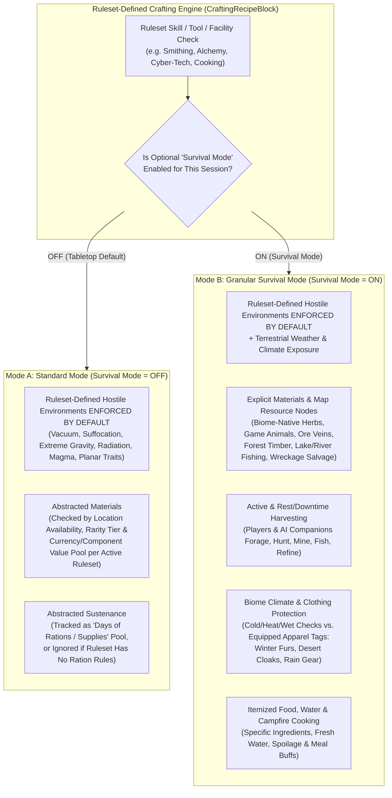
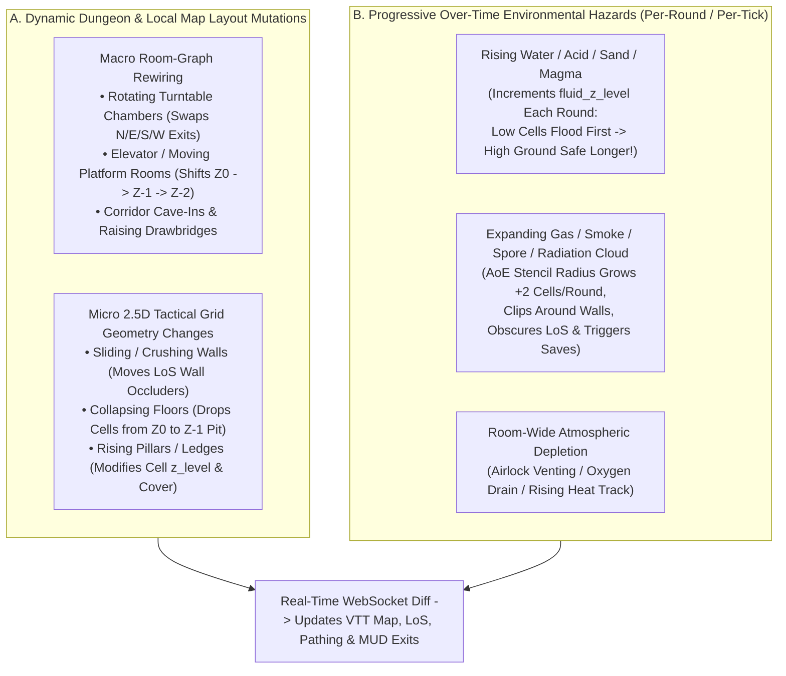
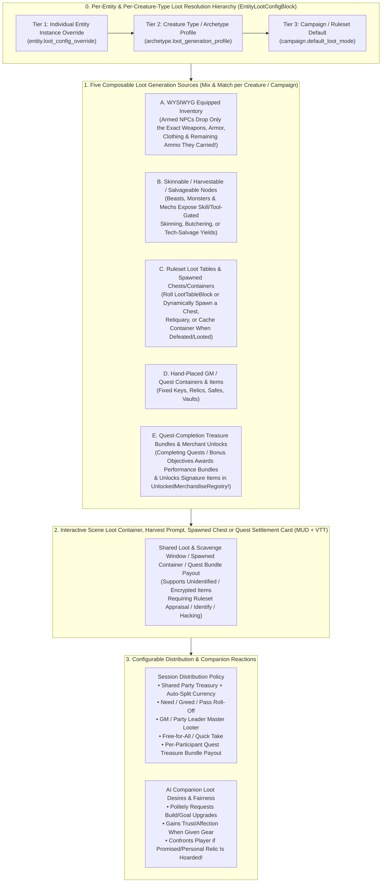
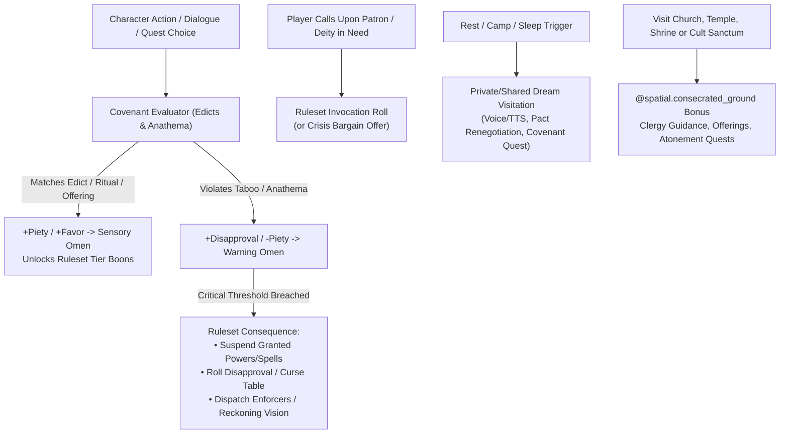
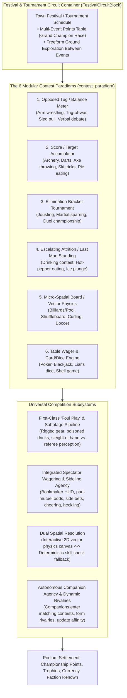
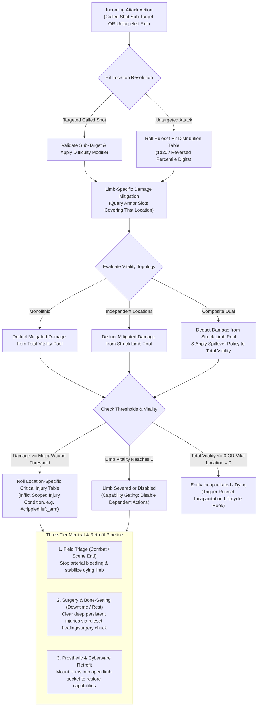

# Meddah Technical Specification — Volume 5: Downtime, Crafting/Survival, Puzzles/Traps, Loot, Piety, Chases/Races, Competitions & Hit Locations (§1.13–§1.17, §1.27–§1.29)

> [!TIP]
> **Modular Technical Specification Navigation**:
> - **Master Index, Module Registry (§1.0), 14-Phase Roadmap (§2) & 77 Design Resolutions (§2.1)**: [technical_specification_and_plan.md](./technical_specification_and_plan.md)
> - **High-Level Architecture, 4 Golden Rules & 50 Locked Decisions**: [system_design_specification.md](./system_design_specification.md)
> - **Vol 1 — Core Ruleset VM, Layered Inventory & Ingestion (§1.0–§1.2)**: [tech_spec_01_core_vm_and_ingestion.md](./tech_spec_01_core_vm_and_ingestion.md)
> - **Vol 2 — AI/Deterministic GM, Companions, Quests & Retinue (§1.3–§1.4, §1.12, §1.19)**: [tech_spec_02_agents_companions_and_quests.md](./tech_spec_02_agents_companions_and_quests.md)
> - **Vol 3 — World, Cosmology, Travel, Law/Capture, Megacities & Geopolitics (§1.5, §1.11, §1.20–§1.24)**: [tech_spec_03_world_cosmology_and_society.md](./tech_spec_03_world_cosmology_and_society.md)
> - **Vol 4 — Multiplayer, West Marches/Guild Server, MUD/VTT UI, Audio/VFX, Safety & Maps (§1.6–§1.10, §1.18, §1.25–§1.26)**: [tech_spec_04_multiplayer_ui_and_vtt.md](./tech_spec_04_multiplayer_ui_and_vtt.md)
> - **Vol 5 — Downtime, Crafting/Survival, Puzzles/Traps, Loot, Piety, Chases, Competitions & Hit Locations (§1.13–§1.17, §1.27–§1.29)**: [tech_spec_05_gameplay_systems_and_anatomy.md](./tech_spec_05_gameplay_systems_and_anatomy.md)

---

### 1.13 Rest, Wilderness Camping & Extended Downtime Activity Engine (`backend/app/systems/downtime_recovery.py` & `desktop/src/components/rest_downtime/`)

Different tabletop RPGs treat resting and downtime in radically different ways—from *D&D's* 1-hour Short Rest / 8-hour Long Rest, to *Blades in the Dark's* structured post-score Downtime Phase (Payoff $\rightarrow$ Heat $\rightarrow$ Entanglements $\rightarrow$ 2 Downtime Actions), to *Pathfinder 2e's* Earn Income / Retraining days, to *Traveller's* 1-week Hyperspace Jump study periods, or *Call of Cthulhu's* months of between-scenario recovery.

In strict adherence to our **Zero-Assumption Golden Rule**, the engine never hardcodes "8 hours restores 100% HP." Instead, **Rest Tiers**, **Camp Roles**, and **Downtime Activities** are modular **Ruleset Building Blocks** (`RestTierBlock`, `CampRoleBlock`, `DowntimeActivityBlock`) extracted by **Ingestion Probe #3** or customized in the **Ruleset Studio**.

```mermaid
flowchart TD
    subgraph Triggers["1. How Rest or Downtime Is Triggered"]
        Cmd["Player / Party Request\n(Click [Rest / Make Camp] or [Enter Downtime],\nor type 'rest' / 'camp' / 'downtime' in MUD)"]
        ScoreEnd["Quest / Heist / Arc Completion\n(Ruleset ECA Hook Automatically Prompts Downtime Phase)"]
        Transit["Long-Distance / Hyperspace / Sea Voyage\n(Multi-Day Ship/Vessel Transit Opens On-Board Downtime)"]
        GMTrig["Human GM / Solo Director Trigger"]
    end

    subgraph ContextCheck{"2. Location Safety & Context Check"}
        Wild["A. Hostile / Wilderness / Dungeon Location\n(Opens 'Make Camp' Interface)"]
        Safe["B. Safe Haven (Settlement Inn/Clinic,\nParty Stronghold/Lair, or Secured Vessel)"]
    end

    subgraph CampFlow["Wilderness / Dungeon Camp Flow"]
        Roles["Assign Camp Roles & Watch Shifts\n(Lookout, Medic, Cook/Forager, Ward-Caster)"]
        CampRP["Companion Campfire Vignette\n(High-Impulse Companion Initiates Heart-to-Heart RP)"]
        Hazard["Deterministic Watch / Ambush Check\n(Vs. Region Threat Level & Camp Concealment)"]
        RecoverA["Apply Ruleset Rest Mutations\n(Consume Rations/Supplies, Restore Pools per Ruleset)"]
    end

    subgraph SafeFlow["Safe Haven Rest & Extended Downtime Flow"]
        Comfort["Select Haven Tier (Common Room, Luxury Suite,\nStronghold Quarters, Medbay Cryo-Pod)"]
        ActSelect["Interactive Downtime Activity Planner\n(Players & AI Companions Pick Activities)"]
        ResolveAct["Deterministic Activity Rolls + Facility Bonuses\n(Craft, Research, Train, Indulge Vice, Heal, Gather Intel)"]
        TickWorld["Advance Calendar, Faction Clocks & Upkeep"]
    end

    Triggers --> ContextCheck
    ContextCheck -->|"Hazardous"| Wild --> Roles --> CampRP --> Hazard --> RecoverA
    ContextCheck -->|"Safe Hub / Base / Ship"| Safe --> Comfort --> ActSelect --> ResolveAct --> TickWorld
```

#### 1. Resting: Wilderness/Dungeon Camping vs. Safe Haven Rest & Settlement Danger Zoning
When the player(s) initiate a rest (via the **`[Rest / Camp]`** HUD button, typing `rest` or `camp` in the MUD terminal, or via a **Party Vote** in multiplayer), the engine inspects the current room's `safety_rating` alongside the active ruleset's `RestTierBlocks` (e.g., *Breather / Short Rest*, *Field Camp / Long Rest*, *Full Haven Recovery*).

**Settlements and Cities Are Not Monolithic Havens**: Room nodes across towns, cities, and stations carry an authoritative **Settlement Safety Rating Triad**:
1. **`safety_rating: "safe_haven"` (Private Sanctuaries)**: Dedicated secure quarters (locked inn bedrooms, player apartments/homes, allied guildhall dorms, private medical suites, secured vessel cabins, party strongholds). Ambient random wanderers are suppressed (`0%`). Long rests do not require watch shifts.
2. **`safety_rating: "settlement_public"` (Public Venues & Main Thoroughfares)**: Tavern common rooms, bustling bazaars, temple plazas, public bathhouses, docks promenades. Ambient rolls draw from the low-lethality **Urban Public Disturbance Pool** (pickpockets, drunkards, criers, guard patrols, barroom brawls). Resting in public nodes is insecure and prompts warning tags or reduced comfort tiers.
3. **`safety_rating: "settlement_hostile"` (Dangerous Urban Sectors & Underbellies)**: Lowtown slums, fog-shrouded smuggling docks, crime syndicate turf, sewers, undercity ruins, or occupied riot zones. **Active Random Encounter Tables and Tension Pools run continuously just like in a dungeon or wilderness!** Resting in `settlement_hostile` rooms automatically defaults to **Mode A (Wilderness / Camp Rules)**, requiring watch shifts, barricades, and nocturnal ambush checks unless a secure safehouse is established.

* **Mode A — Making Camp in the Wilderness or a Dungeon (`safety_rating: "hazardous" | "wilderness" | "settlement_hostile"`)**:
  1. **Interactive Camp Setup & Watch Roster**:
     - Opens the **Campfire Setup Card** where players and **AI Companions** are assigned to ruleset-defined **Camp Actions / Watch Shifts**:
       - *Lookout / Sentry* (rolls Perception/Alertness against night ambushes),
       - *Forager / Cook* (rolls Survival/Cooking to save rations or grant a temporary well-fed buff),
       - *Field Medic* (rolls Medicine to tend wounds/conditions before recovery is calculated),
       - *Camouflage / Ward-Setter* (sets perimeter alarms, rituals, or hides the campfire smoke to lower encounter chance),
       - *Resting / Preparing* (memorizing spells, repairing gear, tuning cyberware).
     - AI Companions automatically suggest the camp role they are best suited for based on their skills (e.g., *"Vane: I'll take first watch on the ridge. Get some sleep."*).
  2. **The Interactive "Campfire / Haven Hangout" RP Phase (Player-Initiated & Companion-Initiated — AI + Deterministic Topic/Gift Cards)**:
     - Resting **never** forces an instant fade-to-black time skip unless the player clicks `[Skip Straight to Sleep]`.
     - Instead, initiating a rest (whether around a wilderness campfire, in a tavern common room, or inside a Stronghold/Ship lounge) transitions the scene into an open-ended **Rest & Hangout Phase**:
       - **Player-Initiated RP Scenes**: Players can click on any AI Companion (or fellow Player Character) or type in the MUD terminal (e.g., `talk to Vane by the fire`, `invite Lyra for a drink on the observation deck`, `confront Kael about the ambush`, `give [ancient_coin] to Vane`, or `tell a story around the campfire`) to start a **1-on-1 Private Pull-Aside Chat** or a **Full-Party Campfire Scene**! **When AI is disabled or unavailable**, clicking a companion opens the **Deterministic Campfire Interaction Card** (offering unlocked *Backstory/Trust Conversation Topics*, *Tell a Story / Perform [Ruleset Social Check]*, *Spar / Train Together*, *Share a Meal/Drink*, or *Give Gift Item* with deterministic relationship/memory updates and persona barks).
       - **Companion-Initiated RP Scenes**: Simultaneously, if an AI Companion has a pending high-impulse topic (a personal revelation, a question about the player's past, or a gripe about a recent decision), a subtle **`[💬 Wants to Talk]`** badge illuminates on their portrait so the player can engage them (via live AI RP or a structured **Companion Choice & Disposition Tree** when AI is unavailable).
       - Players can take as many turns of roleplay, banter, and camp activity as they like; the night only advances when the player(s) click **`[Turn In for the Night / End Rest]`** (or type `sleep`).
  3. **Freeform / Unstructured Camp Duties & Rest Activities (Beyond Pre-Built Mechanics — With Deterministic Custom Activity Adjudicator)**:
     - Players are **never** restricted to clicking pre-programmed ruleset camp buttons!
     - During any rest (in camp, at an inn, or at a base), a player can type **any custom duty, routine, or roleplay activity** in the MUD input or the `"Custom Rest Activity"` box—even if the active ruleset has zero built-in mechanics for it:
       - *Examples*: `"I spend an hour sharpening my father's broken sword and oiling my armor"`, `"I carve a wooden figurine for the orphan we rescued"`, `"I study the strange star-chart under a magnifying glass"`, `"I teach the rookie companion how to parry a feint"`, `"I pray at the makeshift shrine"`, or `"I rig a tripwire of tin cans along the northern gully"`.
     - **How the Engine Handles Unstructured Rest Activities (AI & Zero-AI Deterministic Modes)**:
       1. **Pure Narrative & Character Depth**: If the activity is purely expressive/roleplay (e.g., writing in a journal, playing a lute, sharing a meal), the AI GM (or **Deterministic Rest Vignette Assembler**) logs the scene, triggers deterministic affinity shifts from nearby companions whose `likes`/`morals` match the activity tags (e.g., `Affection +5`, new episodic memory), and requires zero dice rolls.
       2. **Ad-Hoc Mechanic / Situational Tag Binding (AI Proposal or Deterministic Custom Activity Builder)**: If the freeform duty has practical value (e.g., rigging the tin-can tripwire, studying the star-chart, or sparring with a companion), the AI GM—or, in Zero-AI / Failover mode, the **Deterministic Custom Activity Adjudicator Card** (where the player/GM selects *Ruleset Skill to Roll + Outcome Type: `Create Situational Tag/Buff`, `Discover Clue`, or `Advance 4-Segment Custom Project Clock`*)—executes the ruleset check and awards the mechanical effect (`add_tag: "Improvised Perimeter Alarm"`, `grant_clue`, or progress clock `"Restore Father's Sword: 1/4"`) without needing a hardcoded button in the ruleset!
  4. **Resource Consumption & Watch Resolution**:
     - Consumes any ruleset-required supplies (*Rations, Firewood, Power Cells*), rolls the deterministic Watch/Encounter check against the region's hazard rating (modified by any freeform preparations the player made!), and executes the ruleset's **Rest Recovery Formulas**.

* **Mode B — Resting in Safe Areas: Settlements, Inns, Strongholds & Vessels (`safety_rating: "safe_haven"`)**:
  1. **Ambient Ambush Suppression vs. Authoritative GM & Narrative Infiltration Events**:
     - **Ambient Monster Suppression**: In dedicated safe havens, ambient wandering monster rolls are suppressed by default (`0%` ambient spawn rate), allowing characters to rest fully without splitting into watch shifts.
     - **Authoritative GM Agency & Narrative Infiltrations**: A safe haven is **never** a magical invulnerability bubble that strips GM authority. Human GMs (via the **GM Director Dock** / Encounter Builder), AI GMs (following dramatic narrative pacing, faction front clocks, or bounty/nemesis callbacks), and Solo Directors retain full authoritative agency to initiate events and encounters mid-rest whenever the narrative calls for it:
       - *Barroom & Taproom Brawls*: Resting or carousing in a tavern common room can erupt into a tavern brawl over cheated dice, old grudges, or drunken mercenaries.
       - *Midnight Assassinations & Infiltrations*: A character sleeping in an inn room or private residence may be targeted by contracted assassins, stealthy thieves climbing balconies, or corrupt city watch serving an arrest warrant.
       - *Arson, Raids & Structural Disasters*: Building fires, riot spillover, or rival faction sieges forcing evacuation.
  2. **Mid-Rest Interruption & Partial Recovery Flow**:
     - **Rest Clock Pause**: When an encounter triggers mid-rest, the active rest session is immediately **paused** (not canceled or wiped).
     - **Deterministic Partial Recovery Check**: The Ruleset VM evaluates elapsed rest time against the active `.rpgrules` `RestTierBlock` hierarchy. If the interrupted rest has crossed the time threshold for an earlier or shorter rest tier (e.g., reaching 2 hours of a scheduled 8-hour Long Rest when the ruleset defines a 1-hour *Breather / Short Rest*), the party deterministically receives the mechanical recovery benefits of that lower tier before initiative is rolled.
     - **Equipment & Sleeping Gear Readiness (`sleeping_gear_state`)**: Sleeping characters evaluate readiness strictly per ruleset mechanics:
       - Characters resting in comfortable beds are marked `status: unarmored` if the ruleset penalizes sleeping in armor (e.g., exhaustion or fatigue penalties), using base unarmored defense or scrambling for weapons placed on bedside nightstands.
       - Targets asleep when combat starts carry the ruleset `#asleep` or `#unconscious` condition until awakened by loud noise, an ally's action, or taking damage per ruleset rules.
     - **Post-Encounter Choices**: Once the encounter concludes (foes slain, driven off, arrested, or parleyed), the party is prompted with context-aware actions:
       - **`[Resume Rest]`**: Continue the remaining hours of the rest if the room is secured.
       - **`[Relocate to New Safehouse]`**: Move to another haven (e.g. guildhall, temple) to finish resting.
       - **`[Transition to Pursuit / Investigation]`**: Follow up immediately on assassin clues or town alarms.
  3. **Ruleset Comfort / Lifestyle Tiers & Facility Bonuses**:
     - Safe havens expose ruleset-defined **Rest Quality Tiers** (e.g., *Sleeping in the Stables / Cheap Bunk*, *Comfortable Inn Room*, *Aristocratic Suite*, *Stronghold Master Bedroom*, or *Starship Advanced Medbay*).
     - Higher tiers or upgraded **Stronghold Facilities** (*Infirmary, Shrine, Spa, Sanctum*) automatically apply their ruleset recovery bonuses (e.g., curing lingering injuries, clearing extra Stress/Exhaustion, or granting temporary inspiration/morale buffs).

---

#### 2. Extended Downtime & Downtime Activities
While **Resting** covers hours or a single night, **Downtime** covers days, weeks, or months between adventures (or during long voyages).

* **When Is Downtime Triggered? (4 Ways)**:
  1. **Player / Party Initiated (Anytime in a Safe Area)**: Whenever the party is in a Settlement, Stronghold/Lair/Station, or aboard a Vessel, players can click **`[Start Downtime]`** (or type `downtime <duration>`) and choose how many days/weeks/turns to spend.
  2. **Automatic Ruleset Phase Transition**: In rulesets with structured episodic loops (like *Blades in the Dark / Forged in the Dark*, *Pendragon* winter phases, or *Ars Magica* seasons), completing a Quest/Score automatically triggers the ruleset's **Downtime Phase** via an `ECA` hook.
  3. **Long-Distance / Interstellar / Sea Voyage Transit**: When travelling aboard a **Starship in Hyperspace**, an **Airship**, or a **Galleon** on a multi-day/multi-week route, the engine opens an **On-Board Transit Downtime Window** so the crew can train, craft, research, or socialize in the ship's facilities while the voyage progresses!
  4. **Human GM / Solo Director Trigger**: The GM can initiate a time-skip or downtime phase (e.g., *"Three months pass before the spring thaw..."*) from the Director Dock.

* **How Players AND AI Companions Select & Perform Downtime Activities**:
  When Downtime begins, the **Downtime Activity Planner UI** opens, listing all **`DowntimeActivityBlocks`** defined in the active `.rpgrules` schema (plus any custom activities unlocked by the current Settlement's districts or the party's **Stronghold/Vessel Facilities**):

  | Common Ruleset Downtime Activity | How It Executes in the Ruleset VM & World State |
  | :--- | :--- |
  | **1. Crafting, Inventing & Enchanting** | Checks `@room.has_facility("forge" / "lab")`, consumes raw material/currency costs, rolls the ruleset's crafting skill check, and either produces the item immediately or advances an **Item Crafting Progress Clock**. |
  | **2. Research, Investigation & Lore Study** | Uses a *Library / Archive / Databank* to roll research checks, unlocking **Mystery Clues**, discovering new **World Map POIs**, or learning new spells/schematics. |
  | **3. Training & Retraining (`Advancement`)** | Spends downtime days + currency/XP with a trainer or *Training Yard* facility to increment a skill, learn a language/feat, or retrain an existing ability per the ruleset's `advancement_graph`. |
  | **4. Recuperation, Surgery & Prosthetic Installation** | Treats severe deep wounds, fractured limbs, internal organ damage, sanity/trauma, cyberpsychosis, or curses that normal overnight rests cannot cure; executes surgical operations (bone-setting, foreign object extraction, amputation) and grafts prosthetic/cybernetic limbs into open sockets (enhanced by a *Clinic / Hospital / Temple / Medbay* or a companion acting as physician/cyber-surgeon). |
  | **5. Indulging Vice / Stress Relief / Carousing** | Rolls the ruleset's Stress/Sanity relief or Carousing table—clearing mental tracks, generating local tavern **Rumors/Side-Quests**, making new NPC contacts (or risking a funny/dramatic *Overindulgence / Hangover Entanglement* if defined by the ruleset!). |
  | **6. Earning Income / Working a Trade / Managing Holdings** | Rolls a profession/business check or operates a **Stronghold Facility**, generating currency/resources for the party treasury. |
  | **7. Long-Term Personal / Faction Projects** | Allows a player (or companion) to create or advance a custom **Long-Term Project Clock** (e.g., *"Decode the Obsidian Tablet: 0/8"*, *"Build a Spy Ring in Port Vane: 0/6"*, or *"Repair the Derelict Airship Engine: 0/10"*). |
  | **8. Reduce Heat / Lay Low / Diplomacy** | Lowers faction hostility/wanted trackers or boosts reputation with a local faction. |
  | **9. Freeform / Custom Player Activity (Any Unscripted Goal or Duty)** | Players can type **any custom downtime endeavor** not explicitly listed in the ruleset (e.g., *"Host a banquet for the town council"*, *"Infiltrate the Noble District disguised as a servant"*, *"Write a treatise on Abyssal flora"*, *"Take Vane on a tour of the old quarter"*). When AI is active, the AI GM adjudicates it as an interactive mini-scene; **when AI is disabled or unavailable**, the **Deterministic Custom Downtime Activity Builder** lets the player/GM bind the endeavor to any **Ruleset Skill Check + Target Output** (*Create/Advance Custom Project Clock*, *Modify Faction Reputation*, *Gain Situational Boon/Tag*, or *Companion Relationship Vignette*) and resolves it deterministically in the VM! |

* **AI Companion Autonomy & Collaboration During Downtime**:
  - **Yes—AI Companions participate fully in Downtime!**
  - When the Downtime Planner opens, each AI Party Member **proposes their own Downtime Activity** based on their `persona`, `short_term_goal`, `long_term_goal`, and current condition (e.g., if Vane is injured, he selects *Recuperate*; if healthy, he works on his personal project *"Decode the Cipher of Ur"* or goes *Carousing for Inquisition rumors*).
  - **Player Coordination & "Assist" Actions**:
    - Players can accept a companion's self-selected activity, **ask a companion to perform a specific activity** for the party (e.g., *"Lyra, brew healing potions in the lab while I research the tomb"*—evaluated via their `Trust`/`Obedience`), **OR** team up on the **same activity** to grant a ruleset **Assist / Help Bonus** (`+1d6` / Advantage / `+2`) while triggering a shared downtime RP vignette!
* **Deterministic World & Clock Advancement**:
  - Once all Players and AI Companions lock in their Downtime Activities, the VM resolves the rolls, narrates a brief montage (or plays out any triggered RP scenes), pays any Stronghold/Ship upkeep, and ticks the **World Calendar & Faction Progress Clocks** forward by the exact downtime duration.

---

### 1.14 Crafting, Resource Harvesting & Optional "Survival Mode" Architecture (`backend/app/systems/crafting_survival.py` & `desktop/src/components/crafting/`)

Crafting, foraging, and wilderness survival are deeply rewarding in solo and tabletop play—yet some groups want fast tabletop abstraction while others want granular resource harvesting and environmental survival. We support both seamlessly via **Ruleset Crafting Building Blocks** paired with a campaign/session **`Survival Mode` Toggle** (`Standard Abstract Mode` vs. `Granular Survival Mode`).



#### 0. Ruleset-Defined Hostile Environments (Default-On, Host-Overridable) vs. Optional Survival Mode (`environment_hazards.py`)
To make sure the world's physical reality and the active ruleset's core hazards are never bypassed, environmental effects are strictly divided into **Two Tiers**:

| Tier | Scope & Examples | Enforcement Rule |
| :--- | :--- | :--- |
| **Tier 1: Ruleset-Defined Hostile & Extreme Environments (Enforced by Default; Host-Overridable via `environment_hazards`)** | **1. Hard Vacuum & Decompression** (Space, hull breaches, airless moons — requires *Sealed Void Suit / Life Support* or triggers immediate suffocation/decompression damage per ruleset).<br>**2. Underwater Submersion & Abyssal Crush Depth** (Requires *Water Breathing / Diving Suit / Submersible* or triggers breath-holding/drowning & pressure damage).<br>**3. Extreme Gravity (`Zero-G`, `Low-G`, `Crushing High-G`)** (Enforces ruleset movement modes, untethered drift, ranged trajectory modifiers, and high-G stamina/encumbrance crushing penalties).<br>**4. Lethal Radiation, Corrosive/Toxic Atmospheres & Biohazards** (Requires *Rad-Suit / Hazmat / Sealed Respirator / Immunity* or applies radiation/poison tracks every round/turn).<br>**5. Extreme Thermal & Planar Lethal Zones** (*Active Lava/Magma, Elemental Plane of Fire, Cryogenic Liquid Nitrogen, Warp Rifts*). | **ENFORCED BY DEFAULT (Host-Overridable via `environment_hazards`).**<br>Whenever defined in the active `.rpgrules` schema and the `environment_hazards` module is active, the Ruleset VM enforces these deterministically regardless of whether `Survival Mode` is ON or OFF (a Host may still disable the module via an audited `MODULE_OVERRIDE`). |
| **Tier 2: Granular Terrestrial Survival & Foraging (`Survival Mode`)** | **1. Terrestrial Biome Weather & Seasonal Apparel** (Wearing warm furs in a snowy forest, breathable robes in a desert, dry cloaks in a rainstorm).<br>**2. Itemized Food, Water, Spoilage & Campfire Cooking** (Replacing abstract `"Days of Rations"` with specific ingredients and recipes).<br>**3. Explicit Crafting Material Harvesting from Map Nodes** (Replacing abstract material value pools with specific herb/ore/timber/fishing nodes). | **OPTIONAL (`survival_mode: true/false`).**<br>Toggled per campaign or expedition depending on whether the group wants granular wilderness resource management or standard tabletop abstraction. |

#### 1. 100% Ruleset-Defined Crafting Mechanics (`CraftingRecipeBlock`)
In keeping with zero assumptions, **how** items are crafted (the skill rolled, difficulty, required tools/facilities, time/clock segments, and critical success/failure perks) is strictly governed by the active `.rpgrules` schema:
* **Ingestion Discovery**: During PDF ingestion, **Probe #3/#6** actively extracts *crafting, alchemy, smithing, enchanting, cooking, engineering, item modification, and harvesting rules* into modular `CraftingMechanicBlock` and `CraftingRecipeBlock` schemas (editable in the **Ruleset Studio**).
* **Dual-Input Recipe Schema**: Every recipe supports both an **Abstract Requirement** (`rarity: "Uncommon"`, `material_category: "Alchemical Reagents"`, `value_cost: 25`) AND an **Explicit Itemized Requirement** (`[{"item": "frost_lotus", "qty": 2}, {"item": "crystal_vial", "qty": 1}]`), so the exact same ruleset works in either mode!

#### 2. Foraging & Material Production During Rests, Downtime & Exploration
Whether in Solo or Multiplayer, **both Players and AI Companions** can spend time during **Rests (Camp Duties)**, **Extended Downtime**, or **Live Room Exploration** to gather or refine crafting materials:
* **In `Standard Abstract Mode`**: Spending a rest/downtime action foraging or salvaging rolls the ruleset's *Survival / Nature / Scavenging / Alchemy* skill against the current location's abundance rating to generate **Abstract Crafting Material Units** graded by Category & Rarity (e.g., *+15 gp worth of `Uncommon Herbalism Reagents`* or *`3 Units of Rare Scrap Tech`*).
* **In `Granular Survival Mode`**: Foraging, hunting, mining, fishing, or logging harvests **explicit named material items and quantities** directly from the local biome and map nodes!

#### 3. Deep-Dive: Optional "Survival Mode" (`survival_mode: true`)
When the Host, GM, or Solo Player enables **Survival Mode** (either for the whole campaign or toggled on during a wilderness expedition arc, with customizable sub-toggles), three interconnected systems activate:

##### A. Biome-Native Harvestable Resource Nodes on World, Region & Room Maps
The **World Generator** and **JIT Room Expander** automatically seed (and let the GM/Solo Player manually place) interactive **Resource Nodes** matched to each location's **Biome & Z-Stratum** as declared in the active `.rpgrules` and `.rpgworld` data packages:

> [!NOTE]
> **Illustrative Sample-Ruleset Examples Only (Zero Built-In Engine Content)**: All specific resource names, herbs, ores, wildlife, tools, and yields shown in the table and paragraphs below (e.g., *Moonleaf*, *Kingsfoil*, *Mithral Ore*, *Titanium Alloy Plate*, *Plasma Coil*) are **illustrative examples from sample fantasy and sci-fi `.rpgrules`/`.rpgworld` packages**. In strict compliance with **Golden Rule #1** and **Golden Rule #4**, the Meddah engine core ships **zero** hardcoded resource items, biomes, or crafting recipes.

| Sample Biome / Location Type (Illustrative) | Sample Ruleset/World Resource Nodes (Illustrative) | Sample Ruleset Tool / Capability & Yield Examples (Illustrative) |
| :--- | :--- | :--- |
| **Forests, Woodlands & Swamps** | *Medicinal Herb Patches, Berry/Mushroom Groves, Game Trails (Deer/Boar), Timber/Hardwood Trees, Resin/Sap Trees* | *Herbalism Kit / Knife* $\rightarrow$ `Moonleaf (x3)`, `kingsfoil (x1)`; *Bow / Snare Trap* $\rightarrow$ `Raw Venison (x4)`, `Thick Hide (x2)`; *Felling Axe* $\rightarrow$ `Seasoned Ash Wood (x5)`. |
| **Mountains, Crags & Underdark (`Z-1 / Z-2`)** | *Iron / Copper / Mithral Ore Veins, Crystal Geodes, Coal Seams, Bioluminescent Cave Moss, Deep-Fungi* | *Miner's Pick / Sonic Drill* + *Strength/Mining Check* $\rightarrow$ `Raw Iron Ore (x4)`, `Star-Quartz (x1)`. |
| **Rivers, Lakes, Coasts & Ocean (`Z0 / Z-1`)** | *Freshwater Fishing Pools, Coastal Shellfish Beds, Kelp Forests, Driftwood, Deep-Sea Vent Minerals* | *Fishing Rod / Net / Spear* $\rightarrow$ `River Trout (x3)`, `Fresh Water`; *Diving Gear* $\rightarrow$ `Abyssal Pearl`. |
| **Arid Deserts, Tundra & Ash Wastes** | *Oasis Springs, Ice-Moss, Frost-Beast Tracks, Obsidian Outcrops,Sulfur Vents* | *Skinning Knife / Ice-Pick* $\rightarrow$ `Insulating Yeti Pelt (x2)`, `Brimstone Powder (x3)`. |
| **Ruins, Battlefields, Space Hulks & Urban Zones** | *Scrap Metal Piles, Salvageable Circuitry/Power Cores, Arcane Ley-Line Fonts, Abandoned Supply Crates* | *Salvage Tools / Arc-Welder* $\rightarrow$ `Titanium Alloy Plate (x2)`, `Intact Plasma Coil (x1)`. |

* **Depletion & Replenishment**: Resource nodes track `remaining_yield` (so a single ore vein or fishing hole can't be spammed infinitely in one afternoon) and replenish over World Calendar ticks/seasons.
* **Refining Chain**: Raw harvested materials (*Raw Iron Ore*, *Fresh Hide*, *Crude Herbs*) can be refined at camp or at **Stronghold/Settlement Facilities** (*Smelter/Forge, Tannery, Alchemical Still*) into processed crafting components (*Steel Ingots*, *Cured Leather*, *Distilled Extracts*).
* **Purchasing & Trading Crafting Materials at Settlement Merchants (In Both Modes!)**:
  - Even with **Survival Mode enabled**, players are **never** forced to personally mine every piece of ore or pick every flower if they have the coin or trade goods!
  - Settlement shops and merchants (*Blacksmiths, Apothecaries/Herbalists, General Stores, Timber Yards, Alchemists, Quartermasters, Cyber-Vendors*) automatically populate their **Merchant Inventory Containers** based on the settlement's `economy_tier`, `trade_routes`, and `surrounding_biome`:
    - **In `Survival Mode`**: Appropriate shops stock **explicit itemized raw and refined materials, tools, biome apparel, and provisions** (e.g., an Apothecary sells `Moonleaf`, `Crystal Vials`, and `Distilled Extracts`; a Blacksmith sells `Iron Ore`, `Steel Ingots`, and `Coal`; a General Store sells `Winter Furs`, `Fishing Rods`, `Salt`, and `Smoked Venison`), and players can also **sell** their excess harvested materials to those merchants!
    - **In `Standard Mode`**: The same shops sell **Abstract Crafting Material Units** by Category & Rarity and abstract `Rations / Supplies` at ruleset prices.

##### B. Terrestrial Biome Weather & Clothing / Apparel Requirements (While Tier-1 Extreme Hazards Stay Active by Default)
While **Tier-1 Lethal Environments** (enforced whenever the `environment_hazards` module is active) (*Vacuum, Underwater Crush Depth, High/Zero Gravity, Lethal Radiation, Toxic Atmosphere, Planar Fire*) are enforced deterministically whenever defined by the active ruleset (a Host may still disable the module, recorded as an audited `MODULE_OVERRIDE`), enabling **Survival Mode** additionally activates **Tier-2 Terrestrial Climate & Weather Exposure** (`temperature_band`: *Freezing Winter $\leftrightarrow$ Temperate $\leftrightarrow$ Scorching Sun*, `precipitation/wetness`, `windchill`):
* **Apparel & Gear Protection Tags**:
  - Clothing, cloaks, and armor linings carry ruleset-bound climate tags in the **Composable Equipment Graph**:
    - *Arctic / Snowy Mountain*: Requires `cold_weather_gear` / `insulated_furs` (and dry clothing if soaked after crossing afreezing river!).
    - *Scorching Desert / Jungle Humidity*: Requires `heat_breathable_garb` / `sun_protection` + increased hydration consumption; wearing heavy metal armor in extreme desert sun applies the ruleset's heat-exhaustion penalty!
    - *Heavy Storm / Bog*: Requires `waterproof_cloak` / `weather_tent`.
  - *(Note: When the `environment_hazards` module is active, Tier-1 protection gear defined by the ruleset—such as `sealed_void_suit`, `radiation_shielding`, `rebreather`, or `grav_harness`—is checked in Vacuum, Radiation, Underwater, or High-G zones independently of the `Survival Mode` toggle!)*
* **Ruleset Exposure Consequences (`ECA` Hooks)**:
  - If a character travels or camps in a harsh biome without appropriate clothing/shelter/campfire warmth, the engine periodically triggers the active ruleset's **Environmental Exposure Check** (e.g., *Constitution / Fortitude / Endurance Save* or *Survival Roll*), applying the ruleset's exact status conditions (*Chilled, Hypothermia, Heatstroke, Exhaustion/Fatigue Track, Frostbite*) until they warm up by a fire or equip proper attire!
  - **AI Companion Awareness**: AI Companions will warn the player before marching into a blizzard without winter cloaks (*"Vane shivers, pulling his collar up. 'We'll freeze before sundown in these linens. We should buy furs in town or hunt some pelts first.'"*).

##### C. Itemized Food, Water, Foraging & Campfire Cooking
* **When Survival Mode is OFF (`Standard Mode`)**:
  - If the active ruleset tracks rations at all, sustenance is handled via a single lightweight abstract counter (`Days of Rations: 5`, `Water Skins: 2`) automatically ticked on camp rests—or ignored completely if the ruleset doesn't use rations.
* **When Survival Mode is ON (`Granular Mode`)**:
  - Abstract ration counters are replaced by **Specific Food & Drink Items** in the party's inventory containers (*Fresh Venison, River Trout, Hardtack Biscuits, Dried Fruit, Clean Water, Ale, Ration Packs*) with optional `freshness / spoilage_days` (unless preserved by salting, smoking at camp, or storing in a Stronghold/Ship cold-larder!).
  - **Campfire Cooking & Meal Buffs**: During the **Wilderness Camp / Haven Rest Phase**, a player or AI Companion assigned as *Camp Cook* can combine harvested ingredients (*River Trout + Wild Herbs*) to cook meals that satisfy hunger/thirst and grant ruleset-defined morale or stamina buffs for the next day's adventure!

---

### 1.15 Modular Puzzle & Trap Generator, Contraption Logic Editor & VTT Deployment (`backend/app/systems/contraptions_engine.py` & `desktop/src/components/puzzle_studio/`)

To allow GMs and Solo Players to design, generate, and deploy everything from classic dungeon traps to intricate multi-room environmental puzzles, the engine includes a **Modular Contraption, Puzzle & Trap Subsystem** built directly on top of the **Ruleset VM's Deterministic `ECA` (Event-Condition-Action) Bus** and the **2.5D Tactical Grid**.

```mermaid
flowchart LR
    subgraph Inputs["1. Modular Sensor & Input Nodes (MUD + 2.5D VTT)"]
        Spatial["Spatial / Grid Sensors\n(Pressure Plates, Tripwires,\nLaser/Light Beams, Proximity Zones)"]
        Interact["Interactable Contraptions\n(Levers, Rotating Statues, Rune Dials,\nKeyholes, Pedestals, Terminals)"]
        Verbal["Verbal / Riddle / Cipher Input\n(Spoken Passphrase, Riddle Answer,\nTerminal Code in MUD Log)"]
        Env["Celestial / Elemental Sensors\n(Moon Phase Lock, High Tide,\nFire/Ice/Lightning Applied to Brazier)"]
    end

    subgraph Logic["2. Deterministic Contraption State Machine"]
        Gates["Logic & Sequence Evaluators\n(AND / OR / XOR, Exact Order [A->C->B],\nWeight/Value Sum, Mirror Ray-Bounce)"]
        Clock["Hazard / Countdown Clocks\n(e.g. 'Water Rises 5ft Every Round')"]
    end

    subgraph Outputs["3. Payloads & World Mutations"]
        Reward["Solved Payloads\n(Unlock Secret Door, Extend Bridge,\nLower Forcefield, Reveal Chest)"]
        TrapHit["Trap / Failure Payloads\n(Ruleset Attack/Save + AoE Stencil,\nPit Drop Z-1, Lock Doors, Spawn Guardians)"]
    end

    Inputs --> Logic --> Outputs
```



#### 1. The 3-Part Modular Contraption Architecture (`Sensor -> Logic -> Payload`)
In the **Puzzle & Trap Studio**, any trap or puzzle is assembled (manually via drag-and-drop nodes, from a starter template, or via AI generation) using three universal building blocks:

| Component Layer | Available Modular Blocks | How Players Interact (MUD Text OR 2.5D VTT Canvas) |
| :--- | :--- | :--- |
| **A. Triggers & Sensors (`Inputs`)** | • **Grid Cell Triggers**: *Pressure Plate* (weight threshold), *Tripwire*, *Illusory Floor*, *Proximity/Motion Sensor*.<br>• **Manipulable Props**: *Multi-State Lever (`Up/Middle/Down`)*, *Rotating Statue/Mirror (`N/E/S/W`)*, *Rune Dial*, *Item Pedestal* (checks item tag/weight placed on it), *Computer Terminal*.<br>• **Elemental / Damage Receptors**: *Unlit Brazier / Arcane Crystal / Conduit* (activates when hit by an Action with `tag: "fire" | "lightning" | "cold" | "radiant"`).<br>• **Verbal / Riddle / Cipher**: Listens for a spoken phrase (`say "Mellon"`) or code entered in the room.<br>• **Celestial / Chronology Lock**: Activates when `@celestial.moon_phase` or `@time` matches. | Players can **move tokens** onto pressure plates, **click/rotate props** directly on the 2.5D VTT map, **drag an item** from their inventory onto a pedestal, **cast a fire spell** at a brazier, or **type MUD commands** (`pull iron lever`, `turn eagle statue east`, `place ruby on altar`). |
| **B. Logic Gates & State Evaluators (`Logic`)** | • **Combination State Match**: e.g., `Statue_1 == "East" && Statue_2 == "West" && Altar.has_item("silver_chalice")`.<br>• **Ordered Sequence Validator**: Must trigger inputs in exact order `[Rune_Water -> Rune_Earth -> Rune_Fire]`; wrong order triggers reset/penalty.<br>• **Toggle / Matrix Network (`Lights-Out` / Pipe / Circuit Routing)**: Flipping Switch A toggles Doors 1 & 2; Flipping Switch B toggles Doors 2 & 3.<br>• **2.5D Ray-Cast Beam / Mirror Reflection**: Uses the VTT's existing **2.5D Line-of-Sight Ray-Caster** to trace a beam of light/laser from an Emitter across rotatable Mirror tokens to a Receptor crystal!<br>• **Counterweight / Balance Scale**: `@pedestal_left.total_weight == @pedestal_right.total_weight`. | Evaluates deterministically in `<5ms` inside the Ruleset VM every time a player interacts with a sensor or moves on the grid, emitting visual/audio feedback cues (e.g., *"A heavy stone gear grinds into place to the north"*). |
| **C. Payloads & Outcomes (`Outputs`)** | • **Map & Portal Mutations**: Unlock/open doors or secret walls, raise/lower bridges or water levels (`z_level` shift!), disable forcefields.<br>• **Trap Attack / AoE Stencil Execution**: Fires a ruleset Action using an **AoE Stencil** (*Flame Jet Line, Poison Gas Sphere, Pendulum Scythe, Falling Ceiling Block*).<br>• **Vertical Pit / Teleport Displacement**: Drops tokens on cell `(X, Y)` from `Z0` down to a `Z-1` Spiked Pit or floods the room.<br>• **Encounter / Construct Activation**: Awakens dormant *Stone Golems / Security Turrets* in the room. | Updates the 2.5D Tactical Map, MUD log, lighting, and character states in real time. |

---

#### 2. Simple Traps vs. Complex Multi-Round Traps (100% Ruleset-Grounded)
* **Zero-Assumption Ruleset Binding**:
  - A trap never assumes "DC 15 Dexterity Save vs 2d10 Piercing." Instead, every trap binds to the **active ruleset's** exact skills and resolution mechanics:
    - **Detection (`spot_check`)**: Passive or active *Perception / Investigation / Sensor Scan* check (revealing the trap's trigger zone on the 2.5D VTT map to players who succeed!).
    - **Disarm / Bypass (`disable_check`)**: *Thieves' Tools / Engineering / Hacking / Dispel Magic* check (with ruleset tiers: e.g., *Success = Disarmed; Fail by 5+ = Triggers Trap!*).
    - **Effect Resolution**: Invokes any `ResolutionMechanic` and damage/condition mutation defined in the active `.rpgrules`.
* **Simple One-Shot / Resetting Traps** vs. **Complex Multi-Round "Hazard Encounters"**:
  - **Simple Trap**: Step on pressure plate $\rightarrow$ Poison dart fires $\rightarrow$ Resolves immediately.
  - **Complex Multi-Round Trap (Encounter Mode)**: Inspired by tabletop *Complex Traps / Haunts*:
    - When triggered (e.g., *The Walls Begin Closing In*, *The Chamber Fills with Poison Gas*, or *Whirling Arcane Sawblades Advance on Initiative Count 20 & 10*), the room automatically transitions into **Round/Initiative Flow Mode**!
    - Each round, the Complex Trap executes its scheduled **Turn Action** (escalating hazard damage, rising water `z_level`, or moving sawblade tokens along a path) while the party works together across multiple turns to jam the gears, hack the console, pry open the blast door, or solve the puzzle before the countdown clock fills!

---

#### 3. Progressive Clue Distribution, AI Companion Hints & Lateral Solutions
A common problem in RPGs is players getting stuck on a puzzle—or coming up with a brilliant lateral solution the designer didn't anticipate. Our engine solves both:
1. **Automatic Clue Seeding across the Dungeon/Region**:
   - When the Puzzle Generator creates a puzzle (e.g., a 4-pillar elemental sequence), it automatically generates **2–3 Diegetic Clues** (*a torn journal page on a skeleton two rooms back, a weathered mural on the wall, an inscription in an ancient language*) and places them in nearby rooms or interactables!
2. **Tiered Hint Escalation & AI Companion Observations**:
   - Each puzzle defines a 3-tier `hint_ladder`. If the party is stuck, players can roll an *Intelligence / Lore / Investigation* check—or ask an **AI Companion** with relevant expertise (*"Lyra, can you make sense of these arcane runes?"*)—to surface progressive in-character hints without spoiling the whole answer outright.
3. **Lateral / Creative Solution Adjudication ("Rule of Cool" Bypass — Deterministic Tag/Property Rules + Optional AI GM)**:
   - While the deterministic State Machine handles the primary puzzle logic, what if a player does something clever outside the box (e.g., *freezing the water pipe with a Cold spell to burst the lock mechanism*, *using a crowbar and 20 Strength to jam the stone gear*, or *phasing into the Ethereal dimension to look inside the lockbox*)?
   - **Deterministic Tag & Property Lateral Bypass (`alternate_bypass_conditions`)**: Every `ContraptionNode` supports built-in deterministic lateral bypass rules matching **Elemental/Action Tags** (`action.has_tag("cold")` on a pipe/lock), **Physical Force / Hardness Thresholds** (`damage >= node.hardness` or `Athletics/Strength >= force_dc`), **Dimensional/Spatial Phase** (`@actor.dimension_id == "ethereal"` or `@actor.z_elevation >= +15ft`), or a **GM/Solo 1-Click `[Adjudicate Creative Skill Bypass]` Card**—so creative solutions work 100% deterministically without an LLM! When an AI provider is active, freeform MUD commands can additionally be evaluated by the AI GM to invoke `bypass_or_trigger_contraption_node(node_id, state="solved")`.

---

#### 4. GM Visual Contraption Studio & Spoiler-Free Solo Mode
* **For the Human GM**:
  - Paint trigger tiles, laser/mirror emitters, levers, and trap AoE zones directly onto the **2.5D Tactical Grid**, wire them visually with `Sensor -> Logic -> Payload` connector lines, test-fire the trap in a 1-click preview, or save reusable trap/puzzle prefabs to the **GM Palette**.
* **For the Solo Player (Spoiler-Free Procedural Puzzle Generation)**:
  - A Solo Player can click **`[+ Seed Mystery Puzzle / Trap Room (Spoiler-Free)]`** when generating a dungeon or ruin.
  - The engine procedurally wires a solvable contraption state machine and hides the randomized combination/solution inside the dungeon's lore clues and murals—so the Solo Player gets to genuinely solve the riddle, mirror beam, or sequence puzzle themselves without having seen the answer in the editor!

---

#### 5. Dynamic Dungeon/Map Layout Mutations & Progressive Over-Time Hazards (`dynamic_hazards.py`)
**Yes to both!** Because the **MUD Room Graph**, the **2.5D Tactical Grid**, and the **Environmental Hazard Engine** are all reactive state structures in the Campaign Store, puzzles and traps can dynamically reshape the architecture of a dungeon and run multi-round progressive environmental simulations:



##### A. Dynamic Changes to the Dungeon & Local Map Layout
When a contraption payload fires, it can execute **Topological & Geometric Map Mutations**:
1. **Macro Dungeon / Room-Graph Layout Mutations (`Scale 4 Node-Graph`)**:
   - **Rotating / Shifting Chambers (`rebind_room_exits`)**: Pulling a lever in a central hub room can rotate the entire chamber $90^\circ$—so the North archway that previously led to the *Barracks* now aligns with the *Hidden Vault*, live-updating both the visual **Node-Graph Canvas** and the MUD terminal's `[Exits: N, S]`!
   - **Vertical Lift / Sinking Rooms (`shift_room_stratum`)**: An entire room (like a Dwarven chain-lift or Space Station cargo elevator) can physically descend from `Z0 (Upper Keep)` $\rightarrow$ `Z-1 (Deep Mines)` $\rightarrow$ `Z-2 (Underdark Cavern)`, reconnecting its exit doors to the new Z-stratum at each stop.
   - **Catastrophic Cave-Ins & Bridge Toggles**: Triggering a trap can collapse a tunnel (`exit.state = "blocked_rubble"`, requiring excavation or forcing the party to find a detour through the sewers) or extend a stone bridge across a chasm.
2. **Micro 2.5D Tactical Grid Geometry Mutations (`Scale 4 Tactical Canvas`)**:
   - **Moving / Crushing Walls & Portcullises**: Wall segments on the 2.5D grid can slide, rotate, or close cell-by-cell each round—dynamically recalculating **2.5D Line-of-Sight ray-casting**, **Cover**, and **Path Tracing** (and pushing or crushing tokens caught against a solid wall!).
   - **Dynamic Terrain & Elevation (`z_level`) Morphing**:
     - *Collapsing Floor Tiles*: Cells `[C4:E6]` shatter and drop from `z_level: 0` to `z_level: -20ft`, dropping any tokens standing on them into the lower pit (or onto the tactical map of the room directly below at `Z-1`!).
     - *Rising Pillars & Platforms*: Solving a rune sequence raises stone pillars to `+10ft` and `+20ft`, creating a climbable/jumpable stepping-stone path to an upper balcony exit.

##### B. Progressive Effects Over Time & Catastrophic Surges (100% Grounded in the Active Ruleset — Zero Forced Math or Conditions)
* **Strict Zero-Assumption Rule for Hazards & Terrain**:
  - The engine **never** forces hardcoded tabletop outcomes, math, damage types, movement multipliers (like "$2\times$ movement cost"), or status conditions (like `"Prone"`, `"Bludgeoning"`, or `"Reflex Save"`) if those concepts do not exist in the active `.rpgrules` schema!
  - Instead, every stage of a Progressive Hazard or Catastrophic Surge is simply a **Spatial & Environmental State Carrier** that delegates 100% of its mechanical resolution to the **active ruleset's defined building blocks**:
    1. **If the Active Ruleset Defines Hazard/Terrain Mechanics**: The hazard stage binds directly to a ruleset-defined `ResolutionMechanic`, `Action`, `ConditionTag`, or `TerrainRuleBlock` (for example: in a d20 ruleset that defines `"Prone"` and `"Difficult Terrain (2x cost)"`, the surge invokes those exact blocks; in a *Forged in the Dark* narrative ruleset with no grid movement math, the surge instead applies the ruleset's `Position: Desperate` or ticks a `4-Segment Harm Clock`!).
    2. **If the Active Ruleset Defines NO Mechanical Rule for a Terrain/Aftermath State**: If a dam collapses and leaves persistent `"ankle_deep_water"` in a ruleset that has zero rules for shallow water or difficult terrain, the engine **does not invent a movement penalty or math**—it updates the visual map, room sensory tags, and narrative state (`tag: "ankle_deep_water"`) with **zero forced mechanical side-effects**!

* **How Multi-Round & Multi-Phase Hazards Execute Using Ruleset Building Blocks**:
  1. **Rising Fluids (`Rising Water / Sand / Acid / Magma`)**:
     - The spatial controller tracks the physical fluid height (`fluid_z`) against each cell's `z_level` (so low cells at `z_level: 0` fill before `+5ft` and `+10ft` ledges).
     - At each depth threshold (`shallow` $\rightarrow$ `deep` $\rightarrow$ `submerged`), the engine checks the active `.rpgrules` schema for any `TerrainRuleBlock` or `ECA` hook bound to that tag—executing the ruleset's exact swimming/submersion mechanic if defined, or treating it purely as a spatial/narrative state if not.
  2. **Wall-Clipped Expanding Volumes (`Gas / Smoke / Spore / Radiation`)**:
     - Expands a 3D AoE stencil around walls/doors each round/tick.
     - Only obscures Line-of-Sight if the hazard specifies `blocks_vision: true` (and the ruleset uses vision rules), and invokes whatever `on_enter_zone` / `on_turn_in_zone` ruleset Action is bound to that hazard in the active `.rpgrules`.
  3. **Multi-Phase Catastrophic Surge Events & Persistent Residual Aftermath (`Surge -> Crest -> Residual State`)**:
     - Events like a **Dam Collapse**, **Flash Flood**, **Avalanche**, or **Hull Decompression** transition through 3 configurable stages, each bound strictly to the active ruleset:

   ```mermaid
   flowchart LR
       subgraph Stage1["Stage 1: Acute Surge Wavefront"]
           Wave["Spatial Wavefront Propagates\nAcross Cells/Rooms Below Z-Threshold"]
           Rule1["Invokes Active Ruleset's Bound Surge Action\n(Only applies saves, conditions, or token push\nIF defined in the active .rpgrules!)"]
       end

       subgraph Stage2["Stage 2: Peak Crest / Turbulence"]
           Crest["Temporary High-Flow State\n(Evaluates Ruleset Current/Turbulence Hook if Present)"]
       end

       subgraph Stage3["Stage 3: Persistent Residual Aftermath (Saved to Campaign Overlay)"]
           Resid["Commits Lasting Map & Sensory State\n• Sets cell/room tag: 'ankle_deep_water'\n• Updates exits (e.g. washed-out bridge)\n• Applies ruleset TerrainRule ONLY if the active\n  ruleset defines a rule for shallow water!"]
       end

       Stage1 --> Stage2 --> Stage3
   ```

     - **Stage 1 (Acute Surge Wavefront)**: Sweeps across cells/rooms below the wave's `z_level`. Rather than hardcoding a "Strength Save vs. Prone + 3d6 Bludgeoning", Stage 1 invokes the **`ruleset_action_id`** configured on the hazard (which uses the active ruleset's own randomizer, outcome tiers, and effects—whether that's a d20 Save, a d100 Dodge test, a 2d6 Defy Danger roll, or a narrative consequence). Token push/drag along the flow vector only occurs if the ruleset action includes a `displace_entity` effect!
     - **Stage 2 (Peak Crest)**: Optional intermediate duration where the surge is at peak height.
     - **Stage 3 (Persistent Residual Aftermath)**: Once the surge subsides, the map commits the lasting aftermath state (e.g., setting low-ground cells to `terrain_tag: "ankle_deep_water"`, marking fragile bridges as washed out, and updating downstream nodes on the Regional Map). If—and *only* if—the active `.rpgrules` defines a `TerrainRuleBlock` for `"ankle_deep_water"` (or elemental tag interactions), those ruleset modifiers apply; otherwise, the persistent ankle-deep water remains a rich visual, audio, and narrative feature of the room without forcing unrequested math!

---

### 1.16 Loot, Loot Tables, WYSIWYG Drops & Party Distribution Engine (`backend/app/systems/loot_economy.py` & `desktop/src/components/loot_modal/`)

To handle rewards and scavenging across every genre without assuming "monsters always drop gold coins and +1 swords," the **Loot & Distribution Subsystem** is built directly on the **Ruleset VM's Randomizers**, the **Composable Container Graph**, and the **Multiplayer/Companion Social Engine**.



#### 1. 100% Ruleset-Grounded Wealth & Loot Paradigms (Zero Assumptions)
Different RPG rulesets represent wealth and rewards in fundamentally different ways. The engine adapts automatically to what the active `.rpgrules` schema defines:
* **Itemized Equipment & Multi-Tier Currencies** (e.g., *D&D, Pathfinder, Cyberpunk, Traveller*): Tracks specific items in the `Composable Container Graph` and ruleset-defined currency denominations (whether *Copper/Silver/Gold/Platinum*, *Eurodollars/Credsticks*, *Imperial Thrones*, or *Barter Trade Goods*).
* **Abstract Wealth / Lifestyle / Payoff Ratings** (e.g., *Blades in the Dark `Coin & Stash`, Call of Cthulhu `Credit Rating`, Fate `Resources`, Rogue Trader `Profit Factor`*): If the active ruleset uses abstract wealth instead of counting individual coins, loot rolls increment the ruleset's exact `Wealth / Coin / Profit` property or track!
* **Ingestion Discovery**: During PDF ingestion, **Probe #3 / #12** extracts *treasure tables, random loot generators, currency systems, creature harvesting yields, and abstract wealth/payoff mechanics* into modular `LootTableBlock`, `EntityLootConfigBlock`, and `CurrencyConfig` schemas (editable in the **Ruleset Studio**).

#### 2. Per-Entity & Per-Creature-Type Loot Generation Overrides (`EntityLootConfigBlock`) and the 5 Composable Loot Sources
Instead of forcing one uniform loot rule onto every entity in a campaign, Meddah resolves loot generation through a **3-Tier Inheritance & Override Hierarchy**, allowing different creatures in the exact same campaign (and even the same combat encounter) to behave completely differently when defeated or looted:
* **3-Tier Resolution Order**:
  1. **Tier 1 — Individual Entity / Spawn Instance Override (`entity.loot_config_override`)**: A specific spawned NPC, mini-boss, or named creature in a scene can override or append to its archetype's loot behavior (e.g., giving a specific guard captain a hand-placed jail key, or configuring an altar guardian to spawn a physical reward chest upon defeat).
  2. **Tier 2 — Creature Type / Compendium Archetype Profile (`archetype.loot_generation_profile`)**: Every creature type or archetype in `.rpgrules` defines its own composable list of active loot sources (`loot_sources: list[LootSourceSpec]`):
     - *Armed Humanoid Archetypes* (`mode: "wysiwyg_only"` or `"wysiwyg_plus_pockets"`): Drop **only** the actual weapons, armor, clothing layers, and remaining ammo they physically held/wore in their `InventoryGraph` (plus an optional small pocket-trinket table if configured).
     - *Wild Beasts, Monsters, Flora & Constructs/Mechs* (`mode: "harvest_or_salvage"`): Drop zero weapons or coin pouches (`wysiwyg_drops: false`), instead exposing **Skinnable / Harvestable / Salvageable** nodes (`HarvestableYieldBlock`).
     - *Bosses, Elementals, Apparitions & Chest-Spawning Creatures* (`mode: "spawn_container_or_table"`): Roll on `LootTableBlock` tables and/or **dynamically spawn a new interactive Container / Chest prop** on the VTT grid and MUD room upon defeat or when looted (e.g., a banished wraith materializing an ancient iron reliquary chest, a shattered crystal golem leaving a geode cache container, or an arcade/dungeon-crawler boss spawning a treasure chest!).
     - *Summoned / Illusory / Ephemeral Entities* (`mode: "none"`): Leave zero corpse, container, or loot behind.
  3. **Tier 3 — Campaign / Ruleset Default (`campaign.default_loot_mode`)**: Provides the baseline policy when an archetype does not specify an override.

* **The Five Composable Loot & Reward Sources (Usable Individually or Combined per Entity/Campaign)**:
  1. **WYSIWYG ("What You See Is What You Get") Held & Equipped Inventory**:
     - Because every NPC on the tactical map is a real entity in the Ruleset VM with an actual `InventoryGraph`, an entity configured with `wysiwyg_drops: true` drops the exact weapons, armor, layered clothing, and remaining unspent ammo/charges they actually carried in the fight (optionally filtered to `held_items_only: true` if a ruleset/creature type specifies that only wielded/carried gear is recoverable while worn biological/integrated armor cannot be stripped).
  2. **Skinnable, Butcherable & Salvageable Creature Yields (`HarvestableYieldBlock`)**:
     - Creature types configured with `harvestable: true` (beasts, dragons, aberrations, flora, or destroyed mechs/drones) expose a **`Skin / Harvest / Salvage`** interaction when inspected or looted, requiring the ruleset's designated skill or tool check (*Survival, Skinning Knife, Nature, Xenobiology, Engineering/Arc-Welder*) to extract hides, pelts, meat, alchemical glands, scales, or intact power cores.
  3. **Deterministic Ruleset Loot Tables & Dynamically Spawned Chests/Containers (`LootTableBlock` & `spawn_container_on_defeat / spawn_on_loot`)**:
     - Built using the ruleset's `Randomizer` primitive (supporting dice-range tables, weighted tag-query pools, nested sub-tables, and conditional danger-tier modifiers).
     - **Dynamic Container / Chest Spawning**: An entity or creature type can declare `spawn_container_ archetype_id` (e.g., `"ornate_boss_chest"`, `"crystallized_remains_cache"`, `"supply_drop_crate"`). When the creature is defeated (or when a player interacts to loot it), the engine deterministically spawns that container entity at the creature's coordinates/room, populates it from the creature's assigned `LootTableBlock` and fixed drops, and optionally applies ruleset lock/trap traits to the spawned chest!
  4. **Hand-Placed GM / Quest Items & Unidentified / Encrypted Loot**:
     - Fixed quest keys, lore documents, or signature relics placed directly on an entity or inside a container. If the active ruleset supports unidentified magic items, alien artifacts, or encrypted data-drives, items can spawn with `identified: false` until a character uses the ruleset's *Identify / Appraisal / Decryption* capability or visits a specialist NPC.
  5. **Quest-Completion Treasure Bundles & Merchant Unlocks (`loot_mode: "treasure_bundles"` or `"hybrid_drops_and_bundles"` — Available in ALL Play Modes)**:
     - Available across **every play mode (Solo, Co-Op, Private Hosted Multiplayer, and Guild Server)** and **every campaign paradigm (*Serialized Epics*, *Episodic Series*, and *West Marches Expeditions*)**:
     - **Generated Upon Completing Quests & Objectives**: Completing a quest, a major quest stage/chapter, an `EpisodeBlueprint`, or hidden/bonus quest objectives awards performance-graded **Treasure Bundles**.
     - **Deterministic Payout & Merchant Registry Unlock**: When the quest completes (or when an expedition settles at a settlement/hub), Treasure Bundles deterministically convert into the active ruleset's primary currency, abstract Wealth/Payoff rating, or campaign renown/advancement marks, and write any associated unique/signature items to the campaign's **`UnlockedMerchandiseRegistry`** so completing party members can purchase or commission them at settlement/hub merchants!
     - **Works Seamlessly Alongside Per-Creature Overrides**: In `"hybrid_drops_and_bundles"` mode (or even in `"treasure_bundles"` mode when specific creatures have per-entity overrides), a beast can still be skinnable for crafting pelts and a guard captain can still drop his held key/weapon via WYSIWYG override, while the overarching quest awards its **Treasure Bundle** upon completion!

#### 3. Loot Distribution Modes (Solo, Multiplayer & Party Treasury)
When a chest is opened, an encounter ends, or a quest completes, an interactive **Scene Loot / Quest Bundle Card** appears in the MUD log (and on the VTT canvas), supporting **5 Host/Session-Configurable Distribution Modes**:

| Distribution Mode | How It Works |
| :--- | :--- |
| **1. Shared Party Treasury + Claim Mode (Default)** | Currency and trade goods automatically go into the **Shared Party Treasury** (or auto-split evenly among party members, configurable by toggle). Individual equipment items sit in the **Shared Loot Window** where any player can click **`[Equip / Claim to Character]`**, **`[Assign to Companion]`**, or **`[Send to Party Stash / Pack Mule / Ship Hold]`** (so unclaimed heavy loot goes straight into your wagon, stronghold, or vessel cargo hold!). |
| **2. Need / Greed / Pass Roll-Off (Multiplayer Fairness)** | For high-rarity or contested items in multiplayer, players click **`[Need]`** (for their active build), **`[Greed / Sell]`**, or **`[Pass]`**. If multiple players click Need/Greed, the engine deterministically rolls a tie-breaker and awards the item. |
| **3. Master Looter (GM or Elected Quartermaster)** | The Human GM or designated Party Quartermaster drags and assigns drops directly to each character's or companion's inventory. |
| **4. Free-for-All / Immersive MUD Mode** | Anyone in the room can immediately `take <item> from <container>` (including secret/sleight-of-hand pocketing if a rogue rolls *Stealth / Sleight of Hand* vs. the party's passive *Perception*!). |
| **5. Quest-Completion Treasure Bundle Payout (`treasure_bundles`)** | Upon completing a quest or returning from an expedition, each participating character (and eligible companion share) automatically receives their converted **Treasure Bundle** payout (currency / abstract wealth / renown) and personal/shared `UnlockedMerchandiseRegistry` unlock rights—requiring zero roll-offs or item-splitting debates! |

* **100% Ruleset-Driven Harvesting/Damage Yield Modifiers, 1-Click Area Loot Consolidation & Container Persistence**:
  - **Zero Invented Elemental Ruin Penalties**: Skinning/harvesting/salvage yields and WYSIWYG item durability only degrade from damage types (e.g., fire, acid, or explosive overkill ruining a pelt) or skill-check degrees of success when explicitly declared in the active ruleset's `HarvestableYieldBlock`.
  - **1-Click "Area Loot & Harvest Drawer" Consolidation**: After an encounter, players can inspect individual corpses/spawned chests OR open the consolidated **Area Loot & Harvest Drawer** listing all nearby searchable bodies, skinnable/salvageable creatures, and dynamically spawned containers in one view.
  - **Configurable Remains & Container Persistence**: In persistent campaigns, unlooted containers and remains persist in the Copy-on-Write world overlay (with optional World Calendar decay ticks for organic corpses while permanent items/chests remain); in ephemeral West Marches instances, unclaimed instance drops resolve or clean up automatically at Atomic Settlement.
* **Configurable Quest Treasure Bundle Payout Timing & Scoped `UnlockedMerchandiseRegistry` Tagging**:
  - **Settlement Timing**: Quests and campaigns configure whether earned **Treasure Bundles** pay out **`instant_on_quest_complete`** (ideal for Episodic Series, Serialized Epics, or abstract Wealth/Payoff rulesets) or remain as **`unbanked_until_haven_or_settlement`** until the party reaches a safe camp rest, settlement, or West Marches Hub.
  - **Scoped Merchant Unlocks**: Signature items written to `UnlockedMerchandiseRegistry` carry availability scope tags (`scope: "global" | "faction_quartermasters" | "min_settlement_economy_tier" | "specific_vendor_id"`), ensuring unlocked rewards appear at appropriate merchants across any campaign paradigm.

#### 4. AI Companion Loot Desires, Loadout Requests & Dispute Reactions
AI Party Members are not silent mannequins when treasure is divided—they interact with loot through their **Persona, Build Archetype, and Relationship Engine**:
* **Polite Upgrade Requests**: If an item drops that is a major upgrade for an AI Companion's archetype/skills (e.g., an *Arcane Focus* for your mage companion, or a *Sniper Rifle* for your marksman), a subtle badge appears on the item (`"Vane could use this"`), and the companion may speak up in character (*"That rifle has a stabilized barrel—mind if I take it?"*).
* **Generosity Builds Trust & Loyalty**: Giving an AI Companion a valuable upgrade, a share of the party's treasure payout, or an item matching their `likes` (e.g., ancient books, fine weapons) grants a deterministic **`Trust` / `Affection` boost** and forms a positive memory.
* **Hoarding, Broken Promises & Personal Quest Relics (`Contested Loot Disputes`)**:
  - If an AI Companion joined a mission for a promised share of the payout—or if a dropped item is **their Personal Quest Relic** (e.g., *Vane's family signet ring* or *the Cipher of Ur*)—and the player pockets it for themselves or tries to sell it to a merchant:
  - The **Moral & Personal Stake Evaluator** triggers! Depending on the item's importance and the companion's personality, they will object in RP, suffer a major `Trust`/`Resentment` shift, or initiate a **Contested Confrontation** demanding their rightful item!

#### 5. In-Game Commerce, Merchant Transactions, Haggling & Atomic Player-to-Player Trading (`backend/app/systems/commerce_and_trade.py`)
To make settlement shops, quartermasters, black-market fences, and multiplayer item exchanges feel seamless and exploit-proof across any ruleset economy:
* **Ruleset-Grounded Currency Conversion & Abstract Wealth Purchasing**:
  - For itemized multi-denomination economies defined in `CurrencyConfig` (e.g., `100 cp = 10 sp = 1 gp`, or `Credits / Scrip`), the commerce engine automatically handles exact change, optional denomination consolidation (`> currency convert`), and weight/encumbrance updates if coins have weight in `.rpgrules`.
  - For abstract wealth rulesets (*Coin/Stash, Credit Rating, Profit Factor*), purchasing items evaluates the ruleset's exact acquisition check or wealth-tier cost without fabricating coinage.
* **Merchant Shopfront, Pricing Modifiers, Stock Limits & Buyback (`MerchantSession`)**:
  - Merchants draw inventory from their assigned settlement/world `InventoryGraph` container plus any unlocked signature items scoped to them in `UnlockedMerchandiseRegistry`.
  - **Dynamic Price Spread & Reputation/Haggling Hooks**: Shops declare configurable `buy_multiplier` (default `1.0`), `sell_multiplier` (default `0.5`, ruleset-overridable), merchant liquid currency cap (`merchant_purse`), and accepted item tags (e.g., a blacksmith buys weapons/ore; a fence buys `#stolen` goods). Active **Faction Reputation** or an optional ruleset-defined **Haggle / Barter Social Check** (`> haggle @merchant`) applies bounded price discounts/markups (`±10%–25%` per ruleset config) on a deterministic per-visit cooldown.
  - **Same-Session Buyback & Pawn Tab**: Items accidentally sold to a merchant remain in a **`[Buyback]`** tab at sale price until the party leaves the settlement or the World Calendar advances a rest/day tick.
* **Atomic Player-to-Player & Party Trading (`> trade @player` / `TradeModal.tsx`)**:
  - Any two characters in the same room (or via a diegetic courier/mail hub in West Marches) can initiate a **Two-Sided Atomic Trade Session** (`> trade @vane` or right-click token $\rightarrow$ `Trade`).
  - Both sides stage items and/or currency into their offer pane; any modification to either side automatically unlocks both **`[Ready / Confirm]`** checkboxes.
  - Only when both seats confirm does the Host commit a single atomic **`TRADE_EXECUTED`** event to `campaign.sqlite`—guaranteeing zero item duplication or item loss if a client disconnects mid-trade. In Solo play, moving items between the PC and willing AI Companions or Party Stash uses instant transfer (respecting companion reluctance on personal relics).

---

### 1.17 Divine Piety, Otherworldly Patrons, Pacts, Dream Visitations & Temples (`backend/app/systems/piety_and_pacts.py` & `desktop/src/components/covenant_panel/`)

When an active ruleset or campaign features deities, pantheons, warlock patrons, elder horrors, ancestral spirits, or even rogue AI overminds/syndicate sponsors, the **Covenant, Piety & Patron Engine** turns those ties into living, reactive gameplay—while maintaining **100% zero-assumption ruleset agnosticism** (if a ruleset has no divine/patron mechanics, this layer stays dormant).



#### 1. Zero-Assumption Building Blocks (`HigherPowerBlock` & `CovenantLinkBlock`)
* **Ingestion & Studio Discovery**: During rulebook ingestion, **Probes #2 & #3** extract divine/patron subsystems—such as *D&D Theros Piety, Pathfinder Edicts & Anathema, Warlock Pacts, Dungeon Crawl Classics Disapproval & Invoke Patron, Glorantha Runes, or CoC Mythos Patrons*—compiling them into modular **`HigherPowerBlock`** (the deity/patron entity) and **`CovenantLinkBlock`** (the character's active bond, track, and boons). GMs and Solo players can also author custom Patrons or Deities in the World/Ruleset Studio.
* **What Each `HigherPowerBlock` Defines**:
  - **Manifestation & Voice Profile**: Assigned `voice_profile` for Dream/Vision TTS narration, sensory omen motif (*warm sunlight, ozone crackle, whispering moths, crimson frost*), and personality/agenda prompt for AI GM roleplay.
  - **Edicts (Approval Triggers) & Anathema (Disapproval Triggers)**: Tagged behavioral conditions (e.g., `edict:protect_travelers`, `anathema:cowardly_retreat`, `edict:uncover_forbidden_lore`, `anathema:show_mercy_to_undead`) linked to deterministic ruleset property updates (`@covenant.piety`, `@covenant.disapproval`, `@covenant.pact_debt`).
  - **Tiered Ruleset Boons & Intervention Formulas**: Exact abilities, spell lists, stat modifiers, or `InterventionAction` definitions defined by `.rpgrules`.

#### 2. Dynamic Approval, Disapproval & Critical Low-Favor Consequences
* **Real-Time Action Evaluation (`on_event`) & Sensory Omens**:
  - Whenever a linked player makes a moral choice, casts a taboo spell, spares/executes a foe, or ignores a sacred shrine, the **Covenant Evaluator** checks Edicts & Anathema. Shifts immediately emit a brief **Omen Line** in the MUD log (*"Your iron holy symbol grows blisteringly cold against your chest"*, or *"A black crow lands beside the altar and nods once"*).
* **What Happens When Disapproval Gets Too High (or Piety/Favor Drops Too Low)?**
  1. **Power & Spell Withholding (Ruleset Lockout)**: If the active ruleset stipulates that losing divine/patron favor revokes granted gifts, abilities tagged with `granted_by_covenant` deterministically lock on the character sheet (*"Your Patron withholds their gift until you atone"*) without touching non-covenant abilities.
  2. **Ruleset Disapproval / Curse / Penance Table**: Executes the active ruleset's exact penalty table (e.g., *DCC Disapproval roll*, *Minor/Moderate/Major Divine Curse*, *Stigmata / Madness tick*, or a mandatory **Penance Condition**).
  3. **Patron Reckoning, Collectors & Defiance Paths**: At critical thresholds, a Warlock Patron, Archfey, Fiend, or Syndicate AI triggers a **Reckoning Encounter**—issuing a final ultimatum in a dream, sending **Planar Enforcers / Inquisitors** after the party in the living world, or forcibly breaking the pact. Players are never soft-locked: they can pursue an **Atonement Quest**, **Defy & Sever the Pact** (potentially fighting the Patron's herald), or **Pledge to a Rival Entity**!

#### 3. Calling Upon Your Deity or Patron in Need
* **Explicit Mechanics + Interactive Crisis Bargains**:
  - Players can click **`[Call Upon Patron / Deity]`** or type `pray to <name> for aid`, `invoke <patron>`, or `beseech <deity>`.
  - **Deterministic Invocation Roll**: Runs the active ruleset's exact formula (e.g., *Divine Intervention `1d100 <= Level`*, *DCC Spell Check + Luck*, or *Spend `@covenant.piety` Points*), automatically factoring in `@spatial.consecrated_ground` (temples/altars) and any offered sacrifice/incense.
  - **The "Desperate Crisis Bargain" (For Patrons & Conditional Powers)**: If the roll falls short during a life-or-death crisis—or for transactional Patrons (*Devils, Feys, Eldritch Beings*)—the entity can pause the action and open an interactive **`[Accept Patron's Bargain / Refuse]` Card** (*"I will mend your shattered bones and turn the blade aside... in exchange for one unnamed favor to be collected at my choosing"*). Accepting binds an active **`CovenantDebt`** tracked on the Character Sheet and Quest Journal!

#### 4. Dream Visitations, Pact Discussions & Vision Quests (`dream_and_vision_director.py`)
* **When Visitations Trigger**: During **Wilderness Camp / Safe Haven Sleep (Section 1.13)**, when crossing a Piety/Disapproval milestone, on a sacred calendar night (eclipse/solstice), or when a player uses `commune` / `meditate` / `sleep`.
* **Atmospheric Dream / Vision Vignette (AI Roleplay + Deterministic Covenant Vision Tree)**:
  - Shifts the player's HUD tint and spawns a surreal, private **Dream Scene** (scoped to that character's MUD log & audio queue in multiplayer unless shared by ritual).
  - When AI is active, the AI GM embodies the Deity or Patron directly using its persistent memory of the character's deeds, piety, and past promises. **When AI is disabled or unavailable (`Tier A` / Failover)**, `dream_and_vision_director.py` runs a **Deterministic Covenant Vision & Pact Choice Tree** assembled from the `HigherPowerBlock`'s sensory omen motifs, active `@covenant.piety`/`@covenant.disapproval` tier, recent Edict/Anathema triggers, and interactive **Pact Negotiation / Boon Selection / Atonement Quest Cards**.
* **Live Pact Negotiation & Dream-Bestowed Quests**:
  - Players can engage in multi-turn RP (or structured Covenant Choice Cards) to **discuss pact terms**, ask for divine counsel, negotiate sacrifices, or argue over conflicting party goals.
  - Through tool-calling or deterministic card selection, the Patron/Deity can directly issue a **Covenant Quest / Geas** (*"Cleanse the corrupted shrine beneath Blackmoor"*, *"Spare no servant of the Pale King"*), registering it in the **Quest Engine (Section 1.12)**, spawning a World Map POI, and configuring automatic `+Piety / Boon` rewards or `+Disapproval` consequences if abandoned.

#### 5. Prayer, Personal Rituals & Seeking Out Churches, Temples & Shrines
* **Prayer & Field Rituals**: Characters can type `pray`, `offer <item> to <deity>`, or `perform <ritual>` anywhere. Matching sacred times (`@celestial.moon_phase`, dawn/dusk) or consecrated ground improves favor outcomes or clears minor stress/conditions if defined by the ruleset.
* **Churches, Temples, Wayside Shrines & Hidden Sanctums (`@room.deity_id`)**:
  - Built into the **Town Builder & POI Generator**:
    - **Friendly Sanctums**: Provide `@spatial.consecrated_ground` bonuses to invocation/prayer rolls, Clergy NPCs who dispense **Oracular Guidance / Quest Leads / Healing Services**, **Altar Offering Containers**, and formal **Atonement Rituals** when a character needs to clear Disapproval and restore suspended powers.
    - **Unaligned / Rival Sanctums**: Allow secular/unlinked characters to **Forge a New Covenant**, or let devout characters risk **Confronting Rival Priesthoods / Reconsecrating Desecrated Shrines** for major piety gains and faction repercussions.

---

### 1.27 Universal Chase, Pursuit, Race & Moving-Battle Engine (`backend/app/systems/chase_engine.py` & `desktop/src/components/vtt/ScrollingTacticalPursuit.tsx`)

Whether fleeing city guards across slippery rooftops, pursuing a fleeing cultist through crowded bazaar alleys, conducting a high-speed vehicle highway battle in a cyberpunk megacity, holding off boarding pirates atop a galloping stagecoach, or competing in a multi-lap chariot circus, desert rally, or orbital starship regatta, pursuits and races demand high momentum, dramatic risk, and tactical agency.

In strict accordance with our **Zero-Assumption Agnosticism (Rule #1)** and **100% Deterministic Usability Directive (Rule #2)**, Meddah implements a universal, paradigm-agnostic **Chase, Pursuit, Race & Moving-Battle Engine** that operates seamlessly across text MUD and visual 2.5D VTT modes with `<5ms` deterministic resolution.

```mermaid
flowchart TD
    subgraph Trigger["1. Initiation Mode"]
        ChaseTrig["Pursuit Mode (Asymmetrical)\n• Combat Flee / Guard Evade / Heist Getaway"]
        RaceTrig["Race Mode (Symmetrical / Staged)\n• Grand Prix, Regatta, Chariot Circus, Rally"]
    end

    Trigger --> ModeSelect{"Mode Context Auto-Detect\n(with 1-Click GM/Player Toggle)"}

    subgraph ModeA["Mode A: Abstract Pursuit & Race Track (HUD / MUD Overlay)"]
        TrackZones["Dynamic Zone Nodes & Lead/Split Tracker\n• Branching Route Forks (Highway vs. Mountain Shortcut)\n• Relative Distance Bands / Sector Timings"]
        Obstacles["Procedural Complications\n(Crowds, Barricades, Slick Oil, Blind Turns)\n• Quarry Counter-Play (> create_obstacle)"]
    end

    subgraph ModeB["Mode B: 2.5D 'Scrolling Conveyor' Tactical Grid (PixiJS Canvas)"]
        Conveyor["Infinite Scrolling Grid Canvas\n• Terrain scrolls backward at relative group velocity\n• Roadway/river/rail obstacles drift downfield toward tokens"]
        VehicleStations["5 Crew Stations & Moving Maneuvers\n• Driver: Accelerate, Brake, PIT, Ram\n• Gunners: Broadsides, Disabling Shots\n• Boarders: Leaping across moving craft"]
    end

    ModeSelect -->|"Foot / Stealth / Dungeon Escape / Narrative"| ModeA
    ModeSelect -->|"Vehicles / Mounted Cavalry / Trains / Starships"| ModeB

    subgraph Topologies["2. Race Topologies"]
        Sprint["Point-to-Point Sprint (race_type: 'sprint')\n• Sequential Waypoint Nodes\n• Timing Gates & Mandatory Control Checkpoints\n• Branching Shortcut Forks & Endurance Bivouacs"]
        Circuit["Closed-Circuit Laps (race_type: 'circuit')\n• Looping Sector Graph (Sector N -> Sector 1)\n• current_lap vs. total_laps\n• Sector Split Times (delta t) & Photo-Finish"]
    end

    ModeA --> Topologies
    ModeB --> Topologies

    subgraph StancesActions["3. Stances, Pit Stops & Ruleset-Grounded Maneuvers"]
        Stances["Party Stances: 'Stick Together' (Unified Escort) vs. 'Scatter!'"]
        Pit["Pit Lane Stops: Position/Time Penalty -> Ruleset Crew Repair Checks"]
        Maneuvers["Strict Ruleset Maneuvers (Zero Hardcoded Math):\n• Drafting -> Ruleset Favorable Circumstance Hook\n• Blocking -> Contested Action Window\n• Push/Overclock -> Native Stress/Strain Hook or Complication Stunt\n• Weaponized Combat -> Native Ruleset Combat Actions & Formulas"]
    end

    Topologies --> StancesActions

    subgraph Resolutions["4. Deterministic End Conditions & Transitions"]
        Esc["Quarry Escapes (Lead >= Threshold OR Broken LoS) -> MUD Exploration"]
        App["Quarry Cornered / Apprehended -> Combat / Arrest / Fail-Forward Capture"]
        RaceWin["Race Finish -> Leaderboard Final Standings & Trophy/Purse Settlement"]
        Wreck["Vehicle Wreck / Crash / Exhaustion Attrition -> Grounded Skirmish"]
        Parley["Surrender / Parley / Toll Negotiation"]
    end

    StancesActions --> Resolutions
```



#### 1. Dual-Mode Pursuit & Racing Architecture & 1-Click View Toggle
The engine provides two native resolution modes, automatically selecting the most appropriate view while giving the GM and players full authority to switch on the fly:
* **Mode A — Abstract Pursuit & Race Track (`PursuitTrack`)**:
  - **Best For**: Foot pursuits through bazaars or alleys, rooftop parkour escapes, sewer flights, dungeon corridor escapes, marathons, or narrative rulesets (*Call of Cthulhu*, *Blades in the Dark*, *Pathfinder 2e Chase Decks*).
  - **Visual HUD**: A sleek **Pursuit & Race Banner** mounts directly above the MUD log / below the VTT header:
    - **Zone Nodes & Relative Lead Bands (`lead_segments: 0..N`)**: In chases, displays relative distance between Quarry and Pursuers (e.g., `Lead 0` = Melee/grapple range; `Lead 1–2` = Close range; `Lead 5+` = Escape threshold). In races, displays position ranking and interval gaps ($\Delta t$).
    - **Branching Route Forks**: At specific zones, competitors are prompted with tactical path splits (e.g., `[Fork: Crowded Bazaar — High Cover, Moderate Maneuver Check]` vs. `[Fork: Rickety Rooftops — High LoS, Challenging Acrobatics/Agility Check]`).
* **Mode B — 2.5D "Scrolling Conveyor" Tactical Pursuit Canvas (`ScrollingTacticalPursuit.tsx`)**:
  - **Best For**: High-speed vehicular pursuits, stagecoach robberies, cyberpunk highway shootouts, train roof skirmishes, riverboat chases, space/aerial dogfights, pod races, and demolition derbies.
  - **Infinite Scrolling Canvas Mechanics**:
    - Ground/road/river/rail terrain tiles scroll backward automatically each round based on the group's baseline speed (`tiles_per_round`).
    - Vehicles and mounted tokens maintain relative spatial positions on the 2.5D tactical grid, free to change lanes, accelerate, brake, ram, or jump across moving hulls.
    - **Procedural Obstacles Drifting Downfield**: Roadblocks, fallen trees, low bridge beams, slow civilian wagons, and debris drift toward tokens at scroll speed, providing dynamic cover and requiring piloting avoidance checks.
* **1-Click Live View Toggle**:
  - A prominent header toggle (`[Switch to 2.5D Scrolling Grid]` $\leftrightarrow$ `[Switch to Abstract Track]`) allows the GM or Solo Player to toggle between tactical conveyor combat and abstract theater-of-the-mind tracking at any second without losing relative distance state!

#### 2. Race Topologies: Sprints (with Sequential Waypoint Checkpoints & Control Gates) vs. Closed-Circuit Laps
When operating in Race Mode (`race_mode: true`), the engine models two distinct competition topologies:
* **Topology 1 — Point-to-Point Sprints (`race_type: "sprint"`)**:
  - Used for canyon runs, desert rallies, river regattas, cross-city rooftop parkour, or long-distance overland endurance races.
  - **Sequential Waypoint Nodes (`TrackWaypointNode`)**: The course is partitioned into discrete sequential waypoints:
    1. **`timing_gate`**: An automated timing gate that logs exact arrival timestamps, calculates sector split times, and updates the leaderboard gap differential ($\Delta t$) without interrupting forward motion.
    2. **`mandatory_control`**: A mandatory checkpoint that requires explicit clearance or physical interaction before advancing—such as stamping a navigational route card, passing a checkpoint customs inspection, grabbing a physical flag/baton, verifying emergency survival supplies, or paying a mandatory road toll. Competitors cannot advance past a control gate without completing the required interaction.
    3. **`split_fork` & `reconvergence`**: The route branches into multiple distinct pathways between Checkpoint $K$ and Checkpoint $K+1$ (e.g., the safe open Highway vs. the treacherous Mountain Pass shortcut). Competitors rejoin at the next mandatory gate, creating dramatic blind-interval racing where competitors cannot see rivals' progress until they reconverge!
    4. **`service_pit` / `endurance_bivouac`**: Designated service waypoints during multi-leg endurance rallies where vehicles can be overhauled, mounts rested, or extended rest/downtime activities performed (Section 1.13) before the next timed stage begins.
* **Topology 2 — Closed-Circuit Laps (`race_type: "circuit"`)**:
  - Used for chariot arenas, velodromes, pod-racing tracks, speedway circuits, or orbital gravity slingshots.
  - **Looping Sector Graph**: The course sectors form a continuous loop: exiting Sector $N$ loops directly back into Sector 1, incrementing `current_lap` against `total_laps` (e.g., `Lap 2 of 3`).
  - Track sectors maintain independent terrain tags (`#hairpin_chicane`, `#slick_oil`, `#blind_tunnel`, `#high_speed_straight`), testing different skills across each lap.

#### 3. Live Race Leaderboard HUD, Sector Splits & Photo-Finish Resolution
* **Live Dynamic Leaderboard**:
  - Ranks all competitors from 1st to $N$th place each round.
* **Time Differentials & Sector Splits ($\Delta t$)**:
  - Based on the active ruleset's round or turn duration (whether defined in seconds, minutes, or abstract combat rounds), margin of success on native maneuvering checks calculates exact gap intervals:
    - *Example*: `[1st: Player (Lap 2)]` $\rightarrow$ `[2nd: Rival Vance (+0.8s / 1 Band)]` $\rightarrow$ `[3rd: Cyber-Racer Jax (+2.4s / 2 Bands)]`.
  - Passing through sector timing gates updates **Sector Split Times** (`Sector 1: 18.2s (Personal Best)`, `Sector 2: 24.1s`).
* **Photo-Finish Tiebreaker**:
  - If two racers cross the finish line in the same round, the engine deterministically resolves ties down to the millisecond via **Highest Margin of Success** on the final maneuver check (or native ruleset initiative/agility tiebreakers).

#### 4. Interactive Pit Stops, Service Bays & Mount Stables
Vehicles degrade, engines overheat, tires wear down, and riding mounts suffer exhaustion. Race Mode introduces **Strategic Pit Stops**:
* **Pit Lane Divergence**:
  - Approaching the final sector of a lap or an endurance checkpoint prompts the racer: `[Stay on Track]` or `[Diverge to Pit Lane]`.
* **Deterministic Time/Position Cost**:
  - Taking a pit stop costs a deterministic position or time penalty (e.g., forfeits 1 movement round or drops `2` positions on the leaderboard).
* **Deterministic Pit Crew Skill Check**:
  - Pit crew specialists or assigned companions (Section 1.4 / Section 1.5.5) roll their native ruleset trade check (Engineering, Mechanics, Animal Handling, Medicine):
    - **Critical Success / Raise**: Lightning turnaround (`0` position loss, full service).
    - **Standard Success**: Normal scheduled turnaround.
    - **Complication / Fumble**: Cross-threaded wheel nut, leaking fuel coupler, or balking mount (a ruleset-defined delay penalty).
  - **Restorative Outcomes**:
    - *Vehicles*: Restores vehicle hull/chassis integrity, replaces worn tires/treads, clears engine overheat counters, refuels boosters/batteries, or recharges energy shields.
    - *Mounts*: Tends physical stamina, clears native ruleset fatigue conditions, or swaps to a fresh relay mount.

#### 5. Strict Golden-Rule Grounding for Maneuvers & Tactics (Zero Hardcoded Math or Conditions)
In strict adherence to **Golden Rule #1 (Zero-Assumption Agnosticism)** and **Golden Rule #2 (100% Deterministic Usability)**, the engine core **never hardcodes flat modifiers (like `+2`), binary advantage systems, or hardcoded condition tags (like `#exhausted` or `blown gaskets`)**. Instead, all racing and pursuit maneuvers hook directly into native `.rpgrules` capability schemas and resolution mechanics:
* **Drafting / Slipstreaming**:
  - Evaluated via spatial proximity (`@spatial.is_behind(target, distance: 1)`).
  - When active, the engine invokes the active ruleset's native **favorable circumstance hook**:
    - In d20: Advantage or rule-defined circumstance bonus.
    - In d100: Bonus Die (`+10s` die).
    - In 2d6 / PbtA: `+1 Forward` or Increased Effect.
    - In Dice Pool: `+1d6` to the pool.
    - In Narrative Systems: Higher fictional positioning.
  - If the ruleset defines no circumstance modifier, drafting simply maintains matching speed without expending stamina or fuel.
* **Blocking / Defensive Line**:
  - Evaluated as an authoritative **Contested Action** (`ContestedResolutionWindow`, Decision #6):
    - The blocking racer rolls their native maneuvering skill (e.g. `Drive`, `Pilot`, `Acrobatics`, `Ride`) vs. the overtaking racer's native maneuvering skill.
    - The winner dictates lane position and right-of-way. Zero engine-invented math!
* **Pushing the Limit / Engine Overclock / Spurring Mount**:
  - Connects strictly to the active ruleset's native **Risk-Reward Overexertion Hooks**:
    - If `.rpgrules` defines an overexertion system (*Pushing the Roll in Call of Cthulhu*, *Taking Stress in FitD*, *Overheat/Strain Track in Cyberpunk/Starfinder*), the engine binds directly to that exact mechanic.
    - If the ruleset defines no vehicle/mount stress mechanics, pushing is evaluated as a standard **Complication Stunt**: the racer rolls their native maneuvering skill; a failure causes a standard ruleset complication (e.g. spin-out, falling back a position, or taking standard collision damage) determined by the ruleset's failure table.
* **Weaponized Racing (Death Races, Chariot Wars, Pod Racing)**:
  - Does **not** invent custom death race rules. It simply executes the active ruleset's **standard Combat Action Economy and Damage Formulas**!
  - If the race permits combat, racers make standard attack actions using their native equipped weapons, spells, or vehicle ramming actions defined in `.rpgrules`, dealing ruleset-native damage to the target entity/vehicle archetype.

#### 6. Configurable Party Chase Stances & The "Slowest Member" Resolution
To solve the classic tabletop dilemma where mismatched speeds split the party, Meddah introduces **Configurable Party Chase Stances**:
* **Stance 1 — "Stick Together" (Unified Escort)**:
  - The party advances at the effective movement speed of its **slowest member**.
  - **Mutual Assist / Co-Op Support**: Faster party members grant native ruleset assist/help bonuses (Advantage, Bonus Die, or `+1d6` per ruleset resolution mechanics) to the slower member's obstacle checks.
  - **Protective Actions**: Party members can spend tactical actions to physically carry smaller characters, cast speed buffs, or deploy rearguard cover (smoke screens, caltrops, ice slicks).
  - **Unified Fate**: If cornered or forced into combat, the entire party enters initiative together.
* **Stance 2 — "Scatter! Every Man for Himself"**:
  - The party splits into **independent individual chase pins**.
  - **Pursuer Split Heuristics**: Pursuers deterministically divide their forces based on proximity, perceived threat, or active bounty priority (e.g. guards with a warrant for the Rogue pursue the Rogue, while remaining guards pursue the nearest PC).
  - **Tactical Asymmetry**: High-speed PCs can achieve early escape and loop back to establish sniper perches or ambush the pursuers from behind, while trapped or slower PCs face combat or capture alone.

#### 7. Three Pluggable Action Economy Modes (Selectable Per Ruleset or Table Setting)
Different RPGs handle actions during pursuits differently. The engine supports **three pluggable action economy modes** (`chase_action_economy: "two_phase" | "action_tradeoff" | "action_menu"`), configurable per `.rpgrules` package or toggled by the host:
* **Mode 1 — Two-Phase Round (Movement Maneuver $\rightarrow$ Tactical Action)**:
  - Every chase round divides into two discrete phases:
    1. *Phase 1: Chase Maneuver*: All participants roll their movement or obstacle check simultaneously, deterministically updating Lead distance or race position.
    2. *Phase 2: Tactical Action*: All participants resolve standard ruleset actions (ranged attacks, casting spells, deploying items, hacking drone locks) at relative ranges determined by the updated Lead/Position.
* **Mode 2 — Full Action-Tradeoff Economy**:
  - Participants spend their native ruleset action pool (e.g. 5e Action + Bonus Action, or PF2e 3-Action economy):
    - Spend actions on *Sprint / Dash / Full Throttle* to maximize Lead gain or race speed.
    - Spend 1 action running and 1 action firing behind them (moderate speed + attack).
    - Spend 0 actions running to halt and cast a high-impact spell or deploy a massive barrier (sacrificing lead).
* **Mode 3 — Dynamic Chase Action Menu**:
  - Streamlines combat actions into a unified 4-option Chase Choice Card:
    - **`[Sprint & Dash]`**: Maximize forward movement check (grants native bonus to lead change).
    - **`[Evasive Weave]`**: Half speed advance, but grants high dodge/cover defense bonus against incoming ranged attacks.
    - **`[Create Obstacle / Drop Trap]`**: Deploy caltrops, overturn carts, shoot steam pipes, or cast area denial to penalize pursuers.
    - **`[Harassing Attack / Cast]`**: Execute an offensive capability against a target within current range bands.

#### 8. Dynamic Procedural Obstacles, Path Forks & Quarry Counter-Play
* **Biome & Setting-Aware Obstacle Pools (`SettingOntologyBlock`)**:
  - Obstacles are generated deterministically based on the current settlement district or overland biome:
    - *Medieval / Fantasy Bazaars*: Overturned cabbage carts, escaping oxen herds, crowded festival processions, low canvas awnings, slick cobblestone corners.
    - *Cyberpunk Megacities*: Neon highway gridlock, low-altitude delivery drones, electrifying broken conduits, wet fire escapes, automated security checkpoints.
    - *Dungeons & Sewers*: Collapsing archways, rushing sluice currents, rusted portcullis drops, toxic mold patches, narrow catwalks.
* **Quarry Active Obstacle Creation (`> create_obstacle` / MUD & Card UI)**:
  - Fleeing characters are not passive victims—they can actively manipulate their environment:
    - Using MUD commands (`> topple cart`, `> cut chandelier rope`, `> cast grease alley`) or clicking the `[Create Obstacle]` card, the Quarry places a reactive hazard in the zone behind them.
    - Pursuers entering that zone must beat the Quarry's check or incur an automatic `-1 Lead` penalty or native ruleset status condition.

#### 9. Vehicle Crew Stations & Moving Battles on the Tactical Conveyor Canvas
When chases or races involve wagons, stagecoaches, trains, hover-cars, speeder bikes, or starships, the 2.5D Scrolling Conveyor Grid activates the **Vehicle Crew Station Matrix**:
| Vehicle Crew Station | Primary Responsibilities | Mechanics & Capabilities Bound |
| :--- | :--- | :--- |
| **1. Driver / Pilot Station** | Vehicle velocity, steering, evasion, executing **Ramming** and **PIT Maneuvers** | Ruleset `Drive`, `Pilot`, `Animal Handling`, or Agility checks |
| **2. Passenger / Gunner Stations** | Operating vehicle turrets, trading broadside fire, targeting enemy tires/engines | Ruleset Ranged Combat, Heavy Vehicle Weapons, Spells |
| **3. Navigator / Scout Station** | Spotting upcoming obstacles downfield, plotting bypass shortcuts, jamming comms | Ruleset Perception, Streetwise, Navigation, Computer/Hacking |
| **4. Engineer / Medic Station** | Extinguishing engine fires, jury-rigging hull repairs, treating wounded crew | Ruleset Mechanics/Engineering, Medicine, Repair Kits |
| **5. Boarder / Defender Station** | Leaping across moving hulls, cutting tow-hooks, repelling boarding enemies | Ruleset Athletics, Acrobatics, Melee Combat, Grappling |

* **Tactical Conveyor Mechanics**:
  - **Tile Scrolling**: Terrain tiles scroll backward at `velocity_tiles_per_round`.
  - **Vehicle Degradation**: Vehicle hulls, armor plating, and wheel/engine health track authoritatively via ruleset entity archetypes. Flat tires reduce speed; damaged sails cause drift; disabled engines cause vehicles to coast and stall.
  - **Collisions & Wrecks**: Ramming an opponent or failing to evade an incoming obstacle rolls contested vehicle collision damage, potentially flipping vehicles and spawning wreckage hazard tiles.

#### 10. AI Companion Persona Heuristics & Deterministic "Hold the Line" Rearguard Sacrifice
* **Persona-Driven Chase Heuristics**:
  - AI Companions respect the party's active stance (`Stick Together` vs. `Scatter`).
  - Companions with high athletic/driving skills take the lead or pilot station, while protective companions automatically position themselves as rearguard shields between the player and pursuers.
* **Deterministic Heroic Rearguard Trigger ("Hold the Line")**:
  - If the party's escape is critically compromised (e.g. Lead drops to `0`, or the slowest PC is cornered by overwhelming lethal force):
    - An AI Companion with high Trust (`Trust >= 80`) and a loyal or guardian archetype (`persona_tag: "loyal_guardian" | "protective"`) deterministically triggers a dramatic **"Hold the Line" Narrative Vignette** (*"Kale slams the iron portcullis shut: 'Keep running! I'll buy you the time you need!'"*).
  - **The Player Choice Card**:
    - **`[Accept Sacrifice & Keep Moving]`**: The surviving party automatically gains a ruleset-defined lead bonus and achieves successful escape. The rearguard companion is captured or downed, generating an immediate high-priority **Dynamic Companion Rescue Quest** (Section 1.4 / Section 1.21.5).
    - **`[Refuse — Turn and Stand Together]`**: The party refuses to leave their friend behind, halting the chase and immediately transitioning into tactical combat with high morale affinity (`Trust +15`).
  - **100% Zero-AI Operation**: Evaluates via strict deterministic thresholds (`Trust >= 80` + archetype tag + lethal threat state) without requiring an LLM.

#### 11. Multi-Faction Pursuit Relationship Matrix & Roaming Apex Hazards
Real chases frequently involve more than two opposing sides:
* **Multi-Pin Targeting Graph**:
  - The Pursuit Engine models $N$ independent entities or factions simultaneously:
    - *Example*: Faction A (Party) is pursuing Faction B (Thief), while Faction C (City Watch) is pursuing *both* Faction A and Faction B.
    - Obstacles deployed by Faction B affect Faction A; obstacles deployed by Faction A affect Faction C.
* **Roaming Apex Predators as Mobile Dynamic Hazards**:
  - If a wild beast, monster patrol, or runaway trolley enters the chase route (e.g. a sewer alligator, warhound pack, or street mob), it is rendered on the track as a **Mobile Dynamic Hazard**.
  - Dynamic hazards act on their own initiative and attack whichever entity is closest in Lead bands—allowing clever players to lure pursuers directly into the monster's path!

#### 12. Deterministic End Conditions & Seamless Scene Transitions
Pursuits and races cleanly conclude under deterministic conditions, transitioning without stalling:
1. **Quarry Escapes (`lead >= escape_threshold` OR Broken LoS + Stealth Check)**:
   - Pursuers lose trail; alert level drops to search cordon; scene transitions smoothly back to standard MUD/VTT exploration.
2. **Quarry Cornered / Apprehended (`lead == 0` OR Cul-de-Sac Dead End)**:
   - Pursuers tackle, box in, or corner the Quarry. Transitions immediately to **Tactical Combat**, **Guard Confrontation Flow** (Section 1.21), or **Fail-Forward Capture / Jailbreak** (Section 1.21.5).
3. **Race Completion & Podium Settlement**:
   - Racers crossing the finish line (Sprint Zone $N$ or final lap) settle immediately into final leaderboard rankings, awarding ruleset currency, guild renown marks, or tournament trophies per campaign settings.
4. **Vehicle Crash / Wreck / Exhaustion Attrition**:
   - When a vehicle reaches its ruleset structural destruction threshold (e.g. 0 Structure/Integrity) or mounts collapse from exhaustion: Spawns wreckage terrain tiles and applies the active ruleset's defined crash damage formulas and knockdown/incapacitation conditions, immediately shifting into a grounded skirmish amidst the debris.
5. **Surrender / Parley / Toll Negotiation**:
   - Either side initiates a parley action to negotiate surrender, pay a bribe, or toss stolen goods to divert pursuers.

#### 13. Ruleset-Agnostic Guarantees & Server-Admin Configurability
* **Strict Agnosticism**: The engine never assumes specific MPH, skill names, or vehicle stats. If `.rpgrules` defines driving skills, speed values, or chase progress clocks, the engine queries them directly; otherwise it uses standard contested checks native to that system.
* **Zero-AI Usability**: The complete chase and race loops, conveyor scrolling, obstacle generation, timing gates, and stance resolution execute deterministically in `<5ms` in Python/TypeScript without consuming LLM compute.
* **Configurable Parameters (`server.toml`)**:
  - `default_escape_lead_threshold: 5` (range: `3..15`)
  - `obstacle_spawn_chance_per_zone: 0.35`
  - `conveyor_scroll_default_speed: 4` (tiles per round)
  - `rearguard_trust_threshold: 80` (range: `50..100`)
  - `race_timing_precision_ms: 10` (split timing precision)

---

### 1.28 Universal Competition, Minigame & Festival Circuit Engine (`backend/app/systems/competition_engine.py` & `desktop/src/components/competitions/CompetitionStageModal.tsx`)

Town harvest festivals, rowdy tavern games, grand jousting tourneys, drinking contests, archery matches, and tavern gambling are staple moments of tabletop roleplaying. Rather than creating bespoke, fragile, hardcoded code for 20 different minigames, Meddah decomposes all competitive activities into **six universal ludological paradigms (`CompetitionEventBlock`)**.

GMs and module authors can craft, customize, or live-trigger **any competition in under 60 seconds** using declarative templates that bind directly to the active `.rpgrules` schema, operable 100% deterministically in Zero-AI mode with `<5ms` turn resolution.



#### 1. The Six Universal Mechanical Contest Paradigms (`CompetitionEventBlock`)
Every minigame, festival contest, or tavern match compiles into a declarative `CompetitionEventBlock` powered by one of six mathematical and procedural primitives:
1. **Opposed Tug / Balance Meter (`contest_paradigm: "opposed_tug"`)**:
   - A single bidirectional balance meter (`-N` to `+N`, neutral at 0).
   - In each round, participants make opposed ruleset checks. The net margin of success shifts the needle toward the victor's side:
     - *Examples*: **Arm wrestling**, **Tug-of-war**, Log rolling, Tractor pull, Legal court closing arguments, Magical willpower clash.
     - Crossing the $+N$ threshold immediately scores a pin/victory!
2. **Score / Target Accumulator (`contest_paradigm: "score_accumulator"`)**:
   - Competitors take $R$ designated rounds or shots. Margin of success or discrete target-ring bands convert into score points:
     - *Examples*: **Archery tournaments**, **Darts**, Axe throwing, Horseshoe toss, **Snowboard/Ski stunt scoring**, Bowling, Pie-eating contest.
     - Tracks individual round cards and cumulative score ledgers; highest total points wins (or first to reach target score $T$).
3. **Elimination Bracket Tournament (`contest_paradigm: "bracket_tournament"`)**:
   - Automates single-elimination or double-elimination tournament trees ($N \rightarrow 8 \rightarrow 4 \rightarrow 2 \rightarrow 1$), pairing PCs, NPCs, and AI Companions into scheduled bracket matches.
   - Each individual match resolves via any selected paradigm (e.g. 1v1 tactical jousting, martial sparring, or an arm-wrestling elimination tree).
   - Winners advance down the tree automatically, displaying a visual tournament bracket card.
4. **Escalating Attrition / Last Man Standing (`contest_paradigm: "last_man_standing"`)**:
   - Features a progressive difficulty escalation curve ($Threshold_1 < Threshold_2 < Threshold_3 < \dots$).
   - Participants roll their native stamina, fortitude, or willpower check each round; failures incur strikes or progressive fatigue/intoxication conditions until eliminated.
   - *Examples*: **Tavern drinking contest** (flagons consumed until passing out), Hot-pepper eating, Frozen lake ice plunge, Breath-holding endurance trial. Last participant remaining un-eliminated wins!
5. **Micro-Spatial Board / Vector Physics (`contest_paradigm: "spatial_board"`)**:
   - Reuses the 2.5D canvas at tabletop scale with directional vector velocity, rebounds, friction, and pocket/scoring zones.
   - *Examples*: **Billiards / Pool**, **Shuffleboard**, Curling, Boules / Bocce, Air hockey.
6. **Table Wager & Card/Dice Engine (`contest_paradigm: "wager_table"`)**:
   - Reuses Decision #17 (`CardDeckVisualizer.tsx` + Authoritative 3D Physics Dice) with betting pots, chip ledgers, bluffing contested checks (e.g. Deception / Bluff vs. Insight / Empathy), and payout tables.
   - *Examples*: **Tavern poker**, Blackjack, Liar's dice, Three-card monte, Craps.

#### 2. Multi-Event Festival & Decathlon Circuits (`FestivalCircuitBlock`)
Town harvest fairs, Olympic-style games, and tournament circuits often group multiple competitions into an overarching event:
* **The Festival Container**:
  - Groups multiple `CompetitionEventBlocks` under a unified festival schedule (e.g., *The Midsummer Harvest Fair: Archery at Noon $\rightarrow$ Arm Wrestling at 2 PM $\rightarrow$ Pie Eating at 4 PM $\rightarrow$ Evening Jousting Tournament*).
* **Overall Championship Points Table**:
  - Each event awards circuit points based on finish position (e.g., 1st: 10 pts, 2nd: 6 pts, 3rd: 3 pts).
  - The live Festival Scoreboard updates across the day, crowning an overall **Grand Champion** and awarding major settlement renown, special titles, and festival boons.
* **Freeform Festival Exploration**:
  - Players and companions are never locked in a rigid menu gauntlet—they can freely wander festival grounds, visit merchant stalls, buy festival snacks for temporary buffs, place bets, and check in at tournament tents when their event is called.

#### 3. First-Class "Foul Play" & Sabotage Pipeline
In tabletop RPGs, cheating and sabotage are celebrated staples of tavern games and tournaments:
* **Declaring Foul Play**:
  - Before or during any competition round, a participant (or an accomplice in the crowd) can declare a covert cheating action:
    - *Examples*: Spiking an opponent's drinking horn, greasing the arm-wrestling table, using weighted dice, loosening a rival's saddle girth, shooting an arrow with a concealed wind charm, or pocketing a billiard ball.
* **The Detection Contested Window**:
  - Evaluates via an authoritative **Contested Check**:
    - Cheater's native covert skill (e.g. Stealth, Sleight of Hand, Subterfuge) vs. Referee & Bystander passive awareness or perception rating (modified by crowd density and Line-of-Sight).
* **Escalating Consequences if Caught**:
  - **Immediate Disqualification**: Forfeits entry fee, bets, and circuit points.
  - **Social & Legal Fallout**: Evaluates the settlement's `JurisdictionLawBlock` (Section 1.21)—spawning fines, warrants for fraud, angry mob hostility, or an immediate **Tavern / Festival Brawl**!

#### 4. Integrated Spectator Wagering & Sideline Agency
Party members who are not competing remain actively engaged through two dedicated mechanisms:
* **Automated Bookmaker HUD**:
  - Non-competing players can open the Bookmaker Drawer to place currency/token bets:
    - **Fixed Odds / Multipliers**: Pre-match betting on individual competitors (e.g., *Orc Champion 2:1, Goblin Underdog 8:1*).
    - **Pari-Mutuel Betting Pools**: Dynamic odds calculated from total table bets.
    - **Round-by-Round Side Bets**: Wagering on specific round events (e.g., *"Will Vane pin the Blacksmith in Round 2?"*).
* **Sideline Agency (Crowd Actions)**:
  - Non-competing spectators take meaningful actions during rounds:
    - **Cheering & Inspiring**: Spends an action to grant morale dice, ruleset assist bonuses, or positive circumstance modifiers to an ally.
    - **Heckling & Distracting**: Rolls an opposed social/presence check (e.g. Taunt, Mockery, or Intimidation) vs. a rival's composure, concentration, or willpower to impose distraction penalties.
    - **Subtle Spellcasting / Tech Jamming**: Activating non-verbal or covert abilities/devices from the crowd, running the Foul Play detection check against referees and security!

#### 5. Dual Resolution for Spatial Boards (Interactive 2D Physics vs. Deterministic Skill Fallback)
For micro-spatial games (billiards, pool, shuffleboard, curling), the engine guarantees full cross-platform parity:
* **Mode A — Interactive 2D Cue & Aim Canvas (Desktop / Web GUI)**:
  - Players click and drag an aim vector, adjusting shot angle, cue ball english/spin, and shot power on an interactive table canvas.
  - Character RPG skills scale the aim guide: higher skill tightens the aim reticle and reduces shot jitter, blending player agency with character capability.
* **Mode B — Deterministic Ruleset Skill Fallback (Terminal CLI MUD / Low-Spec / Pure Tabletop)**:
  - In Terminal MUD mode (`meddah attach`), on headless servers, or when players prefer pure tabletop resolution:
    - The engine resolves shots purely through ruleset skill checks against tiered difficulty ratings defined by the active ruleset (e.g. Routine / Easy Straight Shot, Challenging / Bank Shot, Formidable / Combination Pocket).
    - Fully playable with `0` graphics, `0` GPU requirements, and `<5ms` turn resolution.

#### 6. Autonomous AI Companion Festival Agency & Dynamic Rivalries
* **Archetype-Driven Contest Entry**:
  - Companions with distinct archetypes proactively express interest in specific contests:
    - Warriors/Brawlers seek out the arm-wrestling ring, strongman hammer, or joust.
    - Rogues/Scoundrels gravitate toward the tavern card tables, knife-throwing, and dice pits.
    - Rangers/Hunters join archery and hunting contests; Monks/Barbarians join drinking and endurance trials.
* **Dynamic Friendly Rivalries & Memory Updates**:
  - If a companion and a PC enter the same tournament bracket:
    - Triggers playful pre-match banter and respectful rivalry dialogue.
    - Winning or losing updates the companion's episodic memories and relationship affinity (e.g., *Respect +10 for an honorable defeat; Affection +5 for celebrating together at the podium*).
  - Works 100% deterministically in Zero-AI mode via persona tags (`likes`, `flaws`, `competitiveness`).

#### 7. Live GM Minigame Studio & Reusable `.rpgcompetition` Packages
* **1-Click Minigame Creation Wizard**:
  - Inside the Live GM Director Dock (Decision #21), GMs click `[Craft Competition]` and pick:
    1. Paradigm (Tug, Accumulator, Bracket, Attrition, Spatial, Wager)
    2. Target skill query from active `.rpgrules` schema
    3. Round count, difficulty curve, or target score
    4. Entry fees, prize purse, trophies, and renown rewards
* **Portable Export**:
  - Saves as standalone `.rpgcompetition` templates that can be packaged into World Templates or shared across campaigns.

#### 8. Strict Golden-Rule Grounding & Zero-AI Performance Guarantees
* **Strict Agnosticism (Rule #1)**:
  - The engine core contains zero hardcoded game terms, attributes, or fixed DCs.
  - Skill checks bind dynamically via queries (e.g. `@character.has_skill('archery') ? 'archery' : 'ranged'`).
* **Deterministic Execution (Rule #2)**:
  - All 6 paradigms execute purely deterministically in Python/TypeScript in `<5ms`: updating meters, calculating split scores, seeding brackets, and awarding rewards without requiring an LLM.

---

### 1.29 Granular Hit Location, Deep Wounds, Anatomical Equipment Slots, Surgery & Prosthetic Retrofit Engine (`backend/app/systems/hit_location_engine.py` & `desktop/src/components/character_sheet/HitLocationSilhouetteHUD.tsx`)

To cleanly support rulesets with localized damage, limb targeting, amputations, and mechanical body degradation (*RuneQuest, BRP, Cyberpunk RED/2020, Warhammer Fantasy Roleplay, Battletech, MechWarrior, Fallout P.N.P., or GURPS*) without imposing limb math onto monolithic vitality systems (*D&D 5e, Pathfinder*), Meddah introduces the **Universal Hit Location & Injury Engine**.

Operable 100% deterministically in Zero-AI mode with `<2ms` resolution, the engine bridges entity health, equipment slot graphs, action capability gating, surgery, and prosthetics.



#### 0. 100% Modular, Agnostic & Optional Architecture (Tone-Scalable Design)
To guarantee universal compatibility across the entire spectrum of tabletop roleplaying games—from light-hearted, narrative, or family-friendly systems (*Toon, Ryuutama, Avatar Legends, Golden Sky Stories, Masks, Tales from the Loop*) to heroic high-fantasy (*D&D 5e, Pathfinder*) and gritty, high-lethality simulations (*Cyberpunk 2020/RED, Warhammer Fantasy, Battletech, RuneQuest, Twilight 2000*)—the entire Hit Location & Injury Engine and every one of its subcomponents is **completely decoupled, independent, and opt-in**:

* **Master Engine Toggle (`hit_location_engine.enabled: boolean`)**:
  - Defaults to `false` (or omitted). When disabled, the engine runs pure monolithic vitality. Limb calculations, called shot sub-targets, and the paper-doll UI are completely bypassed with zero CPU overhead.
* **Modular Subcomponent Matrix**:
  Each subcomponent can be independently enabled, disabled, or customized in the ruleset schema without forcing any other mechanic:

  | Subcomponent | Config Flag / Options | Behavior When Disabled or Simplified | Behavior When Fully Enabled / Gritty |
  | :--- | :--- | :--- | :--- |
  | **Amputations & Permanent Dismemberment** | `amputation_mechanics: "disabled" \| "cinematic_reversible" \| "permanent_hardcore"` (Default: `"disabled"`) | **Strictly No Amputations**: Limbs cannot be severed or lost. Dropping a limb to 0 merely inflicts temporary non-lethal conditions (`#bruised`, `#sprained`, `#strained`) that heal automatically during rest. Zero body horror or prosthetics needed. | Mangled limbs reaching critical thresholds suffer permanent loss or gangrene, requiring surgical amputation to survive and unlocking prosthetic retrofitting. |
  | **Medical Care & Field Surgery Pipeline** | `medical_pipeline_mode: "none" \| "simplified_rest" \| "tiered_surgery"` (Default: `"simplified_rest"`) | **Fast Narrative / Simplified**: Rests, potions, or spells automatically recover all vitality and clear temporary injuries without requiring medical checks, triage kits, or sterile surgery rooms. | Activates the full Three-Tier Medical Pipeline: Field Triage (halt bleeding/stabilize), Downtime Surgery/Bone-Setting, and Clinic/Hospital Recuperation. |
  | **Universal Anatomical Slots & Multi-Layer Apparel/Armor Stacking** | `anatomical_slots_and_layering_mode: "abstract_slots" \| "anatomical_layered"` (Default: `"abstract_slots"`; configured in `inventory_graph.py` §1.1.3 and usable **even when `hit_location_engine.enabled: false`**) | **Abstract Equipment Slots**: Characters equip clothing, cosmetics, and armor into simple abstract slots (e.g., `Outfit`, `Armor: +2`). No per-location coverage arrays or layer ordering required. | **Universal Clothing, Cosmetic, Gear & Armor Layering**: Clothing, cosmetics, disguises, accessories, climate gear, and armor bind to anatomical location nodes (`head`, `face`, `torso`, `left_arm`, etc.) with multi-location coverage arrays and ordered layers (`undergarment` $\rightarrow$ `inner_clothing` $\rightarrow$ `mid_layer` $\rightarrow$ `armor` $\rightarrow$ `outer_garment` $\rightarrow$ `cosmetic_accessory`)—driving paper-doll visuals, disguise/concealment tags, climate insulation, and localized or global armor DR/ablation. |
  | **Critical Injuries & Trauma Tables** | `critical_injuries_mode: "none" \| "cinematic_conditions" \| "granular_tables"` (Default: `"none"`) | **Cinematic / Clean**: Critical hits deal extra numeric damage or apply temporary cinematic tags (`#dazed`, `#winded`, `#off_balance`) that expire after 1 round. | Major wound thresholds roll location-specific trauma tables (skull fractures, shattered femurs, arterial bleeds, organ damage). |
  | **Declarative Body Location Nodes** | `body_topology: "none" \| "humanoid_standard" \| "custom_nodes"` (Default: `"none"`) | No body parts declared; entities are a single unified target. | Declarative node graph defining custom limbs, hierarchical parent-child relationships, and capability gating. |

* **1-Click Tone Profiles in Ruleset Studio**:
  To empower ruleset designers and GMs to instantly configure the engine for their desired gameplay feel without manual JSON editing, Meddah provides pre-packaged **Tone Profiles**:
  1. **"Light-Hearted / Narrative / Cartoon"** (*e.g., Toon, Ryuutama, Avatar Legends, Wanderhome*):
     - `hit_location_engine.enabled: false` (or `composite_dual` with comedic flavor).
     - `amputation_mechanics: "disabled"`, `medical_pipeline_mode: "none"` or `"simplified_rest"`, `critical_injuries_mode: "cinematic_conditions"` (e.g. `#comedic_stars`, `#tangled_shoelaces`), `anatomical_slots_and_layering_mode: "abstract_slots"`.
  2. **"Heroic / Cinematic Action"** (*e.g., D&D 5e, Pathfinder, Star Wars / Genesys, Marvel Multiverse*):
     - `hit_location_engine.enabled: false` (monolithic vitality baseline) OR optional called shots with `amputation_mechanics: "cinematic_reversible"`, `medical_pipeline_mode: "simplified_rest"`, `critical_injuries_mode: "none"`.
  3. **"Gritty Survival / Hard Military / Cyberpunk"** (*e.g., Cyberpunk 2020/RED, Warhammer Fantasy, Battletech, Twilight: 2000, Call of Cthulhu, GURPS*):
     - `hit_location_engine.enabled: true` (`independent_locations` or `composite_dual`), `amputation_mechanics: "permanent_hardcore"`, `medical_pipeline_mode: "tiered_surgery"`, `critical_injuries_mode: "granular_tables"`, `anatomical_slots_and_layering_mode: "anatomical_layered"`.

#### 1. Three Declarative Vitality Topologies (`HitLocationTopologyBlock`)
Rulesets configure `vitality_topology: "monolithic" | "independent_locations" | "composite_dual"`:
1. **`monolithic` (Single Entity Vitality Pool)**:
   - Traditional tabletop baseline (*D&D 5e, Pathfinder, Fate, Call of Cthulhu base*).
   - Entities possess a single global health pool (`vitality.total`). Limbs do not track independent hit points; incoming damage reduces `vitality.total` directly. Wounds and conditions may attach abstract location descriptors (e.g. from a critical hit table), but body locations have no independent health pools.
2. **`independent_locations` (Pure Localized Hit Locations)**:
   - Granular per-limb health pools (*BattleTech mechs, targeted machines, Cyberpunk standalone limb systems*).
   - No global vitality pool exists. Each body location tracks its own current and maximum vitality pool (`BodyLocationNode`).
   - Damage directly and exclusively deducts from the struck location's health pool.
   - **Vital Location Incapacitation**: Reducing any location marked `is_vital: true` (e.g. `head`, `torso`, or `engine_core`) to 0 vitality triggers the ruleset's general incapacitation/death lifecycle hook.
   - **Limb Disablement**: Reducing a non-vital location to 0 inflicts `#crippled:location_id` or `#severed:location_id`, immediately disabling dependent capabilities on the Capabilities Deck without causing entity death.
3. **`composite_dual` (Simultaneous Global Vitality AND Individual Limb Pools)**:
   - Hybrid dual-tracking system (*RuneQuest, Basic Roleplaying (BRP), Cyberpunk RED / 2020, Fallout Tabletop / P.N.P., Twilight: 2000*).
   - Entities track **both** a global `vitality.total` pool (governing overall consciousness, blood loss, and survival) **and** independent health pools for every limb (`vitality.locations[location_id]`).
   - **Declarative Damage Coupling Policy (`damage_coupling_policy`)**:
     Specifies how mitigated damage landing on a hit location couples with the global total vitality pool:
     - `"direct_mirror"`: 100% of damage absorbed by the limb is also deducted from `vitality.total` (the classic *RuneQuest / BRP* standard where localized trauma drains overall physical stamina).
     - `"excess_overflow"`: Damage is absorbed by the struck limb first; only damage that exceeds the limb's remaining vitality (or a ruleset limb damage cap) spills over into `vitality.total`.
     - `"vital_locations_only"`: Damage to vital locations (`is_vital: true`, e.g. torso/head) deducts from both the location and `vitality.total`; hits to non-vital extremities (arms, legs) only deduct from that limb's pool unless severed or amputated.
     - `"scaled_ratio"`: An AST formula scales transferred damage (e.g. `total_damage = floor(limb_damage * 0.5)`).
   - **Dual Incapacitation Conditions**:
     - General Incapacitation / Dying occurs when **`vitality.total <= 0`** OR when any location marked **`is_vital: true`** drops to 0.
     - A non-vital limb dropping to 0 disables that limb and gates dependent capabilities, but does NOT incapacitate the entity as long as `vitality.total > 0`.
   - **Dual Healing & Repair Coupling (`healing_coupling_policy`)**:
     - Rulesets define how targeted healing (field dressing, limb surgery) vs. general healing (rest, systemic recovery) restores both pools (`"targeted_with_mirror" | "independent_pools" | "general_distribution"`).

* **Declarative Body Location Nodes (`BodyLocationNode`)**:
  - `location_id`: Identifier (e.g., `head`, `torso`, `left_arm`, `right_arm`, `left_leg`, `right_leg`).
  - `max_vitality_formula`: AST formula computing base location vitality (e.g. `floor(@self.vitality_stat / 3)`).
  - `is_vital`: Flag indicating whether reducing this location to 0 causes general incapacitation or death (e.g., `head` or `torso`).
  - `parent_location_id`: Hierarchical body relationship (e.g., `left_hand` attached to `left_arm`; severing the arm detaches the hand!).
  - `capabilities_dependent`: Capabilities that require this location to be functional (e.g., `two_handed_weapons`, `dual_wield`, `bipedal_sprint`).
* **Non-Humanoid Body Topologies**:
  - Full support for Quadruped beasts (forelegs, hindlegs, tail), Avians (wings, talons), Mechs/Vehicles (cockpit, turrets, treads, engine core), and Multiped/Amorphous horrors (tentacles, eye stalks).
* **3-Tier Per-Archetype & Per-Entity Vitality Topology Overrides (`Entity Instance -> Creature Archetype -> Campaign Default`)**:
  - Just like loot generation profiles, `vitality_topology` can be overridden per creature archetype or individual spawned boss entity within the same campaign and encounter: e.g., swarm/minion enemies use fast `"monolithic"` pools, Player Characters use `"composite_dual"` or `"monolithic"`, and colossal dragons, mechs, or multi-part bosses use `"independent_locations"` with targetable limbs/subsystems in the exact same fight.
* **Proportional Reversible Vitality Mapping on Mid-Campaign Module Toggle**:
  - Toggling `hit_locations` on/off or switching vitality topologies mid-campaign preserves raw vitality events in the append-only log while mapping current health percentages proportionally between `vitality.total` and `vitality.locations[location_id]` so no character wounds are lost or artificially reset.

#### 2. Untargeted Hit Distribution vs. Called Shots
* **Untargeted Attacks**:
  - Evaluates the ruleset's declarative `hit_distribution_table` (e.g., `1d20` lookup, or using the units digit of a d100 roll).
* **Called Shots / Sub-Targeting**:
  - Combatants can declare a specific sub-target location on the targeting HUD.
  - The ruleset's `called_shot_penalty` formula applies situational difficulty modifiers (e.g., tiered penalties for small extremities like the head or hand; moderate penalties for limbs).

#### 3. Universal Anatomical Slot Binding, Clothing/Cosmetic/Armor Layer Stacking & Durability Ablation
Integrates directly with the **Composable Container & Attachment Graph (`inventory_graph.py`, Section 1.1.3)** via `anatomical_slots_and_layering_mode: "abstract_slots" | "anatomical_layered"`. Crucially, **anatomical slot binding and layer stacking are NOT exclusive to armor or to the Hit Location Engine**—they can be enabled in monolithic vitality rulesets or non-combat campaigns for clothing, fashion/cosmetics, disguises, and environmental apparel:
* **Abstract Slots Mode (`"abstract_slots"` — Default)**:
  - For streamlined games, clothing, cosmetics, and armor equip into simple abstract slots (e.g., a single `Outfit` slot and an aggregate `Armor` score). Items do not require per-location coverage arrays or layer indices.
* **Anatomical Layered Mode (`"anatomical_layered"` — Clothing, Cosmetics, Gear & Armor)**:
  - **Universal Location-Bound Attachment Nodes**: Any wearable item—whether cosmetic attire, everyday clothing, jewelry, disguise, climate apparel, utility harness, or combat armor—binds to one or more anatomical body locations (`head`, `face`, `neck`, `shoulders`, `torso`, `left_arm`, `right_arm`, `hands`, `waist`, `left_leg`, `right_leg`, `feet`, or custom non-humanoid locations).
  - **Multi-Location Coverage for Apparel & Armor (`covered_locations`)**: Items declare an array of covered locations (e.g., a *Silk Shirt* or *Chainmail Hauberk* declares `covered_locations: ["torso", "left_arm", "right_arm"]`; a *Tailored Greatcoat* or *Full Plate Suit* covers torso, arms, and legs).
  - **Multi-Layer Apparel & Equipment Stacking (`WearableLayerSpec`)**:
    - Each body location supports an ordered stack of ruleset-configurable layers: e.g., `base_undergarment` $\rightarrow$ `inner_clothing` $\rightarrow$ `mid_layer_padding` $\rightarrow$ `rigid_armor` $\rightarrow$ `outer_garment_cloak_coat` $\rightarrow$ `cosmetic_accessory_or_transmog_override`.
    - **Non-Combat & Visual Layering Benefits (Works Even When `hit_locations` Is Off)**:
      1. *Paper-Doll & Portrait Rendering (§1.7.5)*: Outermost visible layers (or an explicit Cosmetic/Outfit Override layer) determine the character's visual appearance on portraits and VTT standees.
      2. *Concealment, Disguise & Social Etiquette*: Wearing an outer *Civilian Trenchcoat* or *Noble Cloak* over a *Kevlar Vest* or *Chain Shirt* conceals the inner armor layer from passive visual inspection (`is_concealed_by_outer_layer: true`) while projecting the outer garment's social/faction tags.
      3. *Climate & Environmental Layering (§1.14)*: Inner thermal linings, mid-layer furs, and outer waterproof cloaks combine across covered locations to satisfy biome weather and hostile environment checks.
  - **Combat Layer Stacking & Local Damage Reduction (When Paired with Armor & Hit Locations)**:
    - When a hit lands on `left_arm` (or globally in monolithic mode), the engine evaluates damage mitigation across all protective layers covering that location (combining padded under-layers and rigid outer-layers per ruleset stacking rules).
  - **Localized Armor & Garment Ablation / Durability**:
    - If the ruleset defines armor degradation or clothing wear/tear (e.g. *Cyberpunk SP ablation* or item durability loss), damage to `left_arm` only degrades the layers covering that specific arm, leaving headgear and footwear unaffected.

#### 4. Deep Wounds, Critical Injury Tables & Automatic Capability Gating
Configured via `critical_injuries_mode: "none" | "cinematic_conditions" | "granular_tables"`:
* **"none"**: Critical hits deal extra numeric damage without status tags or injury tables.
* **"cinematic_conditions" (Light-Hearted / Narrative Tone)**:
  - Exceeding wound thresholds inflicts temporary, non-lethal conditions (e.g. `#dazed`, `#winded`, `#off_balance`, or comedic effects like `#tangled_shoelaces`) that automatically clear after 1 round or at scene end, without permanent debuffs or body trauma.
* **"granular_tables" (Gritty / Simulationist Tone)**:
  - Single hits exceeding a location's wound threshold trigger the ruleset's **`on_wound_threshold_exceeded` Event Hook**.
  - The engine rolls on the location's critical injury table, applying ruleset-defined scoped persistent conditions:
    - `head`: e.g. `#concussion`, `#fractured_skull`, `#eye_damaged` (imposing vision/perception penalties per ruleset).
    - `arm`: e.g. `#broken_arm`, `#severed_hand`, `#arterial_bleed` (dropping held items and imposing manipulation penalties per ruleset).
    - `leg`: e.g. `#shattered_femur`, `#severed_leg` (forcing knockdown/collapse conditions and halving movement speed per ruleset).
* **Automatic Capability Gating**:
  - When a limb acquires a disabling condition (e.g. `#crippled:left_arm` or `#severed:left_arm`), the **Capabilities Deck** immediately scans `capabilities_dependent`.
  - Actions requiring two hands (two-handed bows, greatswords, climbing) are **automatically disabled and greyed out** on the player's action bar with explanatory tooltips: `Disabled: Requires functional left arm`.

#### 5. Three-Tier Medical Care & Field Surgery Pipeline
Configured via `medical_pipeline_mode: "none" | "simplified_rest" | "tiered_surgery"`:
* **"none" / "simplified_rest" (Narrative & Heroic Fantasy Default)**:
  - Standard rests, healing potions, or spells automatically recover all vitality and clear temporary injury conditions. No triage checks, sterile medbays, or surgical kits are required.
* **"tiered_surgery" (Gritty / Hardcore Simulation)**:
  - Deep wounds and mangled limbs cannot be cured by passive resting alone. The engine implements a structured medical workflow:
    1. **Tier 1 — Field Triage & Emergency Stabilization (In Combat / Immediate Scene End)**:
       - Medics spend ruleset actions or consumable supplies rolling their native triage/healing skill (e.g., *First Aid, Treat Wounds, Medicine, Field Dressing*).
       - Success halts active bleeding tracks (`#arterial_bleed -> #bandaged`) and stabilizes dying limbs, preventing gangrene or fatal shock per ruleset mechanics.
    2. **Tier 2 — Surgical Intervention & Bone-Setting (Rest / Downtime Activity)**:
       - Performed during Camp Rest or Settlement Downtime (Section 1.13).
       - Requires ruleset-appropriate medical/repair equipment or facilities and a successful check using the active ruleset's medical/technical skill (e.g., *Surgery, Medicine, Field Surgery, or Cybertech*).
       - Clears structural injury conditions (`#broken_bone -> #set_in_splint`, advancing to recovery).
    3. **Tier 3 — Hospital / Clinic / Temple Long-Term Recuperation**:
       - Severe trauma, organ replacement, and long-term recovery takes place at settlement facilities or player strongholds with dedicated medbay wings.
    4. **Surgical Amputation**:
       - Gated by `amputation_mechanics == "permanent_hardcore"`. When a mangled limb cannot be saved, a surgeon executes an amputation check, transitioning the limb condition (e.g. `#gangrenous_limb -> #clean_amputation_stump`) to save the patient's life and open a prosthetic socket.

#### 6. Prosthetic, Cybernetic & Bioware Retrofits
Configured via `amputation_mechanics: "disabled" | "cinematic_reversible" | "permanent_hardcore"`:
* **Amputations Disabled (Narrative / Light-Hearted Default)**:
  - In light-hearted, narrative, or family-friendly games, limbs can **never** be severed or permanently amputated. When a limb drops to 0, it is merely bruised or strained and recovers on rest.
* **Prosthetic Sockets in Gritty Systems**:
  - In systems with amputations enabled, an amputated location exposes an open **`Prosthetic Socket Attachment Node`** (`socket: "left_arm"`).
* **Modular Augment Sockets (Intact Transhumanist Bodies)**:
  - Ruleset designers for sci-fi, transhumanist, or superhero games can also designate attachment nodes as **Modular Cybernetic / Bioware Sockets** on fully intact bodies (e.g., neural jacks, subdermal plating, ocular augments) without requiring limb loss.
* **Prosthetic Items**:
  - A prosthetic item (e.g. *Wooden Peg-Leg*, *Clockwork Grasp*, *Chrome Cyberarm*, *Bio-Grown Clone Limb*) is an equipable item that mounts directly to the socket.
* **Capability & Stat Restoration**:
  - Equipping the prosthetic item clears the `#missing_limb` penalty and restores all dependent capabilities (`manipulate_left`, `two_handed_weapons`).
  - Replaces flesh vitality with structural integrity or cyberware durability.
  - Grants integrated sub-slots (e.g. pop-up wrist blades, smuggling compartments, reinforced armor plating).

#### 7. Dynamic Anatomical Silhouette HUD (`HitLocationSilhouetteHUD.tsx`)
* **Dynamic Rendering & Automatic Visibility**:
  - **Monolithic / Narrative Rulesets**: When `hit_location_engine.enabled == false` or `vitality_topology == "monolithic"`, the anatomical silhouette is completely hidden, rendering a streamlined, classic vitality bar across the Character Sheet.
  - **Hit Location & Dual Composite Rulesets**: When `independent_locations` or `composite_dual` is active, the Character Sheet renders an interactive anatomical silhouette paper-doll representing the entity's declared body topology.
  - In `composite_dual` mode, renders a prominent **Global Vitality Bar & Status Header** across the sheet header alongside the localized paper-doll, keeping overall survival and per-limb integrity visible at a glance.
  - Displays localized vitality bars, armor ratings, and condition badge pills over each individual limb.
  - Hovering a limb displays its active injuries, equipped armor pieces, and attached prosthetics; clicking prompts targeting in combat or medical treatment during rest.
* **Portrait & Standee Shaders (`ConditionVisualSpec`)**:
  - Bandages, splints, amputated stumps, and cybernetic limbs render dynamically on the character's layered paper-doll portrait and VTT standee token.

---

